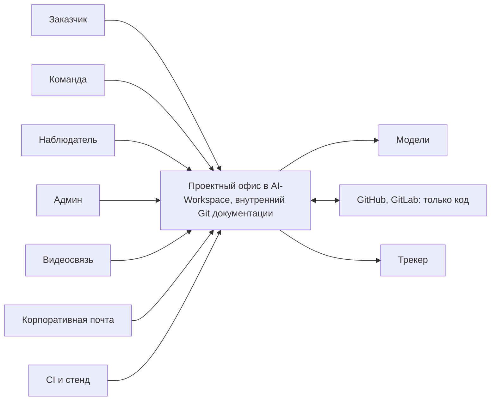
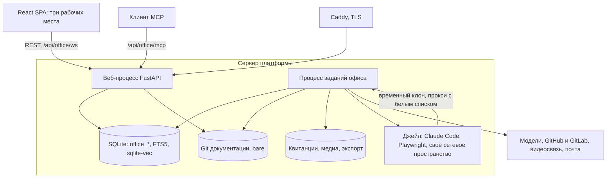
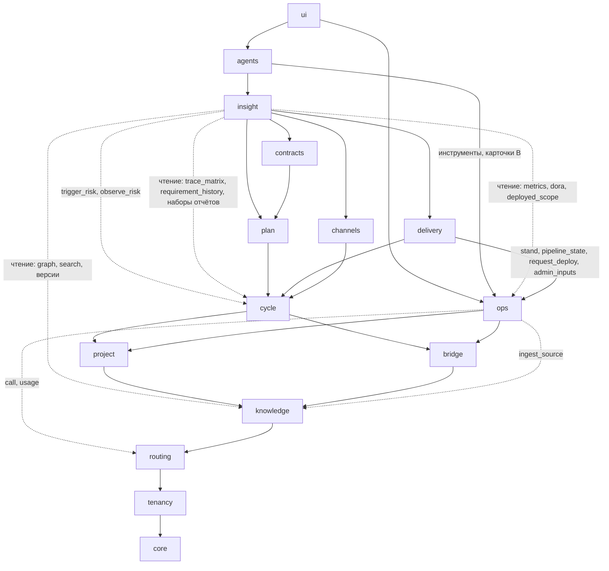

# 00. Обзор архитектуры AI-first проектного офиса

Для разработчиков, без кода. Обязательны единые решения `05-sverka-superarhitektora.md` §3 (дальше «05 §3.x»): при расхождении верны они. Номера: R, G, A (манифест), И (история спецификации), P и D (пакет 2026-10-22), К (находки `06`). **Решение обзора** значит: решил архитектор, в спецификации этого не было.

## 1. Контекст системы

Офис это новый раздел текущего AI-Workspace (R07): тот же сервер, вход, база и Claude Code.

| Рабочее место | Роли | Главное действие |
|---|---|---|
| Заказчика (G42, G46) | Представитель, подписант | Читает открытое его профилю и статусу версии, комментирует абзац, согласует шаг; подписант принимает версию (P09) |
| Команды (G47) | Менеджер, бизнес- и системный аналитик, архитектор, разработчик, тестировщик, тимлид, технический лид, руководитель проектного офиса | Паспорт, бриф, задание, требования, задачи, код, сверки; меню по роли. Руководитель офиса согласует базу крупного проекта здесь (R64) |
| Наблюдателя (G48) | Наблюдатель с областью проект, подразделение или компания; руководитель офиса | Здоровье и портфель, только чтение |
| Все три | Администратор системы (G45) | Пользователи, видимость, ключи, режим записи; действие вместо роли пишется в журнал от имени админа |

| Внешняя система | Зачем | Владелец адаптера | Срез и статус |
|---|---|---|---|
| Поставщик языковых моделей | Черновики, извлечение, сверка, ответы | `routing` | A; источник ключа до юриста (P02) |
| Эмбеддинги (числовое представление смысла текста) | Векторный поиск | `knowledge` | C; локальная модель или внешний сервис, переключает админ компании (A17) |
| Claude Code CLI, Agent SDK | Запуски агента с файлами | `routing` (транспорт `src/claude/bridge.py`) | A; уже в стеке |
| Видеосвязь: Яндекс Телемост, Контур.Толк, Zoom, Google Meet; IP-телефония | Запись, расшифровка как источник контекста | `channels` | D; своей нет (G25, A18) |
| GitHub, GitLab; внешний CI и стенд | Код, запросы на слияние; стенд сверки | `delivery` | E; G29, P01 |
| Корпоративная почта: Яндекс 360, VK Workspace, Mail.ru, Google Mail; календари | Письма из подключённых ящиков и папок проекта; выход: ответ человека, уведомления; встречи | `channels` | F, первый выпуск (A16, A19); своего почтового домена нет |
| Telegram, Макс | Уведомления, чаты как источник | `channels` | F; бот опционален |
| Трекер пилотных студий, вики, документооборот | Выгрузка принятого | `bridge` | G, первый выпуск (A16); один трекер (P06); документооборот позже (D06) |
| Figma, Pen.dev | Макеты | `delivery` | E; G39, G40 |

Не строим: свою видеосвязь, Git для кода (A14), свою модель, общий логин. Вне первого выпуска: D01-D06.

## 2. Архитектурные принципы

| # | Принцип | Причина | Следствие для кода |
|---|---|---|---|
| 1 | Внутри AI-Workspace | R07 | `src/office/`, `src/web/routes_office_*.py`, `web/src/`; общий вход и установщик |
| 2 | Ядро знаний в центре | G110-G112, A13 | Факты пишутся в `knowledge`, контекст читается через `search` и `fragments` |
| 3 | Документы как код во внутреннем Git | A10-A12, A14, A15 | Две равные копии текста, связанные отпечатками; номер и статус в базе (3.4) |
| 4 | Один писатель | `interfaces.md` | У каждой таблицы и у репозитория документации один модуль-писатель (05 §3.1) |
| 5 | Права до ранжирования | Правило ядра 5, И48 | Область прав считает `tenancy.scope`; скрытое не попадает даже в счётчик |
| 6 | Агент предлагает, человек публикует | G06, G23 | Агент работает правами назначившего; нет операции «опубликовать заказчику» у `agents`, API, MCP; вердикт агента не одобрение |
| 7 | Принятое неизменяемо | `HANDOFF.md` | Откат и правка дают новую версию; метка принятой версии не двигается |
| 8 | Детерминизм, где можно | И41, И52 | Цитату (`verify_quote`), цвет матрицы, согласия считает код |
| 9 | Каждый вызов модели через шлюз | G11, G12, P02 | `routing`: резерв до вызова, списание после; прямых вызовов SDK нет |
| 10 | Деградация, не отказ | Таблица глубины | Без эмбеддингов слова и граф; без модели фрагменты без ответа |
| 11 | Повтор безопасен | Колонка «Обрыв» | Ключ идемпотентности у каждого входа (повтор не создаёт второй записи) |
| 12 | Зависимости только вниз | Сборка и тест по модулю | Вверх только события и задания `core` (05 §3.1) |
| 13 | Один сервер, рост за швами | On-premise у студии | Швы раздела 4.1 |
| 14 | Значимое в журнал | И62, P03, P04 | `office_audit` отдельно от событий, с цепочкой отпечатков |
| 15 | Контекст собирается онлайн (Дополнение 2026-10-23, A39) | A39, A38, A40 | Созвоны, задачи, переписка, документы, стенд, страницы трекера и репозитория попадают в ядро по ходу работы в рабочем месте, браузере платформы и расширении (13 §3.7, 15 §2, 11 §3-5), а не импортом постфактум; импорт файлов (13 §2) запасной путь; карта по областям PMBOK в 05 §8.3 |
| 16 | Ни одна рабочая задача не требует выхода из платформы (Дополнение 2026-10-23, A41) | A41, A38 | Внешний браузер только для сторонних программ (видеосвязь с камерой, плагин подписи); каждая задача каждой роли имеет место в платформе, проверка «роль → задачи → где» в 05 §8.4, дополнена работами DevOps и перепиской в чатах в 05 §9.5; исключения названы там же |
| 17 | Смысл документами ядра, контекст через RAG (Дополнение 2026-10-23, A41-A45, A45) | A45, A42, A13 | Всё, что модуль или агент производит для другого как смысл, существует документом ядра или версией источника (Markdown с фронтматтером, версия), не полем таблицы; агент получает контекст только через `knowledge.search`, фрагменты и документы в правах назначившего, структурные факты инструментами над операциями владельцев; `office_events` и `office_jobs` остаются техническим сигналом «документ готов» со ссылкой, второго смыслового канала нет (05 §9.4, ADR-80) |

Дополнение 2026-10-26 (сверка 27, A71, A72; `27` §2-§4). Принципы 5 и 6 говорили, кто читает; не хватало правила, что права идут за данными в хранилище RAG и за выводом агента. Добавляются два принципа:

| # | Принцип | Причина | Следствие для кода |
|---|---|---|---|
| 18 | Права идут за данными и за выводом | A71: «Преимущество RAG-системы и симонтического ядра не должно стать слабым звеном»; `27` У27-01, У27-02 | Каждый фрагмент, вектор, смысловое ядро версии и узел графа несут классы данных и метки области (`data_classes`, `scope_tags`), поиск и обход графа фильтруют по ним внутри запроса (И-86). Любой вывод агента или модели, который увидит кто-то кроме запустившего (ветка и MR, комментарий, кандидат, протокол, результат, черновик ответа), строится в области `tenancy.audience_scope`: права запустившего ∩ профиль агента ∩ классы и профиль аудитории вывода; область считается до поиска и действует на `knowledge.search`, инструменты MCP, конституцию, наборы данных и пакеты контекста (И-87). Персональный вывод (ответ ассистента владельцу, план дня) строится в правах самого владельца. Поиск по ядру не выходит за один проект ни для одного вывода (И-89) |
| 19 | Наружу только ссылка на закрытое | A71; `27` У27-11..У27-14 | Почта, Telegram, Макс, внешний MCP-клиент и внешний MCP-сервер не получают содержимого классов `budget` и `management_chat`; при закрытом контуре и `export_ban ≠ none` внешние мессенджеры выключены, содержательные инструменты токена `mcp` к проекту закрыты (И-88, И-105). Право включает только клетка ролевой матрицы `13` §4.7; поля шаблонов и выдачи МП в проекте только сужают круг (И-103) |

Дополнение 2026-10-27 (проверка ИБ 29, A75; `29` §2, §9). Принципы 5, 6, 18 и 19 говорят, кто читает данные; не хватало правил о недоверенном вводе, о процессах и ключах, о двух людях и о единой серверной проверке. Добавляются пять принципов:

| # | Принцип | Причина | Следствие для кода |
|---|---|---|---|
| 20 | Недоверенное это данные, а не команды | A71, A75; `29` УИБ29-36, -42, -47, -48 | Документ, письмо, чат, страница, тикет, ответ коннектора и MCP-сервера, вывод модели не дают прав, не становятся уликой и словами заказчика без человека (`origin`, И-130) и показываются через один санитайзер (И-129); права агента задаёт токен запуска с профилем, а не модель (И-124, И-131, И-132) |
| 21 | Наименьшие привилегии процессов | A74, A75; УИБ29-54, -70, -81, -82 | Процессы, которые трогают недоверенный ввод (джейл, `LocalLoopRunner`, Chromium, разбор файлов, загрузка моделей, MCP-серверы), работают под своими пользователями ОС без ключей и без прямой сети; ключи держит хранитель ключей (И-127); правила шлюза подписаны (И-128) |
| 22 | Двое на выход и на необратимое | A74 «только для обезличенных данных и с журналом»; УИБ29-01..-04 | Открытие выхода наружу, раскрытие класса шире, изменение принятого и журналов, назначение ОПД делают две разные учётки; администратор платформы этого не обходит (И-122, И-123) |
| 23 | Одна серверная проверка на каждом слое | A71; УИБ29-06, -07, -13 | REST, WS, MCP, поиск, граф, проекции, кэши, экспорт и события проверяют права на сервере одной функцией; токен клиента ограничен своим маршрутом; скрытое всегда 404 (И-124, И-126) |
| 24 | Журналы вне досягаемости писателя | A75; УИБ29-61, -88 | Журналы только добавляются, голова цепочки подписывается хранителем и выносится вне базы; журнал стираний вне основной базы (И-134, И-135) |

## 3. Карта модулей

### 3.1. Контейнеры

### 3.2. Модули

По 05 §3.1 и §3.7 (`snake_case`), здесь ключевое. Дополнение 2026-10-23, A41-A45: модулей 15, добавлен `ops` (A43, 17, ADR-73; 05 §9.2). `comms` это `channels`, `integrations` это `bridge`, `scheduler`, `browser`, `skills` части `agents`.

| Модуль | Ответственность | Выставляет | Прячет | Зависит от | Путь |
|---|---|---|---|---|---|
| `core` | `office_events`, `office_audit`, `office_jobs`, миграции, соединения; `office_heartbeats` и реестр проб модулей (17 §5.2) | `transaction`, `emit`, `enqueue`, `audit`, `register_probe`, `run_probes`, `heartbeat` | SQL, блокировки | нет | `src/office/storage.py`, `src/office/_core/` |
| `tenancy` | Компания, подразделения, `office_company_users` (с `tz`, `work_hours`), профили видимости, политика записи, `office_credentials`, `office_model_routes`, `office_limits`; `office_model_providers`, `office_model_prices`, `office_subscription_bindings`, `office_work_calendars` (05 §6) | `invite`, `set_visibility`, `set_model_route`, `set_limit`, `put_credential`, `model_credential` (ссылка), `scope`, `can`, `open_project` | Шифрование, наследование проект, подразделение, компания | `core` | `src/office/tenancy/` |
| `routing` | Выбор модели и усилия (в том числе автовыбор, 12 §3), резерв и списание лимита, журнал расхода; `office_route_outcomes`, `office_route_scores` | `resolve`, `reserve`, `settle`, `call`, `usage` | Провайдер, ключ, токены | `tenancy` | `src/office/routing/` |
| `knowledge` | Документы, версии, абзацы, Git документации, источники, квитанции, фрагменты, индексы, граф, экспорт; швы `Embedder`, `SpeechRecognizer`, `MediaEncoder`; `office_cross_links` (D01) | `ingest`, `ingest_source`, `has_version`, `open_branch`, `merge_branch`, `import_agent_commits`, `restore_version`, `revert_merge`, `search`, `ask`, `verify_quote`, `graph`, `export`, `reindex`, `transcribe`, `create_page`, `move_page` | Разбор, Git, эмбеддинги, нарезка | `routing` | `src/office/knowledge/` |
| `bridge` (integrations) | Среда коннекторов: подключения, ссылки, исходящая очередь; адаптеры трекера, вики, документооборота | `connect`, `check`, `push_accepted`, `register_adapter` | Протокол системы | `knowledge` | `src/office/bridge/` |
| `project` | Паспорт, тип, `office_memberships`, смены типа | `create_project`, `set_type`, `request_type_change`, `add_member`, `remove_member` | Правило предложения типа | `knowledge` | `src/office/project/` |
| `ops` (Дополнение 2026-10-23, A41-A45; 17, ADR-73) | Пайплайны и задания CI, окружения, развёртывания, реестры образов, серверы и выдачи, шим, контейнеры, терминал, журнал команд, ряды телеметрии (`telemetry.db`), оповещения, здоровье модулей; швы `CiProvider`, `ServerTransport`, `MetricsSource`, `RegistryClient` | `link_ci`, `trigger_pipeline`, `pipeline_state`, `stand`, `request_deploy`, `approve_deploy`, `rollback`, `deployed_scope`, `register_server`, `grant_server`, `restart_service`, `open_terminal`, `metrics`, `dora`, `platform_health`, `admin_inputs` (17 §7.3) | Протоколы CI и реестра, SSH, упаковку рядов | `bridge`, `project`, `knowledge` (`ingest_source`), `routing` | `src/office/ops/` |
| `cycle` | Требования, кандидаты, противоречия, след, маршруты, MR и ревью документов, комментарии, публикации, задачи, риски, ролевая модель | `draft_spec`, `open_doc_mr`, `review_doc_mr`, `merge_doc_mr`, `start_route`, `approve_step`, `accept_spec`, `publish`, `trace_matrix`, `approve_task` | Правила согласий и зачёта, цвет колонок | `project`, `bridge` | `src/office/cycle/` |
| `plan` | Дерево работ, оценки, ставки, факт затрат, база (срез F); освоенный объём и Гант после D06, схема сейчас (09 §6-7, 05 §6) | `save_baseline`, `change_cost_preview`; `earned_value` после D06 | Формула | `cycle` | `src/office/plan/` |
| `contracts` | Анкеты, шаблоны (тексты у `knowledge`) | `fill_questionnaire`, `draft_addendum` | Шаблоны компании | `plan` | `src/office/contracts/` |
| `delivery` | Код, коммиты и MR кода, индекс кода, макеты, сценарии, сверки и находки, ролик; адаптеры GitHub, GitLab; швы `BrowserRunner`, `MockupEngine`, `Synthesizer` | `link_repo`, `record_commit`, `open_code_mr`, `merge_code_mr`, `run_check`, `guide_inputs` (вместо `render_guide`, 10 §7), `final_readiness`, `register_mockup`, `render_demo` | Номер тикета, Pen.dev, Playwright | `cycle` | `src/office/delivery/` |
| `channels` (comms) | Созвоны, встречи и календарь, подключения ящиков, уведомления, подписки на объекты; адаптеры видео, телефонии, почты, календарей, мессенджеров | `place_meeting`, `schedule_meeting`, `calendar_window`, `find_slots`, `ingest_meeting`, `finalize_call`, `bind_speaker`, `connect_mailbox`, `notify` | Протоколы каналов | `cycle` | `src/office/channels/` |
| `insight` | Движок метрик с среза C (снимки, `metric.updated`, оценка рисков); дашборды из набора метрик в H (P13, И59) | `build_dashboard`, `project_health` | Что роль видит | `plan`, `contracts`, `delivery`, `channels` (чтение); `cycle.trigger_risk`, `observe_risk` (09 §5.3) | `src/office/insight/` |
| `agents` | Запуски, журнал и откат (И62), черновики, расписания (P19), скилы (P12), браузер на стенд (P23), план дня `office_day_plans` (09 §8), мастер `office_wizard_runs` (10 §12) | `assign`, `schedule`, `rollback_run`, `pause_agents`, `enable_skill`, `import_skill` | Подсказка, Claude Code, Playwright | `insight` и ниже | `src/office/agents/` |
| `ui` | HTTP, WebSocket, MCP, три рабочих места | 05 §3.6 | Домена нет | все | `src/web/routes_office*.py`, `web/src/components/office/` |

`agents` над доменом: второй вход с правами назначившего; домен будит агента событием или заданием `core`.

Дополнение 2026-10-23, A38 (13 §3, 05 §8, ADR-70): часть `browser` модуля `agents` это узел браузера платформы для людей (шов `BrowserHost`, таблицы `office_browser_sessions`, `office_browser_tabs`, `office_browser_events`, операции `open_browser_session`, `open_browser_tab`, `browser_page_context`, `browser_login_as`, `record_browser_demo`); `tenancy` владеет `office_browser_allowlist`, `office_browser_extensions` и `browser_policy`; `insight` даёт `match_artifacts` (страница → узлы графа артефактов). Браузер запуска агента остаётся в джейле запуска за `BrowserRunner` у `delivery` (один движок, два хоста). `ui` получает вкладку `browser` с трансляцией и адресную строку центра (15 §2).

### 3.3. Зависимости

«A → B»: A вызывает B. Все ещё зовут `core` и `tenancy`.

| Место | Вызов вверх, который был бы | Как снят |
|---|---|---|
| Черновик задания (таск 04) | `cycle` зовёт агента | `cycle.draft_spec` зовёт `routing.call`; в тесте подменяется шлюз |
| Ревью документа агентом | `cycle` зовёт агента | Событие `docmr.review_requested`; агент отвечает `cycle.review_doc_mr` с `reviewer_kind=agent` |
| Откат запуска (И62) | | `agents.rollback_run` выше домена и снимает непринятое с `run_id` операциями `knowledge` и `cycle` |
| Запрет смены типа (P10) | `project` спрашивает `cycle` | `knowledge.has_version(project, family, status)` |
| Выгрузка в трекер | | `cycle` ставит `bridge.push_accepted`, `bridge` ниже |
| Здоровье модулей выше `ops` (Дополнение 2026-10-23, A41-A45) | `ops` зовёт `agents`, `delivery` | Модули при старте регистрируют пробы в `core.register_probe`; `ops` зовёт `core.run_probes()` (17 §5.2) |
| Красная сборка будит агента DevOps; сборка у MR кода | `ops` зовёт `agents`, `delivery` | Событие `pipeline.finished` с `failure_class`; `delivery` слушает его и пишет `office_code_mrs.ci_state` (17 §2.2; 05 §9 С128) |

Дополнение 2026-10-23, вечер (05 §7 С78): рёбра чтения `insight → cycle` и `insight → knowledge` для проекций графа артефактов и хронологии (14 §3.5, §5.5) и наборов отчётов (13 §4.3); запись вниз у `insight` по-прежнему только `trigger_risk`, `observe_risk`; свои таблицы (`office_timeline_items`, `office_reports*`, снимки) `insight` пишет сам.

Дополнение 2026-10-27 (сверка 32, `32` С32-01, С32-02, С32-04, С32-20). Раздел 31 (проектный офис, портфель, политика ИИ) новых модулей и рёбер не добавляет. Три места, где был бы вызов вверх, сняты так:

| Место | Вызов вверх, который был бы | Как снят |
|---|---|---|
| Вехи для критериев выхода (`cycle.check_gate`) | `cycle` читает вехи ИСР у `plan` и этапы договора у `contracts` | Таблица `office_gate_milestones` у `cycle` (ключ `MS-N`); `plan` и `contracts` зовут `cycle.register_milestone` сверху вниз (`31` §6.8) |
| Черновик итога зрелости `pmo:maturity` | `insight` пишет документ через `cycle.draft_artifact`, а запись вниз у `insight` только `trigger_risk`, `observe_risk` | `agents` по событию `maturity_campaign.closed` читает итог у `insight` и зовёт `draft_artifact` (`31` §3.4) |
| Старт проекта по решению портфельного комитета | `project` проверяет решение у `insight` | `ui` читает решение у `insight` и зовёт `project.approve_start(project, decision_ref)` по клетке `project/approve_start`; `insight` сверяет по событию `project.start_approved` (`31` §4.3) |

Нижние модули на события верхних не подписываются: `tenancy` не слушает `bias_check.finished` (`routing`), `plan` не слушает `contract_stage.state_changed` (`contracts`). Пространство компании (`office_projects.space_kind = company`) создаёт `ui` при первом входе в «Проектный офис» или установщик, а не `tenancy` при создании компании.

Дополнение 2026-10-28 (сверка 35, `35` С35-05, С35-10). Фраза выше уточняется: нижний модуль может слушать событие верхнего, только если событие несёт ключи, а обработчик пишет свои таблицы и не зовёт и не читает верхний модуль. Снятые сверкой 32 подписки были лишними, потому что данные туда приходят вызовом сверху. По этому правилу `cycle` уже слушает `plan.deviation_detected` и `gantt.deadline_unreachable` (`03` §6), а теперь `process.out_of_control` (`insight`) и `gantt.forecast_shifted` (`plan`): кандидата риска пишет `cycle.propose_risk_from_signal`. Новых рёбер вызова нет, запись вниз у `insight` прежняя. В таблице §3.2 `plan.earned_value` после раздела 33 выставляется частично: PV, EV, SPI, ES. CPI, EAC и прочее остаются D06.

### 3.4. Документы как код (A10-A15)

Два Git (A14, A15). Код только во внешнем GitHub или GitLab, адаптер у `delivery`. Документация во внутреннем bare-репозитории (без рабочей копии) на проект: это хранилище платформы, не git-сервер. Нет `clone`, `push`, зеркал, вебхуков, интеграций; наружу уходят только экспорт версии (Word, PDF) и передача принятого в документооборот (D06). **Решение обзора:** Git документации это шов `DocRepo` внутри `knowledge`: версия теперь коммит, второй писатель версий нарушил бы принцип 4.

Канон (05 §3.2 п. 2-3): текст хранится двумя равными копиями, блобом Git и колонкой `markdown`, связанными `blob_sha` и `content_sha`; номер и статус только в базе. Так выполнены и `HANDOFF.md` («в базе и в поиске»), и A10 («ещё и в Git»).

Состав (05 §3.3). В Git: `brief`, `spec`, `guide`, `role_model`, `as_built`, `architecture`, `page:*`, `protocol:*`, `contract:*`, `addendum:*`, `act:*`, `gost34:*`, `gost19:*`, `presentation:*`. Вне Git: `letter`, `chat`, `call`, `meeting`, `demo`, `file`, `commit`, `code_mr`, `ticket`, `comment`, `scheduler`, `mockup`; Дополнение 2026-10-23, A41-A45: `pipeline`, `incident`, `log` (17), `digest` (18), `report` (13 §4.3, A45); в Git вид `architecture:db-<слаг>` (14 §2.1). Результат планировщика остаётся источником; страницу из него делает человек через MR.

| Элемент | Правило |
|---|---|
| Репозиторий и путь | `<данные>/office/git/<company>/<project>.git`; вид `f` → `f.md`, `f:k` → `f/k.md` |
| Версия | Коммит первой родительской цепочки `main`, изменивший один файл, плюс строка версии. Номер `max+1` при слиянии; у MR свой номер `!12` |
| `main` | Пишут только слияние MR, прямая запись (`brief`, `page`, соло маленького типа) и откат. Слияние `--no-ff`; squash и rebase запрещены; ветка обновляется слиянием `main` |
| Ветки | `edit/<doc>/<user_id>-<n>`, `agent/<run_id>/<doc>`, `call/<call_id>/<doc>`, `import/<upload_id>/<doc>`; `:` в имени вида заменяется на `/`. Закрытая ветка уходит в `refs/closed/`, строка получает `abandoned` |
| MR документа | Сущность `cycle`. Сохранения ветки не версии; одна слитая правка = одна версия `draft`. Одобряется голова (`head_sha`): одно одобрение не автора плюс владельцы задетых разделов, иначе менеджер. Автослияния документов нет (P07 про код) |
| Слияние | `git merge-tree` (git 2.38+) во временном дереве; конфликт показан человеку по абзацам двумя вариантами |
| Маршрут | Идёт по неизменяемой версии, на маршруте одна версия документа; `main` тем временем принимает слияния. Принятие ставит аннотированную метку `accepted/<doc>/v<N>`, подписанную ключом платформы (это не подпись P09) |
| Заказчик | Видит версии на статусах своего профиля; никогда ветки, MR, ревью, `draft`, `internal` |
| Откат | `restore_version` (коммит с текстом версии K) или `revert_doc_mr` (обратный коммит MR); оба дают `draft` |
| Агент | Временный клон своей ветки в каталоге запуска; `knowledge.import_agent_commits` забирает коммиты с проверкой путей, автора и секретов. Bare-репозиторий в джейл не монтируется (К08) |

Запись Git и базы (К06, К07, 01 §3.2, 05 §3.2 п. 3). Общей транзакции нет, запись двухфазная через журнал намерений `office_git_intents` (`repo`, `ref`, `old_sha`, `new_sha`, `kind`, `payload`, `state pending | applied | aborted`, писатель `knowledge`). 1) Объекты Git по содержимому. 2) Транзакция базы: намерение `pending`. 3) `update-ref` со сравнением со старым значением; отказ даёт `aborted` и 409 `stale_head`. 4) Транзакция базы: версия, `office_doc_commits`, `main_head`, событие, намерение `applied`. Восстановление при старте и каждую минуту: ссылка равна new, значит шаг 4; равна old, значит `aborted`; иное, значит `aborted` и событие админу. Все записи под блокировкой проекта внутри `DocRepo`; сборка мусора только заданием обслуживания. Сверщик идёт в одну сторону: строка без коммита получает коммит из `markdown`, коммит без строки получает строку по трейлерам, при расхождении верна копия, совпавшая с `content_sha`. Тест обрыва в каждом окне обязателен.

## 4. Стек и инфраструктура

| Слой | Есть | Добавляется | Альтернативы | Выбор |
|---|---|---|---|---|
| База | SQLite WAL, Alembic у чатов | Таблицы офиса; соединение на поток, короткие записи, эмбеддинги вне транзакции (К12) | PostgreSQL | SQLite за `core` |
| Векторы, слова | нет | sqlite-vec с фиксированной версией; FTS5 по леммам и сырому тексту | LanceDB, pgvector, Qdrant, OpenSearch | По спецификации |
| Эмбеддинги | нет | Оба варианта за `Embedder`: локальная многоязычная модель на процессоре и внешний сервис | Только один | A17: переключатель в настройках компании, смена запускает переиндексацию (И35); умолчание локальная bge-m3 |
| Очередь | цикл `src/scheduler/cron.py` внутри бота | Одна `office_jobs`; цикл расписаний переносится в процесс заданий (К37) | Redis с Celery | Без нового сервиса |
| Файлы | `data/` | `BlobStore`: квитанции по SHA-256, медиа, экспорт | S3-совместимое | Диск |
| Git документации | `git` | `DocRepo` поверх git CLI 2.38+ | dulwich, pygit2 | CLI: полные слияния |
| Модели | Agent SDK, CLI; `src/apikeys` | `routing`; доработки `ClaudeBridge` (п. 62 сверки) | Внешний маршрутизатор | Ключ только из `tenancy` (P02) |
| Разбор, экспорт | `.docx` стандартной библиотекой | Excel, PDF, распознавание текста; распознавание речи локально или внешним сервисом с переключателем (A24); Word, PDF, PDF/A | Pandoc, LibreOffice | Выбрано 2026-10-23 вечером (13 §2.2, §4.5): pypdfium2, Tesseract, openpyxl, LibreOffice только как необязательный компонент для старых форматов; экспорт швом `ExportRenderer` у `knowledge` (Chromium для PDF, python-docx, XlsxWriter, vl-convert); Pandoc не нужен |
| Изоляция | `scripts/ai-workspace-jail.sh` (bubblewrap) | Сетевое пространство джейла, прокси с белым списком, Playwright | Платный браузер | P23, К24 |
| Браузер людей (Дополнение 2026-10-23, A38) | нет | Узел браузера `ai-workspace-office-browser`: Chromium из образа Playwright по процессу на сессию под bwrap с cgroup, трансляция по протоколу отладки, прокси узла с белым списком и правилами SSRF, каталог расширений CRX (13 §3.3-3.5) | Расширение в браузере пользователя как единственный путь; iframe с переписывающим прокси | Гибрид 13 §3.2: внутреннее рисует платформа, внешнее серверный Chromium; расширение второй клиент (A40) |
| Эксплуатация (Дополнение 2026-10-23, A41-A45, A43) | `src/ssh/` (asyncssh), терминал панели | Модуль `ops`: шим `scripts/ops/office-ops-shim` на серверах компании (POSIX sh, `docker` CLI), сбор метрик по SSH без демона, ряды в отдельном `<данные>/office/ops/telemetry.db` (SQLite WAL, уровни 1 мин, 5 мин, час, сутки), внешний CI и реестр через `CiProvider`, `RegistryClient` (17 §1-5) | node_exporter и Prometheus; толкающий демон; свой раннер и реестр; Loki | Шим по SSH, ряды отдельным файлом (исключение из Н17, 05 §9 С127); `push_agent`, Prometheus, OpenMetrics после выпуска |

Вариант «один сервер» (умолчание): веб и процесс заданий, SQLite с sqlite-vec и FTS5, диск, `office_jobs`. Вариант «рост»: несколько исполнителей, отдельный узел эмбеддингов и распознавания, PostgreSQL с pgvector, S3-совместимое хранилище, очередь на PostgreSQL или Redis за теми же швами. Переход, когда ожидание записи в SQLite выше порога или объём выше потолка раздела 7.

### 4.1. Тест-швы

Каждый шов имеет вариант «один сервер», вариант «рост» и подделку для тестов; общий контрактный тест гоняется на всех вариантах. Шов приёмки по-прежнему публичные операции `cycle` (`interfaces.md`).

| Шов | Контракт | Подделка в тестах |
|---|---|---|
| `VectorIndex` | `upsert`, `delete`, `knn(project, filter, k)`; фильтр прав и статуса версии внутри запроса (К19) | Перебор в памяти |
| `JobQueue` | `enqueue(kind, key)`, `claim`, `complete`, `fail` с паузой повтора; ключ идемпотентности | Синхронное исполнение в тесте |
| `DocRepo` | `write_blob`, `commit`, `update_ref(old, new)`, `merge_tree`, `read`, `tag`, `list_refs` | Настоящий git во временном каталоге; обрыв между шагами подставляется |
| `ModelGateway` | `resolve`, `reserve`, `call`, `settle`; внутри адаптеры формата (`claude_code`, позже `anthropic_http`, `openai_http`, 12 §2) | Записанные ответы модели; счёт резерва проверяется |
| `Embedder`, `SpeechRecognizer` (`knowledge`) | `embed(texts) -> vectors, model_tag`; `recognize(audio, diarize, lang?) -> реплики` (ADR-13) | Детерминированные векторы; записанные расшифровки |
| `MediaEncoder` (`knowledge`) | `extract_audio`, `concat`, `encode`, `burn_subtitles`, `mix_audio`, `probe`; ffmpeg в отдельном bwrap без сети (12 §8.1) | Проверка аргументов без кодирования |
| `BlobStore` (`knowledge`) | `put(stream) -> sha256`, `get(sha)`, `exists(sha)`, `delete(sha, reason)` (только вычистка по 152-ФЗ) | Каталог во временной папке |
| `ExportRenderer` (`knowledge`) | `html_to_pdf`, `docx_from`, `xlsx_from`, `chart_static`; безголовый Chromium своим вызовом в процессе заданий под bwrap без сети, не через `BrowserRunner` (13 §4.5; 05 §7 С77); служит экспорту версий и отчётов | Файлы-заглушки нужных форматов, проверка аргументов |
| `BrowserRunner`, `MockupEngine`, `Synthesizer` (`delivery`) | 10 §1 | Записанные снимки дерева доступности; файлы макета; тишина нужной длины |
| `BrowserHost` (`agents`; Дополнение 2026-10-23, A38) | `open_session`, `open_tab`, `navigate`, `input`, `screencast`, `page_context`, `aria_snapshot`, `screenshot`, `set_file_inputs`, `on_download`, `hibernate`, `restore`, `close` (13 §3.3); вариант «один сервер» юнит на той же машине, «рост» отдельный узел по тому же контракту HTTP и WS | Записанные кадры и снимки дерева доступности; политика сети проверяется без Chromium |
| `ChannelSender` (`channels`) | `describe`, `check`, `bind_start`, `on_update`, `send`, `unbind` (11 §6.2) | Сбор отправленного в память |
| `ChatPlatform` (`channels`; Дополнение 2026-10-23, A41-A45, 18 §1.6) | `describe`, `resolve_chat`, `bot_access`, `on_update`, `fetch_file`, `send`, `message_link`, `history`; варианты `telegram`, `max` | Записанные обновления и ответы платформы |
| `CiProvider`, `ServerTransport`, `MetricsSource`, `RegistryClient` (`ops`; Дополнение 2026-10-23, A41-A45, 17 §1) | `parse_hook`, `list_pipelines`, `get_pipeline`, `jobs`, `job_log`, `trigger`, `retry`, `cancel`, `lint`, `pending_approvals` (`gitlab_ci`, `github_actions`); `run`, `stream`, `host_key`, `open_pty` (`ssh_shim`, `local`); `collect` (`ssh_shim`, `local_proc`; позже `push_agent`, `prometheus`); `tags`, `digest`, `check` (`oci_v2`) | Записанные ответы хоста CI и реестра; подделка шима с набором глаголов; ряды из файла |

На macOS джейла нет: режим без джейла только флагом, который прод не принимает (К36).

## 5. Развёртывание и среды

| Среда | Данные | Как поднимается |
|---|---|---|
| Локальная | Дамп базы и бандлы Git из `data/dumps/`; данные офиса в дампе только обезличенные (К14) | `bash scripts/run_stand.sh` поднимает базу и бандлы |
| Стенд, прод (on-premise, сервер в РФ) | Обезличенный набор копии; живые | `scripts/install.sh`, `scripts/update.sh` |

Процессы: юнит `ai-workspace` и новый `ai-workspace-office-worker` (**Решение обзора**: эмбеддинги, разбор, расписания, сверщик не блокируют веб). Имена юнитов и `/opt/ai-workspace` не меняются. Каталог данных офиса (база, `office/git/`, `office/blobs/`, `office/media/`, `office/export/`) лежит вне `PROJECTS_DIR` и `confine_root`, иначе сессия чата прочла бы документы мимо видимости.

Изменения установщика: bubblewrap обязателен (сейчас только предупреждение, A23): без него установка отказывает, а явным выбором админа ставит веб без чата Claude Code; сетевое пространство джейла; git 2.38+; проверка загрузки sqlite-vec при старте; локальная модель эмбеддингов (можно пропустить, если компания выбрала внешний сервис, A17) и словари лемм с локального зеркала, установка проверяется без внешней сети (К21); Playwright с Chromium; генерация мастер-ключа `CONNECTIONS_SECRET_KEY`; второй юнит. Ориентир сервера: 4 ядра, 16 ГБ, 100 ГБ диска (допущение, замер до среза C, К15); число параллельных агентов ограничивается памятью. Дополнение 2026-10-23 (05 §6): с среза D ffmpeg (libass, libvpx) и `fonts-noto-core` из пакетов ОС, без них ролик и локальное распознавание записей выключены (12 §8.1); Node и pen CLI в образе джейла профиля «Дизайнер макетов» (10 §10); корневой сертификат Минцифры в доверенных сервиса для Макса (11 §6.3); `update.sh --check-jail`, перенос хранилища сессий чата в `<данные>/chat-homes/<user_id>/` и явный флаг `--web-without-chat` при переходе живого прода на обязательный джейл (12 §8.2).

Дополнение 2026-10-23, A38 (13 §3.3, 12 §8.3): третий юнит `ai-workspace-office-browser` (узел браузера) со среза E: Chromium и зависимости из образа Playwright уже в установщике, добавляются cgroup памяти на сессию, каталог `office/browser-profiles/` (шифрованные профили) и `office/browser-extensions/` (CRX по допуску), прокси узла; `update.sh --check-browser` проверяет запуск Chromium под bwrap с `--unshare-net` и cgroup; без узла вкладка `browser` показывает причину, остальное работает.

Дополнение 2026-10-23, A41-A45 (17 §3.2, §4.1, §5.3; 12 §8.4): шим `office-ops-shim` лежит в релизе `scripts/ops/` и ставится на сервер компании командой подготовки, которую человек выполняет под `root` сам (платформа пароль не получает); сервер платформы заводится установщиком как `purpose=platform`, `transport=local`; ряды телеметрии в отдельном `<данные>/office/ops/telemetry.db`, в согласованную копию попадают только свёртки часа и суток раз в сутки (минутные ряды это кэш 14 дней, 05 §9 С127); `update.sh --check-ops` проверяет `sqlite3` для второго файла и запись `office_heartbeats`.

Миграции: один механизм до среза B (К34), общий с 03 §8: нумерованные шаги при старте до приёма запросов; пробный прогон на копии прода с критерием «сверщик без расхождений». Смена модели эмбеддингов это фоновая переиндексация (И35), не миграция.

Резервная копия (К10): один согласованный набор под блокировкой записи Git: `sqlite3 .backup`, `git bundle` каждого репозитория, новые квитанции и манифест с номером последнего события `office_events` и списком голов веток. Ночью и после принятия версии (допущение). Набор шифруется; ключ шифрования секретов хранится отдельно. Восстановление: база, бандлы, сверщик, пересборка индексов из фрагментов. Ежемесячная проверка на стенде с критерием «сверщик без расхождений».

Обновления идемпотентны, задания продолжают с сохранённого этапа.

## 6. Мультиарендность и безопасность

Одна установка обслуживает одну компанию, в схеме есть `company_id` (закрыто сверкой). Иерархия: компания, подразделения (один уровень), проекты, участники `office_memberships`. Роли: 12 ролей участия по 05 §3.5. Сторона учётной записи `office_company_users.side` (`executor`, `customer`); админ компании `is_company_admin`; администратор системы только флагом `users.is_admin`. Роли двух сторон в одном проекте запрещены. Заказчику закрыты чат, файлы, терминал, ключи, настройки MCP.

| Уровень изоляции | Правило | Где |
|---|---|---|
| Проект | Чужой и несуществующий неразличимы, 404 | `tenancy.open_project` |
| Вид и статус версии | Профиль видимости; умолчания заказчика из спецификации. Заказчик не видит пометку «внутреннее обсуждение» (источник показан как «задание, версия N, абзац») и колонку «Договор» (A21). Бюджет как артефакт видят только менеджер проекта и вышестоящие: руководитель офиса, подразделения, директор, админ; разработчик видит и вводит оценки своих задач по дереву работ (A22) | `tenancy.scope` |
| Фрагмент | Допуск и статус версии фильтруются внутри запроса слов и векторов | `knowledge.search` |
| Модель | Фрагменты одного проекта; «конституция проекта» (постоянное начало подсказки) своя на область видимости (К23) | `knowledge`, `routing` |
| Git | Права по файлам Git не делит, поэтому люди работают только через интерфейс | `DocRepo` |
| Чат на том же сервере | Каждая сессия чата Claude Code, включая админа и белый список, идёт в джейле и видит только свои проекты; база офиса, репозитории документации и каталог данных офиса в джейл не монтируются (A23, К22 закрыт) | джейл, `confine_root`, права ОС |
| Исключение участника | Доступ закрыт сразу, расписания автора сняты (P19) | событие `member.removed` |
| Браузер платформы (A38, 13 §3; Дополнение 2026-10-23) | Внешние страницы открываются серверным Chromium по процессу на сессию под bwrap со своим сетевым пространством; выход только через прокси узла по белому списку компании и проекта с запретом частных диапазонов и перепривязки DNS; у процесса нет данных офиса, только профиль сессии; профиль шифруется при сне и удаляется по концу сессии, хранение входов между сессиями после юриста; расширения из каталога компании по допуску админа с проверкой подписи CRX, их сеть через тот же белый список; содержимое страницы уходит ассистенту только по режиму пользователя и политике `no_context`; инъекция со страницы может только предложить карточку B | `agents` (`BrowserHost`), `tenancy` (`browser_policy`), прокси узла |
| Ассистент офиса (A25, 13 §1) | Профиль агента `assistant` в джейле запуска, инструменты только MCP офиса с правами «человек ∩ профиль», проверка на каждом вызове; операции уровня B исполняются только после подтверждения человеком; чат Claude Code данных офиса по-прежнему не видит (A23) | `agents`, `/api/office/mcp`, `office_assistant_actions` |
| Серверы и выкладка (A43, 17; Дополнение 2026-10-23, A41-A45) | Сервер доступен только ключом платформы с принудительной командой шима (белый список глаголов, метки проекта и окружения, И-49); ключ хоста закреплён подтверждением админа, несовпадение блокирует сервер (И-51); секреты SSH, CI, реестра и окружений видит только процесс заданий на время соединения, в API, события, аудит, ядро, чат и Git не попадают (И-48); прод только после одобрения другим человеком (И-50), агенты и ассистент прод не запрашивают и не одобряют; терминал только человеку с правом и причиной, с записью вывода; чат Claude Code данных `ops` не видит; заказчику серверы, пайплайны и стенд закрыты | `ops`, `tenancy` (матрица `ops`, `ops.infra`), шим, `office_credentials` |
| Проектные чаты (A44, 18; Дополнение 2026-10-23, A41-A45) | Читаются только привязанные чаты с подтверждением администратора чата и уведомлением участников; отказ участника оставляет метаданные без текста; видимость по участию в чате и клетке `chats`, заказчику раздел закрыт (A21); во внешний чат уходит только текст, отправленный человеком из подписи с `params_sha` (И-56), у агентов и MCP отправки нет; черновик заказчику в правах его профиля, обещания без МП не уходят (И-57); `scope_tag` чата в метаданных фрагментов до ранжирования | `channels`, `agents`, `tenancy` (матрица `chats`), `knowledge` |

Джейл агента (К24, К25, P02): своё сетевое пространство; наружу только через прокси с белым списком (API модели, адреса стенда, зеркало пакетов). Файл подписки владельца (`.credentials.json`) в джейл не монтируется, API-ключа в окружении нет: ключ подставляет локальный прокси `routing`, агент его не видит. Для офиса своя ветка моста с `require_jail=True`.

Ключи (P02): только `tenancy.model_credential(project)` по цепочке проект, подразделение, компания; ключ пользователя из `src/apikeys` и подписка физлица агентом не используются. Все секреты (ключи моделей, токен бота P22, учётки стенда P01, секреты коннекторов) лежат в `office_credentials`, шифруются `SecretBox` мастер-ключом `CONNECTIONS_SECRET_KEY`, в API и журнал не отдаются. Сканер секретов чистит коммиты до индексации (И54).

152-ФЗ и запись (P03, до юриста): данные на сервере заказчика; по умолчанию «только текст» (аудио, видео и голосовые отпечатки не хранятся); согласие каждого в журнале до старта, отказ даёт созвон «без записи»; вывод наружу идёт через точку политики в `routing`. Источники каналов вне Git, но договоры и акты с персональными данными в Git (К11): вопрос юристу расширен.

Журнал `office_audit` отдельно от событий: кто, от чьего имени, что, над чем, результат, включая чтения, публикации, шаги маршрута, откаты, просмотр кандидатов при пачке. Запись хранит отпечаток предыдущей (**Решение обзора**), подмена видна (S09).

Дополнение 2026-10-26 (сверка 27). Уровни изоляции для разделов 25 и 26:

| Уровень изоляции | Правило | Где |
|---|---|---|
| Класс данных у фрагмента | Реестр классов один (`03` §2.5, дополнение 27): `team`, `customer`, `budget`, `internal_text`, `code`, `usage`, `personal`, `showcase`, `management_chat`; у фрагмента, вектора, ядра версии и узла графа классы и метки области; фильтр внутри FTS и KNN, кэш ответа и графа ключуется ими | `knowledge`, `tenancy.scope` |
| Вывод агента | Область аудитории вывода (принцип 18); при импорте коммита агента источник каждой цитаты виден аудитории вида | `agents`, `knowledge.import_agent_commits` |
| Уведомления | Строки без текста, проверка при доставке, уровни детализации внешних каналов, личные каналы (`25` §2) | `channels` |
| Результаты (отчёты, презентации) | Пакет фактов в области аудитории, жёсткие проверки кодом, действующий человек видит каждый класс (`26` §2, И-101) | `insight`, `agents`, `cycle`, `tenancy` |
| Внешние каналы и клиенты | Без `budget` и `management_chat`; закрытый контур и `export_ban` выключают мессенджеры и содержимое для `mcp` (принцип 19) | `channels`, `tenancy`, `bridge` |
| Агрегаты | Порог по единицам, недоступным зрителю; вторичное подавление (И-100) | `insight` |

Дополнение 2026-10-27 (проверка ИБ 29; `29` §3, §8). Уровни изоляции после проверки:

| Уровень изоляции | Правило | Где |
|---|---|---|
| Процессы ОС | Веб, задания, хранитель ключей, шлюз, `LocalLoopRunner`, узел браузера, разбор файлов под разными пользователями ОС; ключи только у хранителя (И-127) | `core`, установщик (таск 139) |
| Сессии и токены | Серверная эпоха сессии, Origin на WS и изменяющих запросах, токены клиентов только на своих маршрутах (И-124, И-125) | `ui`, `tenancy` (таск 138) |
| Администраторы | АдмП не проходит `sovereignty/*`, `pii/*`; двойные действия двумя учётками (И-122, И-123) | `tenancy` |
| Журналы | Только добавление, внешний якорь, метки вместо значений ПД (И-134) | `core` (таск 141) |
| Вывод и недоверенное | Один санитайзер, CSP `default-src 'self'`, все ресурсы SPA в пакете, без CDN (И-129, УИБ29-96) | `ui` (таск 140) |
| Одна база SQLite | Остаётся (ADR-19); правила шлюза, журнал шлюза и якорь журналов вынесены из неё; квоты загрузок и резерв места, копия через `VACUUM INTO` без долгой блокировки (УИБ29-89) | `core` |

Абзац «Ключи (P02)» выше читается вместе с `28` §1 и `29`: `CONNECTIONS_SECRET_KEY` и `WEB_JWT_SECRET` держит хранитель ключей, а не `.env` (УИБ29-83). Абзац «152-ФЗ и запись» заменён `28` §5, §6.

## 7. Нефункциональные требования

«Доп.» значит допущение для пилота (P20), не факт.

| Область | Требование | Значение |
|---|---|---|
| Отклик | Экраны; матрица до 500 требований | p95 до 300 мс; до 2 с (доп.) |
| Поиск | Слова и векторы без генерации | p95 до 1 с (доп.) |
| Ответ | Первый токен; бюджет контекста | до 5 с (доп., замер пути через Claude Code, К27); 6000 токенов, конституция до 800 |
| Приём | Word на 50 страниц до «проиндексирован» | до 2 мин (доп.) |
| Созвон | Час расшифровки до протокола | до 5 мин (доп.) |
| Карта абзацев | 600 абзацев, 200 комментариев | до 2 с в процессе заданий, кэш по паре sha (доп., К35) |
| Объём | Потолок проектирования на проект; ожидаемый пилот (01 §3.4) | 3 тыс. документов, 30 тыс. версий, 200 тыс. фрагментов; около 10 тыс. фрагментов за полгода |
| Объём | Проектов на компанию | до 300 (доп.) |
| Хранение | Сроки (A20) | Без ограничения и без авто-удаления; удаление только по запросу субъекта по 152-ФЗ. Объём растёт: почта (A16, A19), расшифровки, квитанции; копии инкрементные, место на диске под наблюдением с порогом предупреждения |
| Доступность | Один сервер | 99,5% в месяц; восстановление до 4 ч; потеря до суток (доп.) |
| Лимиты | Модель; приём; планировщик | Сверх лимита вызов не уходит, 429 называет лимит, агенты на паузе (И33, И62); 2 разбора на проект (доп.), размер файла `routes_files.MAX_UPLOAD_BYTES`, Excel сверх 2000 строк только словами; интервал от суток (P19) |
| Кэш | Ответ поиска | 10 мин по запросу, области прав и эпохе; роли кэш не делят |
| Браузер (Дополнение 2026-10-23, A38) | Сессии узла; первый кадр; отклик ввода; сопоставление страницы с артефактами | 8 сессий на сервер-ориентир, 1 ГБ cgroup на сессию, сон через 20 минут простоя, жизнь 12 часов (доп.); первый кадр до 2 с из активной сессии, до 5 с после сна; ввод p95 до 150 мс в сети студии; `match_artifacts` до 1 с без модели (13 §3.10) |
| Эксплуатация (Дополнение 2026-10-23, A41-A45, A43) | Сбор метрик; проба окружения; ряды; события хоста CI | Раз в 60 с, до 8 параллельных сборов, одна команда в минуту на сервер, до 20 серверов по 10 контейнеров на сервер-ориентир (доп.); проба HTTP 5 с, `down` после 3 провалов; `telemetry.db` около 200 МБ минутных плюс 250 МБ в год свёрток; событие хоста до карточки пайплайна до 30 с, опрос без публичного адреса раз в 5 минут (17 §2.2, §5.1, §5.3) |
| Проектные чаты (Дополнение 2026-10-23, A41-A45, A44) | Сообщение до поиска; пункты извлечения; черновик ответа; ответ платформе | До 1 минуты; пачка 2 минуты или 30 сообщений; черновик до 5 минут от вопроса; ответ Bot API быстрее 30 с (18 §2.1, доп.) |

Расход токенов: единая таблица операций, потолков резерва и цен в 01 §7.8 и 02 §6.3; здесь не повторяется. Потолок операции это резерв `routing.reserve`, вызов сверх лимита не уходит.

## 8. Сквозные механизмы

**События (05 §3.8).** Имена `<сущность>.<событие>`; запись в `office_events` в транзакции изменения. Веб-процесс читает `office_events` по номеру и отдаёт в `/api/office/ws` кадром `{seq, name, project_id, at, payload}` с `last_seq`, поэтому событие процесса заданий доходит до браузера (К13). В шину `src/event_bus` идёт одним типом `OfficeEvent`. Подписчик помнит последний номер.

| Событие | Пишет | Слушает |
|---|---|---|
| `document.version_created`, `docmr.merged`, `docmr.review_requested`, `source.indexed` | `knowledge`, `cycle` | `cycle`, `agents`, `channels` |
| `route.step_activated`, `requirement.confirmed`, `conflict.opened`, `task.status_changed` | `cycle` | `channels`, `insight`, `plan`, `agents` |
| `plan.deviation_detected` | `plan` | `cycle` |
| `usage.threshold`, `agents.paused`, `agent_run.queued`, `agent_draft.created` | `routing`, `agents` | `channels`, `insight` |
| `member.removed` | `project` | `agents`, `channels` |
| `pipeline.created`, `pipeline.finished`, `pipeline.triaged`, `deployment.*`, `environment.*`, `container.*`, `server.*`, `ops_alert.*`, `terminal_session.*`, `env_secret.changed` (Дополнение 2026-10-23, A41-A45, 17 §8) | `ops` | `delivery` (`ci_state`, P07, `check.queued`), `agents` (DevOps, ассистент), `insight`, `channels` |
| `platform_module.health_changed` | `core` | `channels` (АП, Адм) |
| `project_chat.*`, `channel_message.received` `kind=group` плюс `message_id`, `chat_message.edited`, `.hidden`, `chat.request_opened`, `.request_closed`, `chat_request.*`, `chat_reply.*` (18 §6.3) | `channels` | `agents`, `channels`, `insight` |
| `chat.decision_detected`, `chat.assignment_detected`, `chat_digest.*`, `chat_reply_draft.*` | `agents` | `agents` (план дня), `channels`, `insight` |

**Задания.** Одна `office_jobs` в `core` (вид, проект, ключ, попытка, ошибка); этапы приёма в `office_sources.status`, запуски в `office_agent_runs`; повтор с паузой, затем «повторить» на экране индекса (И47).

**Повтор и версии (05 §3.6).** Заголовок `Idempotency-Key`: повтор отдаёт первый результат с 200; `request_key` в теле только у `POST /projects`. Каналы: отпечаток файла, идентификатор письма и сообщения, sha коммита, отпечаток кандидата, пара противоречия. Правка несёт `expected_head`, иначе 409 `stale_head`. Префикс `/api/office`, версия 1 без сегмента с заголовком `X-Office-Api: 1`, ломающее в `/api/office/v2`; MCP `/api/office/mcp`; вебхуки `/api/office/hooks/{connection_token}`. Листание `?cursor=&limit=`, кроме `GET /projects`.

**Ошибки.** Тело `{"detail", "code", "fields"?, "request_id"}`.

| Код | `code` и когда |
|---|---|
| 400 | `bad_input`: пусто или не читается |
| 401, 403 | Нет входа; `forbidden`: проект виден, действие роли нет |
| 404 | `not_found`: чужое неотличимо от несуществующего (И25) |
| 409 | `invalid_transition`, `conflict`, `stale_head`, `type_locked` |
| 413, 415, 422 | Размер, формат, `validation` |
| 423 | `on_route`: версия на маршруте |
| 429 | `limit_exhausted` с именем лимита |
| 503 | Внешняя зависимость, где нельзя деградировать |

## 9. Срез A: что построено и что поменять

Первый выпуск теперь срезы A-G: почта через корпоративные ящики (F) и один трекер (G) входят в него (A16); `plan.md` нужно поправить.

Построено: таски 01 и 03 в коммитах (`9cbb7d0`), таск 04 не начат. `OfficeStore`, `tenancy` (11 ролей, `open_project`), `project` (паспорт по `request_key`, тип), `knowledge` (`ingest`, `ingest_file`, абзацы и их карта), вкладки паспорта и брифа. 

Таск 02 лежит в рабочей папке без коммита (`storage.py`, `project/_passport.py`, `project/_type.py`, роутеры, вкладка паспорта, тесты). По слову пользователя «ничего не удаляй» он сохраняется как есть. При продолжении: прогнать тесты, поправить чтение версий `spec` на `knowledge.has_version` и умолчания под `office_memberships`, затем закоммитить отдельным коммитом таска 02 в `develop`. Отбрасывать или смешивать с другими изменениями нельзя.

| # | Изменение | Почему | Когда |
|---|---|---|---|
| 1 | Ключ модели: «ключ пользователя, иначе подписка» заменить на `tenancy.model_credential`; своя ветка моста без подписки владельца | P02, К25 | Срез B |
| 2 | `office_document_versions`: плюс `content_sha`, `blob_sha`, `commit_sha`, `merge_request_id`, `origin`, `run_id`, `accepted_at`, `accepted_by` (05 §3.9); новые `office_doc_repos`, `office_doc_branches`, `office_doc_commits`; разовый перенос версий в коммиты по номерам с автором и датой | A10-A15 | Срез B; таск 04 не блокируется |
| 3 | 12 ролей, тимлид и технический лид в срезе B (нужны пресейлу); `system_admin` не назначается | 05 п. 50, 52 | Срез B |
| 4 | `office_members` заменить на `office_memberships` с ключом `(project_id, user_id, role)` | 05 п. 57 | Срез B |
| 5 | Доработки `ClaudeBridge` по 05 п. 62, `require_jail=True` | 05 п. 62 | Срез B |
| 6 | Приватные `_connection()` и `_lock` заменить хуком транзакции `core`; соединение на поток | Долг таска 03, К12 | С `core` |
| 7 | `project` проверяет принятое задание через `knowledge.has_version` | 05 п. 5 | Таск 02 и 04 |
| 8 | Компания, подразделения, сторона учётки, `office_credentials`, миграции, события, аудит, `office_jobs` | Разделы 5, 6, 8 | Срез B |

## 10. Открытые вопросы и допущения

Закрыто сверкой (05 §4): два Git и зеркало (A14, A15), канон текста, одна компания на установку, `routing` ниже `knowledge`, вход заказчика паролем с приглашением одноразовой ссылкой, общий файл базы с обезличенным дампом (Н17), Git как технология без пересмотра A10-A15 (Н19). Закрыто пользователем: У1 почта и трекер в первом выпуске (A16), У2 эмбеддинги оба варианта (A17), У3 видеосвязь (A18; распознавание: расшифровка от платформы или загрузкой), У4 корпоративные ящики (A19), У5 без срока (A20), У6 скрыто от заказчика (A21), У7 бюджет (A22).

| Вопрос | Чей | Что стоит до ответа |
|---|---|---|
| Вывоз текста во внешний сервис эмбеддингов (A17) | Юрист | Внешний сервис включает админ компании с записью в журнал |
| P02, P03; удаление по 152-ФЗ против истории Git, включая договоры с персональными данными (К11) | Юрист | Рекомендации пакета; вычистка админом с переиндексацией |
| Прямой API для текстовых операций вместо Claude Code (К27): быстрее и дешевле, но против решения среза A «пакет `anthropic` не добавлять» | Пользователь после P02 | После замера; до него `routing.call` через `ClaudeBridge` с `max_turns=1` |
| Хранение входов сотрудников в сторонние системы между сессиями браузера платформы; режимы `match` и `full` сбора контекста страниц (Дополнение 2026-10-23, A38, A40; 13 Q13-12, Q13-13) | Юрист | Профиль удаляется по концу сессии, внутри сессии шифруется; умолчание `manual`, `full` только на белом списке |

Вопросы разделов 09-12 (пользователь, юрист, пилот) сведены в 05 §6.5; разделов 13-15 в 05 §7.5 и §8.6; разделов 17-18 и A41-A45 (В17-01-В17-17, В18-01-В18-14, Q13-18, Q13-19) в 05 §9.7.

Решено (A24): распознавание речи двух видов, локальное и внешний сервис, с переключателем в настройках компании, как эмбеддинги (A17).

Допущения: числа раздела 7 и размер сервера; SQLite с двумя процессами при коротких транзакциях (проверить нагрузкой до среза C); внешняя видеосвязь отдаёт расшифровку или запись (проверить в P20).
