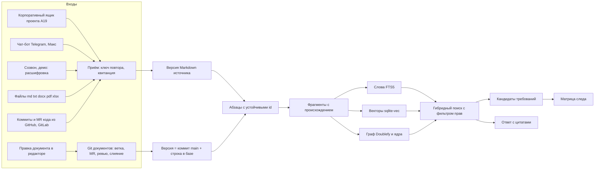
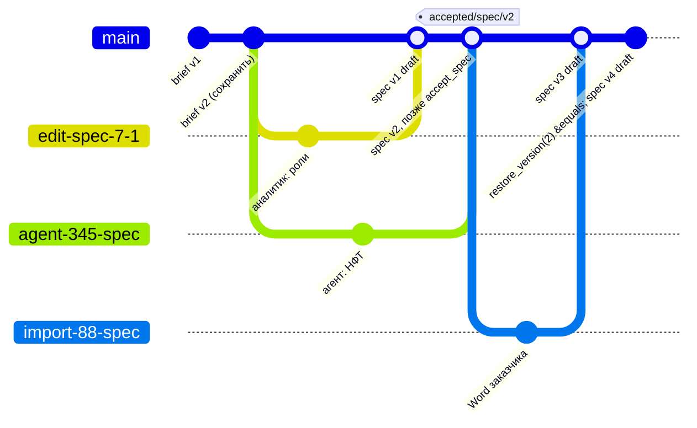
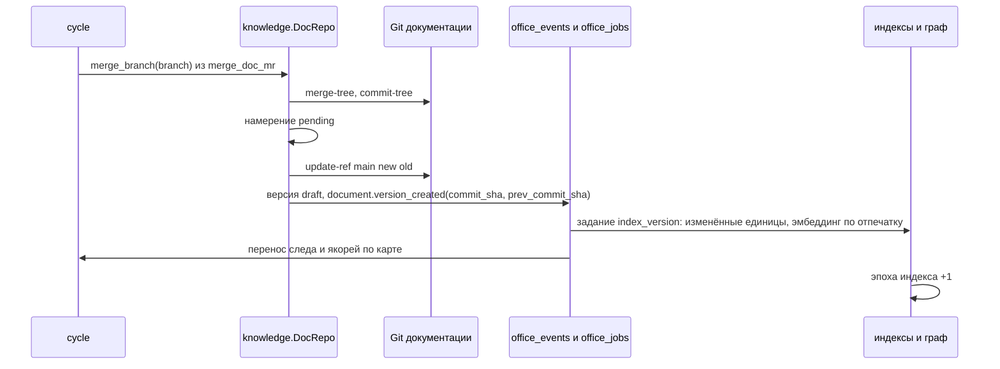
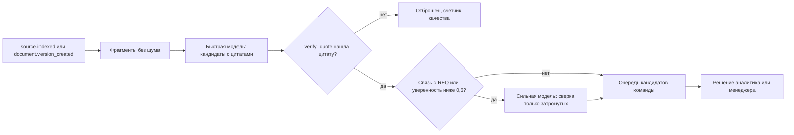
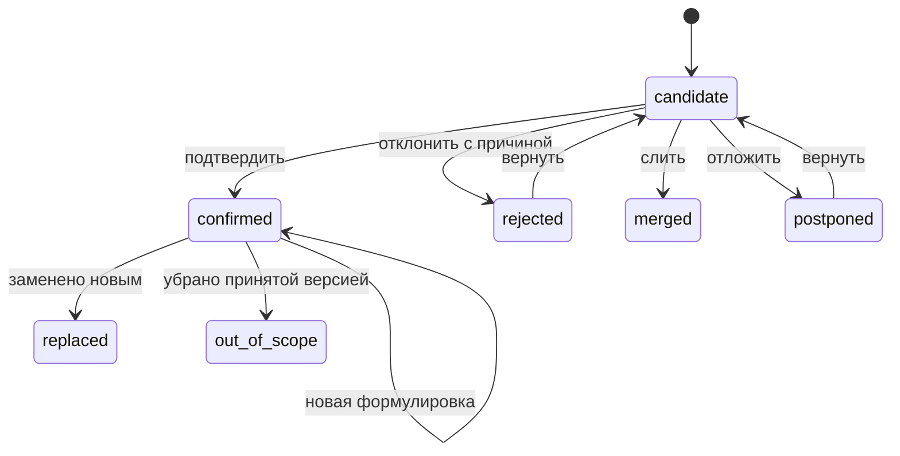
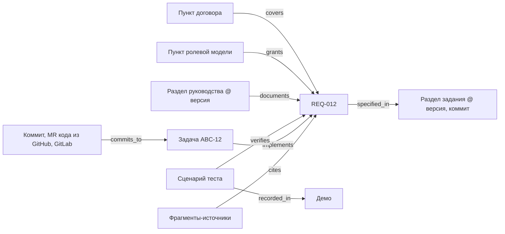
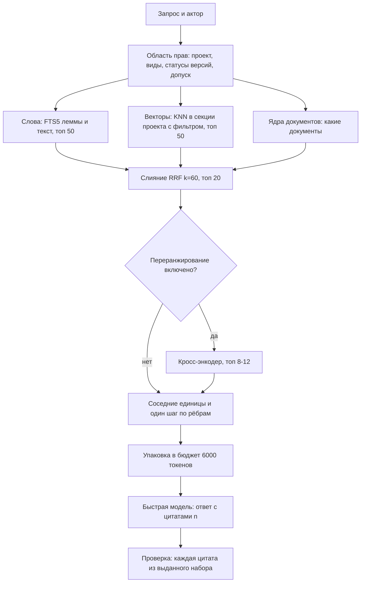

# 01. Ядро знаний: хранилище контекста, Git документов и след требований

Документ для разработчиков. Кода нет. Строится поверх `spec.md` (разделы «Ядро», «Ядро: решения по реализации», истории 34-64), `interfaces.md` (таски 01-03), `HANDOFF.md`, `brainstorm/02-yadro-rag.md`. Обязательные единые решения: `05-sverka-superarhitektora.md`, раздел 3; при расхождении верен он. Имена таблиц, статусов и событий взяты из `03-domennaya-model.md`. Закрытые решения и P01-P23 не переоткрываются. Углубляет R25, R35, R56, R76-R78, G07, G74-G80, G103-G106, G110-G112 и строки манифеста A10-A15 (документы в своём Git с MR, ревью и откатом; код только во внешнем GitHub или GitLab; «отдельное внимание архитектуре RAG»).

RAG-часть (разделы 4, 7, 8, 9 и индексы в 3.4) больше половины объёма: у каждого выбора разобраны альтернативы и названа причина. «Умолчание» меняется настройкой; «[решает пользователь]» закрывает пользователь.

---

## 1. Ядро в одном экране

RAG (retrieval-augmented generation: модель отвечает не по памяти, а по найденным кускам материалов проекта) это позвоночник платформы: бриф, задание, задача, коммит, тест, демо и руководство читают из ядра и пишут в ядро (G111).

| Вопрос | Ответ |
|---|---|
| Что хранится | Документы с правкой людьми (бриф, задание, руководство, ролевая модель, договорные виды, страницы, протоколы) в своём Git документации проекта и в базе; источники (письма, чаты, созвоны, демо, файлы, коммиты и MR кода, тикеты, комментарии, планировщик) как неизменяемые версии Markdown с квитанцией; фрагменты с происхождением; три индекса; требования и след |
| Что извлекается | Кандидаты требований, решений, замечаний, вопросов с дословной цитатой; дубли и противоречия; рёбра графа; смысловое ядро |
| Что отдаётся | Ответ с цитатами до абзаца или таймкода; контекст агентам; матрица следа, карточка требования, превью правки; граф |
| Кто пишет (05 §3.1) | `knowledge`: документы, версии, абзацы, Git документов (ветки, коммиты, слияние, метки), источники, квитанции, фрагменты, индексы, граф, эпоха, качество. `cycle`: требования, кандидаты, улики, противоречия, дубли, след, маршруты, MR и ревью документов, комментарии и их якоря. `core`: события `office_events`, задания `office_jobs`, аудит. Всё от модели лежит «предложено» |

Семь правил ядра из `spec.md` действуют без изменений. Новое после A10-A15: текст версии документа хранится дважды, блобом в Git и Markdown в базе, копии равны и связаны отпечатками (раздел 3.2).

Дополнение 2026-10-23, A41-A45 (A45; 00 §2 принцип 17; 05 §9.4; ADR-80). Ядро это и канал обмена между модулями и агентами: всё, что модуль или агент производит для другого как смысл (текст, сводка, спецификация отчёта, схема данных, предложение абзаца), существует документом ядра или версией источника с единым минимумом фронтматтера (`key`, `family`, `kind`, `version` или `receipt_sha`, `project`, `author`, `side`, `created_at`, `visibility`, `based_on[]`, `req_keys[]`) и телом Markdown; таблицы хранят структуру для экранов и проверок, не единственный экземпляр смысла. Агент получает контекст только через `search`, фрагменты и документы в правах назначившего; структурные факты инструментами над операциями владельцев. События `office_events` и задания `office_jobs` несут ссылки (`source_id`, `version_id`), не текст; текст в событии допустим только как транспорт входящего личного сообщения до записи (13 §1.8). Фронтматтер пишут те же писатели, что документы и источники (`ingest`, `ingest_source`).

---

## 2. Источники и приём

### 2.1. Общий путь

Каждый вход проходит одну цепочку: ключ повтора (идемпотентность: повтор того же входа не создаёт второй записи) → квитанция (неизменяемая байтовая копия с отпечатком sha256, `office_receipts`) → строка источника → версия Markdown → абзацы → фрагменты → индексы. Этап хранится в `office_sources.status`, работа идёт заданиями `office_jobs` (05 п. 10); сбой продолжает с последнего завершённого этапа (раздел 11).

### 2.2. Каналы

| Канал | Вход и нормализация | Позиция | Видимость | Ключ повтора |
|---|---|---|---|---|
| Письмо (A19) | Письмо из подключённого корпоративного ящика проекта (Яндекс 360, VK Workspace, Mail.ru, Google Mail; папка или ящик, адаптер у `channels`) становится источником `letter:<ключ>` через `ingest_source`; у пересланного исходный отправитель «не проверен» (К26); цитаты и подписи шум; вложения `file:`; тред по `In-Reply-To` | Абзац | Команда | `letter:<ключ>`, ключ из Message-ID |
| Чат Telegram, Макс (Дополнение 2026-10-23, A41-A45, A44, 18 §2.3; 05 §9 С131, С134) | Бот в привязанном проектном чате (`office_project_chats`, 18 §1); источник на чат за день в поясе МП, `external_key = <platform>:<chat>[:<thread>]@<день>`, документ чата `chat:<platform>:<id>` объединяет дни; абзац равен сообщению (`paragraph_id = m:<external_message_id>`, `lineage` стабилен при правке, прошлое в `edits`), текст `**[чч:мм] Имя (сторона)** ↩ m:<id>: текст`, вложения ссылками `file:`, голос через `transcribe`; стикеры и «ок» `noise=1`; сырой JSON как квитанция; исходящие ответы человека тем же источником | Сообщение; фрагмент окном до 300 токенов по ветке ответов со `speaker`, `side`, `t_from`, `t_to` | По участию в чате и клетке `chats`: `visibility=team` плюс `scope_tag = chat:<chat_id>` в метаданных вектора и FTS, `tenancy.scope` отдаёт разрешённые метки до ранжирования (7.3); заказчику закрыто (A21) | `(platform, chat, external_message_id, kind)` |
| Созвон (P03), демо | Загрузка записи или расшифровки, импорт из встречи. Канон `**[чч:мм:сс] Имя (сторона):** текст` плюс выжимка `digest`. «Только текст»: аудио и видео не хранятся. У демо список «показанные требования» | Реплики до 300 токенов, таймкоды | Команда; заказчику после публикации (P18) | meeting_id:recording_id |
| Встреча календаря | Повестка, участники, решения рукой | Пункт | Команда | id встречи |
| Файл md, txt, docx, pdf, xlsx, csv, png, jpeg (R77, G74) | Выбор: «новая версия документа X» (ветка `import/<upload_id>/<doc>` и MR «предложение заказчика» или команды, 3.2) или «новый материал» `file:<хэш-12>`. docx: комментарии Word на абзацы, скрытый текст вырезается и помечается (К26); pdf по текстовому слою, иначе распознавание, низкая уверенность «нужно распознавание» и вне поиска; xlsx лист в таблицу, сверх 2000 строк только слова | Абзац, строка, страница | Команда; заказчику своё | sha256 |
| Коммит и MR кода (R35, 54) | Только через подключение к внешнему GitHub или GitLab (`delivery`, срез E, A14); платформа код не хостит. Сканер секретов до индексации; дифф по файлам; откат удаляет фрагменты | Файл до 400 токенов | Только команда | `commit:<sha>`, `code_mr:<id>` |
| Тикет | `ticket:<ABC-12>`, версия на правку описания или приёмки; смена статуса событие графа | Описание, критерий | Команда; заказчику статус (P18) | ключ:ревизия |
| Код ветки по умолчанию (12 §5, срез E) | Снимок архивом API хоста без клона, инкремент по слиянию; исключения, сканер секретов, символы деревом синтаксиса | Символ до 400 токенов | Только команда | `code:<путь>`, повтор по `(путь, blob_sha)` |
| Комментарий | Фрагмент `comment` с якорем (3.10 сверки) | Абзац и диапазон | Внутренний или опубликованный | id |
| Планировщик (G103) | Источник `scheduler:<задача>:<дата>` вне Git (05 п. 35), вид «черновик агента»; в кандидаты и след только по настройке задачи; документ из него делает человек через MR | Абзац | Только команда | задача:запуск |
| Страница из расширения (A27, 13 §3.2) | Кнопка «импортировать страницу» в боковой панели ассистента: адрес, заголовок, основной текст (Readability), только видимое, до 30 тыс. символов; источник `web:<хэш адреса>` вне Git; карточка B | Абзац | Команда | хэш адреса и отпечаток текста |
| Сводка чата (Дополнение 2026-10-23, A41-A45, 18 §3.4) | `agents.build_chat_digest` пишет Markdown с фронтматтером (период, чаты, полнота) и телом по разделам через `ingest_source`; семейство `digest`, ключ `chat:<project>:<scope>@<from>..<to>`, версии при пересборке; фрагменты `kind=digest` ниже весом, в улики, кандидаты и стража не идут | Раздел | По правам чатов периода (разделы без права вырезаются при чтении) | ключ и `version_n` |
| Пайплайн, инцидент, фрагмент лога (Дополнение 2026-10-23, A41-A45, 17 §2.8, §3.3, §5.4) | `ops` пишет источник `pipeline:<id>` (фронтматтер: `pipeline_id`, `ref`, `sha`, `failure_class`, `task_keys`; тело: сводка 2-3 предложения, маскированная выдержка до 8 КБ), `incident:<id>` (critical окружения дольше 10 минут), `log:<sha>` (фрагмент, сохранённый человеком с привязкой к задаче или оповещению); секреты вычищены маской и сканером до записи (И-48) | Абзац | Команда; фрагменты логов прода только Адм (В17-11) | `pipeline:<id>` плюс `job_id`; `incident:<id>`; sha фрагмента |
| Сохранённый отчёт (Дополнение 2026-10-23, A41-A45, A45, 13 §4.3) | `insight` при `report.saved` и `report.revised` пишет ревизию отчёта источником `report:<rid>:<n>` (Markdown с фронтматтером спецификации и телом секций, числа подставлены кодом) | Секция | По грантам отчёта и классам данных ревизии (И-46); `budget` по A22 | `(report_id, n)` |

Семейство `demo` (05 §6 С41): `demo:<render_id>` это ролик `delivery.render_demo` (10 §9), `demo:browser-<session>` журнал демо во встроенном браузере (D06); созвон-демо остаётся источником `call:<id>` с видом `demo`.

Дополнение 2026-10-23, вечер (A26, 13 §2): загрузка из любого канала (веб, мобильный веб, Telegram, Макс, почта, расширение) идёт через `office_uploads` (`knowledge`; приём частями, sha256, повтор файла даёт тот же источник) и карточку привязки «проект, семейство, допуск, версия документа или материал», дальше общий путь 2.1. Разборщики: 13 §2.2; видео и аудио созвонов: 13 §2.3; Google Таблицы и Документы через адаптер `google_drive` у `bridge`: 13 §2.4.

Трекер в первом выпуске (A16) только принимает выгрузку принятого и возвращает статус; его комментарии не источник, ключ внешнего тикета `tracker:<system>:<key>`. У фрагмента всегда: автор, сторона, дата в источнике и дата приёма, ссылка на оригинал, позиция, допуск, режим записи и согласия (у созвона).

### 2.3. Правила приёма

- Сторона автора (заказчик, команда, внешний, система) пишется у фрагмента при приёме: «сказал заказчик» весит больше. Внешний участник без учётки хранится текстом; привязка к персоне распространяется на все его фрагменты проекта (история 37).
- Шум не теряется: `noise=1` исключает фрагмент из векторов, кандидатов и ответов, но оставляет в поиске по словам.
- Удаление источника (только команда) убирает фрагменты из всех индексов; улики получают «источник удалён» с сохранённой цитатой. Поэтому источники в Git не идут: история Git неизменяема.
- Исключённый участник теряет доступ сразу, его фрагменты остаются.

---

## 3. Модель хранения

### 3.1. Слои

| Слой | Что лежит | Почему |
|---|---|---|
| SQLite, таблицы `office_*` | Проекты, участники, документы, версии с копией текста, абзацы; источники, фрагменты, FTS5, векторы, граф, требования, след, MR, события, задания | Одна транзакция на запись, одна копия, уже в стеке |
| Git документации (A10-A12, A14, A15) | Голый репозиторий на проект: файлы документов с правкой людьми, ветки, слияния, метки принятых версий | История, ревью разных авторов, откат как у кода |
| Каталог данных офиса | Репозитории, квитанции, медиа (если запись не «только текст»), кэш экспорта, временные клоны агентов. Каталог вне `PROJECTS_DIR` и `confine_root`, иначе чат читал бы документы мимо видимости (05 п. 14) | Байты для спора «что прислали»; экспорт пересобирается |

Зеркало `.md` на диске и `git worktree` для агента не используются: агент правит во временном клоне своей ветки в каталоге запуска, голый репозиторий в джейл не монтируется (05 п. 8, К08).

### 3.2. Git документов (A10-A12, A14, A15; 05 §3.2-3.4)

**Два Git не смешиваются.** Репозиторий документации свой, это хранилище платформы без интеграции со сторонним решением: голый репозиторий `<данные>/office/git/<company>/<project>.git`, без git-сервера, внешнего клона, push, зеркала и вебхуков (A15). Код проекта живёт только во внешнем GitHub или GitLab; платформа его не хостит, коммиты и MR кода приходят в ядро источниками через подключение `delivery` (A14). Ниже «коммит», «ветка», «MR» без уточнения относятся к Git документации.

**Где живёт репозиторий.** Выбран свой голый репозиторий на проект внутри платформы (A14, A15): работает до подключения кода, видимость документов не смешана с доступом к коду, правила слияния по маршруту, а не правила кода (P07, P22). Отклонены `docs/` в репозитории кода (смешивает два Git) и репозиторий документации на GitHub или GitLab, первичный или зеркало (A15).

**Средство.** git CLI через подпроцесс за интерфейсом `DocRepo` (уже ставится установщиком; pygit2 требует системную libgit2, dulwich слаб в слиянии). Слияние без рабочего дерева `git merge-tree --write-tree` требует git 2.38+; установщик проверяет версию, при старом git слияние идёт во временном дереве (05 п. 15).

**Модель версии (05 §3.2, обязательна).**

1. В Git: `brief`, `spec`, `guide`, `role_model`, `as_built`, `architecture`, `page:*`, `protocol:*`, `contract:*`, `addendum:*`, `act:*`, `gost34:*`, `gost19:*`, `presentation:*`. Вне Git: `letter`, `chat`, `call`, `meeting`, `demo`, `file`, `commit`, `code_mr`, `ticket`, `comment`, `scheduler`, `mockup`. Путь: вид `f` это `f.md`, вид `f:k` это `f/k.md`.
2. Версия это коммит первой родительской цепочки `main`, изменивший один файл, плюс строка `office_document_versions`. Номер `max+1` назначается при рождении версии; у MR свой номер `!12`.
3. Текст хранится дважды: блоб в Git и `markdown` в базе, связаны `blob_sha` и `content_sha`. Номер и статус только в базе. Почему: HANDOFF требует «канон в базе и в поиске», A10 «ещё и в Git»; две равные копии выполняют оба, экраны и поиск читают базу, история, авторство и откат идут из Git.
4. В `main` пишут только слияние MR, прямая запись (`brief`, `page`, соло маленького типа) и откат. Слияние `--no-ff`; squash запрещён (теряет авторство абзаца), rebase запрещён (переписывает коммиты, на которые якорились комментарии). Отставшая ветка обновляется слиянием `main` в ветку.
5. Одна слитая правка = одна версия `draft`. Коммиты ветки (кнопка «сохранить» или 5 минут тишины) версиями не являются. Прямая запись: явное «сохранить» даёт коммит в `main` и версию, как построено в таске 03; повтор того же текста версии не даёт.
6. Маршрут идёт по неизменяемой версии; на маршруте одновременно одна версия документа; `main` тем временем принимает слияния (N+1 в `draft`). Статусы версии: `draft`, `internal`, `customer`, `accepted`, `returned`, `signed` (договорные).
7. `cycle.accept_spec` ставит аннотированную метку `accepted/<doc>/v<N>`, подписанную ключом платформы (целостность, не подпись, P09). Принятое не меняется.
8. После возврата текст N остаётся в `main` рабочим; следующая правка идёт MR поверх него с учётом замечаний. Если нужно начать от принятого, менеджер делает `restore_version(K)`. Ничего не переписывается (К02).
9. Откат (A12) двумя действиями: `restore_version` (один коммит `rollback` с текстом версии K) и `revert_merge` (обратный коммит одного MR через `cycle.revert_doc_mr`); оба дают `draft` и идут по маршруту заново. Одного `git revert` мало: при слияниях между ними он не даёт текст K.
10. Заказчик видит только версии на статусах своего профиля, никогда ветки, MR, ревью, `draft`, `internal`; номера могут идти с пропусками.

| Элемент | Правило (05 §3.3) |
|---|---|
| Ветки | `edit/<doc>/<user_id>-<n>`, `agent/<run_id>/<doc>`, `call/<call_id>/<doc>`, `import/<upload_id>/<doc>`; `:` в `<doc>` заменяется на `/`; закрытая ветка уходит в `refs/closed/`, строка `abandoned`, история не теряется |
| Автор | `user-<id>@office.invalid`; агент `agent-<run_id>@office.invalid` с `Co-Authored-By` назначившего. Настоящая почта в Git не попадает |
| Трейлеры | `Office-Document`, `Office-Version`, `Office-MR`, `Office-Run`, `Office-Actor`, `Office-Source`, `Req`, `Approved-by`; по ним сверщик строит строку версии для коммита без строки |
| MR и ревью | Сущность `cycle` (03 §2.6, §3.9): одно одобрение не автора плюс владельцы задетых разделов, новый коммит снимает одобрения (раунд по `head_sha`), ветка не отстаёт или сливается без конфликта, сливают менеджер или владелец, соло маленького типа с журналом. Автослияния документов нет (05 п. 27); вердикт агента это проверка, не одобрение |
| Агент | Пишет только в `agent/<run_id>/<doc>` через временный клон; не сливает |

**Слияние: один алгоритм (К04, К05; заменяет «по карте абзацев» в 04 §2.2 и «перебазирование» в 02 §3.6).**

- Нормализация при каждом `commit_to_branch` и при импорте Word: один абзац на строку без жёстких переносов; строка таблицы и пункт списка отдельной строкой; блок кода и цитата построчно. Единица абзаца совпадает со строкой.
- Изменение построенного `split` (таск 03): строка таблицы и пункт списка становятся отдельными единицами со своими id (сейчас таблица и список один абзац). Тогда правка ячейки не уводит в `pending` маркеры всей таблицы, а комментарий садится на строку (К05).
- Алгоритм: `git merge-tree --write-tree` (стратегия ort, трёхсторонняя от общего предка). Так как единица равна строке, конфликт Git это конфликт единицы, и поведение совпадает с правилом 04: правка в одной ветке берётся, правка одной единицы в обеих или удаление против правки дают конфликт, перенос одной единицы обеими ветками тоже конфликт.
- Карта абзацев слияние не вычисляет: она показывает конфликт («основа», «их», «ваше»), переносит якоря и след. Вариант модели при конфликте только «предложено». Решение конфликта это коммит в ветку.

**Запись: двухфазность и журнал намерений (К06, К07).** Общей транзакции у Git и SQLite нет, поэтому запись в `main` или ветку идёт так:

1. Объекты Git пишутся по содержимому (повтор безопасен).
2. Транзакция базы: строка `office_git_intents` (ref, old_sha, new_sha, вид, данные будущей версии), состояние `pending`.
3. `git update-ref <ref> <new> <old>`: сравнение со старым значением. Отказ: намерение `aborted`, ответ 409 `stale_head`.
4. Транзакция базы: строка версии и `office_doc_commits`, `main_head`, событие `document.version_created` в `office_events`, намерение `applied`.

Восстановление при старте и каждую минуту: для `pending` ссылка равна new, значит применить шаг 4; равна old, значит `aborted`; иное, значит `aborted` и событие админу. Тест обрыва в каждом окне обязателен. Все записи в репозиторий проекта сериализуются блокировкой файла `office.lock` внутри `DocRepo`; упаковка и сборка мусора только заданием обслуживания под той же блокировкой. Агент в репозиторий не пишет: `import_agent_commits` забирает коммиты из его клона в `refs/quarantine/<run>`, проверяет, что тронут только файл его документа, автор `agent-<run_id>`, нет коммитов слияния и секретов, и двигает ветку агента тем же порядком. Сверщик по 05 §3.2 п. 3: строка без коммита получает коммит из `markdown`; коммит без строки получает строку по трейлерам; при расхождении текстов верна копия, совпавшая с `content_sha`; админ получает событие.

Дополнение 2026-10-26 (сверка 24). К списку п. 1 «в Git» добавляются виды артефактов PM Book и сессий проработки (`22` §3.1, `23` Р23-03): `plan:*` (сводный план, коммуникации, RACI, качество, ресурсы, закупки), `final_report`, `final_report:*`, `gate:*`, `register:*` (снимки реестров, путь `register/<вид>.md`), `status_report`, `status_report:*` (статус аудитора, таск 85, и статус заказчику), `elicitation:*` (ответы сессии проработки, прямая запись как у `brief`); `act:phase-*` покрыт `act:*`. Вид `report:final` из первой редакции `22` не вводится: семейство `report` занято источниками сохранённых отчётов вне Git (`report:<rid>:<n>`, §2.2), а принадлежность к Git решается по семейству. Прямая запись в `main` (п. 4) разрешена ещё `elicitation:*` и снимкам `register:*` (снимок пишет код, не человек, текст детерминирован). Входы версий и их синхронность: `22` §4.

Дополнение 2026-10-27 (проверка ИБ 29, УИБ29-54, -60, -95). `import_agent_commits` не запускает git в каталоге клона агента: агент сдаёт `git bundle`, `knowledge` разбирает его в голом репозитории с `core.hooksPath=/dev/null`, пустыми глобальным и системным конфигами и `transfer.fsckObjects=true`; бандл с режимами 120000 (символическая ссылка), 160000 (подмодуль), 100755, с alternates или с файлом `.git` вместо каталога отклоняется; в список проверок входят трейлеры по белому списку `02` §3.6. Иначе `.git/config` клона (`core.fsmonitor`, `core.hooksPath`) исполнил бы команду процессом `knowledge` рядом с базой. Ключ подписи меток `accepted/*` держит хранитель ключей (`28` §5.5, И-127). Вычистка истории (`28` §5.10) переписывает все держатели sha одним заданием (цитаты, входы версий, якоря, `set/v<n>`, хронология) и подтверждается двумя людьми (И-123). Адрес автора коммита один: `user-<id>@office.invalid`. K2 §12 «вычистка админом» заменён криптоудалением (`28` Р28-18).

### 3.3. Индексация Git, ссылки на коммит, якоря

- **Триггер** это событие `document.version_created` с `commit_sha` и `prev_commit_sha` в той же транзакции, что версия; индексацию делает задание `index_version` в `office_jobs`. Внешних push нет, других триггеров нет. Отставание догоняет сверка `office_doc_repos.last_indexed_sha` при старте и ночью.
- **Инкремент.** Дифф имён файлов между коммитами, затем карта абзацев (`same | moved | changed | removed | added`, порог 0,6); заново режутся только изменённые единицы, эмбеддинг неизменённого текста берётся из кэша по отпечатку.
- **Скорость карты (К35).** Сначала точные совпадения по id, схожесть считается только среди несовпавших и в окне ±20 единиц; результат кэшируется по паре sha; превью и перенос считаются в процессе заданий. Бюджет: 600 единиц и 200 комментариев за секунду на эталоне.
- **Ветки (К09).** Головы веток в общий индекс не идут: эмбеддинги на каждое сохранение не считаются, варианты одного абзаца не забивают выдачу. Автор видит свою ветку в поиске разовым поиском по словам в одном файле; ревьюер видит дифф MR, а не поиск.
- **Цитата** хранит формат 05 §3.10: `document_id`, `version_id`, `commit_sha`, `paragraph_id`, `lineage`, `start`, `end`, дословный `quote`, у реплик `t_from`, `t_to`, у фрагмента `fragment_id`. Блоб по коммиту неизменяем, цитата не протухает; `verify_quote` сверяет с `markdown` версии, равным блобу по `content_sha`. Постоянная ссылка: документ, версия, якорь абзаца.
- **Линия абзаца.** id абзаца `p-<sha1[:12]>-<n>` это отпечаток текста, правка даёт новый id. `lineage` это id первого появления, карта переносит его при `same`, `moved`, `changed`; при `added` линия новая. Комментарии, маркеры следа и «история абзаца» держатся за линию.
- **Якоря комментариев** пишет `cycle` (`office_comments`, 05 п. 6): `knowledge` отдаёт карту между любыми двумя коммитами (`diff`) и линии. На `docbranch.committed` и `document.version_created` `cycle` переносит якорь: `same`, `moved` молча; `changed` с пометкой «абзац изменён»; `removed` оставляет комментарий на старом коммите и кладёт в список автора «абзац удалён» (история 51). Если `main` ушёл вперёд, применяется вторая карта «голова ветки → результат слияния». Заметки Git (`git notes`) отклонены: у них нет прав и статусов.

Дополнение 2026-10-27 (проверка ИБ 29, УИБ29-10). Класс бюджетного вида действует до рождения версии: `office_documents.data_classes` берётся из класса шаблона при открытии первой ветки; ветка, MR, дифф, `change_preview`, история абзаца и комментарии проверяются по нему (404 без класса); фрагмент `comment` наследует классы документа.

### 3.4. Реестр таблиц ядра

Один писатель на таблицу; поля, не перечисленные здесь, по 03. Таблицы `office_doc_changes`, `office_comments_anchor`, `office_index_jobs` и колонка `mirror_url` прошлой редакции сняты (05 п. 6, 7, 10, 12).

| Таблица | Писатель | Главные поля | Где определена |
|---|---|---|---|
| `office_documents` | knowledge | `kind`, `family`, `editable`, `title`, `repo_path` | 03 §2.5 |
| `office_document_versions` | knowledge (статус через `set_version_status` по вызову `cycle`) | `number`, `status`, `markdown`, `content_sha`, `blob_sha`, `commit_sha`, `merge_request_id`, `origin`, `run_id`, `accepted_at`, `accepted_by` | 05 §3.9 |
| `office_paragraphs` | knowledge | JSON `[{id, lineage, text, clause_no?, req_keys[], kind: p, row, item}]` | 03 §2.5 плюс `lineage` и `kind` |
| `office_doc_repos` | knowledge | `project_id`, `path`, `main_head`, `last_indexed_sha`, `merge_rules` | 05 §3.9 |
| `office_doc_branches`, `office_doc_commits` | knowledge | ветка, база, голова, `state open, merged, abandoned`; коммит, `content_sha`, `kind`, `version_id` | 03 §2.6 |
| `office_git_intents` | knowledge | `repo`, `ref`, `old_sha`, `new_sha`, `kind`, `payload`, `state pending, applied, aborted` | здесь, 3.2 |
| `office_sources` | knowledge | `family`, `external_key`, `status`, `visibility`, `side`, `consent_mode`, `consent_json`, `document_id`, `authored_at`, `captured_at`, `origin_url`; уникально `(project_id, family, external_key)` | 05 §3.9 |
| `office_receipts` | knowledge | `source_id`, `sha256`, `path`, `size`, `mime`, `retention_until` | 03 §2.5 |
| `office_fragments` | knowledge | `source_id`, `version_id`, `commit_sha`, `para_from`, `para_to`, `lineage`, `t_from`, `t_to`, `speaker`, `side`, `kind`, `text`, `lemmas`, `text_hash`, `lang`, `noise`, `tokens`, `visibility`, `version_status`, `is_current` | здесь |
| `office_fragments_fts` | knowledge | FTS5 по `lemmas` и `text`, внешнее содержимое | здесь, 4.4 |
| `office_embedding_cache` | knowledge | `(model_tag, text_hash)` → вектор | здесь, 4.3 |
| `office_vectors` | knowledge | vec0: `fragment_id`, секция `project_id`, метаданные `visibility`, `family`, `version_status`, `is_current`, `model_tag`; `embedding int8[D]`, `coarse bit[D]` | здесь, 4.3 |
| `office_nodes`, `office_edges` | knowledge | узлы с `core_json`, `core_hash`, `visibility`, `status accepted, future, hidden`; рёбра `status accepted, proposed, future, broken, rejected`, `evidence_fragment_id`, `version_id` | здесь, раздел 8 |
| `office_index_epoch`, `office_search_log`, `office_feedback`, `office_gold` | knowledge | эпоха проекта; журнал запросов с отпечатком области прав; отметки; золотой набор | здесь, раздел 9 |
| `office_requirements`, `office_requirement_versions`, `office_candidates`, `office_evidence`, `office_conflicts`, `office_duplicate_pairs`, `office_trace_links` | cycle | статусы 05 §3.4; цитаты и якоря 05 §3.10; `office_requirement_versions(n, text, spec_version_id, reason, source_evidence_id)` | 03 §2.7 |
| `office_doc_merge_requests`, `office_doc_reviews`, `office_threads`, `office_comments`, `office_route_passes`, `office_step_decisions` | cycle | MR и ревью с `reviewer_kind`, `head_sha`, `round`; якорь по 05 §3.10 со статусом `same, changed, removed` | 03 §2.6, §2.7 |
| `office_events`, `office_jobs`, `office_audit` | core | `seq`, `name`, `payload`, `audience`; задания с повтором | 03 §2.3, 05 §3.1 |

**Хранение (A20).** Сроки хранения без ограничения: квитанции, медиа, письма, версии, векторы старых принятых версий и копии не удаляются автоматически, `retention_until` пуст. Удаление только по запросу субъекта по 152-ФЗ, вручную админом с журналом (K2). Объёмы и копии планируются на рост без очистки.

**Объёмы** (ожидаемый пилот; потолок проектирования в 00, 05 п. 67): проект на полгода около 10 тысяч фрагментов (50 созвонов по 60, 300 писем, 180 дней чата, 50 документов по 40, 1000 коммитов). Вектор 1024 измерения: 1 КБ в int8, 128 байт в bit; проект около 10 МБ векторов, с хранением векторов по версиям (4.3) до 30 МБ. Репозиторий документации: единицы мегабайт. Не измерено, проверить на стенде.

---

## 4. Фрагменты и эмбеддинги

### 4.1. Нарезка: разбор вариантов

| Способ | Плюсы | Минусы | Итог |
|---|---|---|---|
| Фиксированный размер с перекрытием | Просто | Режет фразу и таблицу; дублирует текст; нет якоря на абзац; цитату нечем проверить | Отклонён |
| Рекурсивное деление по символам, «поздняя» нарезка | Чуть лучше; контекст документа в векторе | Те же проблемы с якорями; ломает кэш по отпечатку | Отклонены |
| По структуре: заголовок, абзац, строка таблицы, пункт списка, реплика, файл диффа | Якорь равен единице абзаца и строке Git; переиндексация только изменённых единиц; посимвольная проверка цитаты | Единицы бывают очень короткими или длинными | **Выбран** с правилами ниже |
| Смысловая нарезка по скачку векторов | Ровные смысловые куски | Граница плавает между версиями, рвёт перенос следа; дорого | Отклонён |
| Утверждения от модели | Точные единицы смысла | Вызов модели на абзац; текст не дословный | Отклонён; утверждения есть в ядре (раздел 8) |

Правила: цель 200-400 токенов; короткие соседние единицы одного раздела склеиваются, длинный абзац делится по предложениям; перекрытия нет, соседи подтягиваются при выдаче («от малого к большому»: ищем по фрагменту, в модель отдаём фрагмент с соседями). Для эмбеддинга к тексту добавляется **контекстная шапка** `документ / раздел / автор / сторона / дата`, собранная без модели. Вариант Anthropic Contextual Retrieval (модель пишет контекст к каждому куску) отклонён на старте из-за расхода; вернуть, если золотой набор покажет рост полноты больше 5 пунктов.

| Семейство | Единица | Размер |
|---|---|---|
| Документ из Git, файл | Единицы раздела | 200-400 токенов |
| Таблица документа, xlsx, csv | Строки с заголовком | до 30 строк |
| Расшифровка, демо | Реплики, не режутся | до 300 токенов |
| Чат | Окно сообщений автора или темы | до 300 токенов |
| Дифф коммита кода | Файл | до 400 токенов, только слова |
| Выжимка созвона, ядро документа | Целиком | до 500 токенов |

### 4.2. Поставщик эмбеддингов (история 35, A17)

Эмбеддинг: числовой вектор смысла текста. Claude Code CLI и Agent SDK их не дают, нужен отдельный кодировщик (не «своя языковая модель»). Закладываются оба варианта, локальная модель и внешний сервис (A17), за одним интерфейсом `Embedder`: `kind` (`local`, `external`), `model_tag`, `dims`, `max_tokens`, `embed_documents`, `embed_query`, `health`. Выбор хранится в настройках компании у `tenancy` (`embedding_provider`: вид, модель, адрес сервиса); ключ внешнего сервиса в `office_credentials` уровня компании, не в файлах. Меняет только админ компании, смена пишется в `office_audit`.

| Кандидат | Где считает | Русский | Длина входа | Размерность | Данные покидают сервер |
|---|---|---|---|---|---|
| bge-m3 | Локально, CPU | Многоязычная | 8192 | 1024, плюс разреженный | Нет |
| multilingual-e5-large-instruct | Локально | Многоязычная | 512 | 1024 | Нет |
| ru-en-RoSBERTa, FRIDA | Локально | Русская | 512; у FRIDA не уверен | 1024; у FRIDA не уверен | Нет |
| Yandex Cloud text-search | Внешний, РФ | Русская | Не уверен | 256 | Да, в РФ |
| Voyage, OpenAI | Внешний | Многоязычная | Длинный | 1024-3072 | Да, за рубеж |

Данные о моделях из `brainstorm/02-yadro-rag.md` (B.6), не перепроверены.

**Правила переключения (A17).** Умолчание локальное. Внешний сервис включается только явно: админ компании выбирает его, видит предупреждение «текст материалов проектов будет отправляться во внешний сервис» и подтверждает; до этого ни один текст заказчика наружу не уходит. Проект с отметкой «запрет вывоза» в паспорте остаётся на локальной модели. Смена поставщика это переиндексация в фоне (4.5): поиск идёт по старым векторам и словам, пока новые не готовы. Кэш эмбеддингов ключуется `(model_tag, text_hash)`, поэтому записи разных поставщиков не путаются; кэш старой модели живёт до нажатия админом «удалить старые векторы», чтобы возврат к прежнему поставщику обошёлся без пересчёта. Пороги близости хранятся по `model_tag` (К17). Внешний сервис недоступен: этап `embed` ждёт, поиск по словам; сам на другой сервис не переключается.

**Умолчание: bge-m3 в int8 на CPU** (без ключей и внешних вызовов; длинный вход позволяет эмбеддить ядро целиком). Критерии для продакшена: качество на русском по золотому набору, допустимость вывоза текста (152-ФЗ, P20), нагрузка. До выбора умолчания обязателен замер на минимальной конфигурации сервера: память модели (около 2 ГБ, не уверен) и фрагментов в секунду (К15). Установка без внешней сети: установщик берёт веса модели и словари pymorphy3 из локального зеркала пакетов и проверяет загрузку при старте (К21).

**Без поставщика** ядро работает в поддерживаемом режиме «слова и граф»: FTS5, рёбра, ядра без вектора; экран индекса это говорит. Кандидаты и проверка цитат от векторов не зависят; дубли ищутся по леммам (коэффициент Жаккара, умолчание 0,7) и сильной моделью для спорных.

Дополнение 2026-10-27 (проверка ИБ 29, УИБ29-55, -57; к §4.1 и §4.2). Внешний `Embedder` не вызывается из `knowledge` напрямую: это облачный класс `embed` через `ModelGateway` и `routing.call` с проверкой И-112, по тексту с метками, только при действующем включении облака двумя (`28` §4); переключателя одного админа нет, K4 §12 читается так же. `embed_query` (вектор запроса) наружу не уходит никогда и в кэш не пишется. Контекстная шапка фрагмента §4.1 собирается только из меток и псевдонимизированных заголовков (автор меткой или ролью); `text_hash` кэша считается по полному входу эмбеддера вместе с шапкой.

### 4.3. Векторный индекс: разбор вариантов

| Вариант | Плюсы | Минусы | Итог |
|---|---|---|---|
| sqlite-vec (vec0 в той же SQLite) | Одна транзакция и копия с фрагментами; секция по проекту и фильтр метаданных внутри поиска ближайших (KNN); int8 и bit | Только полный перебор, без приближённого индекса (ANN); версия до 1.0 | **Выбран**, версия фиксируется, за интерфейсом `VectorIndex`; при старте проверка, что расширение грузится (К36) |
| LanceDB | Встроенный, есть ANN | Второе хранилище со своей транзакцией | Запасной за тем же интерфейсом |
| Qdrant | Зрелый ANN и фильтры | Отдельный сервис в установщике | Отклонён для одного сервера |
| pgvector | Зрелый HNSW | Postgres нет в стеке | Вернуться при переезде базы (бш-S17) |
| Chroma, FAISS, hnswlib | Быстро | Фильтр прав только после поиска, это нарушает «права до ранжирования» | Отклонены |

**Строка вектора на фрагмент, кэш отдельно (К19).** Прошлая редакция держала один вектор на текст (`text_hash`) с секцией по проекту: тогда статус версии нельзя проверить внутри KNN, а фильтр после поиска запрещён. Решение: `office_embedding_cache(model_tag, text_hash)` хранит вектор один раз на компанию (не пересчитывать), а `office_vectors` держит строку на фрагмент с копией вектора и метаданными `visibility`, `family`, `version_status`, `is_current`, `model_tag`; секция `project_id`. Смена статуса версии перезаписывает строки её фрагментов (удалить и вставить: обновление метаданных vec0 на месте не проверено). Вектора старых версий в статусе `draft`, `internal`, `returned` удаляются, когда версия перестала быть текущей; принятые остаются для запросов про историю. Альтернатива «отбор разрешённых id до KNN и перебор только их» отклонена: при большой области перебор тот же, а при малой фильтр метаданных vec0 даёт то же без второго запроса. Тест прав до ранжирования по каждому статусу версии обязателен.

Полного перебора хватает: секция одного проекта (около 10-30 тысяч строк) это миллисекунды; выше 100 тысяч строк (умолчание) включается грубый bit-вектор для первого отбора и перепроверка int8. Векторы разных моделей в одном KNN не смешиваются (фильтр `model_tag`).

### 4.4. Индекс слов

FTS5 (полнотекстовый поиск SQLite) с оценкой BM25 (формула релевантности по частоте слов). Встроенный стеммер английский; Python-модуль sqlite3 не даёт зарегистрировать свой токенизатор. Варианты: лемматизация pymorphy3 (точнее), стеммер Snowball (грубее, быстрее), триграммы FTS5 (подстроки, индекс в разы больше). **Выбрано (К18):** две колонки FTS5, `lemmas` (pymorphy3, один разбор) и сырой `text`; запрос ищется по обеим, оценки складываются с весом 0,7 и 0,3 (умолчание). Сырая колонка ловит фамилии, термины и ошибки распознавания, где леммы расходятся. Токенизатор `unicode61` с символами `-_` внутри слова, чтобы `REQ-012` и `ABC-12` были одним словом. Колонки внешнего содержимого FTS5 обновляются в той же транзакции, что `office_fragments`.

### 4.5. Переиндексация и стоимость

- Новая версия: только изменённые единицы по карте; эмбеддинг из кэша по отпечатку; ядро по правилам раздела 8 (история 53).
- Смена модели: новый `model_tag`, фоновое задание по всем отпечаткам, до конца поиск по старым векторам и словам, экран «векторы: 63% на новой модели», затем старые удаляются. Пороги близости хранятся по `model_tag`, смена модели включается только после регрессии на золотом наборе и калибровки порогов (К17).
- Локальная модель: проект в 10 тысяч фрагментов за 3-8 минут процессора (оценка); внешний: цена за токен по договору компании.

Дополнение 2026-10-26 (сверка 24). Задание `index_version` (§3.3) становится шагом `index` цепочки актуализации `actualize:<project>:<doc>:v<N>` (`22` §5, ведёт `cycle`) с тем же ключом; отдельной подписки на `document.version_created` рядом с цепочкой нет. Ответ ассистента цитирует версию N только после шага `index` N, иначе последнюю проиндексированную с пометкой «новая версия ещё индексируется» (И-65).

---

## 5. Извлечение требований

1. **Триггер.** Один раз, когда источник семейств письмо, чат, созвон, демо, встреча, файл или комментарий получил `source.indexed`. Коммиты, тикеты и планировщик не запускают (планировщик только по настройке задачи). Документы из Git извлекаются по `document.version_created` и только из изменённых единиц.
2. **Вход быстрой модели** (класс `extract`, через `routing.call`): фрагменты с id, индекс требований проекта (ключ и заголовок), словарь сущностей графа, последние 10 исправлений людей проекта как примеры.
3. **Выход:** кандидаты четырёх видов (уточнение 14): требование, решение, замечание, вопрос. Поля: формулировка с явной модальностью, вид, цитаты `{fragment_id, quote}`, сторона автора, связь `{REQ, same | refines | changes | contradicts}`, флаги, уверенность.
4. **Проверка без модели (К16):** `verify_quote` нормализует обе строки одним каноном: Unicode NFC, «ё» в «е», все виды кавычек в `"`, все тире и дефисы в `-`, неразрывный пробел в пробел, мягкий перенос удаляется, регистр складывается, пробелы схлопываются; смещения считаются по карте «нормализованная позиция → позиция в оригинале» и сохраняются в оригинале. Нет цитаты: кандидат отброшен и посчитан. На пилоте доля отброшенных не выше 5%, иначе разбор канона.
5. **Сильная модель** (класс `check`) только для спорных; на вход кандидат и полный текст затронутых требований с главными уликами.
6. **Флаги** из `spec.md` плюс «источник без полномочий» (автор не представитель и не подписант, C54) и «отправитель не проверен» (пересылка, К26). В риски только через принятие менеджером.
7. **Решение человека** (аналитик, если назначен, иначе менеджер; G07): подтвердить, подтвердить как изменение (новая формулировка), слить, поправить и подтвердить, отклонить с причиной, отложить. Пачкой только после просмотра каждого, факт просмотра в журнал (история 41).

**Дубли и противоречия** по правилам `spec.md`: близость формулировок выше T1 (умолчание 0,92) даёт «тот же, что REQ-…», между T2 (0,80) и T1 решает сильная модель, «разные» глушит пару навсегда (`office_duplicate_pairs`). Пороги хранятся по `model_tag` и калибруются на размеченных парах (К17). Ключ кандидата (`dedup_key`) это отпечаток формулировки и главного фрагмента (история 42). Нарезку задач блокирует только противоречие двух подтверждённых требований (история 55); решение по умолчанию «новая версия, старое заменено» (история 38); ключ пары упорядочен.

**Формулировки и история.** Каждая правка формулировки это строка `office_requirement_versions` (`n`, `text`, `spec_version_id`, `reason`, `source_evidence_id`); отсюда таймлайн карточки (история 57).

Статусы кандидата: `proposed`, `accepted`, `rejected`, `postponed`; противоречия: `open`, `waiting_check`, `resolved` (05 §3.4, 03 §2.7).

---

Дополнение 2026-10-27 (проверка ИБ 29, УИБ29-53). `verify_quote` сравнивает по границам слов, цитата не короче порога слов (калибровка, не цель), а отрицание или модальность слева в том же предложении («не», «нельзя», «не должна») делают совпадение частичным с пометкой; рядом с цитатой показывается всё предложение источника.

## 6. Матрица следа

Каждая стрелка это строка `office_trace_links` со статусом `proposed | confirmed | pending | broken`; создатель система (ключ `ABC-12` в коммите кода, маркер `<!-- req:REQ-012 -->` в версии документа), агент (предложено) или человек (подтверждено). Ссылка на раздел несёт версию и коммит документации, поэтому ссылка на старую принятую версию живёт всегда. Колонки и правило цвета как в `spec.md`; цвета и «готово» вычисляются из ссылок и кэшируются по эпохе индекса.

**Перенос следа при рождении версии** (истории 39, 51): маркер найден или единица `same` → `confirmed`; `moved`, `changed` → `pending` и список «подтвердить след» (пачкой можно); `removed` → `broken` и противоречие `dropped_from_spec`. У версии `draft` перенос виден команде сразу, матрица по умолчанию показывает последнюю принятую версию с переключателем. Те же правила для руководства, ролевой модели, договорных видов. Кроме того, `requirement.version_changed` и `requirement.out_of_scope` переводят ссылки `guide_paragraph` и `role_item` требования в `pending` сразу, до новой версии документа (10 §8.1); колонка «Руководство» становится жёлтой «требование изменилось после раздела». Экспорт в Word теряет маркеры, импорт Word веткой `import/...` восстанавливает их по карте.

**Превью последствий правки (история 58, N02, A03).** Строится на лету и ничего не пишет: дифф `merge-base(main, head)..head` открытого MR (или версии на маршруте против последней принятой) по единицам → линии с маркерами и ссылками следа → затронутые требования → их задачи, сценарии, разделы руководства, пункты ролевой модели и договора → прогноз цвета каждой колонки. Где макет уже утверждён, пометка «станет красным в сверке». Считается в процессе заданий с кэшем по паре sha (К35), пересчёт на новый коммит ветки с задержкой; заказчику не показывается.

**Карточка требования (история 57, N01, A02).** `cycle.requirement_card(req, actor)`: статус и цвет по колонкам; улики с цитатой, каналом, автором, датой и ссылкой на абзац, сообщение или таймкод; таймлайн формулировок с источником каждой правки и версией задания; задачи, коммиты и MR кода, сверки, сценарии, демо, разделы руководства; открытые противоречия. Заказчику та же карточка в его контуре (история 40): без коммитов, оценок, рисков, кандидатов; внутренний источник скрыт (умолчание У6 сверки).

**Метрика «путь требования» (история 59, N04, A04).** `cycle.requirement_path(scope, period)`, читает `insight` из фиксированного набора (P13): дни от `authored_at` самой ранней подтверждённой улики до первого зелёного прогона сценария `verifies`; доли подтверждённых требований без подтверждённой улики, без сценария, без сверки; разрезы проект, подразделение, компания. Заказчик не видит.

Дополнение 2026-10-26 (сверка 24). Перенос следа при рождении версии идёт шагом `trace` цепочки актуализации (`22` §5), правила выше не меняются. Звено «Основание» принимает абзацы ответов сессий проработки (`elicitation:<id>`) и отправки брифа заказчика (`21` §5.1); решение журнала связано с требованием колонками `office_decisions.requirement_id`, `office_requirements.internal_decision_id` (ребро `decided_in`), пакет ИСР ссылкой `wbs_item` (ребро `planned_in`); отчёты и уроки связаны проекциями входов версий и структурных колонок (`reports_on`, `learned_from`), см. `14` §2.2 и §3.2, дополнения сверки 24. Тип `target_type` не расширяется.

---

## 7. Поиск и выдача в модель

### 7.1. Конвейер

### 7.2. Разбор выборов

| Узел | Варианты | Выбрано и почему |
|---|---|---|
| Режим | Только слова; только векторы; гибрид | **Гибрид.** Слова ловят ключи, числа, имена (`REQ-012`, «3 секунды»), векторы ловят перефразы («оплата картой» и «эквайринг»); по отдельности каждый проваливает класс вопросов (бш-S14) |
| Слияние списков | Взвешенная сумма; RRF (сложение обратных рангов); обучаемое ранжирование | **RRF, k=60:** не требует нормировать несравнимые BM25 и косинус и подбирать веса; обучаемое без данных невозможно |
| Разреженный вектор | bge-m3 sparse, SPLADE | Отложено: FTS5 по леммам даёт то же без второй модели; проверить на золотом наборе |
| Переранжирование | Нет; локальный кросс-энкодер (модель читает запрос и фрагмент вместе, например bge-reranker-v2-m3); быстрая модель списком; ColBERT | **Выключено по умолчанию**; включается, если на золотом наборе nDCG@10 растёт на 5 пунктов при p95 до 1,5 с. Для намерения «сверить» включено всегда |
| Граф | Нет; один шаг по рёбрам; сводки сообществ GraphRAG | **Ядра первым ярусом и один шаг по рёбрам:** ядро отбирает документы, фрагменты дают дословный текст (C18). GraphRAG отклонён: дорогая генерация на каждую версию и пересказ вместо цитаты |
| Преобразование запроса | Нет; HyDE (поиск по гипотетическому ответу); переформулировки; подвопросы | **Нет для обычного вопроса.** Для «сверить» разбор на подвопросы по требованиям. Фильтры (версия, «как было в версии 2», вид) извлекаются правилами, не моделью |
| Порядок в контексте | По оценке; лучшие в начало и конец | **Лучшие в начало и конец:** середина длинного контекста теряется (Liu и др. 2023, бш-S14) |

### 7.3. Права до ранжирования (истории 25, 45, 48)

- Область прав считается первой (`tenancy.scope`): ровно один проект (P04); виды документов роли; статусы версий (заказчику только статусы его профиля, ветки и `draft`, `internal` никогда); `visibility`. Исключённый получает отказ по проекту, а не пустой ответ.
- FTS5 соединяется с `office_fragments` по `visibility`, `family`, `version_status` до `LIMIT`; vec0 ищет в секции `project_id` с фильтром метаданных `visibility`, `family`, `version_status`, `model_tag` внутри KNN (К19). Фильтр после поиска запрещён: он дал бы дыры в топе и выдал бы число скрытого.
- Расширение по графу не переходит в скрытые узлы; заказчику только `accepted` рёбра. Число найденных считается внутри области. Чтение поиска идёт отдельным соединением WAL, не под блокировкой записи (К12).

Дополнение 2026-10-26 (сверка 27, С27-01, У27-01; И-86). Разделы 21-26 объявили классы данных, которые поиск обязан скрывать (`budget` у видов с `data_class = budget`, `management_chat` у чата руководства, классы фактов результата, классы протокола ресёрча, `personal` у текстов тикетов), но фрагмент хранил только `visibility`, `family`, `version_status`, и фильтр по классу был бы невозможен. Поэтому:

- `office_fragments` получает колонки `data_classes` (битовая маска по реестру классов `03` §2.5, дополнение 27) и `scope_tags json` (метки области: `chat:<id>`, `support:<project>`, `research:<id>`); те же поля идут в метаданные vec0 и в соединение FTS5. `scope_tag` чата из `18` §2.3 теперь колонка, а не только метаданные.
- Классы фрагмента берутся при приёме: у версии документа из `office_document_versions.data_classes` (класс шаблона `21` §3.2 ∪ классы фактов пакета `26` ∪ классы процитированных источников), у источника по каналу (`chat` вида `management` даёт `management_chat`, тикет даёт `personal`, отчёт по `data_classes` ревизии). Смысловое ядро версии и его узлы и рёбра в `office_nodes`, `office_edges` наследуют классы версии.
- `tenancy.scope(actor)` и `tenancy.audience_scope(...)` отдают разрешённую маску классов и список меток; FTS и KNN фильтруют по ним внутри запроса до `LIMIT`, как по `visibility`. Фрагмент, у которого хотя бы один класс не разрешён, в выдачу не попадает и в счётчик не входит.
- Отпечаток области в ключе кэша ответа (§7.6) и `scope_hash` графа артефактов (`14` §3.5) включают маску классов и список меток: смена участия в чате или роли даёт новый ключ.
- Подсказки ввода (упоминания `@`, ключи `REQ` и `ABC`, поиск узла по ключу, поиск в шапке) идут той же областью вводящего (`03` §4.3, дополнение 27).
- Перенос: миграция проставляет `data_classes` существующим фрагментам по виду документа и каналу; до её завершения поиск для ролей без `plan.budget/view` исключает виды класса `budget` по `family` и `kind`, а фрагменты чатов по меткам, иначе отказывает с 503.

Дополнение 2026-10-27 (проверка ИБ 29, УИБ29-12, -14, -15). (1) Соседние единицы, которые подтягиваются при выдаче, выбираются тем же запросом с `data_classes`, `scope_tags`, видимостью и статусом версии, что основной фрагмент; раздел сводки по чату и раздел отчёта это отдельные фрагменты со своими метками. (2) Наружу не отдаётся оценка `score`, только порядок; подсказки ввода не строятся из словаря FTS5; если замер покажет, что статистика BM25 общей таблицы выдаёт наличие слова в чужих проектах, FTS5 делится по проекту (таблица или файл на проект). Тест: оценка в проекте A не меняется от загрузки документов в проект B. (3) Смена класса задним числом (шаблон вида, вид чата, тикет, `export_ban`) идёт операцией `knowledge.reclassify(project, kind | source)`: задание перекрашивает фрагменты, метаданные vec0 и узлы, сбрасывает эпоху кэшей, пишет аудит; до конца задания действует больший класс. Класс встроенных денежных видов задаёт код, он только повышается.

### 7.4. Цитаты и ответ (история 34)

Модель (класс `search_answer`) получает фрагменты под номерами `[n]` и правило «каждая фраза со ссылкой». Проверка без модели: каждый `[n]` есть в выданном наборе; фраза без `[n]` помечена «вывод модели»; текст в кавычках сверяется `verify_quote`. Интерфейс превращает `[n]` в ссылку на документ, версию, абзац или таймкод. Нет фрагментов выше порога: «в материалах проекта не найдено», модель не вызывается. Модель недоступна: список фрагментов. Уверенность словами: «по N фрагментам из M документов».

Дополнение 2026-10-27 (проверка ИБ 29, УИБ29-47, -48). Ответ, источник, версия и подсветка поиска показываются через единый санитайзер (И-129): Markdown без сырого HTML, без внешних картинок, ссылки с видимым доменом, подсветка смещениями, а не HTML. Фрагмент с `origin` `agent:<run_id>`, `external_client` или `model_generated` (вывод агентов, сводки, протоколы, источники от внешних клиентов) не служит уликой, словами заказчика и примером извлечения без принятия человеком (И-130); ответ помечает такой материал и письма непроверенного отправителя. Примеры исправлений людей для подсказки извлечения берутся только в области аудитории текущего извлечения.

### 7.5. Бюджет контекста и конституция по области (К23)

Умолчание 6000 токенов: конституция проекта до 800 (05 п. 63), ядра отобранных документов до 700, фрагменты с соседями до 4000, история диалога до 500. Сверх бюджета режутся соседи, затем хвост топа. Весь архив в модель не уходит (G79). Конституция (паспорт, словарь, индекс требований ключ-заголовок) собирается **по области видимости**: команде полный индекс требований; заказчику только требования из версий на статусах его профиля и поля паспорта, открытые роли. Внутри одной области текст одинаков, поэтому кэш подсказки работает на область. Тест: в подсказке заказчику нет ни одного ключа скрытого требования.

### 7.6. Кэширование

| Уровень | Ключ | Срок | Зачем |
|---|---|---|---|
| Эмбеддинг | `(model_tag, text_hash)` в пределах компании | Бессрочно | Тот же текст не эмбеддится второй раз |
| Ядро версии | `core_hash` по `content_sha` | Бессрочно | Версия неизменяема |
| Кэш подсказки у поставщика | Конституция области одним текстом в начале | По правилам поставщика | Дешевле повторные вызовы, если маршрут его даёт |
| Ответ | отпечаток запроса + отпечаток области прав + эпоха | 10 минут | Разные роли никогда не делят кэш |
| Цвета матрицы | проект + эпоха | До смены эпохи | Матрица без пересчёта |

### 7.7. Межпроектное

Выключено (P04, D01): `search` и `ask` не выходят за проект; межпроектных рёбер в срезах A-G нет. После выпуска: настройка `crossProjectLinks` (имя в схеме `cross_project_links`), только ядра, только при доступе к обоим проектам, каждый запрос в журнал. Проект целиком, с таблицей `office_cross_links`, правами и расходом: 12 §6 (отложено до D01).

Дополнение 2026-10-26 (сверка 24). Опыт выполненных проектов (`23` §4) не делает поиск межпроектным: в контекст модели идут только одобренные карточки библиотеки решений и агрегаты похожих проектов по полям паспорта от порога (И-72); сравнение векторов брифов разных проектов это межпроектный поиск и ждёт D01.

Дополнение 2026-10-26 (сверка 27, С27-04, И-89). Результаты отделу и компании (`26`, аудитория `management`, область `department` или `company`) тоже не делают поиск межпроектным: `audience_scope` с областью шире проекта отдаёт пустой фильтр поиска, такие результаты строятся только из наборов данных и агрегатов `insight`, цитаты только фактами пакета. `search` и `ask` по-прежнему принимают ровно один проект.

### 7.8. Расход (К27, К28)

Модель ядро зовёт только через `routing.call` с классом; одношаговые операции без файлов (извлечение, ядро, ответ, протокол) идут через `ClaudeBridge` с `max_turns=1` без инструментов; переход на прямой API только после замера задержки и расхода (К27). Цены из оценки бш-S10 (справочник на 2026-10-06, проверить при сборке): быстрая модель $0,10 и $0,50 за миллион токенов входа и выхода, сильная $4 и $20.

| Операция | Класс | Потолок токенов (резерв в `routing`) | Стоимость в среднем |
|---|---|---|---|
| Ответ на вопрос | `search_answer` | 6000 вход, 800 выход | около $0,001 |
| Извлечение из часового созвона | `extract` | 50 000 вход, 4000 выход | около $0,006 |
| Сверка спорного кандидата | `check` | 10 000 вход, 3000 выход с рассуждением | около $0,05-0,1 |
| Ядро новой версии | `draft_text` | 6000 вход, 1200 выход | около $0,001 |
| Эмбеддинги | вне строк | любые | только процессор |

Главная статья расхода это сильная модель на сверке: она идёт только для спорных и только против ближайших по вектору требований; доля её вызовов видна в отчёте. Расход ревьюера MR, превью ИИ-правки и многоходовых запусков считает 02. Вызов сверх лимита не уходит (429 `limit_exhausted`).

---

## 8. Граф связей документов (Doublefy)

**Узлы и рёбра** как в `spec.md` («Doublefy, уточнение»), плюс узел «дизайн-система». Узел документа держит версию и коммит.

**Статусы рёбер** (`accepted, proposed, future, broken, rejected`). Структурные факты (ключ тикета в коммите кода, вложение, ответ на письмо, комментарий к абзацу, маркер `req:`) сразу `accepted`. Выведенные моделью `proposed` до подтверждения человеком. Рёбра непринятой версии (`draft`, `internal`, `customer`) лежат `future` с `version_id`; на `version.accepted` становятся `accepted`, на `version.returned` и при снятии версии снимаются (C19). Ветки MR рёбер не хранят: превью считает их на лету (раздел 6). Отклонённое ребро помнится.

**Смысловое ядро** (G77): summary 2-3 предложения, сущности с абзацем, утверждения 5-30 с абзацем и видом, требования, открытые вопросы, ссылки `explicit | inferred`. Строится только из собственного текста версии (C59). Явные ссылки дают `accepted`, выведенные (совпадение сущностей и близость векторов ядер выше порога, умолчание 0,85 по `model_tag`) дают `proposed`. Пересчёт при отправке версии по маршруту (`route.started`), при принятии или кнопкой «зафиксировать»; у `draft` пометка «ядро устарело»; в модель уходят изменённые разделы и прошлое ядро (история 53).

**Визуализация (G80, истории 44, 45).** Окрестность выбранного узла на два шага, не весь граф (C20). Цепочка «бриф → задание → требование → задача → коммит кода → сценарий → демо → руководство» это путь по рёбрам `specified_in, implements, commits_to, verifies, recorded_in, documents` от требования, с версией у узлов документов. Скрытый узел не рисуется и не учитывается в числе рёбер; заказчику ни `proposed`, ни `future`. Сообщества и хабы считаются на лету.

Дополнение 2026-10-26 (сверка 24). Шаг `core_graph` цепочки актуализации (`22` §5) не меняет правило пересчёта ядра: у каждой новой версии структурные рёбра (маркеры, явные ссылки) пишутся статусом `future`, смысловое ядро моделью строится только на `route.started`, на принятии и по кнопке; у черновика пометка «ядро устарело». Так требование пользователя «каждая новая версия запускает актуализацию графа» выполнено без вызова модели на каждое сохранение.

---

## 9. Качество

| Метрика | Как считается | Ориентир пилота [решает пользователь] |
|---|---|---|
| Recall@10, MRR, nDCG@10 | Золотой набор «вопрос → ожидаемые абзацы», отдельный класс «ключи, числа, имена» (К18) | Recall@10 не ниже 0,95 по принятым требованиям (бш-S14) |
| Точность цитат ответа | Доля `[n]`, подтверждённых фрагментом (выборка человеком); кавычки посимвольно | 100% посимвольно |
| Точность извлечения | confirmed / (confirmed + rejected) | не ниже 0,70 (бш-S13) |
| Отброшено по цитате | Счётчик `verify_quote` | не выше 5% (К16) |
| Дубли после подтверждения | Доля «тот же» | не выше 5% |
| Ложные противоречия | Доля `not_conflict` | Наблюдать |
| Полнота следа, `pending` после версии, время до подтверждения | Матрица | Наблюдать |
| Время решения по кандидату | Медиана | не больше 2 минут |
| Ложно изменённые единицы | Доля `changed` при правке одной ячейки или пункта | Замер на 10 ТЗ пилота (К05) |

**Золотой набор (К20).** Основной набор уровня компании собирается из материалов P20 («волшебник» на 10 созвонах) и обезличивается; набор проекта необязателен и не требует аналитика: он пополняется сам из подтверждений, отклонений с причиной «не требование» и «шум», отметок «полезно» и «не то» и переносов следа. Классы: поиск, извлечение, след (новая версия → ожидаемые `same, pending, broken`), инъекции (К26: подложное письмо, скрытый текст docx). Перед сменой модели, подсказки, порога или включением переранжирования прогоняется регрессия под тегом модели; пороги калибруются на размеченных парах по `model_tag` (К17).

**Обратная связь.** Правка формулировки кандидата и причина отклонения сохраняются парой «было, стало» и идут в подсказку извлечения проекта последними N примерами (без дообучения). Пороги подстраиваются по статистике решений и применяются после «применить» у админа. Отчёт видят команда и админ.

---

## 10. API ядра

Имена `snake_case` (05 §3.7); camelCase спецификации это синонимы. Ошибки и повтор по 05 §3.6 (`stale_head` 409 при `expected_head`, `Idempotency-Key`).

| `knowledge` | Сигнатура и смысл |
|---|---|
| `ingest`, `ingest_file` | Построено (таск 03), сигнатуры прежние. Версия документа: для прямой записи коммит в `main`; повтор текста `created=False` |
| `ingest_source` | `(project, family, payload, actor, external_key) -> source`: внешний вход вне Git |
| `versions`, `version`, `paragraphs`, `paragraph_map`, `has_version` | Построено плюс `commit_sha`, `lineage`; `has_version(project, family, status)` для `project` (05 п. 5) |
| `set_version_status` | Только для `cycle` |
| `open_branch`, `commit_to_branch(branch, markdown, actor, expected_head)`, `merge_branch(branch, actor)`, `close_branch` | Git документов; `merge_branch` зовёт только `cycle.merge_doc_mr` |
| `import_agent_commits(run)` | Коммиты из временного клона агента с проверками 3.2 |
| `restore_version(document, k, actor)`, `revert_merge(mr_version, actor)` | Откат, результат версия `draft` |
| `diff(sha_a, sha_b, path)` | Карта единиц со статусами и линиями; основа превью, переноса якорей и следа |
| `search(project, actor, query, filters)` | `{hits: [{fragment_id, document, version, commit_sha, paragraph_id, t_from?, quote, score}], scope_hash, epoch}` |
| `ask(project, actor, question)` | `{answer, citations: [n → hit], unsupported_sentences, found: {fragments, documents}}`; поток через `/api/office/ws` |
| `fragments`, `verify_quote(target, quote) -> {ok, start, end}` | Общая проверка для кандидатов, протокола (64), правок задач (61) |
| `graph(project, actor, node, depth=2)` | `{nodes: [{id, type, title, version?, status}], edges: [{from, to, type, status}]}` после фильтра прав |
| `export(version, format, profile?)`, `reindex(project, scope)`, `index_status(project)` | Экспорт из текста версии, профиль `gost` или `presentation` (шаблон компании, 10 §15); картинки версии по `GET /documents/{did}/versions/{n}/assets/{sha}` (10 §7.2); отдельный тест допустим для `reindex`, `index_status` |
| `transcribe(blob_ref, diarize, lang?)` | Распознавание речи за `SpeechRecognizer` для созвонов (11 §3.2) и надиктовки расписания (09 §9); звук к 16 кГц моно швом `MediaEncoder` |
| `create_page(project, title, parent_id?, template?)`, `move_page(document, parent_id, after_id?)` | Страницы `page:<n>` с деревом в базе (09 §2.1); перенос версию не рождает, событие `document.moved` |

| `cycle` (ядровая часть) | Смысл |
|---|---|
| `open_doc_mr`, `submit_doc_mr`, `review_doc_mr`, `merge_doc_mr`, `revert_doc_mr`, `close_doc_mr`, `rollback_document` | MR документов; слияние зовёт `knowledge.merge_branch` |
| `start_route`, `approve_step`, `return_step`, `accept_spec` | Маршрут по неизменяемой версии; `accept_spec` ставит метку через `knowledge` |
| `propose_requirements`, `decide_candidate`, `resolve_conflict`, `confirm_trace`, `trace_matrix(project, actor)` | Матрица уже по правам |
| `requirement_card`, `change_preview`, `requirement_path` | Истории 57, 58, 59 |

**События** (05 §3.8, каталог 03 §6): пишутся в `office_events` в транзакции изменения, доставляются по `seq`, обработчики идемпотентны по `(name, seq)`. Ядро публикует `source.received`, `source.indexed`, `source.failed`, `source.deleted`, `document.version_created` (с `commit_sha`, `prev_commit_sha`), `docbranch.committed`, `document.rolled_back`. Слушает `docmr.*` (превью), `version.accepted`, `version.returned`, `route.started` (ядро, рёбра), `requirement.confirmed` (узел графа), `member.removed` (сужение поиска), `comment.created` (комментарий как источник), `codemr.merged`, `commit.linked` (индекс кода после сканера секретов).

**Построенное.** Таблицы `office_documents`, `office_document_versions`, `office_paragraphs`, id `p-<sha1[:12]>-<n>`, порог 0,6, карта по запросу, `ingest`, `ingest_file`, `IngestError`, HTTP брифа сохраняются. Меняется: колонки версий по 05 §3.9; в JSON абзацев `lineage` и `kind`; `split` выделяет строки таблиц и пункты списков (3.2); существующие версии один раз переносятся в Git коммитами по порядку номеров с автором и датой, проверка «сверщик без расхождений» на копии прода (К34); запись абзацев через приватные `_connection()` и `_lock` заменяется публичным хуком транзакции `OfficeStore` до среза B.

---

Дополнение 2026-10-27 (проверка ИБ 29, УИБ29-13). Все читающие операции ядра (`export`, `diff`, `verify_quote`, `sync_state`, `graph`, `search`, `ask`) принимают актора или `audience_scope`; на цель вне области ответ всегда 404, в том числе у изменяющих методов (решение по ребру, по разрыву), чтобы 403 не выдавал существование; `verify_quote` к скрытой цели даёт 404 и не служит оракулом перебора; вики-ссылка `[[...@vN]]` на скрытое рисуется простым текстом без версии; `move_page` проверяет проект родителя.

## 11. Отказы и восстановление

| Отказ | Поведение |
|---|---|
| Обрыв загрузки | Файл во временном каталоге, строки нет; уборщик удаляет сироты старше суток |
| Обрыв разбора или индексации | Этап в `office_sources.status`, повтор задания `office_jobs` с нарастающей паузой; частично источник в поиске не виден (история 47) |
| Нет поставщика эмбеддингов или модели | Поиск по словам, значок «векторы отстают на N»; извлечение и сверка ждут; ответ списком фрагментов |
| Обрыв между Git и базой | Журнал намерений (3.2): при старте и каждую минуту `pending` доводится до `applied` или `aborted` по фактической ссылке |
| Две записи в одну ветку | Второй `update-ref` получает отказ, 409 `stale_head`; редактор сливает по единицам |
| Повреждён vec0 или FTS5 | Пересборка из `office_fragments` и `office_embedding_cache` |
| Потеряна база, репозитории живы | Сверщик строит строки версий по трейлерам, тексты из блобов; источники из квитанций; требования и след только из копии |

**Резервная копия (К10).** Набор копии один: онлайн-копия SQLite, `git bundle create --all` каждого репозитория, каталог квитанций и медиа, плюс манифест с номером последнего события `office_events.seq`, `main_head` каждого репозитория и отпечатками файлов. Порядок: база, затем бандлы; база не новее Git, сверщик догоняет. Восстановление ежемесячно на отдельной машине с критерием «сверщик без расхождений». Стенд (`scripts/run_stand.sh`) восстанавливает бандлы рядом с дампом базы; дамп офиса на стенд разработчика только обезличенным (К14).

---

Дополнение 2026-10-27 (проверка ИБ 29, УИБ29-59). Исправление пропуска ПД и криптоудаление убирают и физические остатки: FTS5 с внешним содержимым получает команду `'delete'` со старым текстом (иначе токены сырого имени остаются в индексе), база работает с `secure_delete=ON`, после исправления идут `wal_checkpoint(TRUNCATE)` и плановый VACUUM; в Git после вычистки `reflog expire` и `gc --prune=now` под блокировкой. При восстановлении копии журнал исправлений `pii_fix` повторяется так же, как журнал стираний (`28` §6.3, И-135).

## 12. Открытые вопросы и допущения

| № | Вопрос | Состояние |
|---|---|---|
| K1 | Где Git документов | Закрыт A14, A15: свой внутри платформы, без зеркала; код только во внешнем GitHub, GitLab |
| K2 | Удаление по 152-ФЗ против истории Git, в том числе персональные данные в договорах и ТЗ (К11) | Сроки без ограничения (A20); удаление только по запросу по 152-ФЗ, способ подтверждает юрист (P20); «вычистка» админом с переиндексацией; персональные данные подписанта держать ссылкой на карточку, не в тексте договора |
| K3, K5, K6, K9, K10 | Метка, трекер, бриф, git 2.38, планировщик | Закрыты сверкой: п. 23, 16, 21, 15, 35 |
| K4 | Поставщик эмбеддингов | Закрыт A17: оба варианта, переключение админом компании, внешний только явным включением (4.2) |
| K7 | Пороги качества | Пилот P20, объявлены заранее (раздел 9) |
| K8 | «Внутреннее обсуждение», колонка «Договор» у представителя | У6: скрыто |
| K11 | Обновление метаданных vec0 на месте | Проверить на sqlite-vec 0.1.9; иначе удалить и вставить (4.3) |
| K12 | 06 §2.2: Git как технология или как поведение «MR, ревью, откат» | A10, A14, A15 не переоткрываю; при любом ответе модель версии та же |

**Допущения:** объёмы, скорость модели и цены не измерены; файлы 02 и 04 должны принять алгоритм слияния из 3.2.
