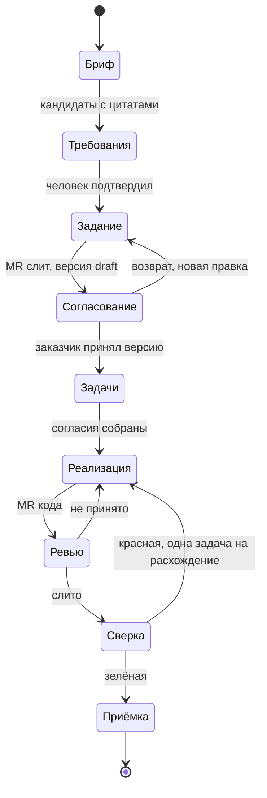
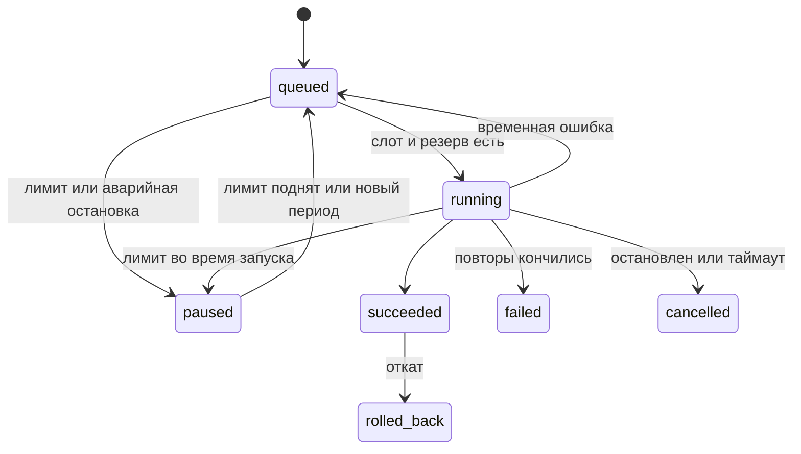
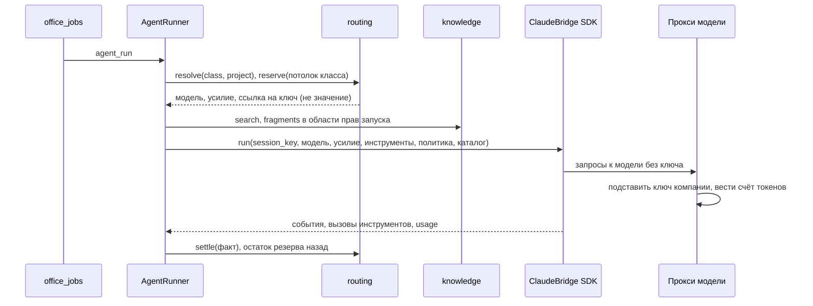

# 02. Слой агентов и моделей

Для разработчиков, без кода. При расхождении верны единые решения `05-sverka-superarhitektora.md` §3 («05 §3.x»). Здесь закрыты находки 06 (К08, К13, К15, К23-К29, К31, К33, К36, К37, S04) и 07 (пункты 9, 12, 46, 50; противоречия 8, 14-18, 20-22).

Место слоя (05 §3.1). `agents` стоит над доменом и под `ui`: это второй вход в домен с правами назначившего человека. Домен агента не зовёт, он будит его событием из `office_events` или заданием `core`. Ключи, строки маршрута и лимиты хранит `tenancy`; модель вызывает и расход списывает `routing` (`resolve`, `reserve`, `settle`, `call`, `usage`). Документы и внутренний git документации у `knowledge`, MR документов и ревью у `cycle`, код во внешнем GitHub или GitLab у `delivery`. В таблицы этих модулей агент пишет только через их операции.

Термины: **запуск** (run, одно исполнение агента с журналом); **скил** (папка с инструкцией `SKILL.md`, как в Claude Code); **класс операции** (тип работы, по которому `routing` выбирает модель и усилие); **джейл** (изоляция процесса ОС через bubblewrap, `scripts/ai-workspace-jail.sh`); **файрвол** (проверка инструмента до вызова, PreToolUse, `src/claude/tool_firewall.py`); **временный клон** (копия одной ветки репозитория в каталоге запуска, удаляется после).

---

## 1. Назначение и принципы

- **П1. Не публикует.** В API и инструментах агента нет `publish`, `approve_step`, `accept_spec`, `hand_to_team`, `approve_task`, `merge_doc_mr` (G23, ист. 12, 30; 03 И-22).
- **П2. Необратимое делает человек:** слияние документа, отправка заказчику, принятие версии, передача задачи. Единственное исключение: автослияние MR **кода** по настройке проекта при зелёной сборке и без конфликтов, только по назначению (P07). Документы агент не сливает никогда (05 №27).
- **П3. Журнал** всего прочитанного и сделанного (3.5, ист. 62). **П4. Откат** одним действием: всё созданное несёт `run_id`.
- **П5. Лимит кончился: пауза, не молчание.** Резерв в `routing` до вызова; ответ 429 `limit_exhausted` с именем лимита (ист. 33).
- **П6. Агент предлагает, человек подтверждает.** **П7. Цитата проверяется без модели** одной операцией `knowledge.verify_quote` (05 §3.10).
- **П8. Права не шире человека:** права запуска = пересечение прав назначившего (`on_behalf_of`) и политики роли агента; проверяются на каждом шаге, не только при старте.
- **П9. Один проект в контексте** (P04, D01). **П10. Поверх моста, не рядом:** `ClaudeBridge`, SDK-транспорт, с доработками раздела 4.1.
- **П11. Два git не смешиваются (A14, A15).** Агент документов работает только с временным клоном ветки внутреннего репозитория документации; агент разработки только с временным клоном внешнего репозитория кода. Ни один из них не видит другой репозиторий.
- **П12. Контекст только через ядро (Дополнение 2026-10-23, A41-A45, A45; 00 §2 принцип 17, ADR-80).** Агент читает документы и `knowledge.search` в правах назначившего, структурные факты инструментами MCP над операциями владельцев; свой текстовый обмен между агентами мимо ядра запрещён: второй агент читает документ первого. Результат агента это документ или версия источника ядра (ветка и MR, `ingest_source`), не поле таблицы.

---

## 2. Каталог агентов

Агент это профиль (роль, скилы, инструменты, класс, кто принимает); все профили исполняет один рантайм (раздел 4).

Граница с доменом. Одношаговые вызовы модели без инструментов (`cycle.draft_spec`, `propose_requirements`, `knowledge.ask`, ядро) делает сам домен через `routing.call`; это не запуски, расход в `office_usage` без `run_id`. Агент нужен для многошаговой работы с инструментами, журналом и откатом: он зовёт те же операции от имени назначившего и правит документы веткой.

### 2.1 Вход, выход, приёмка

| Агент | Вход | Выход | Принимает | Срез |
|---|---|---|---|---|
| Аналитик | Бриф, источники, письма корпоративных ящиков проекта как `letter` (A19) | Правка задания веткой `agent/<run_id>/spec` с маркерами `req:` и цитатами; кандидаты через `propose_requirements` | Аналитик, иначе менеджер (ревью MR) | A, C |
| Системный аналитик | Принятые требования, замечания | Системные требования; ролевая модель «предложено» (P15); задачи черновиками через `slice_tasks` | Сист. аналитик или менеджер | C, E |
| Архитектор | Принятое задание, репозиторий кода на чтение; Дополнение 2026-10-23, A41-A45 (A42, 05 §9 С141): требования и ролевая модель для схемы данных | Правка `architecture` веткой; внутренние комментарии на пресейле; схема данных новым видом `architecture:db-<слаг>` (14 §2.1): сущности, таблицы, поля, связи, индексы, миграции таблицами Markdown и `erDiagram`, маркеры `req:`, веткой `agent/<run_id>/architecture/db-<слаг>` и MR | Архитектор, иначе менеджер | B, E |
| Разработчик | Переданная задача со спецификацией и путями к макету и дизайн-системе; схема данных `architecture:db-*` и символы ядра по коду (12 §5), если есть | Ветка `agent/ABC-12-<слаг>` и MR кода во внешнем GitHub или GitLab от бота (P22); сборку MR делает внешний CI, состояние приходит `pipeline.finished` из `ops` (17; до среза F разбирает `delivery`) | Тимлид или техлид; на маленьком типе менеджер | E |
| Ревьюер кода | MR кода, задача, сборка | Комментарии, вердикт | Человек; в режиме «авто» вердикт плюс зелёная сборка это условие слияния кода | E |
| Ревьюер документов | Событие `docmr.review_requested` | Ответ `cycle.review_doc_mr` с `reviewer_kind=agent`: комментарии к абзацам и вердикт. Вердикт это проверка, не одобрение (05 №9) | Ревьюеры-люди MR | B |
| Тестировщик | Требования, ролевая модель, макет, стенд (P01) | Черновик сценария в формате 10 §2, проба ролевой модели, починка локатора, разведка без сценария. Саму сверку и прогоны исполняет раннер `delivery` без модели (10 Р10-01, 05 §6 С38); задача на расхождение рождается `cycle.report_defect` (10 §5.2); сценарий «кандидат» (P08) | Тестировщик; «в автотест» менеджер | E; демо D06 |
| Технический писатель | Пакет `delivery.guide_inputs` (10 §7.1): требования `verified`, сценарии с подписями, снимки, пункты ролевой модели, прошлая версия `guide` | Правка `guide` веткой, разделы с маркерами `req:` (уточнение 3); `as_built` (10 §8.3) | Менеджер; заказчику после публикации | E |
| Дизайнер макетов (10 §10.2) | Требования по выбору менеджера, ролевая модель, дизайн-система, утверждённые макеты | `.pen` и кадры через pen CLI, `delivery.register_mockup`, прототип HTML; класс `design` | Менеджер или аналитик регистрирует, утверждает подписант | E; на созвоне G |
| Агент рисков | Событие `risk.triggered`, принятые решения по похожим рискам, скилы | Варианты смягчения; выбранный становится черновиком задачи | Менеджер | C |
| Секретарь созвона | Расшифровка с таймкодами из Телемоста, Контур.Толка, Zoom, Google Meet или загрузки (A18, адаптеры у `channels`) | Протокол веткой `agent/<run_id>/protocol/<id>` (A09); пакет правок к задачам (A06) кандидатами; тикеты черновиками (P17) | Менеджер построчно; заказчику после публикации (P18) | D |
| Договорной | Паспорт, задание, база бюджета, шаблоны | `contracts.fill_questionnaire`, `draft_addendum`; правка `contract`, `addendum`, `act` веткой (A05) | Менеджер, маршрут ист. 56 | G |
| Планировщик дня | `channels.calendar_window`, задачи и шаги актора, пояс и рабочие часы (`tenancy`); письма проектных папок, сообщения привязанных групп, пересылки боту (15 §1.1) | План дня в `office_day_plans` (09 §8, 15 §1): кандидаты из текстов одношаговым `extract` без инструментов (`extract_plan_candidates`), счёт, приоритет и укладку считает код, черновик на завтра вечером, модель пишет только сводку | Пользователь | F |
| Агент дашборда | Фраза | Тройка «метрика, разрез, период» из каталога `insight` (P13) | Пользователь | H |
| Ассистент офиса (13 §1, ADR-58) | Сообщение из веба, мобильного веба, Telegram, Макса, почты или расширения; контекст страницы; `trigger=chat` | Ответ с цитатами и проверкой 01 §7.4; карточки действий B и C (`office_assistant_actions`), исполняет только подтверждённое человеком его правами; инструменты только MCP офиса | Владелец диалога | E; каналы F; расширение G |
| Сборщик отчётов (13 §4, ADR-61) | Фраза, каталог наборов данных в правах автора, ряды через `dataset_query` | Спецификация отчёта (`spec_version=1`) как Markdown с фронтматтером и телом секций (A45, 05 §9 С144); `insight` компилирует и рендерит, числа подставляет код; SQL, HTML и JavaScript модель не пишет; класс `report` | Автор; права при сохранении в каталог | G |
| DevOps-инженер (`devops`; Дополнение 2026-10-23, A41-A45, 17 §2.7, ADR-76) | Задача вида `ops` или с требованиями эксплуатации; `Dockerfile`, compose, файлы CI из временного клона; окружения и факты серверов без адресов и секретов; при починке класс и маскированная выдержка (источник `pipeline:<id>`) | Ветка `agent/ABC-12-<слаг>`: CI по стадиям `office:*`, многоступенчатый `Dockerfile`, compose с пределами и `${ИМЯ}`; MR от бота с ключами `REQ`; `ops.admin_inputs` техническому писателю для `guide:admin` (руководство сам не правит); класс `code`, скилы `bundled` `ci_gitlab`, `ci_github`, `dockerfile`, `compose`, `ci_triage` | ТЛ или Тим; на маленьком МП | F |
| Секретарь чатов (`chat_secretary`; Дополнение 2026-10-23, A41-A45, 18 §3.1, ADR-77, ADR-78) | Сообщения привязанных чатов пачкой, открытые запросы `ASK-N`, цепочка вокруг запроса, шаблоны тона компании и стиль проекта | Пункты извлечения строгой схемой с цитатой (`extract`, одношагово), кандидаты решений и обещаний через `cycle.propose_candidates`, запросы в реестр `channels`; сводка документом `digest` (`draft_text`); черновик ответа двумя формами одним вызовом (`assistant`) в правах «отправитель ∩ профиль ∩ аудитория чата» | МП, БА (решения); адресат или МП (обещания); отправитель нажимает отправку; МП или РПО одобряет обещания | F |

Ролик у `delivery.render_demo`, озвучка отложена (P01).

### 2.2 Доступ, запреты, проверка

| Агент | Операции и внешнее | Запрещено | Проверка без модели |
|---|---|---|---|
| Аналитик | `knowledge.search`, `fragments`, `cycle.draft_spec`, `propose_requirements`, `open_doc_mr` | `accept_spec`, `approve_step`, `decide_candidate`, `merge_doc_mr` | `verify_quote`, иначе «предположение модели» |
| Системный аналитик | То же плюс `trace_matrix`, `slice_tasks` | Принять пункт ролевой модели, `approve_task` | Задача ↔ `REQ` в обе стороны |
| Архитектор | Поиск, внутренний `comment`, клон кода на чтение | Согласовать шаг (N24 не принят) | Ссылки на `REQ` существуют |
| Разработчик | Поиск, задача; git во временном клоне внешнего репозитория | Пуш, слияние, правка CI, секреты, репозиторий документации | `ABC-12` в коммите, сканер секретов, CI |
| Ревьюер кода и документов | Дифф, `paragraph_map`, `trace_matrix`, граф | Слияние, одобрение, `approve_step` | Проверки 3.6 |
| Тестировщик | `delivery.run_check`, браузер на стенд (P23) | Ставить `done`; демо в сценарий без кнопки | Итог прогона; без дубля задачи |
| Писатель, секретарь, договорной | Поиск, фрагменты, `open_doc_mr`; секретарь `propose_requirements` | Применять правки к задачам, публиковать, ставить `signed` (P09) | `verify_quote` с таймкодом; поле анкеты без источника пустое |
| План дня, дашборд | Видимое актору; каталог метрик | Менять календарь и задачи; генерировать запрос к данным | Тройка из каталога, иначе отказ |
| DevOps (Дополнение 2026-10-23, A41-A45) | `search`, `get_fragment`; git во временном клоне кода; `ops` только чтение (`list_pipelines`, `job_log`, `environments`, `server_facts`, `lint_ci`) | Пуш, слияние, SSH, шим, защищённые ветки, выкладка, секреты, правила защиты, руководства | `ops.lint_ci`, `hadolint`, `docker compose config`, сканер секретов, литерал вместо `${ИМЯ}` отклоняется; зелёный пайплайн MR это условие приёмки, не одобрение |
| Секретарь чатов (Дополнение 2026-10-23, A41-A45) | `search`, чтение MCP офиса (13 §1.4) до 6 вызовов в черновике; извлечение и сводка без инструментов | Отправка в чат, решение по кандидату, создание задачи, смена статусов; реестр запросов только по 18 §4.4 | `verify_quote` на каждый пункт, иначе пункт отброшен; даты и адресатов разрешает код; обещания срока, денег, объёма ищет код (`needs_pm`) |

Смена статуса задачи агентом (MCP `set_task_status`) идёт только предложением, которое подтверждает человек (К26).

Дополнение 2026-10-31 (`45` §5, §6). Колонка «Проверка без модели» становится контрактом приёмки профиля: каждая проверка имеет `severity` и падающую `fixture`. У агента есть паспорт в реестре компании; запуск вне статуса `active` отклоняется.

Дополнение 2026-10-26 (сверка 27, С27-02, У27-02, У27-17; И-87, И-102). «Правами назначившего» мало: МП видит бюджет и чат руководства, а ветка и MR агента видны команде сразу после `succeeded` (§3.2), до слияния человеком. Поэтому:

- Каждый запуск несёт аудиторию вывода: вид документа или результата, который он пишет (колонка `office_artifact_templates.audience`, дополнение сверки 27 к `03` §2.0; значения `26` §2.1; для видов вне каталога `internal`), либо адресата (ответ ассистента владельцу, план дня владельцу, черновик ответа в чат по аудитории чата, `18` §5.2). Токен запуска считает `tenancy.audience_scope(назначивший, аудитория)`: права назначившего ∩ профиль агента ∩ классы и профиль аудитории. Ею ограничены `knowledge.search`, `fragments`, инструменты MCP, конституция (§4.2), наборы `insight`, пакеты контекста.
- В аудиторию `internal` (документы проекта, MR, кандидаты, комментарии) не входят классы `management_chat` и `usage`; `budget` только у видов с `data_class = budget` (И-73). Ревьюер документов и страж цепочки пишут комментарии и MR, видимые команде, поэтому работают в `internal`, даже если запуск поставлен подпиской МП.
- `knowledge.import_agent_commits` проверяет, что источник каждой цитаты `[n]` и каждой улики виден аудитории вида; иначе импорт отказывает с причиной `source_outside_audience`, запуск `failed`, созданное снимается.
- `member.removed` и `member.role_changed` с потерей нужной клетки отменяют идущие запуски этого назначившего (`cancelled`, созданное снимается механизмом отката) и его подписки; токен запуска перепроверяет участие на каждом вызове, а не только при выдаче.

---

Дополнение 2026-10-27 (проверка ИБ 29, УИБ29-41). Аудитория запусков класса `code` и агента DevOps равна читателям внешнего репозитория (у заказчика или в облаке это внешний адрес). Перед пушем `delivery` прогоняет дифф через детектор ПД и сверку n-грамм (последовательностей слов) с фрагментами классов вне этой аудитории (И-132); находка останавливает пуш и открывает пункт МП.

## 3. Оркестрация

### 3.1 Конвейер проекта

Конвейер повторяет Autopilot (бриф, манифест, спецификация, таски, исполнители, ревью, приёмка) на проекте заказчика. Аналог манифеста: каждый абзац брифа и источника получает статус «дал требование», «не требование» или «ждёт решения», ничего не пропадает молча.



Ворота человека: решение по каждому кандидату (G1 Autopilot: у каждого абзаца статус); слияние MR правки задания человеком; «предположение модели» уходит заказчику только с подтверждением менеджера (G2: каждое `REQ` в задании); внутренние шаги маршрута, затем заказные, принятие у подписанта (P09); согласия на задачи по ист. 7 (G3: задача ↔ `REQ`); «в разработку» и ручное ревью кода по умолчанию; итог сверки у тестировщика, приёмка у подписанта (G4). Нарезку закрывает только противоречие двух подтверждённых требований (ист. 55); решает человек (`resolve_conflict`).

### 3.2 Машина состояний запуска

Единый перечень 05 §3.4 и решение 05 №61; 03 §3.6 приводится к нему.



Дополнение 2026-10-31 (`45` §5.1): между `running` и `succeeded` появляется `verifying`, при исчерпании возвратов `needs_human`. `succeeded` ставит только код. Диаграмма выше читается вместе с диаграммой `45` §5.1.

`paused` хранит причину (`limit`, `emergency_stop`, `provider_down`; `45` §6.2 добавляет `card_suspended`). Объекты запуска пишутся с `run_id` и видны только после `succeeded`. При `failed` и `cancelled` запуск снимает созданное сам, тем же механизмом, что откат, поэтому перехода `failed → rolled_back` нет: откат это действие человека над `succeeded`.

### 3.3 Очередь и параллельность

Очередь одна на офис: `office_jobs` в `core` (05 №10). Запуск это строка `office_agent_runs` плюс задание `core` вида `agent_run`. Расписания тоже ставят задания в `office_jobs`; цикл живёт в процессе заданий офиса, а не в Telegram-боте, поэтому работает и в установке только с вебом (К37). Тест: расписание срабатывает без токена бота.

Приоритет: назначение человеком выше события, событие выше расписания. Ключ идемпотентности запуска `request_key` = `(агент, объект, версия объекта, триггер)`; через API заголовок `Idempotency-Key` (05 §3.6). Повтор события не даёт второго запуска.

Параллельность по памяти (К15): слотов = min(8, (свободная память минус резерв под эмбеддинги и базу) / бюджет запуска), бюджет 1 ГБ, с браузером 2 ГБ (доп.). Плюс 2 запуска на проект, 1 агент разработки на задачу. После рестарта `running` без процесса уходит в `queued`, промежуточное снято.

### 3.4 Повторы и таймауты

Временная ошибка (`_is_transient_error` в `bridge.py`): 3 повтора через 30 с, 2 и 8 мин, затем `paused` с причиной `provider_down`. Ключ не подходит: `failed`, без списания, сигнал админу. Таймауты: черновик и протокол 5 мин, ревью 15, браузер 20, разработка 60; таймаут ведёт в `cancelled`.

### 3.5 Журнал и откат (история 62)

Журнал `office_agent_run_log` (только добавление): триггер и назначивший; агент, скил с версией, класс и модель; идентификаторы прочитанных фрагментов, версий, файлов; каждый вызов инструмента (имя, сокращённые параметры, результат или причина блокировки); созданные версии, ветки, MR, черновики, кандидаты; токены и стоимость из `routing.usage`. Видят менеджер и админ, заказчик нет. Это журнал запуска; общий аудит с цепочкой отпечатков `office_audit` в `core` получает запись о каждом запуске и откате (05 №11).

`rollback_run(run, actor)`: закрывает неслитые MR документов и их ветки через `cycle.close_doc_mr` (ветка уходит в `refs/closed/`, история не теряется, 05 №33); снимает черновики и кандидаты через `cycle`; закрывает неслитый MR кода и удаляет ветку агента во внешнем репозитории через `delivery`. Принятое и слитое человеком не трогает: для слитой правки документа предлагает `cycle.revert_doc_mr`, для слитого кода черновик revert-MR; решает человек.

Дополнение 2026-10-27 (проверка ИБ 29, УИБ29-08). Журнал запуска хранит идентификаторы фрагментов, версий и фактов, отпечатки и классы, а не тексты результатов; показ результата вызова идёт через `tenancy.scope` зрителя (скрытое не показывается и не считается); классы журнала как у протокола (И-85); АдмК и АдмП читают журнал только через `admin_as_role` с уведомлением.

### 3.6 Правки документов во внутреннем git (A10-A12, A14, A15)

Модель версии одна для всего комплекта: 05 §3.2, имена 05 §3.3. Здесь только то, что касается агентов.

**Два git.** Репозиторий документации внутренний: голый репозиторий `<данные>/office/git/<company>/<project>.git` вне `PROJECTS_DIR`, без git-сервера, push, зеркала и вебхуков (A15); владелец `knowledge`, все записи через одну очередь одного процесса (К07). Код живёт только во внешнем GitHub или GitLab проекта, его ведёт `delivery` через подключение (A14).

**Модель версии глазами агента.**

1. Канон: текст хранится дважды, блобом в git и `markdown` в базе, связан `content_sha` и `blob_sha`; номер и статус версии только в базе (05 §3.2 п. 2-3).
2. Одна слитая правка = одна версия `draft` (05 №21). Коммиты ветки агента версиями не являются.
3. Маршрут идёт по неизменяемой версии; `main` тем временем принимает другие слияния. Принятие ставит метку `accepted/<doc>/v<N>`. Откат даёт новую версию `draft` через `knowledge.restore_version` или `cycle.revert_doc_mr` (05 №32).
4. Заказчик видит версии на статусах своего профиля, никогда ветки, MR и ревью.

**Как агент правит документ.**

```mermaid
sequenceDiagram
    participant A as agents
    participant K as knowledge
    participant J as Запуск в джейле
    participant C as cycle
    A->>K: open_branch(doc, agent/run_id/doc)
    K-->>A: временный клон одной ветки в каталоге запуска
    A->>J: клон смонтирован на запись, голый репозиторий не смонтирован
    J-->>A: коммиты в клоне
    A->>K: import_agent_commits(run, clone)
    K->>K: проверка путей, автора, трейлеров, секретов; запись в очереди
    A->>C: open_doc_mr от имени назначившего
```

Голый репозиторий в джейл не монтируется вовсе; `main` и метки агенту недоступны физически (К08). Тест: после запуска с враждебной инструкцией `main` и метки `accepted/*` не изменились. `import_agent_commits` принимает только файлы документа ветки, автора `agent-<run_id>@office.invalid` с `Co-Authored-By` назначившего, трейлеры `Office-Run`, `Office-Document`, `Req`, `Office-Source` (05 §3.3); иначе коммит отклонён и это видно в журнале.

**Правила MR документа, касающиеся агента** (полный автомат в 03 §3, зачёт ревью 05 №28).

1. Агент пишет только в `agent/<run_id>/<doc>`, сам MR не сливает, одобрение не ставит (05 §3.2 п. 9).
2. Слияние по одобрению головы MR (раунд, `head_sha`). Новый коммит открывает новый раунд (05 №25).
3. Нужны одно одобрение человека не автора плюс владельцы задетых разделов (`section_owners`), иначе менеджер (05 №26). Агент-автор MR автором-человеком не считается: назначивший может одобрить правку агента.
4. Автослияния документов нет (05 №27). Вердикт агента-ревьюера не одобрение и не условие слияния (К26).
5. Ветка обновляется слиянием `main` в ветку (`/update-branch`); rebase и squash запрещены, потому что ломают якоря (05 №24).
6. Маленький проект: соло-режим 03 (`solo_mode`): если второго участника с правом правки нет, менеджер сливает сам, факт пишется в журнал (05, закрыт 02 О2).

**Просмотр по шагам.** Правка агента приходит серией коммитов, по одному на требование или абзац. Решение по коммиту это инструмент, не единица одобрения: отклонённый шаг снимается обратным коммитом в ветке, и начинается новый раунд одобрения головы (05 №25, К31).

**Конфликт человека и агента.**

| Случай | Поведение |
|---|---|
| Разные абзацы | `knowledge` обновляет ветку слиянием `main`, запись в журнале |
| Один абзац, правка человека уже слита | Агент конфликт не разрешает (C28). MR получает флаг `has_conflict` и событие `docmr.conflict_detected`; экран показывает базу, принятое человеком и предложение агента, человек выбирает или правит руками. Можно назначить агенту «пересобрать на новом тексте»: новый запуск, новый раунд |
| Обе правки открыты | Первой сливается собравшая одобрения; вторая в случай выше |
| Абзац удалён в `main` | Шаг «абзац удалён», требование в список «подтвердить след» |

**Агент-ревьюер документов.** Запускается событием `docmr.review_requested`, отвечает `cycle.review_doc_mr` с `reviewer_kind=agent`. Без модели: маркеры `req:` целы; новые цитаты проходят `verify_quote`; подтверждённое требование не выпало молча (иначе противоречие «выпало из задания», ист. 39); у изменённого абзаца есть `Req` или пометка «редакторская правка». С моделью: однозначность и измеримость, согласие с ролевой моделью и словарём, структура по скилу (ГОСТ), превью последствий по будущим рёбрам (ист. 58).

---

## 4. Рантайм агента

### 4.1 Запуск и доработки моста

`AgentRunner` (внутри `agents`) берёт задание `agent_run` из `office_jobs`, просит у `routing` строку и резерв, собирает каталог запуска и вызывает `ClaudeBridge` на SDK-транспорте. CLI и tmux для запусков офиса запрещены.



Обязательные доработки `ClaudeBridge` (05 №62; 07 `routing`):

1. Модель и уровень усилия на запуск (сейчас модель из общего `settings.json`).
2. `max_turns`, список инструментов, окружение и политика файрвола по профилю.
3. Ключ сессии строкой `office-run:<run_id>` вместо `topic_id`: запуски не пересекаются с чатами.
4. Отдельная ветка запуска офиса: `require_jail=True`, без файла подписки владельца, без ключа в окружении (К25, P02).
5. Сетевое пространство джейла и прокси с белым списком (К24).
6. Режим разработки без джейла для macOS; вне режима разработки старт отказывает (К36).

**Ключ и подписка (К25, P02).** Текущий мост для ограниченной сессии может взять вход по подписке владельца и монтирует `.credentials.json` в джейл. Для запусков офиса это запрещено: файл подписки не монтируется (режим `AI_WORKSPACE_JAIL_NO_OWNER_CREDS=1` уже есть), API-ключ в окружение процесса не кладётся. Claude Code внутри джейла ходит на локальный прокси модели (`ANTHROPIC_BASE_URL`), прокси вне джейла подставляет ключ компании, подразделения или проекта, который `routing` получил ссылкой от `tenancy.model_credential`. Тест: из Bash агента не читается ни ключ, ни файл подписки; OAuth-токен подписки как ключ компании отклоняется (S04).

**Сеть (К24).** Джейл запускается в своём сетевом пространстве (`--unshare-net`); единственный выход это прокси с белым списком: API модели (через прокси ключа), адреса стенда проекта (только у тестировщика), зеркало пакетов (только у разработчика, если админ включил). Внешний GitHub или GitLab из джейла не нужен: клон и пуш делает `delivery` снаружи. Тест: внешний адрес из джейла недоступен любым способом (Python, Node, DNS).

**Два пути (К27, К29; единое решение 05 Н5).** До замера одношаговые операции домена идут `routing.call` через `ClaudeBridge` (SDK, `max_turns=1`, без инструментов, короткая системная подсказка); многоходовые запуски с инструментами через тот же мост полным циклом. Прямой клиент API это вопрос пользователю после замера на P20 (О2): пакет `anthropic` по решению среза A не добавляется.

Дополнение 2026-10-27 (проверка ИБ 29, УИБ29-40, -56). Фразы «каждый вызов модели через `ClaudeBridge`» читаются по `28` Р28-04, Р28-05: одношаговые вызовы идут локально через `openai_http`, многоходовые без оболочки через `LocalLoopRunner`, `ClaudeBridge` только для облака и классов `code`, `browser_check`, `design`. Отсутствие облачного ключа это нормальное состояние, а не ошибка запуска. В запусках и в чате файрвол запрещает WebFetch и WebSearch; прокси `routing` пропускает поля запроса к поставщику по белому списку (`28` §3.4, И-131).

### 4.2 Контекст и бюджет

Конституция проекта одна на область видимости и не длиннее 800 токенов (05 №63): паспорт, словарь, индекс требований «ключ, заголовок», одним и тем же текстом в начале каждого запроса ради кэша подсказки. Агент получает конституцию по видимости назначившего: бюджет и сводные оценки видят только запуски МП, РПО и админа; запуску разработчика или тестировщика они не подмешиваются и инструментами не читаются, хотя свои оценки по ИСР он видит (A22); заказчику конституция строится по его профилю, без скрытых ключей (К23, тест в 01). Дальше: профиль и скилы до 3 000 токенов; фрагменты `knowledge.search` с идентификаторами для цитат до 4 000; объект (задача, правка, созвон; у документа только изменённые разделы и прошлое ядро). Остальное агент дочитывает инструментами платформы (раздел 7) до потолка класса, каждое чтение в журнале. Область прав считается до поиска.

### 4.3 Инструменты и файрвол

Три вида: файлы и git в каталоге запуска (Read, Edit, Write, Bash), инструменты платформы через MCP-сервер (раздел 7) токеном запуска, браузер (раздел 9) только у тестировщика. Набор задаёт профиль.

`firewall_check` расширяется политикой офиса, внутренняя ошибка по-прежнему блокирует: путь вне каталога запуска; чувствительные файлы; `git push`, `remote`, `config credential`; инструмент вне профиля; любое имя операции публикации. Шаблоны команд это второй рубеж; первый это сетевое пространство (К24).

### 4.4 Изоляция и секреты

**Песочница чата (A23).** Песочница обязательна для каждой сессии чата Claude Code, включая админа и белый список: джейл, файрвол и `confine_root` только на проекты этого пользователя в `PROJECTS_DIR`. Каталог данных офиса (база, `<данные>/office/`, репозиторий документации, каталоги запусков) лежит вне `PROJECTS_DIR` и в джейл чата не монтируется; данные офиса чат получает только через API или MCP с правами пользователя.

- Каталог `<данные офиса>/runs/<run_id>/` вне `PROJECTS_DIR`, удаляется после запуска; журнал остаётся.
- Документы: временный клон одной ветки `agent/<run_id>/<doc>`, сделанный `knowledge` снаружи джейла; голый репозиторий не монтируется (3.6).
- Код: временный клон назначенного внешнего репозитория, сделанный `delivery` снаружи джейла; ветка `agent/ABC-12-<слаг>`; агент коммитит локально; пуш ветки и MR кода во внешней системе делает `delivery` токеном бота с записью только в `agent/*` (P22).
- Санитизированный `settings.json` без MCP-ключей; `.mcp.json` и хуки из клонированного репозитория не исполняются. Скилы раскладываются в `.claude/skills/` каталога запуска.
- Секреты в `office_credentials` (`tenancy`, `SecretBox` с `CONNECTIONS_SECRET_KEY`, 05 №58): ключи моделей, токен бота, учётки стенда. Модель их не видит: ключ подставляет прокси, вход на стенд делает инструмент `login_as(role)`. Сканер секретов до импорта коммитов, до пуша и до индексации (ист. 54).

---

## 5. Библиотека скилов

### 5.1 Формат

Папка, совместимая с Claude Code: `SKILL.md` с YAML-шапкой и текстом, рядом только текстовые файлы. `name` и `description` как в Claude Code (`description` служит условием выбора по фразе). Поля платформы в блоке `office`, чтобы скил читался и вне платформы: `version` (целое), `role`, `triggers` (события и фразы), `reads` (виды документов), `produces` (вид результата), `route_step`, `task_class`, `review_marks` (места для проверки человеком).

### 5.2 Права и версии

Создаёт, ввозит и включает (`enable_skill`) админ компании; без включения агенты скил не видят. Менеджер назначает включённый скил агенту на проект или задачу (05 №53). В общую библиотеку (`publish_skill`) публикует администратор системы, то есть `users.is_admin` (05 №56), после ручной очистки от данных клиента (P12, C36); библиотека «с внедрений» отложена (D04). Назначение закреплено на версии; о новой версии менеджер видит пометку, подмены нет.

### 5.3 Ввоз и адаптация

Шаги: разбор архива скила Claude Code или текста инструкции ChatGPT; отброс скриптов, бинарников, хуков, `.mcp.json` со списком для админа; подстановка ролей, статусов и видов документов платформы («approve» → шаг маршрута, «отправить клиенту» → «черновик к публикации человеком»); пометки для человека; черновик скила компании. Ввезённый скил сам не публикует (G62). `import_skill` берёт пакет целиком, чтобы песочница для скриптов (D04) встала позже без смены сигнатуры.

Дополнение 2026-10-27 (проверка ИБ 29, УИБ29-45). При ввозе блок `office` скила (класс задачи, триггеры, рантайм) отбрасывается; класс, триггеры и профиль задаёт АдмК при включении, скил их не меняет и не переводит запуск из `LocalLoopRunner` в Claude Code. Архив скила разбирается в песочнице с пределами размера, числа файлов и глубины.

### 5.4 Стартовые примеры

| Скил | Вход | Выход | Ограничение |
|---|---|---|---|
| Черновик по структуре ГОСТ 34 и ГОСТ 19 | Только принятые требования и задание (G63) | Правка `gost34:<документ>` или `gost19:<документ>` веткой агента | Называется «черновик по структуре ГОСТ» до маршрута: соответствие проверяет нормоконтролёр (C38) |
| Презентация из контекста | Паспорт, принятое задание, статус требований, демо | Правка `presentation:<ключ>` веткой | Заказчик видит на открытом его роли статусе (G64) |

Библиотека готовых решений (уточнение 9) живёт рядом по тем же правилам.

Дополнение 2026-10-31 (`45` §9). К стартовым примерам добавляются семь скилов РП с уведомлением MIT и контрактом приёмки.

---

## 6. Маршрутизация моделей и биллинг

### 6.1 Кто за что

`tenancy` хранит ключи (`office_credentials`), строки маршрута (`office_model_routes`), лимиты (`office_limits`). `routing` выбирает строку (`resolve`), резервирует (`reserve`), вызывает (`call`), списывает (`settle`) и ведёт `office_usage`, `office_usage_reservations` (05 №4). Ключ только компании, подразделения или проекта, поиск по цепочке проект, подразделение, компания (P02, формулировка до юриста). Ключ пользователя из `src/apikeys` и подписка физлица агентом не используются. Без ключа вызовы выключены, экран это говорит. Дополнение 2026-10-23: путь «личная подписка участника» спроектирован выключенным флагом установки до юриста P02 и одобрения Anthropic, режим «одна подписка на команду» зарезервирован (12 §1, ADR-49).

### 6.2 Классы операций (G12, 05 №64)

Умолчание: черновик в быструю модель с низким усилием, сверка и код в сильную с высоким; админ меняет модель и усилие класса, не перечень. Эмбеддинги вне строк: поставщика выбирает `knowledge` за интерфейсом `Embedder` (01 §4.2), локальная модель или внешний сервис с переключением в настройках компании (A17); агент эмбеддинги не зовёт, только `knowledge.search`. Распознавание речи (созвоны, голос планировщика) так же: локальная модель или внешний сервис с переключением в настройках компании (A24).

| Класс | Операции | Модель по умолчанию |
|---|---|---|
| `draft_text` | Черновик задания, протокол, план дня, презентация, договорной черновик, руководство, смягчение риска, дашборд фразой | Быстрая, низкое усилие |
| `extract` | Кандидаты из источника, ядро документа | Быстрая; спорные (связь с `REQ`, уверенность ниже 0,6, дубли 0,80-0,92) уходят в `check` |
| `check` | Сверка противоречий и спорных кандидатов | Сильная, высокое усилие |
| `doc_review` | Ревью MR документа | Быстрая; сильная по кнопке «сверить» |
| `code` | Агент разработки, ревью кода | Сильная, высокое усилие |
| `browser_check` | Черновик сценария, починка локатора, разведка без сценария (сверку исполняет раннер без модели, 10 Р10-01) | Сильная |
| `design` | Макеты через pen CLI (10 §10.2), только Claude Code; потолок 300 тыс. токенов (доп.) | Сильная |
| `search_answer` | Ответ поиска | Быстрая |
| `assistant` | Ход ассистента офиса (13 §1.8): потолок хода 40 тыс. токенов входа и 8 вызовов инструментов | Быстрая, низкое усилие |
| `report` | Спецификация отчёта (13 §4.2): резерв до 150 тыс., таймаут 10 минут | Сильная, среднее усилие |

### 6.3 Стоимость запусков агентов (К28, S04)

Цены из 00 §7 и 01 §7.8 (оценка скептика S10 по справочнику на 2026-10-06, проверить при сборке): быстрая модель $0,10 вход и $0,50 выход за миллион токенов, сильная $4 и $20. Токены это допущения для пилота, без учёта скидки кэша и служебной подсказки Claude Code (её размер не замерен, К27).

| Запуск | Токены (доп.) | Класс | Стоимость |
|---|---|---|---|
| Протокол часового созвона | 40 тыс. вход, 3 тыс. выход | `draft_text` | около $0,006 |
| Правка задания из брифа | 15 тыс. вход, 8 тыс. выход | `draft_text` | около $0,006 |
| Ревью MR документа | 20 тыс. вход, 2 тыс. выход | `doc_review` | около $0,003; по кнопке «сверить» около $0,12 |
| Сверка спорного кандидата или изменённого требования | потолок 01 §7.8: 10 тыс. вход, 3 тыс. выход с рассуждением | `check` | около $0,10 |
| Ревью MR кода | 60 тыс. вход, 5 тыс. выход | `code` | около $0,34 |
| Сверка в браузере, 10 шагов | раннер без модели (10 Р10-01); модель только на черновик сценария или починку локатора | `browser_check` | около $0 на прогон; $0,70 только на редкую разведку |
| Агент разработки, 30 ходов по 40 тыс. контекста | 1,2 млн вход, 30 тыс. выход | `code` | около $5,40 без кэша |
| Сводка по расписанию | 30 тыс. вход, 2 тыс. выход | `draft_text` | около $0,004 |

Месяц маленького проекта (доп.: 8 протоколов, 5 правок задания, 40 ревью, 100 сверок, 20 запусков разработки с ревью кода и браузером): около $140, из них разработка $108, браузер $14, сверки $10, ревью кода $7, остальное меньше доллара; после перевода сверки на раннер без модели (10 Р10-01) браузер почти ноль, месяц около $126. Экономику держит агент разработки, поэтому у `code` потолок резерва 1,5 млн токенов на запуск, а сверка только по изменённому. Проверка S04 (не больше 30% цены места) на материалах P20.

### 6.4 Лимиты и доли

Уровни: компания (месячный лимит), подразделение (доля, свой ключ по желанию), проект (доля подразделения). Внутри проекта доли по видам расхода (умолчания, меняет админ):

| Доля | Умолчание | Источник |
|---|---|---|
| Роль заказчика (поиск в кабинете) | 10% | 05, закрыт 02 О3 |
| Расписания | 20% (доп.) | P19, C16 |
| Агент разработки | 50% (доп.) | Чтобы разработка не съела сверки и черновики |
| Ассистент (`share_assistant`) | 15% (доп.) и 200 ходов в день на человека | 13 §1.8 |
| Страж цепочки (`chain_guard`) | 10% (доп.) | 14 §6.3 |
| Секретарь чатов (`share_chat_secretary`; Дополнение 2026-10-23, A41-A45) | 10% (доп., потолок С74) | 18 §6.5 |
| Агент DevOps (Дополнение 2026-10-23, A41-A45) | Доля как у планировщика (P19); автопочинка один запуск на `(ref, failure_signature)` | 17 §2.7 |
| Остальное (команда, черновики, сверки) | остаток | |

Дополнение 2026-10-23, вечер (05 §7 С74): доли это потолки по видам расхода, не разбиение лимита; сумма потолков может превышать 100%, первичен общий лимит проекта. Сверх долей в `office_limits` живут лимит компании `personal_planning` на пересылки без проекта (15 §1.3) и вид `speech_minutes` для внешнего распознавания (13 §2.5).

Перед вызовом `routing.reserve` по потолку класса, после вызова `settle` по факту, остаток возвращается; двойной клик даёт один запуск. Стоимость по прайсу строки, который вносит админ. Сигналы `usage.threshold` на 80 и 100 процентов (уточнение 16). На 100 процентах агенты проекта уходят в `paused` (событие `agents.paused`), ручной вызов получает 429 `limit_exhausted` с именем лимита, прошлый расход не стирается. Отчёт по дням, проектам, агентам, классам, с долей сильной модели.

### 6.5 Поставщики и недоступность

Недоступен поставщик: повторы 3.4, затем `paused`; поиск идёт словами. Переключение только на запасного поставщика класса, заданного админом. Отечественная модель (S03) открыта: Claude Code нужен API формата Anthropic (`base_url` в `src/apikeys/providers.py`), одношаговым операциям порт модели (О2).

---

Дополнение 2026-10-27 (проверка ИБ 29, УИБ29-51, -56). Классы `elicitation`, `senior_check`, `council_member`, `council_arbiter`, `embed`, `pii_check` получают строку в таблице `28` §3.2; `routing.resolve` на неизвестный класс отвечает отказом, а не умолчанием. Потолки и доли считаются и в токенах и `gpu_ms`, а не только в деньгах: у локального поставщика цена ноль (`28` §3.2).

## 7. MCP-сервер платформы (история 63, A08, N17)

Тонкий слой над API истории 25, адрес `/api/office/mcp` (05 §3.6). Токен пользователя и его роль; заказчику MCP-настройки закрыты (05 §3.5).

| Режим | Инструменты |
|---|---|
| Чтение | `search` (с цитатами), `get_fragment`, `list_versions`, `get_version`, `diff_versions`, `get_requirement`, `trace_matrix` (отфильтрована по правам), `list_tasks`, `get_task`, `graph_neighbors` (два шага); плюс 13 §1.4 (`project_status`, `task_history`, `sprint_report`, `list_calls`, `get_protocol`, `list_risks`, `list_change_requests`, `calendar_window`, `find_slots`, `index_status`, `import_status`, `report_datasets`) и 14 §6.13 (`artifact_graph`, `trace_path`, `requirement_history`, `chain_gaps`, `chain_gap`); Дополнение 2026-10-23, A41-A45: 17 §5.6 (`ops_status`, `pipeline_failure`, `deployed_scope`, `environment_metrics`, `active_alerts`; у агента DevOps `list_pipelines`, `job_log`, `environments`, `server_facts`, `lint_ci`) и 18 §6.2 (`chat_digest`, `chat_requests`, `draft_chat_reply`; поиск по чатам через `search` с семейством `chat`) |
| Изменения | `comment` (внутренний), `ingest_source`, `propose_task_status` (предложение, К26), `open_doc_mr` (правка документа веткой); `propose_action` (карточка уровня B, исполняет человек подтверждением, 13 §1.5); `report_draft` (13 §4.2) |

Публикации заказчику, принятия версии, согласования шага, одобрения и слияния MR нет ни в одном режиме.

Токены лежат в `office_api_tokens` (`tenancy`; `user_id`, `client enum(mcp, extension)`, `mode`, `project_ids`, `token_hash`, `expires_at`, `revoked_at`; 13 §7, 05 §7 С80); клиент `extension` получает только область «ассистент», доступ 1 час с обновлением 30 дней (13 §3.2). Токен личный: на проект или все свои, «только чтение» или «изменения», хранится хэшем, отзывается сразу; исключение из проекта сразу сужает доступ. Чужое даёт 404. Каждый вызов в `office_audit`. Claude Code подключается `claude mcp add` с адресом и токеном в заголовке, Cursor так же. Агенты зовут те же инструменты токеном запуска (П8, живёт до конца запуска).

Дополнение 2026-10-26 (сверка 27, У27-13, И-88). Внешний клиент MCP (Claude Code, Cursor на машине сотрудника) отправляет прочитанное своему поставщику модели мимо `routing` и `export_ban`. Поэтому у проекта с `export_ban ≠ none` и в закрытом контуре токен клиента `mcp` к этому проекту получает только метаданные (списки, статусы, ключи, ссылки), без инструментов, возвращающих текст (`search`, `get_fragment`, `get_version`, `diff_versions`, `chat_digest`, `pipeline_failure` и подобные); экран выдачи токена это объясняет. Фрагменты классов `budget` и `management_chat` внешний клиент не получает ни в одном проекте. Токен запуска агента (П8) перепроверяет участие назначившего на каждом вызове (И-102).

---

Дополнение 2026-10-27 (проверка ИБ 29, УИБ29-06, -34, -36, -48). (1) Токены клиентов `mcp` и `extension` принимаются только на `/api/office/mcp` и на белом списке путей расширения; REST, WS и раскрытие ПД отдаются только сессии человека (И-124). (2) `expires_at` обязателен, не больше 90 дней (калибровка, не цель); токен выпускает только исполнитель после второго фактора; снаружи контура работают только режим чтения и метаданные; в аудит пишется `client` токена, а не `User-Agent`. (3) Токен запуска (П8) несёт профиль: список инструментов, режим, документ-цель, проект; сервер MCP проверяет его на каждом вызове независимо от PreToolUse. В джейл токен не кладётся: заголовок подставляет прокси вне джейла; с внешнего маршрута токен запуска не принимается. (4) Инструмент `ingest_source` убран из набора агентов; источник от клиента `mcp` получает `origin = external_client`, сторону ставит код по вызывающему, такой источник не основание кандидатов и проверки по видению без принятия человеком (И-130).

## 8. Планировщик по расписанию


Правила: cron хранится во времени сервера плюс исходный пояс пользователя (G101, C35); интервал не меньше суток, без интервала не включается; отдельная доля лимита; до включения три ближайших запуска (P19); права автора проверяются на каждом запуске, исключение автора снимает расписание, сервисной идентичности нет (05 №54, К33); весь контекст проекта в правах автора (G102). Результат это источник вида `scheduler` через `knowledge.ingest_source`, вне git документации (05 №35), только команде; в след и кандидаты без явной настройки задачи не идёт (ист. 46, G103). Страницу из результата делает человек через MR. Пути к `delivery.merge_code_mr` и публикации нет, агент разработки по расписанию не назначается (P07, D05). Пропущенный запуск выполняется один раз (доп.). Структурное правило `rule json`, `next_run_at`, политики пропуска и наложения: 09 §9.

---

## 9. Встроенный браузер

- Playwright через его MCP-сервер внутри джейла запуска.
- Раннер `delivery` без модели (сверка, прогоны, запись ролика) и агенты; человек браузером не управляет (P23, расширения H1-H3 по 10 §13 ждут пользователя); только стенд проекта (P01), прокси пропускает только его (К24).
- Новый изолированный профиль на запуск, удаляется после (C34). Вход `login_as(role)` из учёток стенда в `office_credentials`.
- Журнал действий: адрес, селектор, значение (секреты скрыты), снимок экрана с отпечатком, время. Человек смотрит трансляцию и журнал.
- Демо в сценарий: только кнопкой менеджера и только для демо, записанного этим браузером с журналом (P08); «кандидат» до первого зелёного прогона; не в первом выпуске (D06).
- Сверка структурная (элементы, тексты, роли); визуальное сравнение подсказка; устаревший макет даёт «пропущено» (P14).
- Дополнение 2026-10-23, вечер (A27, 13 §3, ADR-60, 05 §7 С99): браузер для людей в первом выпуске это расширение «Ассистент офиса» в Chromium-браузере пользователя с боковой панелью и чтением вкладки по действию человека (G); серверный браузер остаётся раннеру и агентам (P23), для людей на стенде шагом H1, H2 и H3 после юриста и на отдельном узле. Пересмотрено ниже по A38.
- Дополнение 2026-10-23, A38 (13 §3, 05 §8, ADR-70; пересматривает дополнение выше): браузер для людей это браузер платформы в центре рабочего места (внутреннее рисует платформа, внешнее серверный Chromium узла браузера `BrowserHost` у `agents`, срез E), расширение для внешних браузеров рядом как второй клиент того же протокола «страница → ассистент → артефакты» (A40, G). Один движок с браузером запуска агента (образ Playwright, формат `browser_action`, клиент трансляции), два хоста: запуск агента живёт в своём джейле за `BrowserRunner` и ходит только на стенд (это и остаётся от P23); узел браузера людей ходит по белому списку компании (13 §3.4). H1 и H3 входят в первый выпуск (13 §3.8); H2 (внешние адреса агентам) отложено до юриста и P20. Трансляция запуска агента в H идёт той же вкладкой `browser` в режиме `watch`.

---

## 10. Безопасность

Главная угроза: инъекция промпта (текст в источнике или на стенде, который командует агентом). Защита строится так, чтобы обманутый агент не мог ни вынести данные, ни сделать необратимое.

| Угроза | Защита |
|---|---|
| Вывоз данных через инъекцию | Сетевое пространство и прокси с белым списком (К24); голый репозиторий не смонтирован (К08); ключ у прокси (К25) |
| Инъекция из источников и комментариев | Источники в рамке с идентификатором и стороной автора, инструкция называет их не командами; скрытый текст docx `knowledge` помечает и в контекст агента не даёт (К26); у пересланного письма в подсказке исходный отправитель |
| Необратимое действие | Операций публикации, одобрения, слияния документа у агента нет; статус задачи только предложением (К26) |
| Подложный кандидат с верной цитатой | Флаг «один слабый источник» и сторона автора на кандидате; решает человек |
| Утечка через Markdown, данные другого проекта | Внешние картинки черновиков не подгружаются; П9, права до поиска |
| Чужой код в скиле, `.mcp.json` или хук репозитория | Ввоз только текста (P12); санитизированные настройки |
| Страница в браузере платформы или расширении командует ассистентом; расширение магазина уносит данные (Дополнение 2026-10-23, A38, A40) | Контекст страницы в рамке «внешний материал» с пометкой на карточках B; действий ассистента на внешней странице в первом выпуске нет; сеть расширений через белый список узла, автообновления выключены, допуск админа по подписи CRX (13 §3.5, §3.7) |
| Секреты, сломанная ветка, расход | Сканер до импорта, пуша и индексации; автослияние кода по P07, бот только в `agent/*` (P22); резерв и пауза |

Чат: то же правило, что в 4.4 (A23), поэтому сессия чата не обходит права офиса (К22).

Набор инъекций (письма, docx со скрытым текстом, страницы стенда, комментарии заказчика) входит в регресс раздела 11; тесты изоляции (сеть, ключ, неизменность ссылок) до среза C. Аварийный выключатель `pause_agents`: админ одним действием переводит агентов компании или проекта в `paused` с причиной `emergency_stop`.

---

Дополнение 2026-10-27 (проверка ИБ 29, УИБ29-47). Весь вывод моделей (ответ ассистента, черновик, MR агента, отчёт, сводка, черновик ответа в чат) и недоверенный текст показываются одним санитайзером (И-129, таск 140): без сырого HTML, без внешних картинок (картинка `` выносит данные при показе), ссылки текстом с видимым доменом, в мессенджерах только ссылки платформы кнопками и без превью, ячейки XLSX и CSV на `=`, `+`, `-`, `@` экранируются, Mermaid в строгом режиме без HTML-меток.

## 11. Оценка качества

Наборы берутся из решений людей (золотой набор ядра). Метрики: извлечение (точность, полнота, доля отброшенных по цитате); противоречия и дубли (доля ложных); правка задания (доля пунктов с цитатой, доля «предположений», объём правок до слияния); протокол и правки к задачам (доля принятых без правки); ревью (совпадение вердикта агента с решением людей); разработка (доля слитых без переделки, время до слияния, красные сборки, S22); стойкость к инъекциям (доля отказов на наборе); расход на завершённую операцию по классам.

Регресс: смена модели класса, скила или инструкции прогоняется на наборе до включения и применяется после «применить» админа. В CI ответы модели записаны и проигрываются, швы подменены фейками с контрактными тестами (К36). Заказчику отчёт не показывается; экран N28 не принят.

Дополнение 2026-10-31 (`45` §4, §8). Слово пользователя принимает показатели качества для РПО и АдмК: метрики агента, контроль дрейфа по живым сигналам и прогон раз в 30 дней. Заказчику они закрыты. Ошибки и отказы сходятся в каталог, из них рождаются правила (`45` §7).

---

## 12. API слоя `agents`

### 12.1 Операции

Имена `snake_case` по 05 §3.7.

| Операция | Кто вызывает |
|---|---|
| `assign(agent, target, actor) -> run` | МП, БА, СА; событие домена через задание `core` |
| `schedule(agent, rule, actor) -> schedule` (выключено, три ближайших запуска); `enable_schedule` | Член команды; включает автор |
| `drafts(actor) -> list`; `discard_draft(draft, actor)` | Команда; удаляет назначивший или МП, пока не принято |
| `run_log(run, actor)`; `rollback_run(run, actor) -> removed`; `cancel_run` | Автор запуска, МП, админ (ист. 62) |
| `pause_agents(scope, actor)`; `resume_agents` | Админ компании |
| `enable_skill(skill, actor)`; `import_skill(package, actor) -> skill` | Админ компании (P12) |
| `publish_skill(skill, actor)` | `users.is_admin` (P12) |

Ревьюер документов не операция, а подписчик события `docmr.review_requested` (05 №9).

Вызовы вниз: `tenancy` (`model_credential` ссылкой, `can`, `scope`), `routing` (`resolve`, `reserve`, `call`, `settle`, `usage`), `knowledge` (`search`, `fragments`, `paragraph_map`, `verify_quote`, `open_branch`, `import_agent_commits`, `ingest_source`), `cycle` (`draft_spec`, `propose_requirements`, `open_doc_mr`, `review_doc_mr`, `close_doc_mr`, `slice_tasks`, `comment`), `contracts` (`fill_questionnaire`, `draft_addendum`), `delivery` (`open_code_mr` от бота, `run_check`, `record_check_result`), `insight` (каталог метрик); Дополнение 2026-10-23, A41-A45: `ops` (чтение `list_pipelines`, `job_log`, `stand`, `deployed_scope`, `metrics`, `active_alerts`; карточки B `trigger_pipeline`, `retry_pipeline`, `deploy_stand`, `restart_service`, `ack_alert` исполняет человек подтверждением), `channels` (`send_chat_message` только из `send_chat_reply_draft` по нажатию человека), `cycle.propose_candidates`.

### 12.2 События

Канон 05 §3.8: имя `<сущность>.<событие>`, запись в `office_events` в той же транзакции, что изменение; в шину одним типом `OfficeEvent`; веб читает `office_events` по номеру и шлёт в `/api/office/ws` (К13). Наследников `BusEvent` в памяти слой не заводит; `CostLimitExceeded` остаётся чату.

| Событие | Полезная нагрузка | Слушатели |
|---|---|---|
| `agent_run.queued`, `agent_run.started` | `run_id`, `agent`, `trigger`, `on_behalf_of`, `task_class` | WS, журнал |
| `agent_run.finished`, `agent_run.failed`, `agent_run.paused`, `agent_run.rolled_back` | `run_id`, `created[]` или `removed[]`, `reason?`, `usage` | `channels.notify`, `insight` |
| `agents.paused` | `scope`, `reason`, `limit?` | `channels.notify` (ист. 33) |
| `agent_draft.created` | `draft_id`, `kind`, `run_id` | Назначивший |
| `schedule.fired`, `schedule.stopped` | `schedule_id`, `run_id` или `reason` | Журнал, автор |
| `usage.threshold` (публикует `routing`) | `scope`, `percent` | `agents` (пауза), `channels.notify` |
| `docmr.review_requested` (слушает), `docmr.review_submitted` (публикует `cycle` с `reviewer_kind`) | `mr_id`, `head_sha` | `agents`, ревьюеры |

### 12.3 HTTP и таблицы

Пути по 03 §5 и 05 §3.6, префикс `/api/office`: `POST /projects/{pid}/agent-runs`, `POST /tasks/{key}/assign-agent`, `GET /agent-runs/{id}` (с журналом), `POST /agent-runs/{id}/cancel`, `/rollback`; `GET /projects/{pid}/agent-drafts`, `DELETE /agent-drafts/{id}`; `POST /projects/{pid}/schedules`, `POST /schedules/{id}/enable`, `/disable`; `GET /skills`, `POST /admin/skills/import`, `/admin/skills/{id}/enable` (админ компании, правка 05 №53 к 03 §5.8), `/admin/skills/{id}/publish`, `POST /projects/{pid}/skills/{id}/assign` (МП). Ошибки 05 §3.6: 403 `forbidden`, 404 `not_found`, 409 `invalid_transition`, 429 `limit_exhausted` с именем лимита. Повтор через `Idempotency-Key`.

Таблицы (писатель `agents`, имена 05 §3.1): `office_agent_runs` (поля 03 §2.11, `state` по 3.2, плюс `pause_reason`, `task_class`, `session_key`), `office_agent_run_log`, `office_agent_drafts` (ссылки на объекты других модулей, не копии), `office_agent_schedules`, `office_skills`, `office_skill_versions`, `office_skill_enablements`, `office_solutions`. Расход не здесь: `office_usage` у `routing`.

---

## 13. Открытые вопросы и допущения

Закрыты сверкой 05: прежние О1 (версия на слитую правку), О2 (соло маленького типа), О3 (доля заказчика 10%), О5 (дублёр роли и сервисная идентичность не вводятся).

| № | Вопрос | Чей |
|---|---|---|
| О1 | Запасной и отечественный поставщик (S03): можно ли вывозить текст заказчика к другому поставщику; источник ключа (P02) | Юрист (P20) |
| О2 | Порт модели без Claude Code для одношаговых операций (К27, К29): добавить прямой клиент API со среза B или держать SDK с `max_turns=1` до замера | Пользователь после замера на P20 |
| О3 | Доли расписаний 20% и агента разработки 50%, бюджет памяти запуска 1-2 ГБ, потолок `code` 1,5 млн токенов | Пилот (P20) |

Допущения: таймауты, повторы, бюджеты это умолчания; стоимости 6.3 по ценам S10 без кэша.
