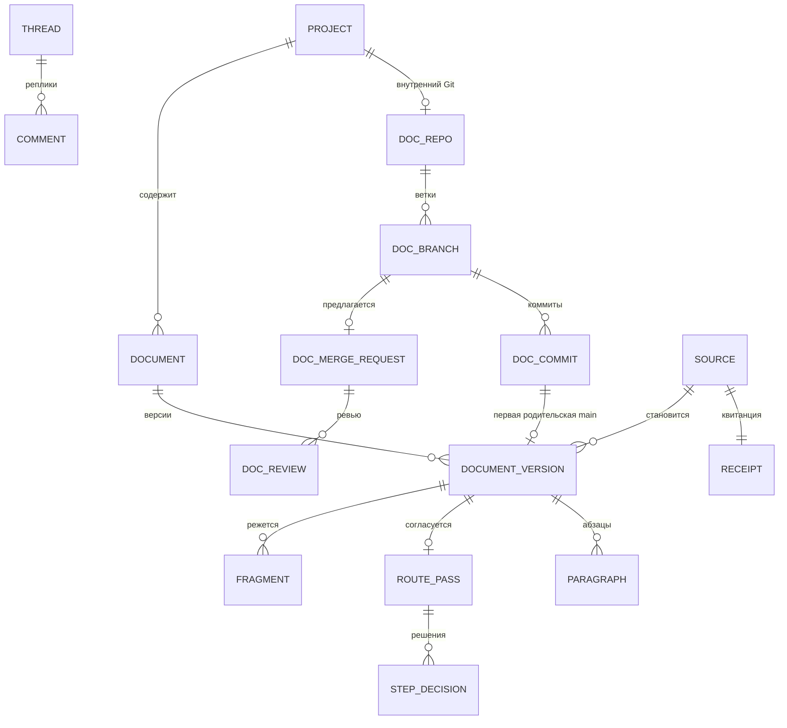
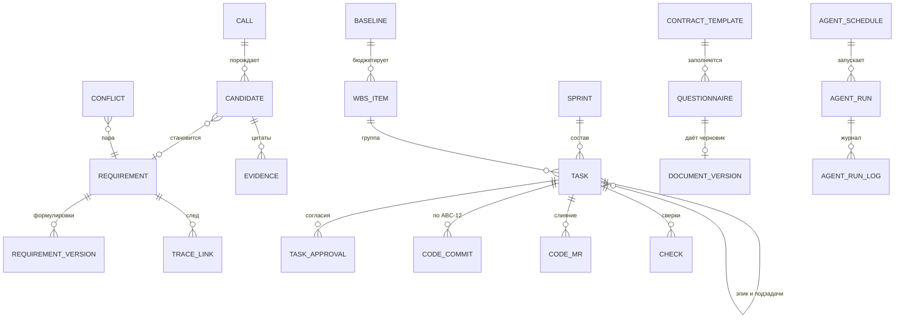
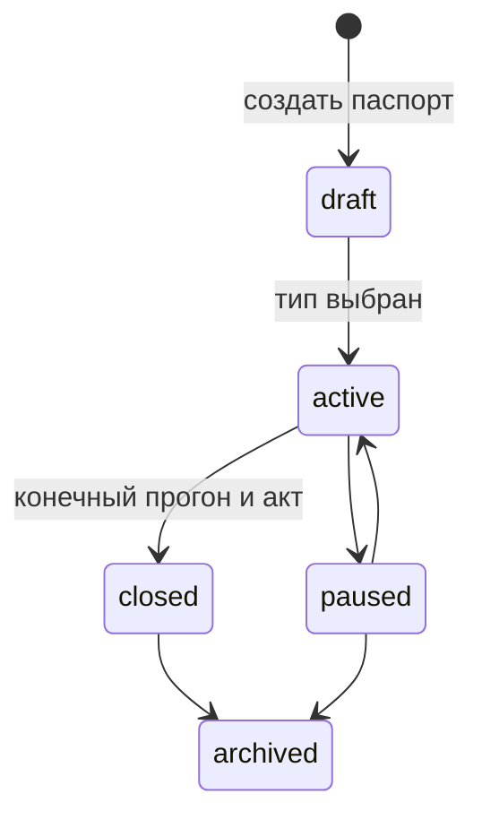
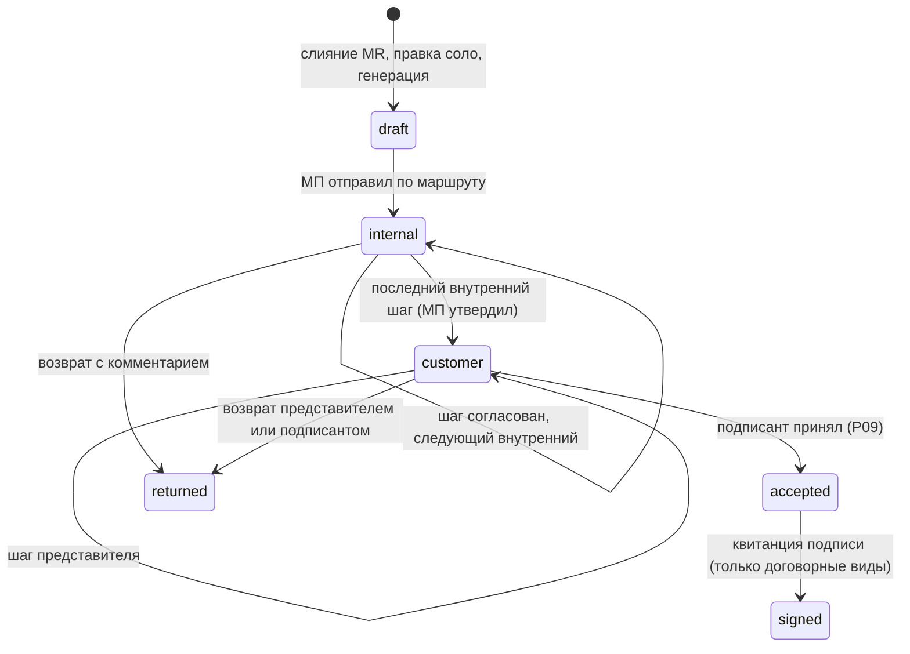
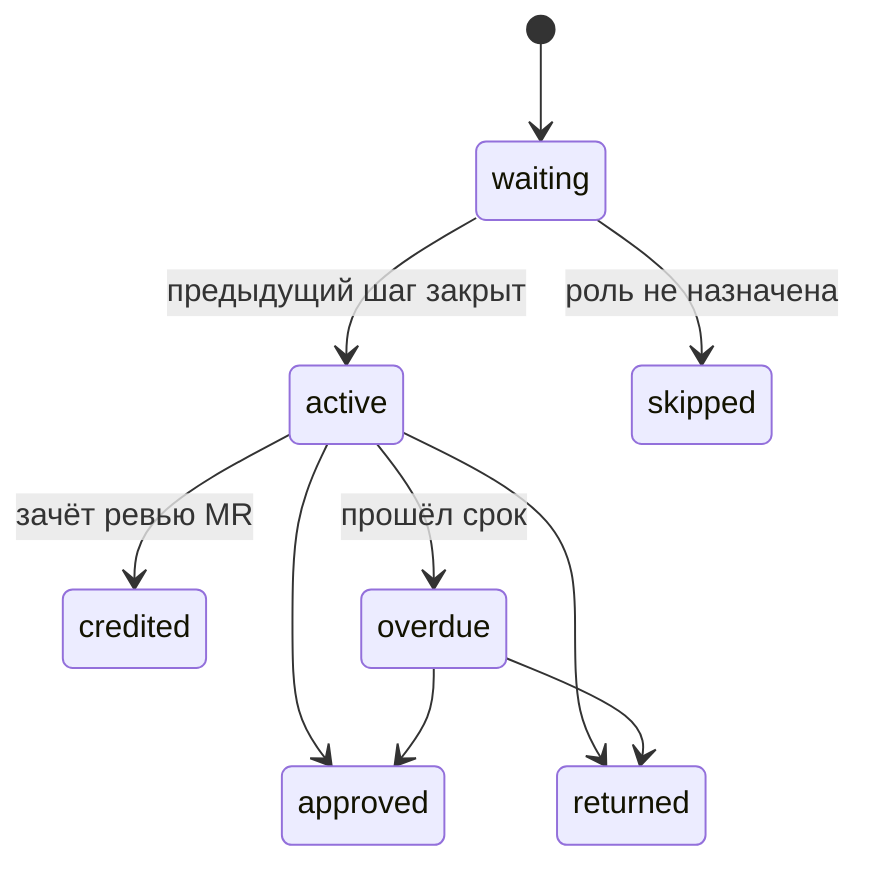
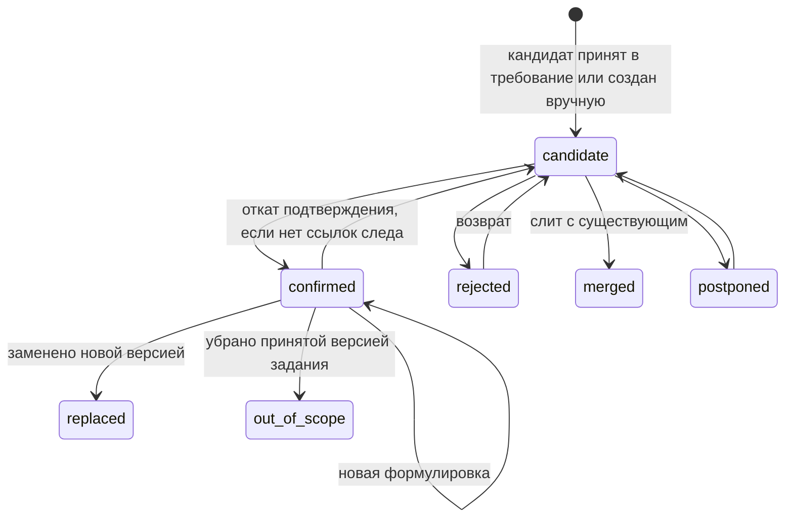
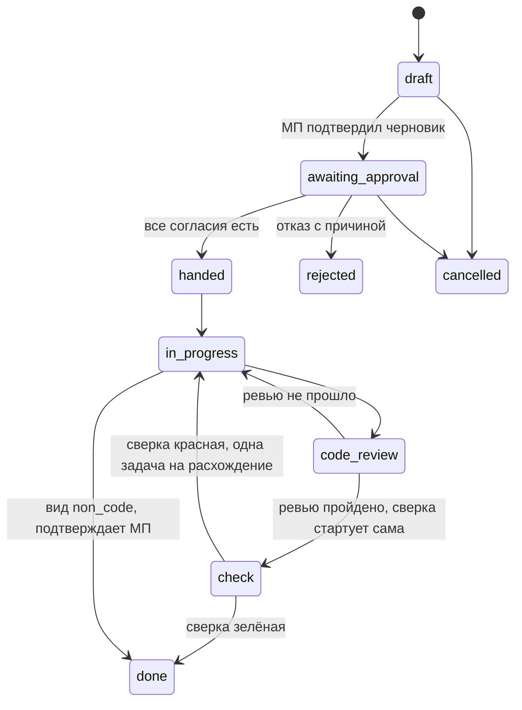
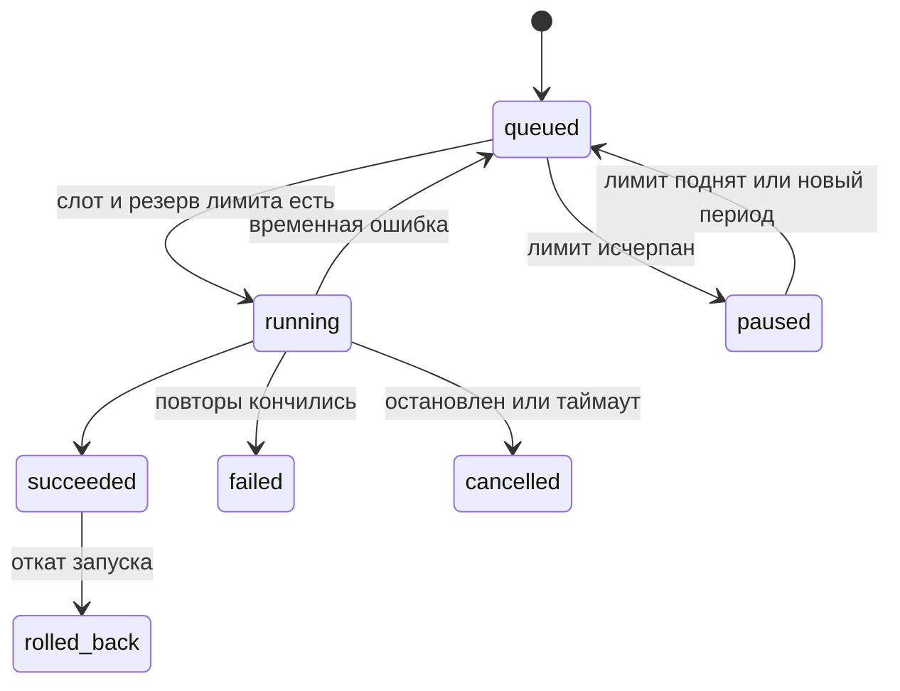
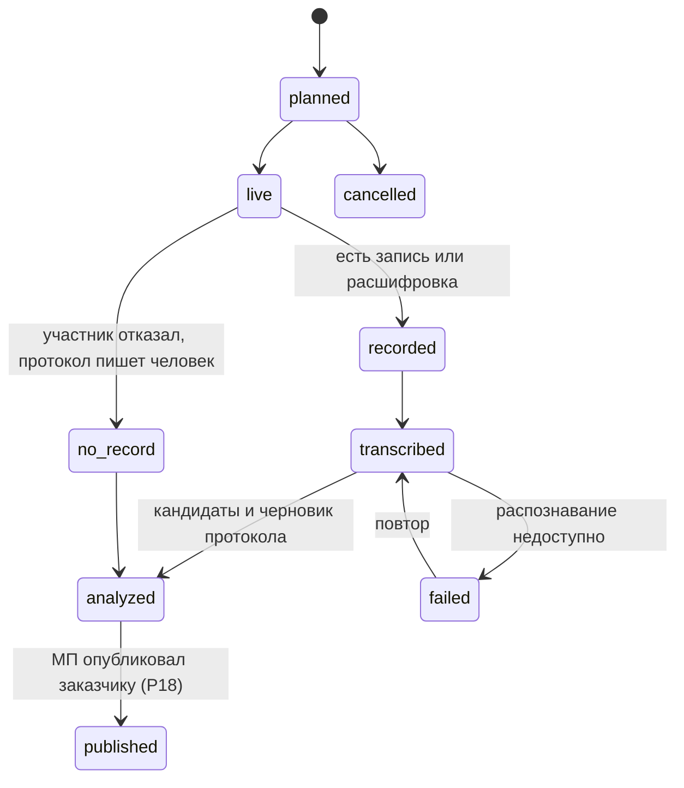
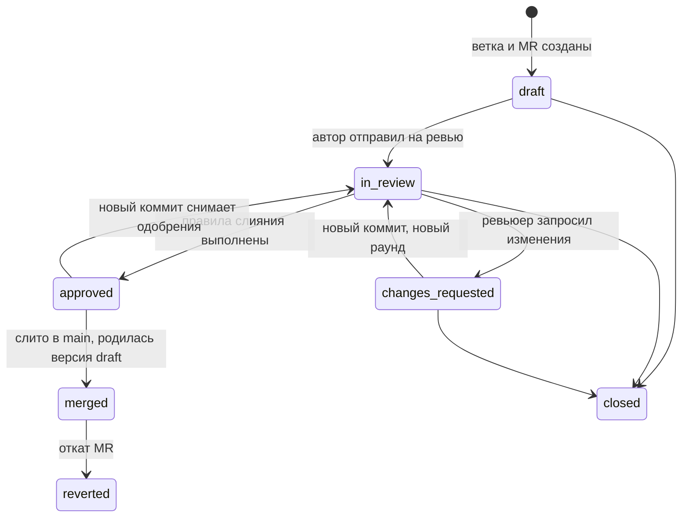

# Доменная модель, состояния и API проектного офиса

Документ для разработчиков, без кода. Источники: `spec.md`, `interfaces.md`, `manifest.md` (с A10-A15), `HANDOFF.md`, код `src/office/` и `src/claude/session.py`. Обязательная основа: `05-sverka-superarhitektora.md` §3, при расхождении верен он. «Ист. 19» это история `spec.md`; R, G, A, P, D строки манифеста; «05 п. 28» строка расхождений файла 05.

Соглашения:

- 15 модулей (`ops` добавлен Дополнение 2026-10-23, A41-A45: A43, 17, ADR-73, 05 §9.2) и их зависимости по графу 05 §3.1 и 00 §3.3: зависимость только вниз, вверх только события `core.emit` и задания `core`; все зовут `core` и `tenancy`. `agents` стоит над доменом: второй вход с правами назначившего (05 п. 2).
- У каждой таблицы один модуль-писатель; чужие таблицы читаются только через публичные операции. Полный список в разделе 2.0.
- Таблицы `office_*` в той же SQLite, что у чатов. Общие поля опущены: `id int PK`, `created_at ts`, `created_by ref(User)|null`, у проектных ещё `project_id`.
- Типы: `int`, `text`, `real`, `bool`, `ts` (ISO 8601, UTC), `json`, `enum(...)`, `ref(X)`, `sha`, `money` (целое в копейках и код валюты).
- Статусы английскими кодами по 05 §3.4, в интерфейсе русские слова. Операции в `snake_case` (05 §3.7).
- Срезы A-H как в `plan.md`; отложенное D01-D06 в модели есть местом, но не строится.

## 1. Словарь домена

| Термин | Сущность в коде | Определение |
|---|---|---|
| Компания | `Company` | Организация-исполнитель: владелец пользователей, проектов, ключей, настроек. В первом выпуске одна на установку, `company_id` в схеме есть |
| Подразделение | `Department` | Часть компании (по умолчанию один уровень); к нему привязаны проекты, ключи, шаги маршрутов |
| Роль платформы | `Role` | Один из 12 ключей участия (2.2) |
| Участник проекта | `Membership` | Пользователь с одной ролью в проекте; ролей может быть несколько, но одной стороны |
| Рабочее место | `Workplace` | Заказчик, команда или наблюдатель; выводится из ролей |
| Администратор системы | `users.is_admin` | Флаг учётки: все проекты и настройки; действие вместо роли пишется в аудит (G45) |
| Админ компании | `CompanyUser.is_company_admin` | Настраивает маршруты, видимость, ключи, лимиты, режим записи, включает скилы |
| Профиль видимости | `VisibilityProfile` | Семейства документов и статусы версий, открытые роли заказчика (G46) |
| Проект и паспорт | `Project` | Заказ; паспорт это его поля: название, вид работ, характер, тип, методика, подразделение, префикс тикетов |
| Документ | `Document` | Объект с историей версий; вид `семейство[:ключ]`, например `spec`, `call:17` |
| Редактируемый документ | `Document.editable=1` | Документ, который правят люди и агенты; файл в репозитории документации (05 §3.3) |
| Источник и квитанция | `Source`, `Receipt` | Внешний вход (письмо, чат, созвон, файл, коммит кода), ставший версией Markdown и не правящийся; квитанция это его неизменяемая копия с отпечатком |
| Версия документа | `DocumentVersion` | Текст документа с номером N; у редактируемого это коммит первой родительской цепочки `main` плюс строка в базе (05 §3.2) |
| Две копии текста | `blob_sha`, `content_sha` | Текст версии хранится блобом Git и колонкой `markdown`; копии равны и связаны отпечатками. Номер и статус только в базе |
| Абзац и линия | `Paragraph`, `lineage` | Кусок версии с id `p-<sha1[:12]>-<n>`; линия это id первого появления абзаца, переносится через правки |
| Репозиторий документации | `DocRepo` | Внутренний голый Git проекта только для документов, без сервера, клона, push и зеркала (A10, A14, A15) |
| Журнал намерений | `office_git_intents` | Двухфазная запись Git и базы: объекты Git, намерение `pending`, `update-ref` со старым значением, транзакция базы с `applied` (05 §3.2 п. 3) |
| Merge request документа | `DocMergeRequest` | Запрос на слияние ветки в `main` с ревью разных авторов (A11), номер `!12` |
| Ревью | `DocReview` | Вердикт по голове MR: одобрить, запросить изменения, комментарий; у агента это проверка, не одобрение |
| Откат | `restore_version`, `revert_doc_mr` | Новый коммит с текстом версии K или обратный коммит MR; история не переписывается (A12) |
| Подключение к репозиторию кода | `CodeRepoConnection` | Интеграция с внешним GitLab или GitHub; своего Git для кода нет (A14) |
| Фрагмент | `Fragment` | Единица поиска с автором, стороной, позицией и допуском (01) |
| Граф Doublefy и ядро | `GraphNode`, `GraphEdge` | Узлы и рёбра (`accepted`, `proposed`, `future`, `broken`, `rejected`); ядро это краткое содержание версии из её текста |
| Интерактивный артефакт | реестр `IA-N` | Экран над уже хранимыми связями. Первый принятый вид: паспорт функции (A105, `39`) |
| Функция | `Function` | Именованное поведение продукта, ключ `FN-N`. Пример: «Рейтинг авторов». Паспорт читает требования и проверки на выбранный день |
| Требование | `Requirement` | Объект с ключом `REQ-012`, не зависящим от версии и позиции |
| Кандидат | `Candidate` | Предложение модели с дословной цитатой: требование, решение, замечание, вопрос, обещание, правка задачи, риск, пункт ролевой модели |
| Цитата | формат 05 §3.10 | `document_id`, `version_id`, `commit_sha`, `paragraph_id`, `lineage`, `start`, `end`, `quote`, у реплик `t_from`, `t_to`; проверка одна, `knowledge.verify_quote` |
| Противоречие и дубль | `Conflict`, `DuplicatePair` | Пара цитат двух подтверждённых требований или «выпало из задания»; пара дублей «тот же» или «разные» |
| Ссылка следа | `TraceLink` | Связь требования с абзацем, задачей, коммитом, сценарием, руководством, договором |
| Матрица следа | `TraceMatrix` | Вычисляемая таблица «требование × колонки» с цветами; не хранится |
| Маршрут согласования | `Route` | Упорядоченные шаги для семейства: внутренние, затем заказные |
| Шаг и прохождение | `RouteStep`, `RoutePass` | Шаг: роль или подразделение, действие, видимость заказчику, срок. Прохождение: маршрут одной версии |
| Принятие версии | `accept_spec` | Решение подписанта: `accepted` и метка `accepted/<doc>/v<N>` (P09; не юридическая подпись) |
| Обсуждение и комментарий | `Thread`, `Comment` | Ветка реплик у абзаца, задачи, требования, созвона, MR; комментарий переживает новую версию |
| Задача (тикет) | `Task` | Работа `ABC-12`; одна на принятое требование или пару «кто и что делает»; бывает эпиком и подзадачей |
| Бэклог и приоритет | `Task.rank`, `Task.priority` | Упорядоченные задачи вне спринта; приоритет из четырёх значений |
| Спринт | `Sprint` | Отрезок Scrum с целью, датами и составом задач |
| Риск | `Risk` | Запись реестра с порогом по метрике каталога |
| Решение и обещание | `Decision`, `Promise` | Принятое решение и «кто что сделает к сроку», оба с цитатой |
| Созвон и протокол | `Call`, `protocol:<id>` | Встреча во внешней видеосвязи (`customer`, `demo`, `standup`); протокол из решений, вопросов, обещаний |
| Пункт ролевой модели | `RoleModelItem` | «Кто, что может, чего не может» продукта заказчика; рождается предложенным (P15) |
| Макет | `Mockup` | Файл или ссылка Figma, результат Pen.dev; утверждается заказчиком |
| Сценарий и прогон | `TestScenario`, `TestRun` | Шаги проверки требования; прогон пула сценариев, в том числе конечный |
| Сверка | `Check` | Приёмка по задаче: шаг требования, макет, ролевая модель; красная держит задачу |
| Дерево работ и база | `WbsItem`, `Baseline` | Элемент дерева это группа задач с оценкой; база это принятые бюджет и вехи |
| Договорной документ | `contract`, `addendum`, `act` | Семейства с версиями, маршрутом и статусом `signed` |
| Шаблон и анкета | `ContractTemplate`, `Questionnaire` | Шаблон компании и анкета, заполненная из паспорта, задания и базы (ист. 60) |
| Метрика и снимок | `Metric`, `MetricSnapshot` | Пункт фиксированного каталога здоровья и его значение на момент (P13) |
| Запуск и расписание агента | `AgentRun`, `AgentSchedule` | Исполнение по назначению, событию или расписанию с журналом; расписание по cron на серверном времени (P19) |
| Скил | `Skill` | Текст инструкции агента с условиями срабатывания и версиями (P12) |
| Подключение | `BridgeConnection` | Адаптер внешней системы со статусом от `draft` до `off` |
| Секрет | `Credential` | Ключ модели, токен бота, секрет вебхука, учётка стенда; значение не отдаётся |
| Событие и аудит | `office_events`, `office_audit` | События для доставки; аудит отдельно, с цепочкой отпечатков и чтениями |

## 2. Сущности и связи

### 2.0 Единый реестр таблиц

Один реестр на комплект; имена ядра как в 01 §3.4, агентов как в 02 §12.3, моста как в 04 §1.1. «Есть» значит построено в срезе A.

| Таблица | Писатель | Ключ и уникальность | Срез |
|---|---|---|---|
| `office_events`, `office_audit`, `office_jobs`, `office_schema_version` | `core` | `seq`; цепочка отпечатков у аудита; одна очередь; номер миграции | B |
| `office_companies`, `office_departments`, `office_company_users`, `office_customer_orgs` | `tenancy` | `(company_id, user_id)`; `(company_id, name)` | B |
| `office_visibility_profiles`, `office_recording_policies` | `tenancy` | `(company_id, role)`; `company_id` | B |
| `office_credentials`, `office_model_routes`, `office_limits` | `tenancy` | `(scope, scope_id, kind, name)`; `(scope, scope_id, task_class)` | B |
| `office_usage`, `office_usage_reservations` | `routing` | `request_key` уникален | B |
| `office_documents`, `office_document_versions`, `office_paragraphs` (есть) | `knowledge` | `(project_id, kind)`; `(document_id, number)`; `version_id` | A |
| `office_doc_repos`, `office_doc_branches`, `office_doc_commits`, `office_git_intents` | `knowledge` | `project_id`; `(doc_repo_id, name)`; `(doc_repo_id, sha)`; `id` | B |
| `office_sources`, `office_receipts` | `knowledge` | `(project_id, family, external_key)`; `source_id` | C |
| `office_fragments`, `office_fragments_fts`, `office_vectors` (строка на фрагмент), `office_embedding_cache` (вектор на `(model_tag, text_hash)`), `office_nodes`, `office_edges`, `office_index_epoch`, `office_search_log`, `office_feedback`, `office_gold` | `knowledge` | по 01 §3.4 | C |
| `office_bridge_connections`, `office_bridge_links`, `office_bridge_outbox`, `office_bridge_cursor` | `bridge` | `(scope, scope_id, system)`; `(connection_id, local_type, local_id)` | первый выпуск: трекер (A16) |
| `office_projects` (есть), `office_memberships`, `office_type_changes` | `project` | `(created_by, create_key)`; `(project_id, user_id, role)` | A, B |
| `office_requirements`, `office_requirement_versions`, `office_candidates`, `office_evidence`, `office_conflicts`, `office_duplicate_pairs`, `office_trace_links` | `cycle` | `(project_id, key)`; `(project_id, dedup_key)`; `(project_id, pair_key, kind)` | A (минимум), C |
| `office_routes`, `office_route_passes`, `office_step_decisions` | `cycle` | `(company_id, project_id, family, revision)`; `version_id` | B |
| `office_doc_merge_requests`, `office_doc_reviews` | `cycle` | `(doc_repo_id, number)`; `(mr_id, reviewer_id, round)` | B |
| `office_threads`, `office_comments`, `office_publications` | `cycle` | `(target_type, target_ref)` | B |
| `office_tasks`, `office_task_approvals`, `office_task_links`, `office_sprints`, `office_risks`, `office_decisions`, `office_promises`, `office_role_model_items` | `cycle` | `(project_id, number)`; `(task_id, role)`; `(project_id, n)` у спринта | C, D, E |
| `office_wbs_items`, `office_estimates`, `office_baselines` | `plan` | `(wbs_item_id, task_id, estimator_id, round)`; `(project_id, n)` у базы | F (05 §6) |
| `office_contract_templates`, `office_questionnaires` | `contracts` | `(company_id, family, revision)` | G |
| `office_code_repo_connections`, `office_code_commits`, `office_code_mrs`, `office_mockups`, `office_test_scenarios`, `office_test_runs`, `office_checks` | `delivery` | `(connection_id, sha)`; `(connection_id, external_id)`; `(task_id, attempt)` | E |
| `office_mailbox_connections` | `channels` | `(provider, address)` | первый выпуск (A16) |
| `office_calls`, `office_meetings`, `office_notifications`, `office_notification_prefs` | `channels` | | D, F |
| `office_dashboards`, `office_metric_snapshots` | `insight` | `(scope, scope_id, metric, period_start)` | H |
| `office_agent_runs`, `office_agent_run_log`, `office_agent_drafts`, `office_agent_schedules`, `office_skills`, `office_skill_versions`, `office_skill_enablements`, `office_solutions` | `agents` | `request_key` у запуска; `(skill_id, n)` | E, H |

Дополнение 2026-10-23: таблицы разделов 09-12 (история задач, пакеты нарезки, изменения скоупа, виды, доски, подписки, ставки, факт затрат, раунды оценок, план дня, мастер, находки, рендеры ролика, встречи с участниками и переопределениями, участники и дорожки созвонов, привязки мессенджеров, поставщики и цены моделей, исходы и оценки маршрутов, межпроектные связи, сопоставления трекера) с писателями и срезами сведены в 05 §6.3; при расхождении верен он.

Дополнение 2026-10-23, вечер: таблицы разделов 13-15 (`office_assistant_threads`, `office_assistant_messages`, `office_assistant_actions`, `office_uploads`, `office_reports`, `office_report_revisions`, `office_report_grants`, `office_report_exports`, `office_role_permissions`, `office_api_tokens`, `office_trace_link_history`, `office_chain_gaps`, `office_chain_gap_items`, `office_timeline_items`, `office_day_plan_candidates`, `office_day_plan_prefs`, `office_channel_inbox`, `office_ui_layouts`) с писателями и срезами сведены в 05 §7.2; при расхождении верен он.

Дополнение 2026-10-23, A41-A45: таблицы разделов 17-18 (`office_ops_*` шестнадцать таблиц и `telemetry.db` у `ops`; `office_heartbeats` у `core`; `office_project_chats`, `office_chat_participants`, `office_chat_messages`, `office_chat_requests` у `channels`; `office_chat_digests`, `office_chat_reply_drafts` у `agents`; `office_reply_templates` у `tenancy`), новые поля (`office_credentials.kind` плюс `ssh_private_key`, `ci_trigger_token`, `registry_credential`, `deploy_secret`; `office_candidates.payload.origin`, `office_decisions.origin`, `office_promises.origin`, `task_id`, `chat_request_id`; `office_trace_links.target_type` плюс `architecture_paragraph`, `anchor_role` плюс `models`; вид задачи плюс `ops`; `office_projects.settings.chat_style`, `chat_thresholds`; адрес стенда уходит в `office_ops_environments` при миграции `ops_environments`) и вид документа `architecture:db-<слаг>` сведены в 05 §9.2; при расхождении верен он. Операции только человека: `channels.send_chat_message` (через `agents.send_chat_reply_draft` по нажатию отправителя), `ops.request_deploy` и `approve_deploy` для `protected` окружений, `ops.open_terminal`; `cycle.propose_candidates(project, kind, items[])` обобщает `propose_requirements` на виды 2.7.

Не создаются или уходят: `office_members` (заменена), `office_index_jobs` (очередь одна, `office_jobs`), `office_doc_changes`, `office_comments_anchor`, `office_bridge_secrets` (секреты в `office_credentials`), `office_requirement_evidence` (имя `office_evidence`), колонка `mirror_url`.

Дополнение 2026-10-26 (сверка 24, `24-sverka-superarhitektora-pmbok.md`): таблицы разделов 21-23 с писателями и срезами. Направление зависимостей 05 §3.1 соблюдено: `knowledge` не читает `cycle` и `plan`, последние номера их объектов ему сообщают сверху вызовом `knowledge.note_input_head`; `cycle` не пишет в таблицы `agents`.

| Таблица | Писатель | Ключ и уникальность | Срез |
|---|---|---|---|
| `office_artifact_templates`, `office_artifact_presets` | `knowledge` | `(company_id, kind, name, version)`; `(company_id, name)` | B |
| `office_artifact_inputs`, `office_artifact_input_heads`, `office_doc_sets` | `knowledge` | `(version_id, input_kind, input_ref, section_key)`; `(project_id, input_kind, input_ref)`; `(project_id, n)` | B |
| `office_brief_submissions`, `office_vision_checks` | `cycle` | только добавление; `version_id` плюс `run_id` | B |
| `office_stakeholders`, `office_assumptions`, `office_issues`, `office_lessons`, `office_vendors`, `office_register_history` | `cycle` | `(project_id, key)` с префиксами `STK`, `ASM`, `ISS`, `LSN`, `VND`; история только добавление | C (`office_vendors` G) |
| `office_actualizations` | `cycle` | `(project_id, doc, version, step)` | C |
| `office_gantt_settings` (было `office_schedule_settings`), `office_gantt_ops` | `plan` | `project_id`; только добавление по `calc_epoch` | F |
| `office_elicitation_sessions`, `office_elicitation_turns` | `agents` | `(session_id, n)` у хода | B (тексты скилов из поставляемого набора до таска 32) |

Не создаётся: `office_brief_questions` (заменена `office_elicitation_turns`), `office_report_schedules` (ссылка `22` первой редакции на несуществующую таблицу; периодичность статуса заказчику настройкой проекта, `22` §2.3). Новые поля чужих таблиц: `office_decisions.typical bool` (`cycle`), `office_solutions.kind` плюс `project_case` и поля карточки опыта (`agents`, `23` §4.1).

Дополнение 2026-10-26 (сверка 27): таблицы разделов 25 и 26 и поля сверки 27. Один писатель у каждой проверен; направление вызовов вниз (`cycle.record_deliverable_check` и `cycle.record_research_result` зовёт `agents` сверху).

| Таблицы | Писатель | Ключ, примечание | Срез |
|---|---|---|---|
| `office_notification_user_settings`, `office_notification_policies`, `office_reminders`; правки `office_notifications`, `office_notification_prefs`, `office_project_chats.kind` плюс `management` | `channels` | `25` §10.1; текста уведомления в базе нет | F |
| `office_artifact_reviews`, `office_review_items`, `office_review_requests`, `office_review_assignments`; правка `office_comments` (`review_request_id`, `review_item_id`) | `cycle` | `25` §10.1; ключ ревью `(subject_type, subject_ref)` | C2 |
| `office_context_packs`, `office_research_runs`, `office_research_answers` | `agents` | `25` §10.1; пакет только добавление | E (E2 предложен) |
| `office_fact_packs`, `office_adoption_daily`, `office_adoption_sources` | `insight` | `26` §6.1 | G3 |
| `office_deliverable_runs`, `office_prompt_overlays`, `office_deliverable_subscriptions` | `agents` | `26` §6.1 | G3 |
| `office_deliverable_checks`, `office_support_tickets`, `office_support_ticket_events`, `office_support_sla_policies`, `office_system_modules` | `cycle` | `26` §6.1 | G3 |
| `office_customer_org_units`; правка `office_model_prices.tier` | `tenancy` | `26` §4.3; `25` §10.1 | G3; E |

Новые поля сверки 27: `office_fragments.data_classes`, `office_fragments.scope_tags` и те же метаданные у vec0, `office_nodes`, `office_edges` (`knowledge`, `01` §7.3); `office_document_versions.data_classes` (`knowledge`, §2.5); `office_artifact_templates.audience enum(internal, management, customer, prospect)`, умолчание `internal` (`knowledge`; значение видов `26` в json `deliverable` не дублируется); `office_gantt_settings.editors json` (`plan`, `22` §6.4). Не вводится: `office_companies.settings.review.bulk_accept` (переключатель только клеткой `review/bulk_accept`, И-103).

Дополнение 2026-10-27 (сверка 32; `31` §8.1 с правками `32`). Новые таблицы и поля раздела 31 с единственным писателем:

| Таблица или поле | Писатель | Срез |
|---|---|---|
| `office_projects.space_kind`; поле настроек `preset_deviations` (операция `project.record_preset_deviation`); `office_project_goal_links` | `project` | C2; G2 |
| `office_document_versions.space_audience`; `office_artifact_templates.focus_area` (было `phase`), `required` у пункта набора; виды входа `pmo_profile`, `ai_policy`, `contract_stages` | `knowledge` | B2, C2 |
| `office_pmo_profiles`, `office_ai_policy_profiles`, `office_strategic_goals`, `office_work_calendars`, `office_model_providers.node_power_kw` | `tenancy` | C2; G2; F |
| `office_gate_milestones` (ключ `MS-N`; пишет `cycle.register_milestone` по вызову `plan` и `contracts`), `office_contribution_records`, `office_benefits`, `office_benefit_measurements`, `office_procurements`, `office_procurement_offers`; поля `office_review_items.origin_kind`, `origin_run_id`; значение `unaware` у `office_stakeholders.attitude` | `cycle` | C2; E2; G |
| `office_contract_stages` | `contracts` | G |
| `office_model_evals.suite`, `office_model_class_gates` | `routing` | B3; C2 |
| `office_portfolio_cycles`, `office_portfolio_scores`, `office_portfolio_scenarios`, `office_portfolio_decisions`, `office_role_capacity`, `office_maturity_campaigns`, `office_maturity_answers`, `office_maturity_results`; у `office_dashboards` поле `scope_id`, значение `source = widgets`, `spec_version = 2` (таблица строится в G2, а не в H) | `insight` | G2 |

Переход проекта `draft → active` при флаге профиля `start_requires_decision` идёт только операцией `project.approve_start(project, decision_ref)` по клетке `project/approve_start`; `POST /projects/{pid}/status` без неё даёт 409 `start_decision_required` (§3.1; флаг доступен с таска 149).

### 2.1 Диаграммы сущностей

Связи организации и проекта видны в реестре 2.0 и в 2.2-2.4; ниже документы, след и поставка.

### 2.2 Роли

12 ролей участия и флаг администратора (05 §3.5). Тимлид и технический лид вводятся в срезе B: пресейл-маршрут задания с ними нужен в B (05 п. 52). `system_admin` из `tenancy.ROLES` убирается: администратор системы это только `users.is_admin`. Руководитель подразделения и директор это `observer` с областью `department` или `company` (`office_company_users.portfolio_scope`).

| Ключ | Роль | Сторона | Рабочее место | На маленьком |
|---|---|---|---|---|
| `project_manager` | Менеджер проекта | исполнитель | команда | обязателен |
| `business_analyst`, `system_analyst` | Бизнес- и системный аналитик | исполнитель | команда | нет |
| `architect` | Архитектор (он же системный архитектор) | исполнитель | команда | нет |
| `developer`, `tester` | Разработчик, тестировщик | исполнитель | команда | нет |
| `team_lead`, `tech_lead` | Тимлид, технический лид | исполнитель | команда | нет |
| `pmo_head` | Руководитель проектного офиса | исполнитель | команда и наблюдатель | нет |
| `observer` | Наблюдатель (проект, подразделение, компания) | исполнитель | наблюдатель | нет |
| `customer_representative`, `customer_signatory` | Представитель, подписант | заказчик | заказчик | нет |

Роли двух сторон в одном проекте запрещены (И-04). Заказчику закрыты чат, файлы, терминал, ключи и MCP-настройки текущей панели.

### 2.3 `core`, `tenancy`, `routing`

- `office_events`: `seq`, `name`, `project_id?`, `actor_id?`, `actor_kind enum(user, admin_as_role, agent, system)`, `payload json`, `audience enum(team, customer, admin)`; пишется в транзакции изменения; это доставка.
- `office_audit`: `seq`, `actor_id`, `action`, `object`, `read bool` (чтения тоже), `prev_hash`, `hash`; отдельно от событий (05 п. 11).
- `office_jobs`: одна очередь заданий (`kind`, `payload`, `state enum(queued, running, done, failed)`, `attempts`, `run_after`). Этапы приёма живут в `office_sources.status`, запуски агентов в `office_agent_runs`.

**Сотрудник компании** `office_company_users`, PK `(company_id, user_id)`: `side enum(executor, customer)`, `department_id` (у исполнителя, одно), `customer_org_id` (у заказчика), `is_company_admin bool`, `portfolio_scope enum(none, department, company)`.

Компания: `name`, `size_class enum(small, medium, large)`, `settings json` (`crossProjectLinks=false` по P04, пороги здоровья, поставщик эмбеддингов; сроков хранения нет, A20). Подразделение: `company_id`, `parent_id?`, `name`, `head_user_id?`. Организация заказчика: `company_id`, `name`, `requisites_ref?` (реквизиты и данные подписанта ссылкой вне текста Git, 06 К11). Профиль видимости: `rules json [{family, statuses[], fields_hidden[]}]`. Политика записи: `mode enum(consent_each, notice, text_only)`, умолчание `text_only` до юриста (P03), голосовые отпечатки не хранятся.

**Секрет** `office_credentials` (05 п. 58), писатель `tenancy`: `scope enum(company, department, project, user)` (секрет `user`, например OAuth личного ящика, читают только владелец и адаптер его ящика, 05 Н10), `scope_id`, `kind enum(model_api_key, git_bot_token, webhook_secret, stand_account, connector_secret)`, `name`, `secret_ref` (ссылка на значение, зашифрованное `SecretBox` с `CONNECTIONS_SECRET_KEY`; мастер-ключ генерирует установщик; значение API и журнал не видят). Ключ модели ищется по цепочке проект → подразделение → компания (P02).

Строка моделей `office_model_routes`: `scope`, `scope_id`, `task_class enum(draft_text, extract, check, doc_review, code, browser_check, search_answer)` (05 п. 64; эмбеддинги вне строк), `model`, `effort enum(low, medium, high)`. Умолчание: черновик быстрой моделью с низким усилием, сверка и код сильной с высоким (ист. 13). Лимит `office_limits`: `scope`, `scope_id`, `period enum(day, month)`, `tokens?`, `money?`, `share_scheduler` (P19), `share_customer` (10%, 05 §4).

`routing` пишет резерв `office_usage_reservations` (`request_key`, `limit_id`, `max_tokens`, `state enum(held, settled, released)`) и расход `office_usage` (только добавление: `limit_id`, `run_id?`, `user_id?`, `model`, `input_tokens`, `output_tokens`, `cost`, `request_key` уникален). Модель зовут только через `routing.call` после `reserve`.

Дополнение 2026-10-27 (проверка ИБ 29, УИБ29-56, -58, -88). (1) Облачный ключ модели только уровня `scope = company` и только после действующего включения облака двумя (`28` §4.1); запись без включения даёт 409 `cloud_not_confirmed`; цепочка проект, подразделение, компания остаётся для локальных маршрутов. (2) `office_audit` только добавляется: удаления и правки нет ни у кого, включая АдмП; голова цепочки отпечатков подписывается хранителем ключей не реже раза в час (калибровка, не цель) и при облачном вызове и раскрытии `identity`, отпечаток уходит на хранилище копий «только запись» и ОПД; проба таска 120 сверяет непрерывность и даёт событие `audit.chain_broken` (И-134, таск 141). (3) В аудите и журналах пишутся метки и ссылки, а не значения ПД и не параметры инструментов целиком.

### 2.4 `project`

**Проект и паспорт** `office_projects` (есть), уникально `(created_by, create_key)`.

| Поле | Тип | Обяз. | Смысл |
|---|---|---|---|
| name, description | text | да, нет | Есть |
| work_kind | enum(site, web_platform, mobile_app) | да | Есть (ист. 1) |
| nature | enum(custom, product) | да | Есть |
| project_type | enum('', small, large) | да | Есть; `''` до выбора человека |
| status | enum(draft, active, paused, closed, archived) | да | Есть `draft`, `active`; остальное новое (3.1) |
| create_key | text | нет | Есть, ключ повтора |
| company_id, department_id, customer_org_id | ref | да, да, нет | Новое; подразделение по умолчанию у менеджера |
| methodology | enum(scrum, kanban) | да | Новое (ист. 9) |
| ticket_prefix | text `^[A-Z]{2,6}$` | да | Новое, уникально в компании (P22) |
| settings | json | да | Пороги рисков, длина спринта; адрес стенда и учётки ролей только ссылками на `office_credentials` (P01) |

**Участник** `office_memberships`, PK `(project_id, user_id, role)`: `added_by`, `added_at`, `removed_at?` (исключение сразу закрывает доступ, фрагменты остаются), `visibility_profile_id?` (у ролей заказчика). **Смена типа** `office_type_changes`: `from_type`, `to_type`, `status enum(pending, approved, rejected)`, `decided_by` (P10). Запрет смены типа читает `knowledge.has_version(project, 'spec', 'accepted')`, не `cycle` (05 п. 5).

### 2.5 `knowledge`: документы, версии, источники

**Документ** `office_documents` (есть), уникально `(project_id, kind)`: `kind` (есть), новое `family` (часть до двоеточия), `editable bool`, `title`, `repo_path`. Путь файла по 05 §3.3: вид `f` → `f.md`, вид `f:k` → `f/k.md`, без префикса `docs/`. `editable=1` у `brief`, `spec`, `guide`, `role_model`, `as_built`, `architecture`, `page:*`, `protocol:*`, `contract:*`, `addendum:*`, `act:*`, `gost34:*`, `gost19:*`, `presentation:*`. Вне Git: `letter`, `chat`, `call`, `meeting`, `demo`, `file`, `commit`, `code_mr`, `ticket`, `comment`, `scheduler`, `mockup`.

**Версия** `office_document_versions` (есть), уникально `(document_id, number)`. Писатель `knowledge`; статус меняет только `cycle` через `knowledge.set_version_status`.

| Поле | Тип | Обяз. | Смысл |
|---|---|---|---|
| number | int | да | Есть; `max+1` при слиянии или прямой записи, номера у заказчика могут идти с пропусками |
| status | enum(draft, internal, customer, accepted, returned, signed) | да | Есть `draft`, `accepted`; остальное новое (3.2); `signed` только у договорных |
| source | text | да | Есть: «текст», имя файла, `merge`, `restore`, `revert`, `scheduler` |
| markdown | text | да | Есть; первая копия текста |
| content_sha | sha | да | Новое: отпечаток `markdown` |
| blob_sha | sha | для editable | Новое: блоб Git, вторая равная копия |
| commit_sha | sha | для editable | Новое: коммит первой родительской цепочки `main` |
| merge_request_id | ref(DocMergeRequest) | нет | Новое |
| origin | enum(human, agent, scheduler, import, system) | да | Новое: «черновик агента» видит только команда (ист. 30, 46) |
| run_id | ref(AgentRun) | нет | Новое, для отката запуска |
| accepted_at, accepted_by | ts, ref(User) | нет | Новое |

**Абзацы** `office_paragraphs` (есть): `version_id PK`, `paragraphs json [{id, kind, lineage, text, clause_no?, req_keys[]}]`, `kind enum(p, row, item)`: строка таблицы и пункт списка это отдельные единицы (05 Н8). `lineage` по 05 §3.10, `clause_no` у договоров, `req_keys` из маркеров `<!-- req:REQ-012 -->`.

**Источник** `office_sources` по 01 §3.4, уникально `(project_id, family, external_key)`: `family` (`letter`, `chat`, `call`, `meeting`, `file`, `demo`, `commit`, `code_mr`, `ticket` (только своя задача, `ticket:<ABC-12>`; внешний тикет зарезервирован как `tracker:<system>:<key>`, не в первом выпуске, 05 Н3), `comment`, `scheduler`), `external_key` (ключ повтора канала), `title`, `author_user_id?`, `author_external?`, `side enum(customer, team, external)`, `authored_at`, `captured_at`, `captured_by`, `origin_url`, `consent_mode`, `consent_json`, `visibility enum(team, customer)`, `document_id`, `status enum(received, parsed, chunked, indexed, failed, quarantined, deleted)`, `error`, `attempts`. Коммит и MR кода из внешнего хоста приходят сюда как `commit:<sha>` и `code_mr:<id>` (05 п. 42). **Квитанция** `office_receipts`: `source_id`, `sha256`, `path`, `size`, `mime`; только добавление, срока жизни нет (A20). Фрагменты, индексы и граф описаны в 01.

Дополнение 2026-10-26 (сверка 27, С27-01, С27-06; И-86). **Реестр классов данных один** (писатель кода `tenancy`, проверка `tenancy.scope`, `tenancy.audience_scope`):

| Класс | Что | Кто видит |
|---|---|---|
| `team` | Обычное содержимое проекта | Команда по профилю |
| `customer` | Открытое заказчику профилем (`§4.2`) | Заказчик по профилю и вся команда |
| `budget` | Деньги: ставки, суммы, резервы, факт затрат; виды с `data_class = budget` | Клетка `plan.budget/view` (A22) |
| `internal_text` | Цитаты из `draft`, `internal`, внутренних обсуждений; ответы внешних MCP и коннекторов `live` | Команда; представителю заказчика закрыто (клетка `customer.internal/view_internal_marks`, A21) |
| `code` | Код, MR кода | Команда |
| `usage` | Расход моделей | МП, АдмК, АдмП |
| `personal` | Исполнители, тексты тикетов, данные сотрудников заказчика | По клетке раздела (`support/view_texts` и подобные) |
| `showcase` | Разрешённое к показу вне проекта (`26` §2.1) | Аудитория `prospect` и команда |
| `management_chat` | Содержимое чата с руководством компании (`25` §5) | Участники чата и `chats/view_management` |
| `direct_chat` | Содержимое личного чата МП с заказчиком (`40` §13) и всё извлечённое из него | МП-владелец. РПО читает ленту (Р40-20), участники заказчика читают ленту по участию |

`customer.internal` это раздел матрицы `13` §4.7, а не класс; в `22` §2.3 и `25` имя заменено на `internal_text`. Имя `management` остаётся видом чата (`18`) и аудиторией результата (`26`), классом не бывает.

`office_document_versions.data_classes` (новое поле, писатель `knowledge`): класс шаблона вида (`21` §3.2) ∪ классы фактов пакета результата (`26`) ∪ классы процитированных источников, считается при записи версии; фрагменты, ядро и узлы графа этой версии наследуют его (`01` §7.3, дополнение 27). Проверки при утверждении, слиянии, публикации, экспорте и отправке читают его через `tenancy` (И-101).

### 2.6 Репозиторий документации (A10-A12, A14, A15)

Решения 05 §3.2 и §3.3, здесь в форме данных.

- **Где.** `<данные>/office/git/<company>/<project>.git`, голый; каталог данных вне `PROJECTS_DIR` и `confine_root` чата, иначе чат читал бы документы мимо видимости (05 п. 14). Без сервера, клона, push, зеркала, вебхуков (A15). Код только во внешнем GitLab или GitHub через `office_code_repo_connections` (A14); общего у двух Git нет (И-33).
- **Чем.** git CLI за интерфейсом `DocRepo` в `knowledge`; версия git 2.38+ (`merge-tree` без рабочего дерева), иначе слияние во временном дереве (05 п. 15).
- **Канон.** Две равные копии текста: блоб и `markdown`, связаны `blob_sha` и `content_sha`. Номер и статус только в базе.
- **Версия.** Коммит первой родительской цепочки `main`, изменивший один файл, плюс строка версии. Слияние `--no-ff`, без squash и rebase; коммиты ветки, попавшие в `main` вторым родителем, версиями не являются (05 п. 20). Одна слитая правка = одна версия `draft`. Автосохранение ветки (сохранение или 5 минут тишины) версий не даёт.
- **Кто пишет в `main`.** Только слияние MR, прямая запись (`brief`, `page:*`, соло маленького типа: явное «сохранить» даёт версию, как построено в срезе A) и откат.
- **Ветки.** `edit/<doc>/<user_id>-<n>`, `agent/<run_id>/<doc>`, `call/<call_id>/<doc>`, `import/<upload_id>/<doc>`; `:` в `<doc>` заменяется на `/`. Закрытая ветка переезжает в `refs/closed/`, строка получает `abandoned`; ничего не удаляется. Обновление ветки только слиянием `main` в ветку (`/update-branch`).
- **Метка.** `accepted/<doc>/v<N>`, аннотированная, подписана ключом платформы; ставится только при принятии (не юридическая подпись, P09).
- **Автор и трейлеры.** Автор `user-<id>@office.invalid`, агент `agent-<run_id>@office.invalid` с `Co-Authored-By` назначившего. Трейлеры `Office-Document`, `Office-Version`, `Office-MR`, `Office-Run`, `Office-Actor`, `Office-Source`, `Req`, `Approved-by`; по ним восстанавливается индекс.
- **Агент.** Пишет только в `agent/<run>/<doc>` через временный клон в каталоге запуска; `knowledge.import_agent_commits` забирает коммиты с проверкой путей, автора и секретов. Агент не сливает, его вердикт ревью это проверка, не одобрение.
- **Запись (журнал намерений, 05 §3.2 п. 3, Н4).** Под файловой блокировкой `DocRepo`, только кодом `knowledge`: 1) объекты Git; 2) строка `office_git_intents` (`repo`, `ref`, `old_sha`, `new_sha`, `kind`, `payload` с данными будущей версии, `state enum(pending, applied, aborted)`) в состоянии `pending`; 3) `update-ref` со сравнением старого значения, отказ даёт `aborted` и 409 `stale_head`; 4) транзакция базы: версия, `main_head`, событие, `state=applied`. Проверка при старте до приёма запросов и раз в минуту: ссылка равна `new_sha`, значит дописать шаг 4; равна `old_sha`, значит `aborted`; иное, значит `aborted` и событие админу. Сборка мусора Git только в процессе заданий под той же блокировкой.
- **Сверщик.** Строка без коммита получает коммит из `markdown`; коммит без строки получает строку по трейлерам; при расхождении текстов верна копия, совпавшая с `content_sha`; админ получает событие. Ночной проход плюс проход после восстановления.

**Таблицы** (писатель `knowledge`, кроме MR и ревью):

| Таблица | Поля |
|---|---|
| `office_doc_repos` | `project_id` (уникально), `path`, `main_head` (равен коммиту последней версии любого документа проекта, 05 п. 37), `last_indexed_sha`, `merge_rules json` |
| `office_doc_branches` | `document_id`, `name`, `base_version_id`, `head_sha`, `author_id` (у агента назначивший), `run_id?`, `state enum(open, merged, abandoned)` |
| `office_doc_commits` | `branch_id`, `sha`, `parent_sha`, `author_id`, `message`, `blob_sha`, `content_sha`, `kind enum(edit, ai_edit, voice_edit, merge, restore, revert, import)`, `version_id?` (только на первой родительской `main`) |
| `office_git_intents` | `repo`, `ref`, `old_sha`, `new_sha`, `kind`, `payload`, `state enum(pending, applied, aborted)`: `pending → applied` после транзакции базы, `pending → aborted` при отказе `update-ref` или при проверке; конечные `applied`, `aborted` |
| `office_doc_merge_requests` (`cycle`) | `number`, `branch_id`, `document_id`, `title`, `description`, `state` (3.9), `base_version_id`, `head_sha`, `round`, `required_reviewers json`, `merged_version_id?`, `revert_version_id?`, `has_conflict`, `origin enum(human, agent, call, customer_import)` |
| `office_doc_reviews` (`cycle`) | `mr_id`, `reviewer_id`, `reviewer_kind enum(human, agent)`, `role`, `round`, `head_sha`, `verdict enum(approve, request_changes, comment)`, `body`; комментарии к строкам это `office_comments` с `target=doc_mr` |

**Правила слияния** (`merge_rules`, по семейству; задаёт админ компании, проект может ужесточить):

| Правило | Умолчание |
|---|---|
| Одобрения | одно одобрение человека не автора по текущей голове (`head_sha`, раунд) |
| Владельцы разделов | если правка задела раздел с меткой части и роль назначена: `business_analyst`, `system_analyst`, `architect`, `tech_lead` одобряют свою часть; если таких нет, одобряет менеджер (05 п. 26) |
| Новый коммит | снимает одобрения, раунд +1 |
| Актуальность | слияние только от текущей головы `main` или без конфликтов после `/update-branch` |
| Кто сливает | менеджер или владелец документа; агент никогда; автослияния документов нет (05 п. 27) |
| Соло | нет второго участника команды с правом правки семейства: менеджер пишет в `main` сам, в журнале `solo_merge` (G91) |

**MR и маршрут это два слоя.** MR решает, как правка попадает в `main` и становится версией `draft`; маршрут ведёт одну неизменяемую версию до `accepted`. Заказные шаги видят только версии, не ветки (G52); MR разных авторов собираются в `main` до маршрута (A11). На маршруте одна версия документа; `main` тем временем принимает новые слияния (N+1 в `draft`).

**Зачёт ревью** (05 п. 28). Внутренний шаг роли X для версии N засчитывается (`credited`), если каждый MR, слитый после последней версии этого документа, прошедшей шаг X, одобрен человеком роли X по своей финальной голове, и прямых записей в `main` между ними не было. Агент в зачёт не идёт. Заказные шаги и шаг менеджера «утвердить и отправить» (G107) без зачёта. Включён по умолчанию, выключается в шаге (`count_mr_review=false`).

**Откат** (A12, 05 п. 32), всегда новым коммитом и версией `draft`:

| Вид | Операция | Кто |
|---|---|---|
| К тексту версии K | `knowledge.restore_version` (коммит с текстом K), через `cycle.rollback_document` | менеджер, владелец документа |
| Снять слитый MR | `knowledge.revert_merge`, через `cycle.revert_doc_mr` | менеджер; автор, пока версия-результат `draft` |
| Запуск агента | `agents.rollback_run`: ветки `abandoned`, MR `closed`, свои версии `draft` без решений маршрута сняты | менеджер, админ, назначивший |

Импорт Word от заказчика это ветка `import/<n>/<doc>` и MR «предложение заказчика» от имени менеджера (05 п. 31).

### 2.7 `cycle`: требования, след, согласование, обсуждения

Цитаты и якоря во всех таблицах ниже хранятся в формате 05 §3.10 (колонки `document_id`, `version_id`, `commit_sha`, `paragraph_id`, `lineage`, `start`, `end`, `quote`, `t_from`, `t_to`, `fragment_id`); проверка одна, `knowledge.verify_quote`. Якоря комментариев и следа переносит `cycle` по карте и линии из `knowledge` (05 п. 6).

| Таблица | Поля |
|---|---|
| `office_requirements` | `key` (`REQ-NNN`), `status enum(candidate, confirmed, rejected, merged, replaced, out_of_scope, postponed)`, `current_version_id`, `part enum(business, system, architecture, tech, other)`, `internal_decision_id?`, `merged_into_id?`, `superseded_by_id?` |
| `office_requirement_versions` | `requirement_id`, `n`, `text`, `spec_version_id?`, `source_commit_sha?`, `reason enum(created, refined, changed_by_customer, conflict_resolution)`, `evidence_id?`; только добавление |
| `office_candidates` | `kind enum(requirement, decision, remark, question, promise, task_edit, risk, role_item)`, `text`, `source_id`, `relation enum(new, same, refines, changes, contradicts)?`, `related_requirement_id?`, `flags json`, `confidence enum(high, medium, low)`, `status enum(proposed, accepted, rejected, postponed)`, `reject_reason?`, `viewed_by json`, `dedup_key`, `model_tag`, `run_id?`, `payload json` |
| `office_evidence` | `candidate_id?`, `requirement_id?`, цитата 3.10, `status enum(proposed, confirmed, source_deleted)` |
| `office_conflicts` | `kind enum(contradiction, dropped_from_spec)`, `req_a_id`, `req_b_id?`, `evidence_a_id`, `evidence_b_id?`, `pair_key`, `status enum(open, waiting_check, resolved)`, `resolution enum(new_version, not_conflict, accept_risk, ask_customer)?`, `reason?` |
| `office_duplicate_pairs` | `req_low_id`, `req_high_id`, `similarity`, `verdict enum(proposed, same, different)` |
| `office_trace_links` | `requirement_id`, `target_type enum(spec_paragraph, task, code_commit, code_mr, scenario, demo, guide_paragraph, role_item, contract_clause, wbs_item, mockup)`, `target_ref`, якорь 3.10 для абзацев, `status enum(proposed, confirmed, pending, broken)`, `created_kind enum(system, agent, human)` |
| `office_routes` | `company_id`, `project_id?`, `family`, `revision`, `steps json`; маршрут с прохождением не правится, правка даёт новую `revision` |
| `office_route_passes` | `version_id` (уникально), `route_id`, `current_step`, `state enum(running, accepted, returned, cancelled)` |
| `office_step_decisions` | `pass_id`, `step_order`, `state enum(approved, returned, skipped, credited, migrated)`, `actor_id`, `as_role`, `comment_id?`, `credited_mr_ids json`; только добавление |
| `office_threads` | `target_type enum(paragraph, document, task, requirement, call, doc_mr)`, `target_ref`, `published bool`, `published_by?` |
| `office_comments` | `thread_id`, якорь 3.10 (пусто у комментария ко всему документу), `anchor_state enum(same, changed, removed)`, `side enum(team, customer)`, `status enum(open, accounted, rejected)`, `accounted_version_id?`, `reason?`, `text`, `origin enum(ui, word_import, api)` |
| `office_publications` | `object_type`, `object_ref`, `published_by`, `revoked_at?` |

Элемент `steps`: `order`, `side enum(internal, customer)`, `role` или `department_id`, `action enum(approve, accept, approve_and_send)`, `customer_visible`, `due_days`, `count_mr_review`.

Дополнение 2026-10-26 (сверка 24). `office_trace_links.target_type` не расширяется. Рёбра сквозного следа `23` §5 хранятся так: `decided_in` (требование → решение) колонками `office_decisions.requirement_id` и `office_requirements.internal_decision_id`; `planned_in` (требование → пакет ИСР) ссылкой с существующим типом `wbs_item`; `reports_on` и `learned_from` проекцией `office_artifact_inputs` и колонок `office_lessons.evidence`, `office_solutions.origin_refs`. Имя `decided_by` для ребра не вводится: так уже называется колонка ссылки следа (кто решил её судьбу, 14 §3.4).

### 2.8 `cycle`: задачи, спринты, риски, ролевая модель

**Задача** `office_tasks`, уникально `(project_id, number)`, ключ `<prefix>-<number>`.

| Поле | Тип | Обяз. | Смысл |
|---|---|---|---|
| number, title | int, text | да | Ключ и название |
| kind | enum(task, epic, subtask, bug) | да | Эпик группирует задачи (Scrum); подзадача ссылается на родителя; `bug` у ошибки регресса и конечного прогона (09 §1.6, 10 §5.3) |
| parent_id | ref(Task) | нет | Эпик или родитель подзадачи |
| status | enum(draft, awaiting_approval, handed, in_progress, code_review, check, done, rejected, cancelled) | да | 3.5 |
| work_kind | enum(code, non_code) | да | `non_code` не красит колонку «Код» |
| req_keys, acceptance, links | json, text, json | да | Требования; критерии из формулировки и ролевой модели; пути к макету, дизайну, дизайн-системе |
| priority | enum(highest, high, medium, low) | да | Умолчание `medium`; правится менеджером, агент предлагает правкой задачи (ист. 61) |
| rank | text | да | Порядок в бэклоге (лексикографический ключ, вставка без перенумерации) |
| sprint_id | ref(Sprint) | нет | Пусто: задача в бэклоге; у Kanban всегда пусто |
| labels | json | да | Метки |
| estimate | real | нет | Оценка для спринта и потока в единице проекта `settings.sprint_unit` (`points` или `hours`); оценка элемента ИСР для бюджета это отдельная величина `office_estimates` (09 Р-08) |
| assignee_id | ref(User) | нет | До передачи пусто; агент разработки допустим |
| origin | enum(slicing, wizard, call, risk, mismatch, manual, change, import) | да | Откуда; `change` из пакета изменения скоупа (09 §4), `import` из разового ввоза (09 §2.6) |
| mismatch_of_task_id | ref(Task) | нет | Задача на расхождение, одна на задачу и причину |
| reject_reason | text | при rejected | Без причины не сохраняется |

**Спринт** `office_sprints`, уникально `(project_id, n)`: `goal`, `starts_on`, `ends_on`, `state enum(planned, active, closed)`, `committed_points`, `done_points` (скорость считается из закрытых спринтов). Один `active` на проект; закрытие переносит незавершённые задачи в бэклог или следующий спринт по выбору менеджера; закрытие спринта собирает промежуточное руководство (уточнение 3). **Связи задач** `office_task_links`: `from_task_id`, `to_task_id`, `kind enum(blocks, relates, duplicates)`. **Согласие** `office_task_approvals`, уникально `(task_id, role)`: `actor_id`, `decision enum(approve, reject)`.

**Риск** `office_risks`: `status enum(candidate, accepted, triggered, mitigated, closed, rejected)`, `criterion json {metric, op, threshold}` (метрика из каталога 2.11; без порога не принимается), `origin`, `requirement_id?`, `mitigation_task_id?`. Порог проверяет `insight` при событиях связанных данных и ночным заданием; `triggered` ставит только `cycle.trigger_risk`, которую зовёт задание `insight` (ребро `insight → cycle`, 09 §5.3, 05 §6). Поля и автомат полностью: 09 §5.1. **Решение** `office_decisions`: `text`, `evidence_id`, `status enum(proposed, accepted, rejected)`, `requirement_id?`, `task_id?`. **Обещание** `office_promises`: `who_user_id?`, `who_label`, `due?`, `evidence_id`, `status enum(proposed, accepted, done, dropped)`. **Пункт ролевой модели** `office_role_model_items` (05 §3.1, у `cycle`): `actor_role`, `can`, `cannot`, `status enum(proposed, accepted, rejected)` (P15), `requirement_id?`.

Дополнение 2026-10-26 (сверка 24). Решение получает `typical bool` (пометка МП «типовое», источник карточки библиотеки, `23` §4.1). История полей риска пишется в общую `office_register_history` (`register_kind = risks`, `22` §2.1); события `risk.*` не меняются; снимок реестра рисков это версия вида `register:risks`.

### 2.9 `plan` (крупный тип)

| Таблица | Поля и состояния |
|---|---|
| `office_wbs_items` | `parent_id?`, `code` (1.2.3), `title`, `estimate real`, `weight` (доля в базе, считается из оценок), `state enum(open, done)`: `done`, когда готовы все его задачи (P21) |
| `office_estimates` (A22) | `wbs_item_id`, `task_id?`, `estimator_id`, `role` (Раз, Тест, аналитик, архитектор, лид), `value real`, `unit enum(hours, points)`, `round`, `state enum(draft, submitted, accepted, rejected)`; вносят исполнители на этапе оценки, принимает МП; оценщик видит свои строки и элемент, не бюджет |
| `office_baselines` | `n`, `budget money` (собирается из принятых оценок и ставок `office_rate_cards`, 09 §6.3), `milestones json [{title, date}]`, `wbs_snapshot json`, `state enum(draft, on_route, accepted, superseded)`, `route_pass_id`; `actual_cost` убран: факт затрат это ряд `office_cost_entries` (09 §6.4) |

Собранный бюджет и база это артефакт только для МП, РПО и наблюдателя-руководства (область `department` или `company`, A22); оценщики и заказчик его не видят. База идёт по маршруту семейства `budget` с последним шагом у РПО. Освоенный объём = бюджет принятой базы × сумма весов готовых элементов; плановый = бюджет × доля срока на сегодня; отклонения по сроку и стоимости; без базы чисел нет, без факта «факт не введён» (ист. 9, P21). Расчёт и Гант отложены (D06), поля и таблицы описаны в 09 §7 и кладутся по 09 §10. Событие `plan.deviation_detected` при выходе отклонения за порог.

### 2.10 `contracts`

Тексты договоров, допсоглашений и актов это версии `knowledge` семейств `contract`, `addendum`, `act` (в Git, маршрут, `signed`). `contracts` владеет только шаблонами и анкетами.

| Таблица | Поля и состояния |
|---|---|
| `office_contract_templates` | `company_id`, `family`, `revision`, `title`, `body_markdown` (с полями `{{поле}}`), `fields json [{name, source: passport\|spec\|baseline\|org\|manual, required}]`, `number_pattern` (`{prefix}-{year}-{n}`), `state enum(draft, legal_checked, retired)`; юридическую проверку отмечает человек |
| `office_questionnaires` | `template_id`, `answers json [{name, value, source_ref, empty}]`, `state enum(draft, filled, generated)`, `result_version_id?`, `number` |

Анкета заполняется из паспорта, принятой версии задания, принятой базы (только крупный тип) и реквизитов организации заказчика (ссылкой); пустое поле подсвечено (ист. 60). `generated` создаёт ветку `edit/<doc>/…` и MR с текстом из шаблона. Черновик допсоглашения из непокрытых требований: `contracts.draft_addendum` по запуску агента, публикует человек (ист. 56). Пункт договора это абзац с `clause_no` и ссылкой следа `contract_clause`.

Дополнение 2026-10-27 (проверка ИБ 29, УИБ29-18). Шаблон договора берёт из базы `plan` только поля белого списка (цена договора как класс `customer`, сроки); `bac`, резервы, ставки и `rates_snapshot` в шаблоны не подставляются (422). `data_classes` версии договора включают классы ответов анкеты. До публикации MR договорного вида видят МП, РПО и клетка `plan.budget/view`, а не вся команда.

### 2.11 `delivery`, `channels`, `insight`

| Таблица | Поля и состояния |
|---|---|
| `office_code_repo_connections` | `bridge_connection_id` (строка `office_bridge_connections`, адаптер регистрирует `delivery`, 05 п. 3), `host enum(github, gitlab)`, `url`, `default_branch`, `agent_branch_prefix` (`agent/ABC-12-<слаг>`), `bot_credential_id`, `webhook_credential_id` (ссылки на `office_credentials`), `merge_mode enum(manual, auto)` (P07), `state` как у подключения. Интеграция, не репозиторий: клона кода у платформы нет |
| `office_code_commits` | `connection_id`, `sha`, `task_id?` (только по `ABC-12`, P22), `message`, `reverted` |
| `office_code_mrs` | `connection_id`, `external_id`, `task_id`, `author_kind enum(human, agent)`, `state enum(open, merged, closed)`, `ci_state enum(pending, green, red)`, `has_conflict`, `merged_by_kind enum(human, auto)`; ревью и слияние идут во внешнем хосте |
| `office_mockups` | `kind enum(figma_file, figma_link, pendev, image, prototype_html)`, `document_id` (`mockup:<id>`, вне Git), `req_version_ids json` (P14), `customer_approved_version?`; плюс `frames`, `structure`, `structure_state`, `variant_group?`, `state` (10 §10.4, §16) |
| `office_test_scenarios` | `requirement_id`, `steps json`, `status enum(candidate, verified, retired)`, `demo_call_id?` (D06) |
| `office_test_runs` | `kind enum(task_check, regression, final)`, `scenario_ids json`, `state enum(queued, running, green, red, failed)`; конечный прогон стартует при всех зелёных требованиях (ист. 20) |
| `office_checks` | `task_id`, `attempt`, `run_id?`, `state enum(queued, running, green, red, skipped, failed)`, `parts json` (шаг; макет `structural` или `skipped`; ролевая модель), `visual_hint json` (не красит, P14) |
| `office_calls` | `kind enum(customer, demo, standup, internal, phone)`, `meeting_id?`, `occurrence_at?` (11 §2.2), `starts_at`, `provider`, `recording_mode` (копия политики), `state` (3.8), `document_id` (`call:<id>`), `published_at?` (P18); согласия строками `office_call_participants` вместо `consents json` (11 §4.4) |
| `office_meetings` | Встреча или серия по 11 §2.2 (повтор, пояс IANA, участники, переопределения, `ceremony`); `call_id` убран, связь через `office_calls.meeting_id`; без проекта не создаётся |
| `office_mailbox_connections` (A19) | корпоративный ящик, не свой домен: `provider enum(yandex360, vk_workspace, mailru, google)`, `address`, `owner enum(user, project)`, `owner_id`, `credential_id` (OAuth или пароль приложения в `office_credentials`), `project_rules json` (привязка по участнику, теме, треду), `cursor`, `state` как у подключения. Письмо становится источником `letter:<ключ>`; без проекта `source.unsorted` |
| `office_notifications`, `office_notification_prefs` | `user_id`, `event_seq`, `class enum(immediate, digest)`, `channel enum(web, email, telegram, max)`, `state enum(pending, sent, failed, read)`; настройки `channel`, `class`, `enabled` |
| `office_dashboards` | `owner_id`, `phrase`, `metric`, `cut enum(project, department, company)`, `period`, `state enum(draft, saved)`; фраза выбирает тройку из каталога (P13) |
| `office_metric_snapshots` | `scope`, `scope_id`, `metric`, `period_start`, `value`, `computed_at`; для трендов, живые цифры считаются при открытии |

Каталог метрик здоровья (уточнение 4, ист. 59), формулы по данным платформы: доля требований, зелёных по матрице; открытые противоречия; красные сверки и дни красной; задачи, просроченные против плана (крупный); отклонения по сроку и стоимости (крупный, после базы); доля ссылок `pending`; расход к лимиту; дни с последнего созвона с заказчиком; версии у заказчика без ответа; путь требования (дни от первой улики до стадии `verified`). Светофор по порогам админа компании.

### 2.12 `agents` и `bridge`

Таблицы и состояния по 02 §3.2, §12.3 (05 п. 59-61).

| Таблица | Поля |
|---|---|
| `office_agent_runs` | `agent`, `skill_version_id?`, `trigger enum(assignment, mention, status_change, schedule, event, chat)` (`chat` это ход ассистента офиса, 13 §1.2), `on_behalf_of`, `target json`, `priority`, `state enum(queued, running, paused, succeeded, failed, cancelled, rolled_back)`, `pause_reason?`, `request_key` (уникален: агент, объект, версия объекта, триггер), `reservation_id`, `usage_tokens`, `attempts` |
| `office_agent_run_log` | `run_id`, `seq`, `kind enum(read, tool_call, blocked, created_version, created_branch, created_mr, created_task_draft, created_candidate, error, browser_action, action_proposed)` (`browser_action` 10 §13, `action_proposed` 13 §1.5), `ref`; только добавление |
| `office_agent_drafts` | `run_id`, `kind`, `ref` (ссылка на объект другой границы, не копия), `state enum(open, accepted, discarded)` |
| `office_agent_schedules` | `author_id`, `rule json` и выведенный из него `cron` (время сервера), `next_run_at`, `tz` (пояс автора для показа) (09 §9), `prompt`, `include_in_trace` (0, ист. 46), `state enum(draft, enabled, stopped)`, `stop_reason enum(author_removed, limit, manual)?`; интервал не меньше суток; права автора на момент запуска (05 п. 54) |
| `office_skills`, `office_skill_versions`, `office_skill_enablements`, `office_solutions` | скил (`scope`, `published`), версия (`instruction` только текст по P12, `triggers`, `reads`, `produces`, `route_step`), включение (`company_id`, `project_id?`, включает админ компании, менеджер назначает), библиотека решений компании |
| `office_bridge_connections` | `system`, `scope`, `scope_id`, `settings`, `credential_ids json`, `state enum(draft, checking, active, degraded, suspended, off)`, `last_error`, `connection_token` (для вебхука) |
| `office_bridge_links`, `office_bridge_outbox`, `office_bridge_cursor` | внутренний ключ и внешний id с ревизией и отпечатком; очередь отправки с попытками; курсор опроса. Наружу уходит только принятое (P06: один трекер) |

Дополнение 2026-10-28 (сверка 35; `33`, `34` с правками `35`). Новые таблицы и поля разделов 33 и 34 с единственным писателем. Имена проверены против §2 и `interfaces.md`, совпадений нет.

| Таблица или поле | Писатель | Ключевое |
|---|---|---|
| `office_risk_categories` | `tenancy` | `company_id`, `project_id?` (лист проекта виден только в проекте), `parent_id?`, `code`, `title`, `archived_at?`; глубина до трёх; удаления нет, только архив |
| `office_risks.category_id` | `cycle` | у кандидата может быть пусто; при принятии обязательно (422 `category_required`) |
| `office_cause_diagrams`, `office_cause_branches`, `office_causes` | `cycle` | `34` §2.1; причина хранит `source_kind`, `source_id` записи из области запустившего (И-156) |
| `office_story_maps`, `office_story_activities`, `office_story_cards` | `plan` | `34` §5.1; часов и денег нет |
| `office_team_surveys`, `office_team_survey_tokens`, `office_team_survey_answers`, `office_team_survey_results` | `insight` | `33` §3.1; ответ без `user_id` и без метки времени, токен без ссылки на ответ (И-153, И-162) |
| `office_gantt_forecasts` | `plan` | `project_id`, `as_of`, `method enum(es, network)`, `finish_date`, `milestones json`, `calc_epoch` |
| `office_ev_snapshots` (было D06) | `plan` | заполняются `pv`, `ev`, `ac`, `spi`, `spi_t`; `cpi`, `eac`, `etc`, `vac`, `tcpi` пусты до слова пользователя (D06) |
| Каталог метрик §2.11 | `insight` | `cycle_time`, `review_return_rate`, `spi_week` (по трудоёмкости), `model_point_reject_rate`; набор `team_effectiveness`; измерения `person`, `assignee` запрещены (И-152, И-157) |

Дополнение 2026-10-29 (сверка 37; `36` с правками `37`). Таблицы и поля раздела 36 с единственным писателем. Имена проверены против §2 и `interfaces.md`: `office_absences`, `office_assigned_resources`, `office_risk_task_links` новые и ни с чем не совпадают; `office_busy_blocks` (`11`, D06) это другой объект.

| Таблица или поле | Писатель | Ключевое |
|---|---|---|
| `office_absences` | `tenancy` | `id`, `company_id`, `user_id`, `start_on`, `end_on`, `reason enum(vacation, business_trip, training, personal)?` класса `personal`, `created_by`; причину ставит только сам человек (И-169) |
| `office_api_tokens.client` плюс `screen`; поля `view_ref`, `show_assignees` | `tenancy` | один `project_id`; `expires_at` не дольше 30 дней (И-172) |
| `office_assigned_resources` | `project` | `id`, `project_id`, `wbs_item_id?` (ставит `plan`), `kind enum(stand, server, environment)`, `title`; без адресов и секретов (И-170) |
| `office_risk_task_links` | `cycle` | `risk_id`, `task_id`, `created_by`; уникально `(risk_id, task_id)` |
| `office_tasks.risk_score` | `cycle` | пишет только код (И-173) |
| `office_wbs_items.department_id`, `office_wbs_items.estimate_basis` | `plan` | `department_id` ссылается на `office_departments`; `estimate_basis` класса `team` без сумм и часов (И-174) |

Дополнение 2026-10-30 (`38`). Очередь задач роли. Имя `office_queue_items` проверено против §2: совпадений нет.

| Таблица или поле | Писатель | Ключевое |
|---|---|---|
| `office_queue_items` | `cycle` | Ссылка на предмет, не копия текста. `role`, `category`, `scope enum(project, customer_personal)`, `owner_user_id?`, `subject_type`, `subject_id`, `status enum(open, done, dismissed)`. Один открытый предмет одной роли один раз в своём контуре (И-175, И-176) |

Дополнение 2026-10-30 (`39`). Реестр интерактивных артефактов. Имена проверены против §2: совпадений нет. Предложения IA-02..IA-07 таблиц не добавляют.

| Таблица или поле | Писатель | Ключевое |
|---|---|---|
| `office_functions`, `office_function_slots`, `office_function_witnesses`, `office_function_gap_dismissals`, `office_function_actions`, `office_function_impacts` | `cycle` | Паспорт хранит ссылки, свидетельства и ключи последнего ответа кнопки последствий. Текст требования в эти таблицы не копируется (И-177, И-178) |
| `office_search_log.sourced`, `office_search_log.duration_ms` | `knowledge` | Утверждение ответа без ссылки и без даты в ответ не входит |

Дополнение 2026-10-30 (`40`). Главный чат проекта. Новых таблиц нет. Имена полей проверены против §2: совпадений нет. Значение `trigger = mention` у `office_agent_runs` уже есть.

| Таблица или поле | Писатель | Ключевое |
|---|---|---|
| `office_project_chats.platform` плюс `office`; `kind` плюс `main` | `channels` | Одна строка `main` на проект. Читатели считаются клеткой `chats/view_main`, не строками участников (И-179) |
| `office_chat_messages.run_id?`, `audience_sha?`, `cited_refs json?`, `data_classes json?`, `scope_tags json?` | `channels` | Только у ответа агента. Классы и метки считаются по всему запуску. Лента сверяет их и ссылки с читателем (И-180) |
| `office_chat_messages.card_kind? enum(summary, protocol)`, `card_period json?`, `card_refs json?` | `channels` | Ключи без текста и чисел (И-181) |
| `office_projects.settings.summary_card` | `project` | `period enum(off, week, month, half_year)`, `stalled_days` |
| `office_calls.protocol_accepted_version_n?`, `protocol_accepted_by?`, `protocol_accepted_at?`, `protocol_viewed json?` | `channels` | Автомат 3.8 не меняется. Операция `channels.accept_protocol` только у МП на экране |
| `office_gantt_settings.shift_threshold_days` | `plan` | Порог сдвига вехи, умолчание 10 рабочих дней |
| Метрика `task_stalled` в каталоге 2.11 | `insight` | Без `person` и `assignee` (И-181) |

События, только ключи, с пометкой WS и `audience = team`: `summary_card.posted (project_id, message_id)`, `main_chat.reply_posted (project_id, message_id)`, `call.protocol_accepted (call_id, version_n, message_id)`. Аудитория `main_chat` добавлена в `tenancy.audience_scope`, белый список классов в `40` §4.2. Операция `cycle.link_promise_task` единственная пишет `office_promises.task_id`.

Личный чат МП с заказчиком (`40` §13): `office_project_chats.kind` плюс `customer_direct`, `customer_user_id?`; `office_chat_participants.invited_by?`, `joined_at`; `office_chat_messages.sent_mode` плюс `direct`; `office_chat_participants.consent_version?`, `consent_at?` (писатель `channels`). `office_scope_tag_readers` (писатель `tenancy`), пишет только вызов `set_tag_readers`. `office_queue_items.owner_only` (писатель `cycle`). События `direct_chat.opened`, `direct_chat.participant_added`, `direct_chat.participant_removed`, `direct_chat.owner_changed`, только ключи, подпиской `me` адресно участникам чата.

## 3. Машины состояний

Общее правило: переход делает публичная операция модуля-владельца; проверка прав идёт первой; событие пишется в `office_events` в той же транзакции, что смена статуса. Недопустимый переход отдаёт 409 с кодом `invalid_transition`.

### 3.1 Проект

| Переход | Кто | Проверка | Событие |
|---|---|---|---|
| создать | любой сотрудник-исполнитель | паспорт полон; повтор `create_key` отдаёт тот же проект | `project.created` |
| draft → active | МП, Адм | `project_type` не пуст (ист. 3) | `project.activated` |
| смена типа small → large | МП, Адм; после согласования задания ещё РПО | запрос `office_type_changes` одобрен (P10) | `project.type_changed` |
| смена типа large → small | МП, Адм | нет принятой базы; до первого согласования задания свободно | `project.type_changed` |
| active ↔ paused, → closed, → archived | МП, Адм | closed: нет задач вне `done/cancelled` (допущение) | `project.status_changed` |

### 3.2 Версия документа (задание и другие редактируемые)

Версия неизменяема по тексту; меняется только статус. `internal` и `customer` значат «на шаге N» своей стороны; номер шага в `RoutePass`.

| Переход | Кто | Проверка | Событие |
|---|---|---|---|
| → draft | `knowledge` по слиянию MR, прямой записи, откату, генерации (журнал намерений 2.6) | текст отличается от прошлой версии | `document.version_created` |
| draft → internal | МП | на маршруте нет другой версии документа (И-12); пункты «предположение модели» подтверждены (ист. 52) | `route.started` |
| шаг вперёд | роль шага, Адм (как роль) | актор назначен на роль; пустая роль пропускается с подтверждением МП | `route.step_decided` |
| internal → customer | МП (шаг `approve_and_send`) | все внутренние шаги `approved`, `skipped` или `credited` | `version.sent_to_customer` |
| customer → accepted | Подп | шаг `accept`; версия та же, что видел представитель; ставится метка `accepted/<doc>/v<N>` | `version.accepted` |
| → returned | роль текущего шага | комментарий обязателен | `version.returned` |
| accepted → signed | система по квитанции | вид `contract`, `addendum`, `act` | `version.signed` |

После `accepted` срабатывают: перенос следа на новую версию (`trace.links_pending`), пересчёт ядра и рёбер, снятие будущих рёбер при `returned`.

### 3.3 Шаг маршрута (в прохождении)

`overdue` только сигнал (уведомление и кандидат риска «версия без ответа 7 дней»), сам ничего не решает. `skipped` требует подтверждения МП на отправку и виден в журнале (уточнение 6). `credited` ставится по правилу зачёта 2.6 и запрещён для `side=customer` и `approve_and_send`.

### 3.4 Требование

Хранимый статус и вычисляемая стадия разделены: спецификация требует, чтобы покрытие (в задании, в задаче, реализовано, проверено) не хранилось, а считалось из ссылок следа.

Вычисляемая стадия у `confirmed`: `in_spec` (ссылка на абзац принятой версии подтверждена) → `in_task` (есть задача) → `implemented` (все задачи `done`, у каждой код или `non_code`) → `verified` (сверки и последний прогон зелёные) → `documented` (раздел руководства). «Устарело» в интерфейсе это `replaced` или `out_of_scope`.

Решает БА или СА своей части, иначе МП: подтвердить (нужна подтверждённая улика или «внутреннее решение»; пачкой только после просмотра каждого), отклонить с причиной, новая формулировка (старая в истории). `out_of_scope` ставит система при `version.accepted`, если требование выпало из принятой версии, и заводит противоречие `dropped_from_spec`. События: `requirement.confirmed`, `candidate.decided`, `requirement.version_changed`, `requirement.out_of_scope`.

### 3.5 Задача

| Переход | Кто | Проверка | Событие |
|---|---|---|---|
| draft → awaiting_approval | МП | задача из созвона ждёт принятой версии задания (P17); нет открытого противоречия по её требованиям (ист. 6) | `task.submitted` |
| → handed | система после последнего согласия | согласие МП всегда; плюс БА, СА, Арх, если их часть есть в задаче и роль назначена (ист. 7, 11); РПО не заменяет | `task.handed` |
| handed → in_progress | исполнитель, Тим | исполнитель назначен (человек или агент разработки) | `task.status_changed` |
| → code_review | исполнитель | есть открытый MR кода или коммит по ключу | `task.status_changed` |
| code_review → check | Тим, ТЛ, Раз (ревьюер, не автор) | MR кода слит вручную или по правилу `auto` (зелёная сборка, без конфликтов, P07) | `check.queued` |
| check → done | система | сверка `green` или её части `skipped` по правилу; автослияние само `done` не ставит | `task.done` |
| check → in_progress | система | сверка `red`; задача на расхождение создаётся, если её нет (И-20) | `check.finished`, `task.created` |

Спринт (Scrum): `planned → active → closed`. Старт: менеджер или тимлид, в проекте нет другого `active`. Закрытие: незавершённые задачи уходят в бэклог или в следующий спринт по выбору менеджера; считается `done_points`; событие `sprint.closed` запускает сборку промежуточного руководства. У Kanban спринтов нет, бэклог упорядочен `rank`.

### 3.6 Запуск агента

Автомат 02 §3.2 (05 п. 61).

Проверки: перед запуском `routing.reserve` с `request_key`, после `routing.settle`; вызов сверх лимита не уходит (ист. 33), `paused` хранит `pause_reason`. Созданное запуском видно только после `succeeded`; сбой, отмена и таймаут снимают его сами тем же механизмом, что откат, поэтому откат бывает только из `succeeded` (И-24). События: `agent_run.queued`, `agent_run.started`, `agent_run.finished`, `agent_run.failed`, `agent_run.rolled_back`, `agents.paused`, `agent_draft.created`.

### 3.7 Договорной документ (`contract`, `addendum`, `act`)

Автомат 3.2 плюс `signed` (квитанция подписанного PDF или отметка документооборота, D06; неизменяема). Черновик допсоглашения агент создаёт веткой и MR, публикует человек (ист. 56); акт только из требований со стадией `verified`. Колонка «Договор»: пункт `signed` версии зелёный, черновика допсоглашения жёлтый. Шаблон: `draft → legal_checked → retired` (отметку ставит человек); анкета: `draft → filled → generated` (2.10). База крупного проекта: `draft → on_route → accepted → superseded`, последний шаг у РПО.

### 3.8 Созвон

Проверки: запись не стартует без выбранного режима и без согласий при `consent_each` (P03); `standup` в `published` не переходит. Строка созвона с среза F рождается лениво от экземпляра встречи (11 §2.2); `POST /projects/{pid}/calls` остаётся для созвона без календаря. Кнопка «сохранить выбор» (G97) доступна в `analyzed`: создаёт задачи `draft` и ветку правки задания с MR от имени МП.

### 3.9 Merge request документа

| Переход | Кто | Проверка | Событие |
|---|---|---|---|
| создать | участник команды с правом правки семейства; агент по назначению | ветка от существующей версии; документ `editable` | `docmr.opened` |
| draft → in_review | автор (у агента: назначивший человек) | есть хотя бы один коммит; вычислены `required_reviewers` | `docmr.review_requested` |
| → changes_requested | ревьюер из списка | вердикт `request_changes` на текущей голове | `docmr.review_submitted` |
| → approved | система | одобрение человека не автора по текущей голове; все владельцы задетых разделов одобрили; нет открытого `request_changes`; вердикт агента не в счёт | `docmr.approved` |
| approved → merged | МП или владелец документа | голова `main` не ушла или ветка обновлена `/update-branch`; нет конфликта (иначе `docmr.conflict_detected`); `--no-ff`; агент не сливает (И-22) | `docmr.merged`, `document.version_created` |
| merged → reverted | МП; автор, пока версия-результат `draft` | создаётся обратный коммит на `main` | `docmr.reverted`, `document.version_created` |
| → closed | автор, МП, откат запуска | MR не слит | `docmr.closed` |

Режим соло (маленький тип): МП правит `main` прямо или сливает свой MR без ревью; запись `solo_merge` в аудите.

## 4. Права

### 4.1 Роль × операция

Обозначения: МП менеджер, РПО руководитель проектного офиса, БА, СА аналитики, Арх архитектор, Раз разработчик, Тест тестировщик, Тим тимлид, ТЛ технический лид, Наб наблюдатель, Пр представитель, Подп подписант, Аг агент (правами назначившего, но без запрещённого). «-» значит нет. Адм может всё, запись в журнал от своего имени. «ч» значит только своя часть или свои объекты, «н» если роль назначена.

| Операция | МП | РПО | БА | СА | Арх | Раз | Тест | Тим | ТЛ | Наб | Пр | Подп | Аг |
|---|---|---|---|---|---|---|---|---|---|---|---|---|---|
| Создать проект, паспорт, тип | да | - | - | - | - | - | - | - | - | - | - | - | - |
| Согласовать смену типа после задания | - | да | - | - | - | - | - | - | - | - | - | - | - |
| Добавить или исключить участника | да | - | - | - | - | - | - | - | - | - | - | - | - |
| Положить бриф, источник | да | - | да | да | да | да | да | да | да | - | файл с допуском «заказчик» | то же | да |
| Ветка правки и MR документа | да | - | да | да | ч | - | - | - | ч | - | - | - | да (черновик) |
| Ревью MR документа | да | - | ч | ч | ч | - | - | - | ч | - | - | - | проверка, не одобрение |
| Слить MR документа | да | - | владелец | владелец | - | - | - | - | - | - | - | - | - |
| Откат MR и документа к версии | да | - | автор | автор | - | - | - | - | - | - | - | - | - |
| Отправить версию по маршруту и заказчику | да | - | - | - | - | - | - | - | - | - | - | - | - |
| Решение на внутреннем шаге | н | бюджет | н | н | н | - | - | н | н | - | - | - | - |
| Решение на заказном шаге, возврат | - | - | - | - | - | - | - | - | - | - | да | да | - |
| Принять версию (P09) | - | - | - | - | - | - | - | - | - | - | - | да | - |
| Комментарий к абзацу | да | да | да | да | да | да | да | да | да | - | да | да | черновик |
| Опубликовать заказчику (ветку, созвон, руководство, ролик) | да | - | - | - | - | - | - | - | - | - | - | - | - |
| Принять протокол созвона (`40` §6) | да | - | - | - | - | - | - | - | - | - | - | - | - |
| Открыть личный чат с заказчиком (`40` §13) | да | - | - | - | - | - | - | - | - | - | - | - | - |
| Решить кандидата, противоречие | да | - | ч | ч | - | - | - | - | - | - | - | - | - |
| Подтвердить ссылку следа | да | - | да | да | ч | - | да | - | ч | - | - | - | предложить |
| Согласие на задачу | да | - | ч, н | ч, н | ч, н | - | - | - | - | - | - | - | - |
| Передать задачу агенту разработки | да | - | да | да | - | - | - | - | - | - | - | - | - |
| Сменить статус переданной задачи | да | - | - | - | - | ч | ч | да | да | - | - | - | ч |
| Слить MR кода вручную | да (маленький) | - | - | - | - | - | - | да | да | - | - | - | только `auto` |
| Принять пункт ролевой модели | да | - | - | да | - | - | - | - | - | - | - | - | - |
| Утвердить макет | - | - | - | - | - | - | - | - | - | - | - | да | - |
| Принять риск, базу крупного проекта | риск | база | - | - | - | - | - | - | - | - | - | - | - |
| Внести оценку элемента ИСР и задачи (этап оценки, A22) | да | - | да | да | да | да | да | да | да | - | - | - | предложить |
| Видеть собранный бюджет и базу (A22) | да | да | - | - | - | - | - | - | - | руководство | - | - | - |
| Назначить агента, расписание | да | - | да | да | да | да | да | да | да | - | - | - | - |
| Спринт: план, старт, закрытие; порядок бэклога, приоритет | да | - | - | - | - | - | - | да | - | - | - | - | предложить |
| Откатить запуск агента | да | - | свой | свой | свой | свой | свой | свой | свой | - | - | - | - |

Скил в компании включает админ компании, на проект или задачу назначает менеджер (05 п. 53). Агенту недоступны всегда: публикация заказчику, слияние MR документа, принятие версии, перевод задачи в `done`, согласие на задачу (G23, ист. 12). Наблюдатель только читает здоровье и получает уведомления.

Дополнение 2026-10-23, вечер (05 §7 С69): доступ к разделам и действиям интерфейса (отчёты, ассистент, план дня, граф, хронология, разрывы цепочки, чат кода) решает матрица `office_role_permissions` с закреплёнными клетками (13 §4.7, 15 §1.5, 14 §7); эта таблица операций остаётся кодом, матрица её не расширяет и не обходит профиль видимости. Операции стража цепочки и графа артефактов: 14 §7.

### 4.2 Видимость для заказчика

Фильтр применяется до выборки и ранжирования (правило ядра 5). Умолчание профиля видимости (G46, HANDOFF), меняет админ компании:

| Семейство или объект | Видно | Условие статуса |
|---|---|---|
| `brief` | да | версии `accepted` и версии на шагах с `customer_visible` |
| `spec` | да | `customer`, `accepted`, `returned` (свой возврат) |
| `guide`, `as_built`, презентация | да | после публикации МП |
| `contract`, `addendum`, `act` | да | `customer`, `accepted`, `signed`; бюджет базы скрыт |
| Требования | да | только попавшие в видимые версии задания; без кандидатов, противоречий, предложенных и будущих рёбер |
| Задачи | только статус по требованию | без названий, оценок, исполнителей (P18) |
| Созвоны и протоколы | свои | после публикации МП |
| Ветки обсуждения | да | `published=1` |
| Видео, ролик, демо | да | после публикации |
| Риски, оценки, бюджет, график, код, MR кода, ветки и MR документов, ревью, внутренние комментарии, черновики агента, `draft` и `internal` версии | нет | никогда без смены профиля админом |

Представитель заказчика не видит пометку «внутреннее обсуждение» (внутренний источник у него не показывается совсем) и колонку «Договор» матрицы следа (A21); подписант колонку «Договор» видит.

### 4.3 Рабочие места и администратор

Заказчик (Пр, Подп): свои проекты и документы по профилю. Команда: меню по роли (`spec.md`). Наблюдатель (Наб, РПО, руководитель подразделения, директор): здоровье и портфель по области, только чтение; базу РПО согласует в месте команды (05 п. 55). Администратор системы (`users.is_admin`): всё без участия, действие вместо роли только явно, `admin_as_role` в аудите. Админ компании входит в проекты только участником.

Дополнение 2026-10-26 (сверка 24). Новые клетки матрицы `office_role_permissions` (13 §4.7, формат «раздел/действие»): `templates/manage` (админ компании, РПО), `artifacts/create` (МП, аналитик), `registers/view` (команда), `registers/edit` (МП, владелец строки), `gantt/edit` (МП и выданные МП), `elicitation/run` (МП, аналитик), `elicitation/customer` (МП), `library/propose` (МП), `library/approve` (РПО). Заказчику все закрыты. Видимость заказчика (4.2): снимки реестров всегда `internal`; график закрыт (09 §7.5) до ответа пользователя на `21` В-7; вопросы сессии в режиме `customer` и статусный отчёт заказчику проходят фильтр профиля до отправки; виды класса `budget` (`plan:procurement`, `final_report:finance`) видит только клетка `plan.budget/view` (A22, И-73).

Дополнение 2026-10-26 (сверка 27, С27-12, С27-13, С27-17, У27-20; И-102, И-103).

- **Одна матрица.** Клетки сверки 24 (выше), `25` §10.5 и `26` §6.6 сведены в одну таблицу `13` §4.7 (дополнение 27), это матрица таска 64. Умолчание клетки всегда роль; «ответственный», «делегат», «назначенный рецензент», «владелец строки», «МП пресейл-проекта», «редактор Ганта» это проверки операции домена над объектом, а не умолчания клетки. Поля шаблона (`review_owner_role`, `deliverable.approver_role`) и выдачи МП в проекте (`office_gantt_settings.editors`) выбирают людей только среди ролей с клеткой (422 `role_not_permitted`); второго места, где включается то же право, нет. Старые имена через точку (`reports.create`, `reports.view_shared`, `chats.manage`, `admin.permissions`) это синонимы формата «раздел/действие» прежней редакции.
- **Роль и исключение.** Участие хранится строками `(project_id, user_id, role)`. `member.removed` пишется только при снятии последней роли человека в проекте; снятие или добавление одной роли при оставшихся даёт `member.role_changed` (`25` §10.4). Оба события отменяют ожидающие уведомления по видам, ставшим недоступными, идущие запуски агентов и подписки этого назначившего, если пропала нужная клетка; ревью и запросы, где он ответственный или рецензент, возвращаются МП; поиск, кэш ответа и кэш графа получают новый отпечаток области.
- **Подсказки ввода.** Упоминания `@`, ключи `REQ` и `ABC`, поиск узла по ключу и поиск в шапке строятся той же областью `tenancy.scope` вводящего: список упоминания это участники проекта, видимые ему по профилю; заказчику только люди и ключи, открытые его профилем; скрытый объект не попадает ни в список, ни в число вариантов.

Дополнение 2026-10-27 (проверка ИБ 29, УИБ29-04, -05). (1) РПО (`pmo_head`) и наблюдатель подразделения и компании назначаются флагом компании в `office_company_users` операцией АдмК, а не `add_member` менеджера; в проект они входят с этим флагом. (2) Предлагающий и утверждающий разные учётки (409 `same_person`): ресёрч выше порога, карточка библиотеки и витрины, наложение компании, база, смена типа (И-123). (3) Права администраторов одной формулировкой: АдмП входит в содержимое проекта только `admin_as_role` с немедленным неотключаемым уведомлением МП, РПО и АдмК и не проходит `sovereignty/*`, `pii/*` (И-122); АдмК в содержимом проекта только участником; «Адм» в таблицах §4.1 и §5 читается так.

Дополнение 2026-10-28 (сверка 35; `34` §5.2, И-167). Видимость для заказчика (§4.2) получает одну строку: снимок карты историй `story_map:customer` виден после публикации МП и ручного ревью. В нём только принятые карточки с ключом требования из видимой заказчику версии задания, вехи, открытые заказчику, и выпуски порядковым номером без имён спринтов и дат. Живая карта историй, рыбья кость, контрольная карта, рассеяние, командная оценка, S-кривая и прогнозы заказчику закрыты, запрос к ним даёт 404 (принцип `00` №23). Новые клетки матрицы: `insight/view_process`, `insight/view_scatter`, `plan/view_story_map`, `plan/edit_story_map`, `team/view_effectiveness`, `team/run_survey`, `pmo/edit_risk_taxonomy` (`13` §4.7, дополнение сверки 35).

Дополнение 2026-10-29 (сверка 37; `36`, И-171). Видимость для заказчика (§4.2) получает строки: снимки `roadmap:customer`, `plan:release:customer`, `plan:test:customer` видны после публикации МП и ручного ревью, по правилам И-167 и И-171. Живые дорожная карта, сеть, план релиза и план тестов, бэклог с `risk_score`, гистограмма, прогноз ролей, отсутствия, список стендов и подразделения на ИСР заказчику закрыты, запрос даёт 404. Новые клетки матрицы: `plan/view_resource_load`, `project/share_screen`, `project/view_stands`, `project/edit_stands`, `calendar/edit_absence_others` (`13` §4.7, дополнение сверки 37).

## 5. Каталог API

### 5.1 Общие правила

- Префикс `/api/office`. Пути ниже без префикса. Существующие маршруты среза A не меняются (5.2, строки «есть»).
- Правила 05 §3.6. Версия 1 без сегмента, заголовок `X-Office-Api: 1`; добавление полей версию не меняет, ломающее идёт в `/api/office/v2`.
- Авторизация: cookie сессии веба (`ai_workspace_session`) или токен пользователя `Authorization: Bearer` (режим `read` или `write`) для внешних систем и MCP; права всегда роли пользователя.
- Ошибка: `{"detail", "code", "fields"?, "request_id"}`; `detail` как у FastAPI сейчас, `code` добавляется. Коды: 400 `bad_input`, 401, 403 `forbidden` (проект открыт, роли нет), 404 `not_found` (чужое неотличимо от несуществующего), 409 `invalid_transition`, `conflict`, `stale_head`, `type_locked`, 413, 415, 422 `validation`, 423 `on_route`, 429 `limit_exhausted` с именем лимита, 503 (поставщик или Git недоступен).
- Листание: `?cursor=&limit=` (1..200, 50), ответ `{items, next_cursor}`. `GET /projects` среза A остаётся массивом с `offset, limit`.
- Повтор: заголовок `Idempotency-Key` у каждого создающего `POST`, повтор отдаёт первый результат с 200. `request_key` в теле только у `POST /projects` (как построено); колонка `request_key` хранит ключ любого вида.
- Правка ветки и слияние принимают `expected_head`, иначе 409 `stale_head`.
- MCP `/api/office/mcp` (инструменты 02 §7), вебхуки `/api/office/hooks/{connection_token}`, без публичного адреса опрос.
- Сокращения прав: К команда проекта, З заказчик проекта, МП, Адм; «роль» значит по матрице 4.1.

Дополнение 2026-10-27 (проверка ИБ 29, УИБ29-06, -30). Правило «cookie сессии веба или токен пользователя `Authorization: Bearer` ... для внешних систем и MCP» сужается: токены клиентов `mcp` и `extension` действуют только на `/api/office/mcp` и на белом списке путей расширения; остальной REST, WS, карта `pii_render` и `pii/reveal` отдаются только сессии человека (И-124). Сессия: срок 8-12 часов (калибровка, не цель), серверная эпоха сессии гаснет при исключении, блокировке, смене пароля и роли (И-125); cookie `HttpOnly`, `Secure`, `SameSite=Strict`; каждый изменяющий запрос проверяет Origin и несёт `X-Office-Api`; вход блокируется после серии неудач на учётку и адрес (калибровка, не цель); сброс пароля отвечает одинаково для существующих и несуществующих учёток. Таск 138.

### 5.2 Проект, участники, компания

| Метод и путь | Вход → выход | Права | Ошибки |
|---|---|---|---|
| GET `/projects` (есть) | `offset, limit` → `[Project]` | видимые актору | 422 |
| POST `/projects` (есть) | паспорт, `request_key` → `Project` 201 | сотрудник-исполнитель | 422 |
| GET `/projects/{pid}` (есть) | → `Project` | участник, Адм | 404 |
| POST `/type-suggestion` (есть) | `work_kind, nature, description` → `{project_type, reason}` | вошедший | 422 |
| PUT `/projects/{pid}/type` (есть) | `{project_type}` → `Project` | МП, Адм | 403, 404, 409 `type_locked`, 422 |
| PATCH `/projects/{pid}` | поля паспорта → `Project` | МП, Адм | 409 `ticket_prefix` занят |
| POST `/projects/{pid}/type-changes` | `{to_type}` → `TypeChange` | МП | 409 база принята |
| POST `/type-changes/{id}/decision` | `{approve, comment}` | РПО | 409 |
| POST `/projects/{pid}/status` | `{to}` → `Project` | МП, Адм | 409 |
| GET `/projects/{pid}/members` | → `{items}` | К, Адм | 404 |
| POST `/projects/{pid}/members` | `{user_id \| email, role}` → `Membership` | МП, Адм | 409 роли разных сторон |
| DELETE `/projects/{pid}/members/{uid}/roles/{role}` | → 204; доступ пропадает сразу, расписания автора стоп | МП, Адм | 409 последний МП |
| GET `/me` | → пользователь, компании, роли по проектам, рабочие места; у учётки `side = customer` без ролей рабочее место `client` и флаг `direct_chats` | вошедший | |
| PUT `/admin/company`, CRUD `/admin/departments` | настройки, дерево | админ компании | 422 |
| PUT `/admin/visibility/{role}` | правила профиля | админ компании | 422 |
| PUT `/admin/recording-policy` | `{mode}` | админ компании | 422 |
| PUT `/admin/model-routes`, `/admin/limits`; POST `/admin/credentials` | строка маршрута, лимит, секрет в `office_credentials` (только запись) | админ компании | 422; значение не возвращается |
| GET `/usage` | `scope, period` → расход по дням | админ компании, МП своего проекта | |
| PUT `/admin/routes/{family}`, `/projects/{pid}/routes/{family}` | шаги | админ компании; МП для переопределения | 409 маршрут занят прохождением (правка = новая запись) |

Дополнение 2026-10-27 (проверка ИБ 29, УИБ29-05). Учётку стороны заказчика заводит АдмК в организации заказчика; `add_member` с ролью Пр или Подп сверяет организацию учётки и проекта (409 `org_mismatch`); приглашение по адресу без учётки создаёт заявку АдмК, а не учётку. Право «Адм» в этом разделе это АдмП через `admin_as_role`.

Дополнение 2026-10-30 (`40` §3.2, слово пользователя). Ограничение: учётка стороны заказчика не получает роль команды ни в одном проекте. Роли стороны исполнителя `add_member` принимает только у учётки `side = executor` этой компании, с `via` и без него, иначе 422 `user_required`. Запрет стоит на стороне учётки, а не на роли.

Дополнение 2026-10-30 (`40` §13.6, A111). Пути личного чата МП с заказчиком: `/projects/{pid}/direct-chats`, `/me/direct-chats`, `/direct-chats/{id}/messages`, `/participants`, `/consent`. Приглашение коллеги не зовёт `add_member`.

### 5.3 Документы, версии, репозиторий документации

| Метод и путь | Вход → выход | Права | Ошибки |
|---|---|---|---|
| POST `/projects/{pid}/brief`, `/brief/file`; GET `/brief/versions`, `/brief/versions/{n}` (есть) | как в `interfaces.md` | К (запись), К и З (чтение по видимости) | 400, 413, 415 |
| GET `/projects/{pid}/documents` | `?family=` → `{items}` | по видимости | |
| GET `/documents/{did}/versions`; GET `/documents/{did}/versions/{n}` | → версии; версия с абзацами | по видимости | 404 |
| GET `/documents/{did}/versions/{n}/diff?against=m` | → карта абзацев и построчная разница | К | 404 |
| GET `/documents/{did}/versions/{n}/export?format=docx\|pdf\|xlsx\|md` | → файл, собранный из Markdown | по видимости | 415 |
| POST `/projects/{pid}/spec/draft` | `{brief_version}` → версия `draft` (генерация) | МП, БА, СА | 409 пустой бриф |
| GET `/documents/{did}/history` | → коммиты `main` с номерами версий, авторами, MR | К | |
| GET `/documents/{did}/branches`; POST `/documents/{did}/branches` | `{from_version}` → `DocBranch` | роль с правом правки | 409 документ не `editable` |
| PUT `/doc-branches/{bid}/content` | `{markdown, message, expected_head}` → `DocCommit` | автор ветки | 409 `stale_head`, ветка закрыта |
| POST `/doc-branches/{bid}/ai-edit` | `{instruction}` или `{audio_upload_id}` → коммит `ai_edit` и превью связей (ист. 58) | автор ветки | 429 |
| POST `/documents/{did}/merge-requests` | `{branch_id, title, description}` → `DocMR` | автор ветки, Аг | 409 уже есть открытый MR ветки |
| GET `/documents/{did}/merge-requests`; GET `/doc-mrs/{id}` | → список; MR с разницей, ревью, превью последствий | К | |
| POST `/doc-mrs/{id}/submit` | → `in_review`, список ревьюеров | автор | 409 |
| POST `/doc-mrs/{id}/reviews` | `{verdict, body, head_sha, comments[{paragraph_id, text}]}` → `DocReview` (`cycle.review_doc_mr`); с токеном запуска агента `reviewer_kind=agent`, вердикт это проверка, не одобрение | ревьюер по 4.1; агент по назначению | 403 автор, 409 голова сменилась |
| POST `/doc-mrs/{id}/merge` | `{expected_head}` → версия `draft` | МП, владелец документа | 409 `conflict`, `stale_head`, не `approved` |
| POST `/doc-mrs/{id}/update-branch` | слияние `main` в ветку → новая голова или список конфликтных абзацев; rebase и squash запрещены | автор | 409 `conflict` |
| POST `/doc-mrs/{id}/revert` | → версия `draft` | МП, автор | 409 не `merged` |
| POST `/doc-mrs/{id}/close` | → `closed` | автор, МП | 409 |
| POST `/documents/{did}/rollback` | `{to_version}` → версия `draft` | МП, владелец документа | 404 |

### 5.4 Маршрут, комментарии, публикация

| Метод и путь | Вход → выход | Права | Ошибки |
|---|---|---|---|
| POST `/versions/{vid}/route` | → `RoutePass` | МП | 423 другая версия на маршруте; 409 неподтверждённые «предположения модели» |
| GET `/versions/{vid}/route` | → шаги и решения | К; З видит только заказные шаги | |
| POST `/route-passes/{id}/steps/{order}/approve` | `{comment?}` | роль шага | 403, 409 не текущий шаг |
| POST `/route-passes/{id}/steps/{order}/return` | `{comment}` | роль шага | 422 без комментария |
| POST `/route-passes/{id}/steps/{order}/confirm-skip` | | МП | 409 |
| POST `/versions/{vid}/accept` | `{comment?}` → `accepted` | Подп | 409 не на шаге `accept` |
| POST `/versions/{vid}/signed-receipt` | файл → `signed` | МП | 409 вид не договорной |
| GET `/documents/{did}/comments?version=n` | → ветки с `anchor_state` | К; З только опубликованные и свои | |
| POST `/threads`; POST `/threads/{tid}/comments` | `{target_type, target_ref}`; `{text, version_id?, paragraph_id?}` | по 4.1 | 404 абзац |
| PATCH `/comments/{cid}` | `{status, reason?, accounted_version_id?}` | МП, автор правки | 422 |
| POST `/threads/{tid}/publish`; POST `/calls/{id}/publish`; POST `/publications` | объект → видим заказчику | МП | 403 агенту всегда |
| POST `/documents/{did}/word-import` | `.docx` с комментариями → версия и комментарии | К | 415 |

### 5.5 Требования, кандидаты, след

| Метод и путь | Вход → выход | Права | Ошибки |
|---|---|---|---|
| GET `/projects/{pid}/requirements` | фильтры → `{items}` со стадией | К; З урезанно | |
| GET `/requirements/{key}?project=` | → карточка требования (ист. 57) | К; З в своём контуре | 404 |
| GET `/projects/{pid}/candidates` | `?status&kind` → `{items}` | К | |
| POST `/candidates/{id}/view` | → отметка просмотра | К | |
| POST `/candidates/{id}/decision` | `{decision, reason?, text?, target_key?}` | БА, СА, МП | 409 уже решён, 422 без причины |
| POST `/projects/{pid}/candidates/decisions` | `{ids, decision}` (пачка) | то же | 409 `not_viewed` |
| GET `/projects/{pid}/conflicts`; POST `/conflicts/{id}/resolution` | `{resolution, reason}` | К; решение БА, СА, МП | 409 |
| POST `/duplicate-pairs/{id}/verdict` | `{same \| different}` | БА, СА, МП | |
| GET `/projects/{pid}/trace-matrix` | фильтры → матрица, уже по правам | К; З урезанно | |
| POST `/trace-links/{id}/confirm`, `/break`; POST `/projects/{pid}/trace-links/confirm` | `{reason?}`; пачка | по 4.1 | 409 |

### 5.6 Задачи, риски, план

| Метод и путь | Вход → выход | Права | Ошибки |
|---|---|---|---|
| POST `/projects/{pid}/tasks/slice` | `{spec_version, mode}` → пакет черновиков и `blocked[]` (09 §3.6) | МП, БА, СА | 409 только если заблокировано всё (И-18) |
| GET `/projects/{pid}/tasks` | `?status&assignee&cursor` → доска | К (Раз только переданные); З статус по требованиям | |
| GET `/tasks/{key}`; PATCH `/tasks/{key}` | → задача со спецификацией из контекста; поля черновика | К | 409 не `draft` |
| POST `/tasks/{key}/submit`, `/approve`, `/reject` | `{reason}` для отказа | по 3.5 | 409, 422 |
| POST `/tasks/{key}/status` | `{to}` | по 3.5 | 409 |
| POST `/tasks/{key}/assign-agent` | `{skill?}` → `AgentRun` | МП, БА, СА | 409 нет согласий |
| POST `/task-edits/{id}/decision` | `{accept \| reject}` (ист. 61) | МП | 409 |
| GET `/projects/{pid}/risks`; POST `/risks/{id}/decision` | `{accept \| reject, criterion}` | К; решение МП | 422 без порога |
| GET, PUT `/projects/{pid}/wbs`; POST `/wbs-items/{id}/estimates`; POST `/projects/{pid}/baselines`; GET `/projects/{pid}/budget` | дерево; оценка исполнителя; база на маршрут; бюджет | дерево и оценки по 4.1; база МП, РПО на шаге; бюджет МП, РПО, руководство | 422 оценка не числом, 404 бюджет без права |
| GET, POST `/projects/{pid}/sprints`; POST `/sprints/{id}/start`, `/close` | `{goal, starts_on, ends_on}`; закрытие `{carry_to: backlog \| next}` | МП, Тим | 409 уже есть активный |
| PATCH `/tasks/{key}/rank`; POST `/tasks/{key}/links` | `{after_key}`; `{to_key, kind}` | МП, Тим | 404 |
| GET `/admin/contract-templates`, PUT; POST `/projects/{pid}/questionnaires`, `/questionnaires/{id}/generate` | шаблоны; анкета → MR договорного документа | админ компании; МП | 422 пустое обязательное поле |

### 5.7 Созвоны, источники, поиск

| Метод и путь | Вход → выход | Права | Ошибки |
|---|---|---|---|
| POST `/projects/{pid}/calls` | `{kind, starts_at, provider}` → `Call` | МП | 422 |
| POST `/calls/{id}/consents` | `{user_id \| label, agreed}` | участник, МП | |
| POST `/calls/{id}/recording` | файл или ссылка выгрузки → `recorded` | МП | 409 режим `text_only` и медиа |
| POST `/calls/{id}/speakers/{label}/bind` | `{user_id \| person}` | МП | |
| POST `/calls/{id}/protocol` | → черновик `protocol:<id>` | МП | 409 нет расшифровки |
| POST `/calls/{id}/protocol/accept` | `{version_n}` → поля принятия, карточка в главном чате (`40` §6) | МП | 403 агенту; 409 `protocol_missing`, `protocol_already_accepted`, `not_viewed` |
| POST `/calls/{id}/finalize` | `{variant_id}` → задачи `draft`, ветка и MR правки задания | МП | 409 |
| POST `/projects/{pid}/sources` | файл, `{as_version_of?}` → `Source` | К; З с допуском «заказчик» | 413, 415 |
| GET `/projects/{pid}/index-status`; POST `/sources/{id}/retry`; DELETE `/sources/{id}` | очередь, ошибки | К; удаление МП | |
| POST `/projects/{pid}/search`; POST `/projects/{pid}/ask` | `{query}` → фрагменты; ответ с цитатами `[n]` | по правам до ранжирования | 404 исключённому |
| GET `/projects/{pid}/graph?node=&depth=2`; POST `/edges/{id}/decision` | окрестность; подтвердить или отклонить ребро | К; З без скрытых | |

### 5.8 Поставка, агенты, уведомления, сводка

| Метод и путь | Вход → выход | Права | Ошибки |
|---|---|---|---|
| PUT `/projects/{pid}/code-repo-connection` | `{host, url, default_branch, merge_mode}` → подключение | МП, ТЛ | 422 чужой хост → `draft` |
| POST `/hooks/{connection_token}` | вебхук → коммиты, MR кода как источники | подпись хоста | 401 |
| POST `/code-mrs/{id}/merge`; POST `/tasks/{key}/code-review` | ручное слияние; отметка ревью | Тим, ТЛ, МП на маленьком | 409 красная сборка |
| POST `/tasks/{key}/checks`; GET `/checks/{id}` | запуск сверки; итог | К; З только цвет | Макет не утверждён: не 409, часть `mockup` получает `skipped: mockup_not_approved` (10 §3.4) |
| POST `/mockups/{id}/approve`; POST `/role-model-items/{id}/decision` | утверждение макета; принятие пункта | Подп; СА, МП | 409 |
| POST `/projects/{pid}/agent-runs`; GET `/agent-runs/{id}` | `{skill, target}` → запуск; журнал | по 4.1 | 429 |
| POST `/agent-runs/{id}/cancel`, `/rollback` | | автор, МП, Адм | 409 |
| внутренняя операция `knowledge.import_agent_commits(run, branch)` | по завершении запуска забирает коммиты временного клона в `agent/<run>/<doc>` с проверкой путей, автора и секретов; HTTP наружу нет | только `agents` | отказ пишет `agent_run.failed` |
| POST `/projects/{pid}/schedules` | `{prompt \| audio_upload_id, cron?}` → черновик и три ближайших запуска | К | 422 интервал меньше суток |
| POST `/schedules/{id}/enable`, `/disable` | | автор, МП | 409 |
| GET `/skills`; POST `/admin/skills/import`, `/admin/skills/{id}/publish`, `/admin/skills/{id}/enable`; POST `/projects/{pid}/skills/{id}/assign` | ввоз только текста (P12) | админ компании; назначение МП | 415 |
| GET `/me/notifications`; POST `/notifications/{id}/read`; PUT `/me/notification-prefs` | | вошедший | |
| GET `/projects/{pid}/health`; GET `/portfolio?scope=&period=`; POST `/dashboards` | `{phrase}` → метрика, разрез, период из каталога (P13) | наблюдатель по области | 403 вне области |
| POST `/me/api-tokens`; `/mcp` | `{mode}` → токен; MCP поверх тех же маршрутов (ист. 63) | вошедший | публикации нет |

Дополнение 2026-10-27 (проверка ИБ 29, УИБ29-25). Внешний репозиторий привязывается только к одному проекту компании (409 при повторе); привязку подтверждает АдмК; токен бота компании выдаётся с областью проекта, `check` проверяет, что токен видит ровно этот репозиторий.

### 5.9 WebSocket

Путь `/api/office/ws`. Клиент шлёт `{"subscribe": {"project_id": 7}, "last_seq": 1200}`; сервер проверяет участие и досылает пропущенные события с `seq > last_seq`, затем живые. Кадр: `{"seq", "name", "project_id", "at", "payload"}`. Фильтр по аудитории события и профилю видимости тот же, что в REST; заказчику уходят только события с `audience=customer`. Отписка при исключении участника немедленная. Идут события раздела 6 с пометкой «WS».

Дополнение 2026-10-23, вечер (05 §7 С82, С83): подписка `{"subscribe": {"me": true}, "last_seq": N}` отдаёт события с `audience=user` о себе (план дня, кандидаты плана, раскладка, диалоги ассистента); `{"subscribe": {"day_plan_of": uid, "day": …}}` работает после проверки клетки `day_plan/view_others`, нагрузка маскируется (15 §2.10). Эфемерные кадры потока токенов `{"stream", "delta", "done"}` для `knowledge.ask` и ассистента (13 §1.8) идут только владельцу и в `office_events` не пишутся; все прочие кадры это записи `office_events` (05 §3.6).

Дополнение 2026-10-27 (проверка ИБ 29, УИБ29-07, -30). Рукопожатие `/api/office/ws` проверяет Origin и одноразовый билет, выданный REST-сессией. Кадр события доставляется только получателю, прошедшему ту же проверку, что `channels.may_deliver` (классы `data_classes` события, метки `scope_tags` вроде `chat:<id>`, клетки `chats/view_*`, `plan.budget/view`); досылка по `last_seq` не раньше вступления в проект и в окне (калибровка, не цель), старше через REST. События классов `budget`, `usage`, `management_chat` несут только ссылку без чисел и текста (И-126). Переход 33 в `28` §8.3.

## 6. События домена

| Событие | Когда | Полезная нагрузка | Кто слушает |
|---|---|---|---|
| `project.created`, `project.activated`, `project.type_changed`, `project.status_changed` | паспорт и тип | `project_id`, старое и новое | insight, WS |
| `member.added`, `member.removed` | участие | `user_id`, `role` | knowledge (сужает поиск), agents (стоп расписаний автора, P19), channels, WS |
| `source.received`, `source.indexed`, `source.failed`, `source.deleted` | конвейер приёма | `source_id`, `family`, `status`, `error?` | cycle (извлечение после `indexed`), channels (ошибка индексации), WS |
| `source.unsorted` | письмо из подключённого ящика или файл без проекта | `source_id`, `family`, `candidates_projects[]` | channels (менеджеру выбрать проект), WS |
| `document.version_created` | новая версия любого документа | `document_id`, `kind`, `number`, `origin`, `commit_sha?`, `prev_commit_sha?`, `mr_id?` | knowledge (фрагменты, ядро по «зафиксировать»), cycle (перенос следа для черновиков как `pending`), agents (триггеры), WS |
| `docbranch.committed` | коммит в ветку | `branch_id`, `sha`, `kind` | cycle (новый раунд ревью), WS |
| `docmr.opened`, `docmr.review_requested`, `docmr.review_submitted`, `docmr.approved`, `docmr.merged`, `docmr.reverted`, `docmr.closed` | автомат 3.9 | `mr_id`, `number`, `state`, `reviewer?`, `reviewer_kind?`, `verdict?`, `version_id?` | channels (ревьюеру «ждёт тебя», автору итог), knowledge (превью будущих рёбер), WS |
| `document.rolled_back` | откат к версии | `document_id`, `from`, `to_version`, `new_number` | knowledge, cycle, WS |
| `route.started`, `route.step_activated`, `route.step_decided`, `route.step_overdue` | маршрут | `pass_id`, `step`, `state`, `actor` | channels (шаг ждёт тебя), cycle (кандидат риска при просрочке), WS |
| `version.sent_to_customer`, `version.accepted`, `version.returned`, `version.signed` | итог маршрута | `version_id`, `kind`, `number` | knowledge (ядро, рёбра принятые или снятие будущих), cycle (перенос следа, `out_of_scope`, `dropped_from_spec`), bridge (только принятое), channels, WS |
| `comment.created`, `comment.status_changed`, `thread.published` | обсуждение | `thread_id`, `paragraph_id?`, `side`, `status` | knowledge (комментарий как источник), channels (автору абзаца), WS |
| `candidate.batch_proposed`, `candidate.decided` | извлечение, решение | `source_id`, `count`; `candidate_id`, `decision` | channels (сводка раз в день), knowledge (золотой набор) |
| `requirement.confirmed`, `requirement.version_changed`, `requirement.out_of_scope` | требование | `key`, `version` | knowledge (узел графа), cycle (пункт ролевой модели `proposed`), insight |
| `conflict.opened`, `conflict.resolved` | сверка требований | `conflict_id`, `kind`, пара | channels, cycle (блок нарезки), WS |
| `trace.links_pending`, `trace.link_broken` | новая версия задания, руководства, договора | `requirement_ids`, `version_id` | channels (список «подтвердить след»), insight |
| `task.created`, `task.submitted`, `task.handed`, `task.status_changed`, `task.done` | автомат 3.5 | `key`, `from`, `to`, `assignee?` | channels, agents (агент разработки), bridge (принятое наружу), insight, WS |
| `commit.linked`, `codemr.opened`, `codemr.merged` | вебхук | `sha`, `task_key`, `ci_state` | cycle (след «код»), knowledge (индекс после сканера секретов) |
| `check.queued`, `check.finished` | сверка | `task_key`, `state`, `parts` | cycle (возврат или `done`), channels (красная), WS |
| `risk.proposed`, `risk.triggered` | порог | `risk_id`, `metric`, `value` | channels (повтор, пока не открыт), WS |
| `call.recorded`, `call.transcribed`, `call.analyzed`, `call.published` | автомат 3.8 | `call_id`, `state` | knowledge (документ `call:`), cycle (кандидаты, протокол), channels |
| `docmr.conflict_detected` | слияние или `/update-branch` нашли конфликт с `main` | `mr_id`, `paragraph_ids[]`, `main_head` | channels (автору), WS |
| `version.repo_mismatch` | сверщик нашёл расхождение блоба и `markdown` или ссылки и строки | `document_id`, `version_id?`, `commit_sha?`, `fixed_by` (`markdown`, `blob`, `row`) | channels (админу), аудит |
| `agent_run.queued`, `agent_run.started`, `agent_run.finished`, `agent_run.failed`, `agent_run.rolled_back` | автомат 3.6 | `run_id`, `trigger`, `state`, `created[]`, `usage` | channels, insight (расход), WS |
| `agents.paused`, `agent_draft.created` | лимит исчерпан; черновик агента | `scope`, `limit`; `draft_id`, `kind`, `run_id` | channels, WS |
| `codemr.automerge_refused` | правило `auto`, но сборка не зелёная или конфликт (P07) | `code_mr_id`, `task_key`, `reason` (`ci_red`, `conflict`, `not_assigned`) | channels (тимлиду, ТЛ), WS |
| `sprint.started`, `sprint.closed` | автомат спринта | `sprint_id`, `n`, `done_points` | agents (технический писатель по триггеру скила, промежуточное руководство, 10 §8.1), insight, WS |
| `plan.deviation_detected` | отклонение по сроку или стоимости за порогом | `baseline_id`, `metric`, `value` | cycle (кандидат риска), channels |
| `bridge.connection_degraded` | адаптер подключения в `degraded` или `suspended` | `connection_id`, `system`, `error` | channels (админу), insight |
| `schedule.fired`, `schedule.stopped` | планировщик | `job_id`, `reason?` | agents, channels |
| `usage.threshold` | 80 и 100 процентов лимита | `limit_id`, `percent` | channels, agents (пауза при 100), WS |

Дополнение 2026-10-23: события разделов 09-12 (`task_batch.*`, `change_request.*`, `risk.*`, `wbs.changed`, `baseline.*`, `meeting.*`, `call.participant_bound`, `test_run.*`, `mockup.*`, `demo_render.*`, `metric.updated`, `model_*`, `code_index.*`, `cross_link.*` и другие) с писателями и слушателями сведены в 05 §6.3.

Дополнение 2026-10-23, вечер: события разделов 13-15 (`channel_message.received` с `kind`, `assistant_message.created`, `assistant_action.proposed`, `assistant_action.decided`, `assistant_thread.closed`, `upload.completed`, `report.*`, `role_permissions.changed`, `trace.link_created`, `trace.link_decided`, `chain_gap.*`, `mockup.version_added`, `commit.unlinked`, `tracker_ticket.status_changed`, `day_plan.ready`, `day_plan.accepted`, `day_plan.closed`, `day_plan.conflict_detected`, `day_plan_item.*`, `day_plan_candidate.*`, `channel.capture_changed`, `ui_layout.saved`, `ui_layout.reset`, `ui_layout_default.changed`) с писателями и слушателями сведены в 05 §7.2.

Дополнение 2026-10-23, A41-A45: события разделов 17-18 (`pipeline.*`, `deployment.*`, `environment.*`, `container.*`, `server.*`, `ops_alert.*`, `terminal_session.*`, `env_secret.changed` у `ops`; `platform_module.health_changed` у `core`; `project_chat.*`, `channel_message.received` `kind=group` плюс `message_id`, `chat_message.*`, `chat.request_opened`, `chat.request_closed`, `chat_request.*`, `chat_reply.*` у `channels`; `chat.decision_detected`, `chat.assignment_detected`, `chat_digest.*`, `chat_reply_draft.*` у `agents`) с писателями и слушателями сведены в 05 §9.2; пути API в 05 §9.2 «К 3.6». Нагрузка событий это ссылки, не текст (00 §2 принцип 17).

Все события уходят в WS по аудитории; ниже WS указан, где событие видно в интерфейсе. Имена и шина по 05 §3.8: один тип `OfficeEvent`, запись в `office_events` в транзакции изменения. Порядок: события одного проекта доставляются по `seq`. Обработчики идемпотентны по `(name, seq)`.

Дополнение 2026-10-26 (сверка 24): события разделов 21-23: `template.published`, `artifact.drafted`, `brief.submitted`, `brief.accepted`, `register.row_created`, `register.row_changed`, `register.snapshot_created`, `actualization.started`, `actualization.step_done`, `actualization.completed`, `actualization.failed`, `artifact.outdated` (пишет `cycle`, слушает `agents` для обновления зависимых), `doc_set.created`, `gantt.changed`, `gantt.deadline_unreachable`, `elicitation.session_started`, `elicitation.question_asked`, `elicitation.answered`, `elicitation.session_done`, `vision_check.finished`. Не вводятся: `brief_question.asked`, `brief_question.answered` (заменены `elicitation.*`). Цепочка актуализации ставится только по `document.version_created` (снимок реестра тоже версия).

Дополнение 2026-10-26 (сверка 27): события разделов 25 и 26. `cycle`: `artifact_review.opened`, `.round_ready`, `.completed`, `.rejected`, `.reassigned`; `review_item.decided`; `review_request.created`, `.responded`, `.completed`, `.cancelled`, `.due_soon`, `.overdue`; `task.assignee_changed`; `deliverable.review_finished`; `support_ticket.synced`, `support_sla.at_risk`, `support_sla.breached`. `agents`: `research.awaiting_confirmation`, `.started`, `.member_failed`, `.judged`, `.decided`, `.failed`; `deliverable.requested`, `.stage_done`, `.ready_for_approval`, `.approved`, `.rejected`, `.published`, `.sent`, `.failed`; `prompt_overlay.activated`, `deliverable_subscription.stopped`, `showcase.approved`. `insight`: `fact_pack.created`, `adoption.ingested`. `channels`: `reminder.due`, `notification_policy.changed`. `project`: `member.role_changed` (семантика §4.3, дополнение 27). Конфликтов имён с прежними событиями нет (проверено сверкой 27). Нагрузка это ссылки (И-60, И-75).

Дополнение 2026-10-27 (сверка 32; `31` §8.4 с правками `32`). Новые события: `pmo_profile.proposed`, `pmo_profile.activated`, `ai_policy.proposed`, `ai_policy.activated`, `ai_policy.expired`, `strategic_goal.changed`, `work_calendar.updated` (`tenancy`); `bias_check.started`, `bias_check.finished`, `model_class.suspended`, `model_class.enabled` (`routing`); `contribution.recorded`, `milestone.registered`, `gate.passed (project_id, milestone_key)`, `benefit.measured`, `procurement.created`, `procurement.state_changed`, `procurement.offer_added`, `procurement.selected`, `procurement.rfp_sent` (`cycle`); `goal_link.proposed`, `goal_link.decided`, `project.start_approved` (`project`); `contract_stage.state_changed` (`contracts`); `portfolio_cycle.state_changed`, `portfolio.scored`, `portfolio_scenario.evaluated`, `portfolio.frozen`, `portfolio.decision_recorded`, `portfolio.decision_executed`, `portfolio.decision_mismatch`, `maturity_campaign.opened`, `maturity.answered`, `maturity_campaign.closed` (`insight`). Правило: события несут ключи и ссылки, не оценки, суммы, часы и тексты; `procurement.offer_added` имеет `data_classes = [budget]` (у поля `audience` значения `budget` нет); события портфеля доставляются по WS только через `channels.may_deliver` с клеткой `portfolio/view_scores` и областью получателя (И-126, И-142). Событие `gate.passed`, на которое ссылались подписки `26` §5.6 и отчёт О9, до сверки 32 нигде не было объявлено.

Дополнение 2026-10-28 (сверка 35; `33`, `34`). Новые события, только ключи: `process.out_of_control (project_id, metric_key)` (`insight`; слушают `cycle`, `channels` К15, WS); `gantt.forecast_shifted (project_id, milestone_key, shift_days)` (`plan`; слушают `cycle`, `channels` К15); `team_survey.closed (survey_id, project_id)` (`insight`; слушает `channels`, МП). Имя `schedule.forecast_shifted` из первой редакции `33` не вводится: `schedule.*` занято расписаниями агентов. Кандидата риска по `process.out_of_control`, `gantt.forecast_shifted`, `plan.deviation_detected`, `gantt.deadline_unreachable` создаёт одна операция `cycle.propose_risk_from_signal` с ключом повтора `risk_signal:<project>:<signal_kind>:<metric_key>`. Правило подписки (уточняет `00` §3.3, сверка 32): нижний модуль слушает событие верхнего, только если событие несёт ключи, а обработчик пишет свои таблицы и не зовёт и не читает верхний модуль.

## 7. Инварианты и правила целостности

- И-01. У каждой таблицы один модуль-писатель; чужие таблицы читаются только через публичные операции.
- И-02. Текст версии не меняется никогда, у любого статуса; блоб и `markdown` равны и связаны `blob_sha`, `content_sha`. Меняется только статус, и только через автомат `cycle`.
- И-03. Принятая и подписанная версии не удаляются и не откатываются удалением; откат это новая версия.
- И-04. Один пользователь в одном проекте не может иметь роли обеих сторон.
- И-05. В проекте всегда есть хотя бы один активный менеджер.
- И-06. Тип не меняется с крупного на маленький после принятой базы; с маленького на крупный после согласования задания только через одобрение РПО (P10).
- И-07. Проект без выбранного типа не переходит в `active`.
- И-08. Версия `accepted` бывает только после решения подписанта; у договорных видов `signed` только по квитанции.
- И-09. Запись Git и базы двухфазная по `office_git_intents` (2.6): объекты Git, намерение `pending`, `update-ref` со старым значением, транзакция базы с версией, `main_head` и `applied`. Проверка при старте до приёма запросов и раз в минуту; в покое нет `pending`, и `office_doc_repos.main_head` равен `commit_sha` последней версии любого документа проекта.
- И-10. Каждый коммит первой родительской цепочки `main`, изменивший файл документа, имеет ровно одну версию, и наоборот; коммиты веток, вошедшие вторым родителем, версиями не являются.
- И-11. Merge request сливается только из `approved`; автор и агент не входят в число одобривших.
- И-12. На маршруте одновременно не больше одной версии документа.
- И-13. Заказчик не видит ветки, MR документов, ревью и версии `draft`, `internal`.
- И-14. Зачёт ревью не применяется к заказным шагам и к шагу «утвердить и отправить».
- И-15. Маршрут, по которому идёт хотя бы одно прохождение, не правится; правка создаёт новую запись маршрута.
- И-16. Кандидат без посимвольно найденной цитаты не сохраняется, а считается в метрике качества.
- И-17. Повтор источника с тем же внешним ключом не создаёт второго источника, документа или кандидата.
- И-18. Нарезку задач по требованию закрывает только открытое противоречие двух подтверждённых требований.
- И-19. Задача не уходит в `handed` без согласия МП и каждого назначенного аналитика или архитектора, чья часть в задаче есть.
- И-20. На одну задачу и одну причину расхождения не больше одной открытой задачи на расхождение.
- И-21. Задача не становится `done`, пока последняя сверка `red`; автослияние кода статус задачи не меняет.
- И-22. Агент не публикует заказчику, не сливает MR документа и не одобряет его, не принимает версию, не согласует задачу, не ставит `done`; пишет в Git только в `agent/<run>/<doc>` через `knowledge.import_agent_commits`.
- И-23. Задача планировщика не сливает код и не публикует; интервал не меньше суток.
- И-24. Откат запуска агента (только из `succeeded`) снимает только созданное этим запуском и ещё не принятое человеком; сбой и отмена снимают своё сами.
- И-25. Вызов модели идёт только через `routing.call` с резервом по `request_key`; сверх лимита не уходит (429).
- И-26. Фильтр прав применяется до ранжирования; фрагменты другого проекта не попадают в контекст модели.
- И-27. Исключённый участник сразу теряет доступ ко всему проекту и к событиям WS; его фрагменты остаются.
- И-28. Значение ключа модели, токена бота и учётки стенда не возвращается ни одним API и не пишется в журнал.
- И-29. Комментарий не теряется: при удалении абзаца он остаётся на старой версии со статусом якоря `removed`.
- И-30. Ссылки следа на принятые старые версии не удаляются никогда.
- И-31. Ключ требования `REQ-NNN` и ключ задачи `ABC-NN` уникальны в проекте и не переиспользуются.
- И-32. Межпроектных рёбер нет в первом выпуске (срезы A-G, D01); после включения только между ядрами и с записью в журнал.
- И-33. Два Git не смешиваются (A14, A15): репозиторий документации встроенный, без внешней интеграции и зеркала, хранит только редактируемые документы; код живёт только во внешнем GitLab или GitHub через подключение; у них разные таблицы, ветки, MR, права и события (`docmr.*` против `codemr.*`).
- И-34. Каталог данных офиса и репозитории документации лежат вне `PROJECTS_DIR` и вне `confine_root` чата.
- И-35. В проекте не больше одного активного спринта; задача в спринте только у Scrum.
- И-36. В каждом проекте слияния и записи в `main` идут по одному, под файловой блокировкой проекта.

Дополнение 2026-10-23, вечер (05 §7 С97): И-37-И-44 из 14 §8, И-45-И-47 из 13 и 15.

- И-37. Ребро графа артефактов хранится ровно в одном хранилище владельца; проекции `insight` (`office_timeline_items`, кэш графа) не источник правды и перестраиваются.
- И-38. Каждый переход статуса ссылки следа пишет строку `office_trace_link_history` в той же транзакции.
- И-39. На субъект и вид не больше одного открытого разрыва цепочки.
- И-40. Разрыв становится `closed` только по `check_chain`; человек может лишь снять его с причиной.
- И-41. Страж цепочки и его агенты пишут документы только веткой агента и MR; в `main`, след, задачи и маршрут напрямую не пишут (продолжение И-22).
- И-42. Требование из разрыва имеет улику с дословной цитатой основания или причину `manual` с текстом (продолжение И-16).
- И-43. В режиме `gate` задача не уходит в `handed`, пока её блокирующий разрыв раньше `on_approval` и не снят (409 `chain_gap_open`).
- И-44. Коммит связан с задачей структурно только по ключу с префиксом проекта (сообщение, ветка, MR); связь по смыслу `proposed` до решения человека.
- И-45. Ассистент офиса исполняет операцию уровня B только после подтверждения человеком карточки с замороженными параметрами (`params_sha`), от имени человека и его правами на момент нажатия; операции уровня C ассистент не исполняет никогда (13 §1.5).
- И-46. Отчёт выдаётся получателю, только если он видит каждый класс данных ревизии; класс `budget` подчиняется A22 при любой матрице; экспорт отчёта только с грантом и правом `export_<формат>` (13 §4.5).
- И-47. План дня один на пользователя и день (`office_day_plans`); чужой план читается и правится только по клетке матрицы `day_plan` с маскировкой и записью в `office_audit` (15 §1.5).
- И-48 (Дополнение 2026-10-23, A41-A45; 17 И17-1). Значение `ssh_private_key`, `ci_trigger_token`, `registry_credential`, `deploy_secret` не попадает в API, события, аудит, лог на экране, выдержку, ядро, каталог агента, чат, Git; лог проходит маску и сканер секретов до показа и сохранения.
- И-49 (17 И17-2). Глагол шима действует только на контейнеры с метками своего проекта и окружения; без выдачи сервер проекту не виден (404).
- И-50 (17 И17-3). Защищённое окружение разворачивается только после одобрения другим человеком (409 `same_person`) или соло маленького типа с записью `solo_deploy`; агент и ассистент прод не запрашивают и не одобряют.
- И-51 (17 И17-4). Соединение с сервером только при совпадении закреплённого ключа хоста, иначе сервер `blocked` до повторного подтверждения админом с причиной.
- И-52 (17 И17-5). Одно развёртывание на окружение за раз; прогон сверки `stand:<project>` и выкладка стенда `deploy:<env>` не пересекаются (409 `deploy_in_progress`).
- И-53 (17 И17-6). Платформа не собирает код и не хранит образы: сборка, тесты, образ во внешнем CI, образы в реестре хоста или OCI компании; у шима нет глагола сборки.
- И-54 (17 И17-7). Команда шима и сессия терминала записаны в журнал до исполнения и дописаны итогом; сбор `metrics` в журнал не пишется.
- И-55 (17 И17-8). Строки уровня телеметрии удаляются только после записи свёртки их интервала.
- И-56 (18). Во внешний чат уходит только черновик, отправленный человеком из подписи, с совпавшим `params_sha`; у агентов и MCP операции отправки нет; бот как транспорт публикует только уведомление о привязке и ответы на `/office_id`, `/office_bind`.
- И-57 (18). Черновик в чат `customer` строится в правах профиля заказчика (03 §4.2); обещание срока, денег или объёма не уходит без одобрения МП или РПО (`needs_pm`).
- И-58 (18). Сообщение записано один раз и в одном проекте по ключу `(platform, chat, external_message_id, kind)`; непривязанная группа не пишется; сообщение автора с отказом не индексируется и не уходит в модель.
- И-59 (18). Запрос `ASK-N` закрывается только ссылкой на ответ (кодом или моделью с отменой) или решением человека с причиной; решение из чата попадает в журнал решений только решением человека.
- И-60 (A45; 00 §2 принцип 17). Смысловой артефакт агента или модуля существует версией документа или источника ядра до события о нём; событие и задание несут ссылку, не текст (кроме транспорта входящего личного сообщения до записи).

Дополнение 2026-10-26 (сверка 24, `24` §7): И-61-И-74 из разделов 21-23.

- И-61. Принятая версия артефакта не меняется; актуализация, страж цепочки и создание по событию (`on_event`) пишут только ветку агента и MR; новую версию рождает слияние человеком или явное действие человека (продолжение И-22, И-41).
- И-62. Документ ссылается на реестр только через версию-снимок `register:<вид>`; повторный снимок без изменений версии не даёт.
- И-63. Версия артефакта, собранная `draft_artifact` или агентом-сборщиком (аудитор, писатель, сессия проработки), записывает входы `office_artifact_inputs` в той же транзакции, что версия, либо пометку «собран без входов».
- И-64. Граф видов входов ацикличен (проверка при публикации шаблона, 409 `input_cycle`); реестры не имеют входов-документов, документы для них только источники кандидатов.
- И-65. Цепочка актуализации одна на версию (ключ `actualize:<project>:<doc>:v<N>`), шаги повторяемы без дублей; ответ ассистента цитирует версию N только после шага `index` N.
- И-66. Автообновление зависимых (`auto_draft`) срабатывает только на принятую версию входа и склеивается ключом `refresh:<project>:<doc>` с отпечатком входов.
- И-67. Комплект документации с `sync_ok = false` не публикуется заказчику и не прикладывается к акту фазы без причины, записанной МП.
- И-68. График в плановой базе меняется только новой базой; правка Ганта пишет `draft` с `calc_epoch`, вторая правка того же элемента получает 409.
- И-69. Сессия проработки не удаляет и не сужает требование: находка становится вопросом, допущением, кандидатом или строкой «вне рамок».
- И-70. Проверка по видению заказчика получает только записи со стороной `customer`, выбранные по происхождению: отправки брифа, ответы заказчика, комментарии заказчика, фрагменты источников стороны заказчика, цитаты улик решений со стороны заказчика; пересказ команды, текст решения и ход сессии ей не передаются.
- И-71. Версия с открытым `contradicted` проверки по видению не публикуется заказчику без подтверждения МП с причиной (409 `vision_contradicted`).
- И-72. Опыт других проектов попадает в контекст модели только одобренной карточкой библиотеки или агрегатом не меньше порога; тексты, ссылки и фрагменты чужого проекта без доступа к нему не попадают (продолжение И-26, И-32).
- И-73. Деньги (ставки, суммы, резервы, факт затрат) не попадают в артефакт вида, видимого без клетки `plan.budget/view`; `draft_artifact` получает данные `plan` проекцией без денег, кроме видов класса `budget` (A22).
- И-74. Вопрос сессии в режиме `customer`, статусный отчёт и комплект для заказчика проходят фильтр профиля заказчика до отправки: карточки библиотеки, похожие проекты, внутренние доводы, бюджет и поля отношения из реестра сторон не уходят.

Дополнение 2026-10-26 (сверка 27, `27` §10): И-75..И-85 из `25`, И-90..И-99 из `26`, И-86..И-89 и И-100..И-105 сверки 27. Номера окончательные, пересечений нет.

- И-75. Строка уведомления хранит только ссылки; текст собирает код по шаблону в момент отправки или показа из текущих данных; модель текст уведомления не пишет.
- И-76. Перед отправкой в любой канал и перед показом в вебе проверяются доступ к проекту (участие или область наблюдателя), клетка раздела, чтение объекта операцией владельца, каждый класс данных и аудитория заказчика; неудача даёт `suppressed` без доставки.
- И-77. Внешний канал (почта, Telegram, Макс) не получает цитат, текста сообщений и писем, сумм денег; уровень не выше потолка компании и не выше `minimal` для классов `budget`, `management_chat`, `internal_text` и видов безопасности; заказчику, закрытому контуру и проекту с `export_ban = all_external` только `link_only`.
- И-78. Уведомление адресовано одному человеку в его личный канал; в групповые чаты мессенджеров уведомления не уходят; подписка, упоминание и запрос на ревью прав не расширяют.
- И-79. Содержимое чата вида `management` (сообщения, фрагменты класса `management_chat`, сводки, кандидаты, уведомления) видно только его участникам и клетке `chats/view_management`; ролям заказчика закрыто закреплённо; в контекст агента попадает только при доступе актора и только для вывода, видимого одним видящим чат.
- И-80. MR агента и прямая версия вида с `review_policy = manual_items` не сливаются и не уходят на маршрут, пока у каждого пункта текущего раунда нет решения человека (409 `review_incomplete`); опровержение без причины не сохраняется.
- И-81. Перепроверка и коллегиальный ресёрч сами не меняют текст, статусы и решения; применение только веткой агента и новым раундом после действия МП; вердикт арбитра это совет, решает человек, расхождение записано с причиной.
- И-82. Участники ресёрча и арбитр получают один замороженный пакет контекста, собранный в правах инициатора ∩ профиль ∩ аудитория предмета до ранжирования; инструментов и чужих ответов у участников нет; арбитр видит ответы под метками без имён моделей.
- И-83. Ресёрч и перепроверка выше порога стартуют только после подтверждения оценки (`estimate_sha`) МП, выше порога компании ещё РПО, с резервом потолка всех вызовов; порог РПО не выше потолка; расход не превышает `cap_usd`.
- И-84. Запрос на ревью создаётся, только если каждый рецензент читает предмет и каждый его класс данных (422 `reviewer_cannot_see`); режим `approval` только ролям, которым §4.1 разрешает ревью MR документа.
- И-85. Протокол ресёрча и его пакет контекста наследуют классы данных и метки области пакета; читатель видит протокол и список ссылок пакета, только если видит каждый класс; заказчику протокол не публикуется.
- И-86. Фрагмент, вектор, смысловое ядро версии, узел и ребро графа ядра несут классы данных и метки области своей версии или источника (`data_classes`, `scope_tags`); поиск, расширение по графу, счётчики, кэш ответа и кэш графа фильтруют и ключуют по ним внутри запроса до ранжирования.
- И-87. Любой вывод агента или модели, видимый не только запустившему (ветка и MR, комментарий, кандидат, протокол, результат, черновик ответа), строится в области `tenancy.audience_scope` (права запустившего ∩ профиль агента ∩ классы и профиль аудитории вывода); класс `management_chat` не входит ни в одну аудиторию вывода, кроме видимой только участникам чата и `chats/view_management`; `budget` только в виды класса `budget`; источник каждой цитаты при импорте коммита агента виден аудитории вида. Класс `direct_chat` не входит ни в одну аудиторию вывода, кроме черновика ответа в этот же чат.
- И-88. Почта, Telegram, Макс и внешний клиент MCP не получают содержимого классов `budget` и `management_chat` ни от уведомлений, ни от ответов ассистента (только ссылку); при закрытом контуре и `export_ban ≠ none` мессенджеры для проекта выключены, токен `mcp` к проекту получает только метаданные.
- И-89. `knowledge.search` и `ask` охватывают ровно один проект для любого вызова, включая результаты руководству; результаты уровня отдела и компании строятся только из наборов данных и агрегатов (продолжение И-26, И-32).
- И-90. Запуск подготовки результата работает в области `tenancy.audience_scope` (права запустившего ∩ профиль аудитории ∩ классы вида); та же область у наборов, `knowledge.search`, инструментов MCP, конституции, снимков и получателей; область считается до поиска.
- И-91. Пакет фактов принадлежит одному запуску и одной аудитории; версия и ревизия результата ссылаются на `fact_pack_id` и `data_sha`; пакет одной аудитории не используется для другой.
- И-92. Каждое число результата для `customer` и `prospect` равно факту пакета; во внутренних число вне пакета помечено «вывод модели»; иначе слияние и сохранение запрещены.
- И-93. Классы результата входят в классы аудитории, `budget` только в `management` и `internal` при `plan.budget/view` у каждого получателя; проверяется при сборе, ревью, слиянии, публикации, экспорте и отправке, после сбора через `tenancy` по `data_classes` версии.
- И-94. Результат для `prospect` содержит только данные своего пресейл-проекта и карточки витрины с `external_use ≠ none`; совпадение со словарём других заказчиков компании блокирует результат для `customer` и `prospect`.
- И-95. Вовлечение хранится только агрегатами по дню, подразделению и модулю; идентификаторы пользователей псевдонимизируются при приёме и не сохраняются; ячейка меньше порога k не показывается ни одной аудитории.
- И-96. Доп-скилы и доп-промпты только текст; они не меняют инструменты, права, аудиторию, классы и проверки кода; версии наложений и скилов пишутся в журнал запуска.
- И-97. Жёсткую проверку ревьюера не снимает никто, включая админа; мягкую снимает МП или РПО с причиной в аудите.
- И-98. Снимок экрана в результате имеет запись происхождения из разрешённого списка `26` §5.5; снимков прода нет.
- И-99. Тексты тикетов поддержки и личность заявителя не входят в наборы данных; в наборы идут счётчики, категории, сроки и ссылки; текст в ядре только классом `personal`.
- И-100. Агрегат по людям или проектам показывается только при числе единиц не меньше порога, посчитанном по единицам, недоступным зрителю; дополнение до родителя и разность соседних периодов подавленную ячейку не раскрывают (вторичное подавление).
- И-101. Утвердить, слить, опубликовать, экспортировать и отправить версию результата или документа может только человек, который сам видит каждый класс данных версии; проверка через `tenancy` по `data_classes` версии и состоянию жёстких проверок у `cycle`, без вызова модуля выше.
- И-102. Исключение участника и снятие его последней роли (`member.removed`) отменяют его ожидающие уведомления, идущие запуски агентов, подписки на результаты, запросы на ревью ему и делегирование ревью ему; снятие одной роли из нескольких даёт `member.role_changed` и пересчёт прав, не исключение.
- И-103. Право в проекте включает только клетка матрицы `office_role_permissions` по роли; поля шаблона и выдачи МП в проекте только сужают круг среди ролей с клеткой; второго места, где включается то же право, нет.
- И-104. Подписка на результат по событию не срабатывает на события версий видов результатов.
- И-105. Внешний MCP-сервер и коннектор в режиме `live` вызываются только в границах связанного внешнего пространства проекта; ответ это материал класса `internal_text` и в аудитории `customer` и `prospect` не входит без сохранения в ядро.

Дополнение 2026-10-27 (проверка ИБ 29, `29` §10). Инварианты И-122..И-139:

- И-122. Шаг «администратор платформы разрешено» не действует на разделы `sovereignty/*`, `models/manage_local`, `pii/*` (кроме `pii/report_miss`) и на правку ревизии матрицы по ним; эти клетки закреплены, правка их ревизии требует подтверждения ОПД.
- И-123. Действие из списка двойных (включение облака, повторное открытие шлюза, флаг ОПД, правило шлюза с `data_level` от `pseudonymized`, вычистка Git, активация наложения компании, одобрение своей карточки библиотеки или витрины, подтверждение своего ресёрча) подтверждает другая учётка с другим вторым фактором; «один человек в двух ролях» только в компании с одной учёткой исполнителя с флагом АдмК и с отметкой.
- И-124. Токены клиентов `mcp` и `extension` действуют только на своих маршрутах; токен запуска агента только на `/api/office/mcp` изнутри платформы и только в профиле, зашитом в токен; REST, WS, `pii_render` и `pii/reveal` отдаются только сессии человека; скрытая цель на любом методе даёт 404.
- И-125. Сессия человека гаснет на сервере при исключении, блокировке, смене пароля или роли; рукопожатие WS и каждый изменяющий запрос проверяют Origin.
- И-126. WS отдаёт событие только получателю, прошедшему проверку `channels.may_deliver` по классам, меткам и клеткам; история событий не раньше вступления в проект; события классов `budget`, `usage`, `management_chat`, `direct_chat` несут только ссылку.
- И-127. KEK, ключ слепых индексов, `WEB_JWT_SECRET`, `CONNECTIONS_SECRET_KEY`, ключ меток Git, ключ подписи правил шлюза и якоря журналов держит только хранитель ключей под своим пользователем ОС; процессы, разбирающие недоверенный ввод (джейл, `LocalLoopRunner`, Chromium, разбор файлов, загрузка моделей, MCP-серверы), ключей и доступа к хранителю не имеют.
- И-128. Шлюз исполняет только правила, подписанные хранителем; клиент шлюза определяется сокетом и пользователем ОС, а не заявлением; правило `model` к внешнему адресу существует только при действующем облаке; поставщик `local` указывает зарегистрированный узел моделей.
- И-129. Вывод моделей и недоверенный текст показываются через один санитайзер: без сырого HTML и скриптов, без внешних картинок, ссылки с видимым доменом, формулы в табличных выгрузках экранированы.
- И-130. Фрагмент, созданный агентом, внешним клиентом или моделью, несёт `origin` от кода и не служит уликой, словами заказчика, примером извлечения или основанием проверки без принятия человеком.
- И-131. Облачный запуск получает поиск и инструменты в области `audience_scope` ∩ классы включения облака; каждый результат инструмента несёт провенанс; облачный вызов без провенанса отклоняется; серверные инструменты поставщика вырезаются.
- И-132. Аргументы вызовов внешних MCP-серверов и коннекторов `live` и дифф пуша во внешний репозиторий проходят детектор ПД и сверку n-грамм с классами вне аудитории запуска до отправки.
- И-133. Любая колонка свободного текста и любое имя (файл, встреча, чат, страница, ветка, коммит) проходит `pseudonymize` до записи; реестр текстовых колонок и копий проверяется тестом схемы; `pii_rescan` и `apply_pii_fix` обходят весь реестр и все ссылки Git.
- И-134. `office_audit`, `office_egress_log`, `office_pii_reveal_log`, `office_pii_erasures` только добавляются, ни у кого нет удаления и правки; голова цепочки подписывается хранителем и выносится вне базы не реже раза в час (калибровка, не цель); журналы хранят метки, а не значения ПД.
- И-135. Стирание субъекта пишется сразу в журнал вне основной базы; восстановление применяет объединение всех журналов стираний и исправлений до приёма запросов.
- И-136. Пакет ставится только после проверки подписи ключом, закреплённым при внедрении, скриптом установленной версии; версия ниже `min_safe_version` и отозванная не ставятся; распаковка без ссылок и путей вне каталога; модели без pickle и исполняемого кода.
- И-137. Браузер платформы и расширения не соединяются с инфраструктурой контура (узел моделей, шлюз, ретранслятор, порты платформы, хранилище копий) ни при каком правиле; `private_ok` только на точный хост и порт.
- И-138. Действие с внешним эффектом (ответ в чат заказчика, письмо, приглашение внешних гостей) подтверждается только в веб-сессии с показом текста и получателей.
- И-139. Отправка с раскрытием раскрывает только уровень `contact` субъектов из набора получателей (все участники группы, все адреса письма); иные метки блокируют отправку; `identity` и `financial` в мессенджер не уходят.

Дополнение 2026-10-27 (сверка 32, `31` §9 с правками `32`). Инварианты И-140..И-150 и уточнения И-123, И-67. Номера окончательные, пересечений с И-01..И-139 нет.

- И-123 (дополнение). В список двойных действий входят: утверждение документа пространства компании, активация профиля проектного офиса и профиля политики ИИ принятием версии (утверждающий не автор и не последний правивший), применение ревизии ролевой матрицы, которая расширяет права роли самого применяющего или роли `pmo_head`.
- И-67 (A79). «Акт фазы» читается как «акт этапа» `act:stage-<веха>`.
- И-140. Пространство компании содержит только виды `pmo:*`, `policy:*`, `page:*`; к нему не привязываются каналы, коннекторы и источники проектов; слияние в нём отклоняется при деньгах, словаре заказчиков компании, ключах `REQ` и кодах проектов; в проекты из него попадают только принятые версии `pmo:methodology` и `policy:ai_use` аудитории `company` блоком данных класса `team`, и только в запуски, чья аудитория вывода содержит `team`, а облачные только при `team` в классах включения облака; поиск по нему фильтрует аудиторию документа по клеткам читателя; заказчику пространство недоступно.
- И-141. Профиль проектного офиса и профиль политики ИИ действуют только после принятия версии документа, у которой эта ревизия во входах; маршрут документа проходят две разные учётки; профиль не выдаёт прав: изменение клеток идёт черновиком ревизии матрицы, который применяет администратор процедурой `13` §4.7; открытые маршруты и акты сохраняют свои шаги.
- И-142. Оценка, ранг, сценарий и решение по проекту видны только РПО, наблюдателю своей области и МП этого проекта (только его строка, без ранга среди чужих; полоса приоритета только в цикле от шести проектов, калибровка, не цель); агрегаты по проектам без доступа зрителя только от порога И-100; события портфеля несут только ключи и доставляются по клетке и области; портфель не использует поиск по ядру (И-89).
- И-143. Финансовые критерии, конверт бюджета сценария, сценарии и решения целиком, потребность в деньгах, поток денег, денежные выгоды, предложения и оценки закупок имеют класс `budget`; без `plan.budget/view` виджет, колонка, критерий и сценарий не строятся и не дают счётчиков; проект, класс значения которого зрителю недоступен (часы ролей по проекту), считается для порога И-100 недоступным, фильтры не сужают агрегат ниже порога, соседние периоды подавляются вторично.
- И-144. Решение портфельного комитета не меняет проект само: исполнение делает человек операцией владельца, решение ссылается на замороженную ревизию данных; при `start_requires_decision` проект не переходит в `active` без `project.approve_start`.
- И-145. Профиль политики ИИ только сужает: класс задач, релиз модели, класс данных и включение облака вне активного профиля отклоняются до вызова (409 `policy_forbids`); настройки проекта сужают профиль дальше; закреплённые запреты (`pii_check` только локально; `budget`, `management_chat`, `personal`, `usage` наружу никогда) профиль не открывает; локальные системные классы `pii_check` и `embed` профиль не закрывает.
- И-146. Класс задач из закреплённого кодом перечня классов с текстами о людях (политика его только расширяет) на релизе модели включён только при зелёных последних прогонах `quality` и `bias` этого релиза на этом железе, остальные классы только при зелёном `quality`; красный прогон предвзятости приостанавливает класс; наборы предвзятости с метками вместо имён, набор компании только из текстов после `pseudonymize` и не уходит наружу; облачная модель проверяется только поставляемым синтетическим набором при действующем включении облака и до зелёных прогонов стоит в `blocked`.
- И-147. Учёт вклада хранит вид автора пункта (модель, человек, совместно), запуск агента и роль, а не личность; персональный вклад виден только самому человеку, никому другому (включая АдмК и АдмП) ни экраном, ни API, ни выгрузкой, считается на запрос и не хранится; роль в сводке только от порога k и только по фиксированным периодам со вторичным подавлением; карточка версии без разбивки по ролям; ни один запрос не группирует и не фильтрует вклад по автору; учёт вклада не входит в метрики здоровья, отчёты, дашборды и оценки по людям.
- И-148. Ответы анкеты зрелости хранятся с псевдонимом респондента и показываются только агрегатом от порога k с вторичным подавлением; сырые ответы видит только сам респондент.
- И-149. Критерии выхода и акт привязаны к вехе реестра `office_gate_milestones` (ключ `MS-N`; источник элемент ИСР `milestone`, этап договора или служебная веха набора), который пишет только `cycle` по вызову сверху; фокусная область это метка артефакта и актом не закрывается.
- И-150. Виды `plan:stakeholder_engagement`, `plan:finance`, `plan:benefits-finance`, `business_case:finance`, предложения закупок и денежные строки реестров не публикуются заказчику и не входят в аудитории `customer` и `prospect`; публикация отклоняется кодом вида.

Дополнение 2026-10-28 (`33` §6, `34` §6). Инварианты И-151..И-161. Номера продолжают И-150, пересечений нет.

- И-151. Подбор рисков и уроков по категории возвращает только проекты из области видимости запустившего.
- И-152. Метрики набора `team_effectiveness` не принимают измерения `person` и `assignee`.
- И-153. Ответ анкеты эффективности команды не хранит `user_id`. Итог и комментарии видны при не меньше чем k ответах. Сырые ответы после подсчёта удаляются.
- И-154. Оценка эффективности команды не попадает к заказчику ни одним видом, отчётом, виджетом и ответом агента.
- И-155. Прогнозные даты, PV, EV, SPI и ES пишет только код. Модель их не меняет.
- И-156. Причина рыбьей кости хранит ссылку только на запись из области видимости запустившего. Записи нет в области, причины нет, заглушка «скрыто» не создаётся.
- И-157. Метрики контрольной карты и диаграммы рассеяния не принимают измерения `person` и `assignee`.
- И-158. Диаграмма рассеяния при недостаточной или слишком узкой выборке отвечает `sample_too_small` и не возвращает состав выборки.
- И-159. Заказчик не читает живую карту историй. Опубликованный снимок вида `story_map` не содержит часов, денег и класса `internal_text`.
- И-160. Портфельные срезы контрольной карты и рассеяния отдают ключи и счётчики проектов из области зрителя. Названия задач в этот срез не входят.
- И-161. Среднее, сигма, границы контрольной карты и линия тренда рассеяния пишет только код.

Дополнение 2026-10-28 (сверка 35, `35` §2). Инварианты И-162..И-167. Номера продолжают И-161, пересечений нет. В И-159 вид снимка читается как `story_map:customer`.

- И-162. Порог k анкеты считается без запустившего опрос. Показываются только средние по вопросам, без распределения. Ответ хранится без метки времени, отметка токена не ссылается на ответ, тело ответа не пишется в журналы, аудит и события. Комментарии не индексируются в RAG и удаляются вместе с сырыми ответами. В ядро попадает только итог, принятый МП.
- И-163. Командные показатели `team_effectiveness`, границы контрольной карты, событие `process.out_of_control` и кандидат риска по нему не строятся, если у данных окна меньше k разных исполнителей.
- И-164. Число точек, состав исполнителей и авторов и сработавшее правило проверки `sample_too_small` живут только в памяти запроса: их нет в снимках метрик, кэше, журналах, аудите, событиях, журнале запуска агента, наборах отчётов и индексе RAG. Агент инструмента рассеяния не получает.
- И-165. Зритель без `plan.budget/view` видит S-кривую, прогноз и `spi_week` вида «Трудоёмкость» только долями от плана, без часов. `spi_week` для контрольной карты считается по трудоёмкости, не по деньгам.
- И-166. Контекст `cycle.draft_causes` собирается маской класса `team` в области запустившего: поля `budget`, класс `management_chat` и `personal` сверх `contact` в подсказку не идут.
- И-167. Снимок `story_map:customer` содержит только принятые карточки с `requirement_key` из версии задания, видимой заказчику, вехи, открытые заказчику, и выпуски порядковым номером без имён спринтов и дат. При публикации `tenancy` перепроверяет, что `data_classes` снимка не шире `customer`.

Дополнение 2026-10-29 (`36` §11). Инварианты И-168..И-172. Номера продолжают И-167, пересечений нет.

- И-168. Гистограмма загрузки и прогноз ресурсов не принимают измерения `person` и `assignee`. Без `plan.budget/view` в них нет часов. Считаются по ролям и долям, табель не читается.
- И-169. Причина отсутствия хранится классом `personal` и отдаётся только самому человеку. Команда видит интервал «занят». Причина не индексируется в RAG.
- И-170. Запись назначения стенда не хранит секреты и адреса. Заказчик список не читает. Таск 171 не включает модуль эксплуатации.
- И-171. Заказчик не читает живые дорожную карту, `plan:release` и `plan:test`. Снимок после ревью не содержит часов, денег и класса `internal_text`.
- И-172. Токен общего экрана показывает один вид класса `team` одного проекта. Отзыв токена прекращает показ. Классы `budget`, `personal` и `management_chat` в показ не входят.

Дополнение 2026-10-29 (сверка 37, `37` §2). И-168..И-172 уточняются, И-173 и И-174 новые. При расхождении с текстом выше верна эта редакция.

- И-168 (уточнение). Гистограмма и прогноз по проекту имеют класс `budget`, как `role_demand` по проекту (`13` §4.3): без `plan.budget/view` и `plan/view_resource_load` ответ 404. Источники только `plan.role_demand`, число участников роли, `office_work_calendars` и интервалы `office_absences`. `office_estimates`, факт затрат и история задач не читаются. Роль меньше k участников для всех, кроме МП проекта, свёрнута в «прочие роли». Прогноза про одного человека нет.
- И-169 (уточнение). `reason` только из списка `vacation`, `business_trip`, `training`, `personal`, свободного текста нет. Причину ставит только сам человек. «Занят» видят участники общего проекта и их МП. Причины нет в событиях, аудите, уведомлениях, выгрузке календаря в любом режиме, подсказках агентов и моделей, поиске, наборах отчётов и экспорте. АдмП её не получает.
- И-170 (уточнение). `title` с адресом, `хост:порт`, учётными данными или строкой, похожей на ключ, отклоняется (422 `secret_like_value`). Ссылок на таблицы `office_ops_*` нет. `wbs_item_id` ставит только `plan` вызовом сверху вниз.
- И-171 (уточнение). Снимки `roadmap:customer`, `plan:release:customer`, `plan:test:customer` подчиняются правилам И-167: карточки и требования только из видимой заказчику версии, даты только у вех, открытых заказчику. В `plan:test:customer` нет текстов сценариев без явного флага МП и нет названий стендов. Подсказка модели для черновиков собирается маской класса `team` в области запустившего.
- И-172 (уточнение). Токен `client = screen` принимает только путь показа, на другие API 401. Показ считается правами выпустившего при каждом запросе, белый список классов только `team`. Токен передаётся фрагментом адреса и не пишется в журналы. Имена исполнителей только при `show_assignees`.
- И-173. `office_tasks.risk_score` пишет только код `cycle` по связям `office_risk_task_links` с рисками в `accepted`, шкалой `probability` и `impact`. `cost_impact` в расчёт не входит.
- И-174. Текст класса `team` в `office_wbs_items.estimate_basis` не содержит сумм и часов (422 `quantity_in_team_text`). Основание живёт на элементе ИСР, не на поимённой строке `office_estimates`.

Дополнение 2026-10-30 (`38` §9). И-175 новый. Номер продолжает И-174, пересечений нет.

- И-175. Строка `office_queue_items` это ссылка. Закрытие строки не удаляет предмет. Агент не переводит строку в `done` или `dismissed` и не экспортирует задачу. Экспорт задачи созвона или демо возможен после проверки менеджера проекта и после согласий, которые задача уже требует. Заказчик очередь не читает. Открытый предмет одной роли встречается один раз в своём контуре. Роль, для которой категории не названы, строк не получает.
- И-176. Четыре представления очереди читают один список. Участник в контуре «С заказчиком» читает только свои строки. МП читает такие строки себя и участников своих проектов, кроме строк `owner_only`. Календарь и Гант очереди не показывают часы, деньги и базу плана. Панель ячейки не добавляет поле, которого актор не видит у предмета.

Дополнение 2026-10-30 (`39` §7). И-177 и И-178 новые. Номера продолжают И-176, пересечений нет.

- И-177. Интерактивный артефакт не хранит вторую копию предмета. Ползунок даты ничего не пишет. Утверждение поиска без ссылки и без даты не входит в ответ. Агент не создаёт функцию, не подтверждает слот, не ставит свидетельство человека, не скрывает неясность и не открывает действие.
- И-178. Заказчик реестр и паспорт не читает. Кнопка последствий не показывает названия предметов вне прав актора и не сообщает, сколько таких предметов скрыто. На паспорте нет адресов стенда, секретов, часов, денег и оценок людей. Общий граф не заменяет паспорт. Вкладка «Граф» остаётся.

Дополнение 2026-10-30 (`40` §10). И-179..И-183 новые. Номера продолжают И-178, пересечений нет.

- И-179. У проекта один главный чат. Его читают только те, кто сейчас проходит `chats/view_main`. Второго списка участников нет. Заказчик и агент клетку получить не могут. Учётка стороны заказчика не получает роль команды ни в одном проекте. Приглашение из чата принимает только роли команды и только учётку стороны исполнителя этой компании. РПО читает чат без участия, пишет только участником. Сообщения главного чата не копируются в привязанные чаты и обратно.
- И-180. Агент пишет в главный чат только ответом на упоминание человека. Ответ строится в области `main_chat`: пересечение спросившего, профиля и всех участников чата. `budget`, `management_chat`, `direct_chat`, `personal`, `usage`, `showcase` в него не входят при любом составе. Запуск не читает личный диалог, тёплую сессию, план дня и прошлые ответы агента и не предлагает действий. Отпечаток состава сверяется перед записью. Лента не отдаёт ответ читателю без прав на его классы, метки и ссылки. Подпись под ответом одна и не зависит от того, закрыто ли что-то. Утверждение без ссылки и даты в ответ не входит. Ответы агента не индексируются и не дают кандидатов.
- И-181. Карточка хранит ключи, не текст и не числа. Модель карточку не пишет. Число и текст считаются при чтении в правах читателя, скрытое в них не входит. Карточка сводки выходит на каждый период, даже пустая, и не называет людей. Метрика `task_stalled` не принимает измерений `person` и `assignee`. Карточка не уведомление и наружу не уходит. Карточка протокола выходит только после принятия МП. Принятие не открывает протокол заказчику. Задачу с карточки создаёт только нажатие человека, вторая задача на поручение не создаётся.
- И-182. Кнопка «ИИ-помощник» открывает существующий личный диалог и новых прав не даёт. `page_context` не расширяет права: предмет экрана читается в правах человека, заголовок и выделение это материал источника. Диалог видит только владелец. Диалог, собранный в более широких правах, кнопкой не открывается.
- И-183. У МП в проекте свой личный чат с представителем заказчика. Его ленту читают только участники этого чата и РПО своей области, АдмП только явным `admin_as_role`. Команда и другие МП его не читают. Сообщения и всё извлечённое из них имеют класс `direct_chat` и метку `chat:<id>`. Метку получает только МП-владелец. Класс не входит ни в одну аудиторию вывода, кроме черновика в этот чат, поэтому чат не попадает в ответ агента в главном чате при любом составе. Заказчику открыты только лента этого чата и отправка в неё, сводки, запросы, кандидаты и черновики ему закрыты. Коллегу приглашает только участник с ролью Пр и только учётку стороны заказчика своей организации. Приглашение не даёт роли в проекте и других экранов. Исключение из проекта закрывает чат. Новый участник видит сообщения с момента приглашения. Смена МП-владельца передаёт чат следующему МП. Агент в этот чат не пишет.

## 8. Миграции от среза A к полной модели

Механизм один (05 §3.1, 00 §5, 06 К34). Срез A оставляет `CREATE TABLE IF NOT EXISTS` и точечные `ALTER`. Со среза B миграции нумерованные: таблица `office_schema_version`, шаги `NNNN_<имя>` в `core`, применяются при старте до приёма запросов, каждый шаг сам идемпотентен (повторный прогон после обрыва безопасен) и имеет обратный шаг, где это возможно. Колонки не удаляются в том же выпуске. Перед выкладкой прогон на копии прода с критерием «сверщик без расхождений».

| № | Шаг | Что делает | Срез |
|---|---|---|---|
| 0001 | Компания | `office_companies` с одной записью; всем проектам `company_id=1`; участникам проектов строка `office_company_users (side=executor)` | B |
| 0002 | Паспорт | `office_projects`: `company_id`, `department_id`, `customer_org_id`, `methodology` (`kanban`), `ticket_prefix` (из названия, проверка уникальности, менеджер может сменить до первой задачи), `settings` | B |
| 0003 | Участники | `office_memberships` с ключом `(project_id, user_id, role)`; копия `office_members`, `added_by = created_by` проекта; `office_members` только для чтения один выпуск. `tenancy` читает новую таблицу с того же шага | B |
| 0004 | Роли | `tenancy.ROLES`: добавить `team_lead`, `tech_lead`, убрать `system_admin`; строк участия с `system_admin` в срезе A нет (не назначалась) | B |
| 0005 | Документы и версии | `office_documents`: `family`, `editable`, `title`, `repo_path`. `office_document_versions`: `content_sha`, `blob_sha`, `commit_sha`, `merge_request_id`, `origin` (`human` при `created_by`, иначе `system`), `run_id`, `accepted_at`, `accepted_by`. Статусы `draft` и `accepted` не меняются; `project/_type.py` переходит на `knowledge.has_version` | B |
| 0006 | Версии в Git | Для каждого проекта создать `<данные>/office/git/<company>/<project>.git`; для каждого редактируемого документа по возрастанию `number` записать коммит на `main` с текстом `markdown`, автором `created_by`, датой `created_at`, трейлером `Office-Version: N` через журнал намерений; заполнить `blob_sha`, `commit_sha`. Версии `accepted` получают метку `accepted/spec/v<N>`; заполненный `commit_sha` пропускается | B |
| 0007 | Прохождения | Версиям `accepted`, если они есть, прохождение `accepted` с решением `migrated` (не `credited`), чтобы след и тип видели принятую версию честной пометкой | B |
| 0008 | Абзацы | В JSON абзаца `kind` (`p` для существующих; строки таблиц и пункты списков отдельными единицами, изменение `split` таска 03 в срезе B), необязательные `lineage` (равен `id` для существующих), `clause_no`, `req_keys`. Хранилище получает публичный хук транзакции вместо `_connection()` и `_lock` (долг таска 03) | B |
| 0009 | Секреты | `office_credentials` новая; `src/apikeys` и `src/connections` остаются за чатом, агент проекта их не использует (P02); переносить нечего | B |
| 0010 | Требования | Таблица таска 04 переносится в `office_requirements`, `office_requirement_versions` | C |
| 0011+ | Новые таблицы | По реестру 2.0, в своём срезе | C-H |
| `NNNN_ops_*` (Дополнение 2026-10-23, A41-A45, 17 §11) | `ops_matrix` (клетки `ops`, `ops.infra`, `chats`; B), `ops_core_probes` (`office_heartbeats`, `telemetry.db`, сервер платформы; B), `ops_ci` (настройка проектов с подключением кода, опрос за 14 дней, источник `ci_state` на `pipeline.finished`; F), `ops_environments` (окружение `stand` из `office_projects.settings`, `delivery` читает `ops.stand`; G), `ops_servers`, `ops_deploy_platform` (G); только добавлением | B, F, G |
| `NNNN_chats` (18 §6.7) | Таблицы и поля 18 §6.1 одной ступенью до F; если групповые сообщения уже писались по 15, разовое задание создаёт `office_project_chats` в `checking`, ставит `chat_id` источникам, удаляет групповые строки `office_channel_inbox`; маршрутизатор `src/bot` с тестами до F | F |

Маршруты среза A остаются, `/documents/{did}/...` добавляются рядом; поле `code` совместимо, фронт среза A читает `detail`.

Дополнение 2026-10-27 (проверка ИБ 29, УИБ29-65). Миграция 0001 выводит сторону учётки из её роли среза A (роли заказчика дают `side = customer`); конфликт сторон останавливает миграцию с отчётом. Миграция 0006 (перенос версий в коммиты) идёт после тасков 128-130 либо прогоняет текст через `pseudonymize` с автором `user-<id>`: иначе в неизменяемый Git попадут сырой текст и настоящее имя.

## 9. Открытые вопросы и допущения

Закрыто: В-01 (12 ролей, 05 п. 50), В-02, В-03 (A14, A15), В-04 (05 п. 28), В-05 (05 п. 31), В-07 (одна компания), В-08 (A20: без срока хранения, кроме удаления по 152-ФЗ), В-09 (A21), В-16 (A22), почта (A19: подключение корпоративных ящиков, в первом выпуске с трекером, A16).

| № | Вопрос или допущение | Что сделано до ответа |
|---|---|---|
| В-06 | Статусы проекта `paused`, `closed`, `archived` в спецификации не названы | Допущение; закрытие только без открытых задач |
| В-10 | P02 и P03 | Рекомендации пакета до юриста |
| В-11 | Префикс тикета у проектов среза A | Генерируется миграцией 0002 |
| В-13 | Удаление персональных данных по 152-ФЗ при истории Git договоров (06 К11) | Реквизиты и данные подписанта ссылкой вне Git; «вычистка» админом с переиндексацией; вопрос юристу расширен |
| В-14 | Запрос на изменение скоупа как отдельная сущность (07, требование 8) | Пересмотрено 2026-10-23: узкая сущность `office_change_requests` без своего маршрута (09 §4, ADR-37); подтверждение пользователя ждётся (09 В-2) |
| В-15 | Ресурсы и загрузка людей (07, требование 20) | Ставки `office_rate_cards` сейчас; загрузка `office_allocations` после D06 вместе с Гантом (09 §6.5) |
