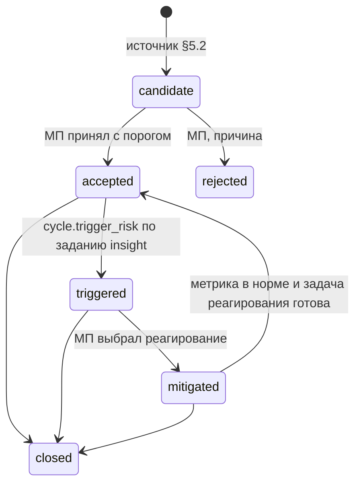

# 09. Планирование и управление работами

Для разработчиков, без кода. Раздел закрывает пункты слепой проверки 07 (§1), оставшиеся «частично» или «нет» по планированию: 3, 4, 7, 8, 9, 20, 21, 44, 50. Обязательны 05 §3 и 08; расхождения, найденные здесь, собраны в §12. Новых модулей нет: `cycle`, `plan`, `insight`, `agents`, `channels`, `knowledge`, `tenancy` по 00 §3.2-3.3.

Соглашения как в 03 (общие поля опущены; `money` в копейках с валютой); добавлен тип `day`: `text` вида `YYYY-MM-DD` в поясе проекта. События `<сущность>.<событие>` в `office_events` в транзакции изменения (05 §3.8); пути без префикса `/api/office`, ошибки и повтор по 05 §3.6.

**Сверено суперархитектором 2026-10-23** (05 §6): план дня, пояс и рабочие часы, календарь, имена графика, вид ошибки и конвейер метрик сведены с 10-12; правки внесены прямо в этот файл, расхождения и решения в 05 §6.2.

**Отложено до: …** значит пользователь вынес часть из первого выпуска (D06, P19, 05 §3.11), но проект полный. **Кладётся сейчас** значит то, без чего потом придётся ломать схему. Пустую колонку добавить позже безопасно, а историю (когда задача стала готовой, когда потрачены деньги) задним числом не восстановить, поэтому сейчас кладётся прежде всего то, что её пишет.

## 0. Решения этого раздела

| № | Решение | Основание |
|---|---|---|
| Р-01 | PMBOK это управленческий слой, Scrum и Kanban поставочный; связь через требование, элемент ИСР и задачу. Тип проекта задаёт глубину первого слоя, методика форму второго, они независимы | 07 п. 3 |
| Р-02 | `office_task_history` пишется с первой задачи (срез C) в транзакции изменения; на ней сгорание, скорость, поток и позже освоенный объём | ADR-17 |
| Р-03 | Страница `page:<n>` с постоянным номером; дерево и порядок в базе, не в путях Git; пространство это проект | 07 п. 4 |
| Р-04 | Сохранённый вид это структурный фильтр из белого списка полей; фраза переводится в него, запрос к данным не генерируется | P13 |
| Р-05 | Нарезка в `cycle.slice_tasks`: каркас кода, два вызова модели, проверка цитат, пакет черновиков `office_task_batches` с отчётом покрытия | 07 п. 7, И-18 |
| Р-06 | Изменение скоупа: узкая сущность `office_change_requests` (`cycle`) без своего маршрута; пересматривает 03 В-14 | 07 п. 8 |
| Р-07 | `triggered` у риска ставит только `cycle.trigger_risk`; зовёт её задание `insight`; ребро `insight → cycle` в графе 00 §3.3 | 07 Н9 |
| Р-08 | Оценка задачи для спринта (очки или часы) и оценка элемента ИСР для бюджета (часы по ролям) разные величины | 03 §2.8 неоднозначен |
| Р-09 | Ставки `office_rate_cards` и факт затрат `office_cost_entries` (`plan`) кладутся сейчас; `office_baselines.actual_cost` уходит | 03 §2.9 |
| Р-10 | Гант и освоенный объём после первого выпуска (D06), схема полная; метрики отклонений в каталоге «после D06» | 07 Н6 |
| Р-11 | План дня хранит `agents` (`office_day_plans`), счёт считает код, модель только пишет сводку, контекст подгружается ссылками заранее | 02 §2.1 |
| Р-12 | Расписание: структурное правило, cron во времени сервера, `next_run_at`; голос через `SpeechRecognizer` (A24); интервал от суток | 02 §8, P19 |
| Р-13 | Пояс и рабочие часы пользователя в `office_company_users` (`tenancy`); календарь (11 §2.2) их не дублирует | План дня, показ расписаний, поиск окна (05 §6, С2) |

## 1. PMBOK и Agile: как сосуществуют (07 п. 3)

### 1.1. Два слоя одного проекта

Управленческий слой отвечает «что входит, сколько стоит, к какому сроку, что угрожает, что поменялось»: паспорт, требования, задание, ИСР, оценки, бюджет, база, риски, изменения скоупа, освоенный объём. Поставочный отвечает «что делаем сейчас и в каком порядке»: бэклог, спринты или поток, доска. Задача живёт в поставочном слое и через требования и пакет работ отчитывается в управленческий.

| Тип × методика | Управленческий слой | Поставочный слой | Освоенный объём (после D06) |
|---|---|---|---|
| Маленький × Kanban или Scrum | Паспорт, задание, риски, изменения скоупа; без ИСР и бюджета | Поток с WIP или спринты со скоростью | Нет |
| Крупный × Kanban | Плюс ИСР, оценки, ставки, бюджет, база через РПО, факт затрат | Поток; задача в пакете работ | По ИСР, 0/100 (P21) |
| Крупный × Scrum | То же | Задача в спринте и в пакете работ | По ИСР или по очкам выпуска (§7.4) |

### 1.2. Карта PMBOK на объекты платформы

| Группа процессов PMBOK | Объект платформы (модуль) | Выпуск |
|---|---|---|
| Инициация: устав, заинтересованные стороны | Паспорт, участники, организация заказчика (`project`, `tenancy`) | A, B |
| Планирование содержания, ИСР | Бриф, задание, требования, след (`knowledge`, `cycle`); ИСР со словарём (`plan`, §6.1) | A-C; ИСР F |
| Сроки | Вехи базы, спринты (`plan`, `cycle`); Гант и критический путь (§7) | F; Гант после D06 |
| Стоимость | Оценки, ставки, бюджет, база через РПО (`plan`, §6) | F |
| Качество | Критерии приёмки, сценарии, сверки, конечный прогон (`cycle`, `delivery`) | C, E |
| Ресурсы | Роли, ставки; загрузка людей (§6.5) | F; загрузка после D06 |
| Коммуникации | Календарь, уведомления, публикации, подписки (`channels`, `cycle`) | D, F |
| Риски | Реестр (§5; `cycle`, `insight`) | C |
| Закупки | Договор, допсоглашение, акт (`contracts`) | G |
| Исполнение | Задачи, MR кода, созвоны, планёрки, план дня | C-F |
| Мониторинг | Здоровье, отчёты, статус «план против факта», освоенный объём (§7) | D, F, G; EVM после D06 |
| Контроль | Изменения скоупа (§4), новая база, матрица следа, приёмка | C, F |
| Закрытие | Конечный прогон, акт, `as_built`, ретро | E-G |

Домены PMBOK 7 покрываются теми же объектами. Дополнение 2026-10-26: мониторинг и контроль разведены по слову пользователя (Р21-01), добавлены артефакты по фазам и реестр покрытия, см. `21-pmbok-artefakty-po-fazam.md`.

Дополнение 2026-10-26 (сверка 24). После второй записи брифа 2026-10-26 строка «Сроки» читается так: Гант и критический путь в срезе F (таски 93, 99; R65 `in-spec`, A62); после D06 остаются освоенный объём, загрузка людей и учёт времени. Артефакты строк «Инициация», «Коммуникации», «Риски», «Закупки», «Мониторинг», «Закрытие» дополнены реестрами и документами-планами `22` §2 (таски 94, 95, 98).

Дополнение 2026-10-27 (сверка 32, С32-15; `30` §5, §9 Р-1, Р-4..Р-7, Р-11; `31`). Мерило R57 теперь PMBOK 8 (A76). Карта выше построена по группам процессов и областям знаний 6-й редакции; рядом действует карта по 8-й:

| Домен PMBOK 8 | Объекты платформы (модуль) | Фокусные области (на экране «фаза») | Выпуск |
|---|---|---|---|
| Руководство (Governance) | Паспорт и устав, `plan:management` с разделами подпланов (`31` §6.1), маршруты и база через РПО, автомат CR, Git документации и комплекты, критерии выхода на вехах `gate:<веха>` и акт этапа, методология и профиль проектного офиса (`31` §3), закупки у поставщиков с разделом «Стратегия закупок» (`31` §6.6), договор с заказчиком как входящее соглашение (`contracts`) | все | A-G; закупки G |
| Содержание (Scope) | Бриф, задание, требования, след, ИСР со словарём, сверка, приёмка | инициация, планирование, мониторинг и контроль | A-F |
| Расписание (Schedule) | Вехи, спринты, Гант с производственным календарём (таск 93), «призрак базы»; прогноз сроков без освоенного объёма предложен (`30` П-С7) | планирование, мониторинг и контроль | F |
| Финансы (Finance) | Оценки, ставки, бюджет и база (`budget`), `plan:finance`, потребность в деньгах по месяцам, график оплат по этапам договора, поток денег (`31` §6.7); освоенный объём и прогноз по завершении в D06 | планирование, мониторинг и контроль | F, G |
| Заинтересованные стороны (Stakeholders) | Реестр ЗС, `plan:stakeholder_engagement` и вид «текущее против желаемого», `plan:communications`, кабинет заказчика, уведомления, вовлечение О8 | инициация, планирование, исполнение, мониторинг и контроль | B-G3 |
| Ресурсы (Resources) | Роли, участия, RACI, `plan:resources`, спрос по ролям против ёмкости в портфеле (`31` §4.4); загрузка и отсутствия людей в D06 | планирование, исполнение | F, G2 |
| Риск (Risk) | Реестр рисков, триггеры по метрикам, реагирование; количественный анализ предложен (`30` П-С1) | планирование, исполнение, мониторинг и контроль | C |

| Сквозное по PMBOK 8 | Где |
|---|---|
| Принцип «Ценность»: выгоды и их измерение | `plan:benefits`, реестр выгод `office_benefits`, О24 (`31` §6.5) |
| Принцип «Устойчивое развитие» | Раздел шаблонов `business_case` и `final_report`, пункт вехи «базовый план утверждён», энергия на ИИ (`31` §6.4) |
| Приложение X2 «Проектный офис» | Пространство компании, методология, тип и зрелость офиса, портфель и дашборды (`31` §3-§5) |
| Приложение X3 «ИИ в управлении проектами» | Политика ИИ документом и профилем, проверки на предвзятость, учёт вклада (`31` §7); `02`, `23`, `25`, `28`, `29` |
| Приложение X4 «Закупки» | Реестр закупок, описание работ, запрос предложений (`31` §6.6) |

Фокусная область это метка артефакта (`focus_area`, `21` §3.2), а не состояние проекта; мониторинг и контроль на экране раздельно (Р21-01), в отчётах «по PMBOK» одной областью. Строки «Сроки» и «Ресурсы» таблицы выше читаются по дополнению сверки 24 и этому блоку; строка «Закупки» выше это договор с заказчиком, закупки у поставщиков живут в домене «Руководство». Фраза «Домены PMBOK 7 покрываются теми же объектами» проверена в `30` §4.2 с оговорками.

### 1.3. Сцепка ИСР, эпика, задачи и спринта

- Пакет работ группирует задачи (P21); задача не больше чем в одном пакете. Связь хранит `plan` (`office_wbs_task_links`), потому что `plan` выше `cycle`.
- Привязка автоматическая: по ссылке следа требования `wbs_item` (03 §2.7), слушатель `plan` на `task_batch.created` и `task.created`. Нет связи: задача «вне ИСР», это сигнал изменения скоупа (§4.2). Ручная привязка МП с аудитом.
- Эпик группирует задачи для поставки. По умолчанию эпик и результат ИСР (`deliverable`) делаются на раздел задания и совпадают, но связь не обязательна.
- Пакет `done`, когда все его задачи `done` или `cancelled` и хотя бы одна `done` (P21). Все отменены: пакет «пуст», в освоенный объём не идёт, МП решает пересмотр базы.
- Две оценки (Р-08): задача в единице проекта (`settings.sprint_unit`: `points` или `hours`), элемент ИСР в часах по ролям. Расхождение сумм показывается МП сигналом.
- Волна планирования: `planning_package` с оценкой «сверху»; раскладка на пакеты это правка ИСР, при смене бюджета новая база.

### 1.4. Scrum

- **План спринта.** Ёмкость `office_sprints.capacity` вводит МП или тимлид; подсказка: средняя скорость трёх закрытых спринтов. Состав выше ёмкости на 10% даёт предупреждение.
- **Старт** фиксирует `committed_points` и строки истории `field=sprint` по составу; один `active` на проект (И-35).
- **Сгорание**: остаток на конец дня это сумма оценок задач спринта не в `done` по истории; добавленное после старта отдельной линией «рост объёма».
- **Церемонии**: планирование и ретро созвоном команды, обзор спринта созвоном `demo` с заказчиком; ретро даёт кандидатов `decision` и задачи-улучшения, всё внутреннее.

### 1.5. Kanban

Колонки доски объединяют статусы (§2.3), лимит WIP на колонку; превышение красит колонку и копит метрику `wip_over_limit_days` (§5.2). «Срочно» это `priority=highest`, одна на колонку вне лимита. Пополнение сверху бэклога по `rank`. `cycle.flow_metrics` по истории даёт время выполнения (создание → `done`) и цикла (первый `in_progress` → `done`) медианой и 85-м процентилем, пропускную способность по неделям, накопительную диаграмму потока, возраст незавершённых задач.

### 1.6. Данные, операции, API

| Таблица | Писатель | Поля |
|---|---|---|
| `office_task_history` (новая, только добавление, **кладётся сейчас**, срез C) | `cycle` | `task_id`, `field enum(status, sprint, estimate, assignee, priority, rank, due_on)`, `old?`, `new?`, `at ts`, `actor_id?`, `actor_kind enum(user, agent, system)`, `run_id?` |
| `office_tasks` (плюс) | `cycle` | `kind` плюс `bug` (самостоятельная ошибка регресса и конечного прогона; расхождение сверки переданной задачи остаётся `subtask` с `origin=mismatch`, 10 §5.3; оба показываются как «ошибка», 05 §6 С19); `due_on day?` (без него метрика «просрочено против плана» 03 §2.11 не считается); `batch_id?` |
| `office_sprints` (плюс) | `cycle` | `capacity real?`, `unit enum(points, hours)` |
| `office_projects.settings` (плюс) | `project` | `sprint_unit`, `size_rules`, `wip_default` |

Операции `cycle.flow_metrics(project, from, to)`, `cycle.sprint_report(sprint)` читают только историю и задачи. API: GET `/sprints/{id}/report`, GET `/projects/{pid}/flow?from&to`, GET `/tasks/{key}/history`; права К, ошибки 404, 422.

| Пункт брифа | Где закрыто |
|---|---|
| «Планирование работ по PMBOK, и работы по Agile, Scrum и Kanban» (07 п. 3) | §1.1 слои, §1.2 карта, §1.3 сцепка, §1.4 Scrum, §1.5 Kanban |
| «покрывает все аспекты PoppyMbook, начиная от инициации проекта, планирования» | §1.2 |

## 2. Замена базового Jira и Confluence (07 п. 4)

Задачи, эпики, связи, бэклог, спринты закрыты в 03 §2.8; здесь остальное.

### 2.1. Страницы, дерево, пространства

- Страница это `page:<n>` во внутреннем Git (05 §3.3), файл `page/<n>.md`. Номер постоянный: перенос и смена заголовка файл не переименовывают (Р-03).
- Дерево в базе: `office_documents.parent_id` (только у `page:*`), `sort_key` (как `rank`), глубина до 7 (доп.). Перенос это `knowledge.move_page`, событие `document.moved`, версия не рождается. API: POST `/projects/{pid}/pages` `{title, parent_id?, template_id?}` (`knowledge.create_page`), POST `/documents/{did}/move` `{parent_id, after_id?}`, GET `/projects/{pid}/pages/tree`; права: команда создаёт, переносит МП и автор.
- Пространство это проект; задание, руководство, протоколы и договоры видны виртуальным корнем «Документы проекта» и не переносятся. Пространство подразделения или компании требует межпроектных знаний (P04, D01). **Отложено до:** решения пользователя (В-1). **Кладётся сейчас:** ничего, страница всегда проектная.
- Создание: пустая; из шаблона (запись `office_solutions` вида `page_template` у `agents`, встроенные протокол, ADR, ретро, регламент; текст передаёт интерфейс в `knowledge.create_page`); из контекста запуском агента веткой `agent/<run>/page/<n>` и MR (05 §3.2 п. 9).
- Правка прямой записью (05 §3.2 п. 4): «сохранить» даёт версию; MR по желанию; `ai-edit` голосом и текстом; комментарии к абзацам, сравнение и откат как у документов.
- Живые вставки: маркеры `<!-- view:<id> -->`, `<!-- task:ABC-12 -->`, `<!-- req:REQ-012 -->` рисуются при чтении в правах читателя. Версия хранит маркер и не меняется; экспорт подставляет снимок с датой в правах экспортирующего.
- Видимость: страница внутренняя. Заказчику её открывает публикация МП (`office_publications`, `object_type=page`) на версию момента публикации; вставки идут по его профилю.
- Метки `office_documents.labels json`, поиск по ядру, обратные ссылки рёбрами графа, архив `archived_at` без удаления (A20). Ограничения страниц внутри команды не строятся (В-9).

Дополнение 2026-10-27 (сверка 32; ответ пользователя 2026-10-27, A80; `31` §3.1). Вопрос В-1 закрыт для документов проектного офиса: у компании одно служебное пространство (`office_projects.space_kind = company`) для `pmo:methodology`, `pmo:maturity`, `policy:ai_use` и регламентов `page:*`; межпроектного поиска нет (И-89), в проекты попадают только принятые методология и политика ИИ блоком данных (И-140). Страницы проектов остаются проектными; пространство подразделения не вводится.

### 2.2. Сохранённые виды (фильтры)

`office_saved_views` (`cycle`): `owner_id`, `scope enum(personal, project)`, `project_id?` (пусто у личного вида по всем своим проектам), `object enum(task, requirement, risk, change_request)`, `name`, `query json`, `layout enum(list, table, board, gantt)` (`gantt` после D06), `columns json`, `sort json`, `phrase?`, `state`.

`query` это `{"all": [{"field", "op", "value"}]}` по белому списку (статус, вид, исполнитель `me`, приоритет, метки, спринт, эпик, требование, срок `overdue`, происхождение, даты, текст по ядру, пакет ИСР только видящим план) с операторами `eq, in, not_in, lt, gt, between, is_empty, contains`. Фраза переводится классом `draft_text` в `query`; неизвестное поле даёт отказ, как P13. `cycle.run_view` сначала применяет `tenancy.scope`; у заказчика видов нет. Вид служит списком, основой доски, быстрым фильтром, вставкой в страницу и подпиской «новое под фильтром» сводкой. API: GET, POST `/projects/{pid}/views`, PUT, DELETE `/views/{id}`, GET `/views/{id}/items?cursor=` (`cycle.run_view`), POST `/views/from-phrase` `{phrase}` → черновик `query`; 422 `validation` на поле вне белого списка.

Дополнение 2026-10-26 (сверка 24). Значение `layout = gantt` доступно со среза F (таск 99), а не после D06; вид Ганта хранит колонки таблицы слева, масштаб и группировку (`22` §6.1).

Дополнение 2026-10-27 (проверка ИБ 29, УИБ29-16). Поле «текст по ядру» есть только у вида проекта; личный вид по нескольким проектам фильтрует только поля задач, без текста по ядру (И-89). Подписка «новое под фильтром» личного вида строит сводку отдельно по каждому проекту в его области.

### 2.3. Доски

`office_boards` (`cycle`): `name`, `methodology`, `columns json [{name, statuses[], wip_limit?}]`, `swimlanes enum(none, assignee, epic, priority)`, `base_view_id?`, `quick_view_ids json`, `is_default`. Колонка только группирует статусы 05 §3.4 (каждый в одной колонке); своих статусов нет, на них держатся согласия и сверка (И-19, И-21). Перенос карточки идёт через `POST /tasks/{key}/status`, отказ автомата показывается на карточке («нет согласия СА», «сверка красная»). `draft` и `awaiting_approval` в колонке «Ждёт согласия» только у МП и аналитиков; `rejected`, `cancelled` скрыты. Карточка: ключ, название, приоритет, исполнитель, оценка, требования, цвет сверки, MR кода, срок. Scrum: доска спринта и экран бэклога. API: GET, POST `/projects/{pid}/boards`, PUT `/boards/{id}`; права: МП и тимлид правят, команда читает.

### 2.4. Остальное базовое

- **Наблюдатели, упоминания.** `office_subscriptions` (`channels`, срез E): `user_id`, `target_type enum(task, requirement, document, change_request, risk, view)`, `target_ref`, `reason enum(author, assignee, mention, comment, manual)`, `muted`. `@логин` даёт `comment.created.mentions[]` и уведомление. Получатели уведомления это правило 11 §6.4 плюс подписчики объекта (11 §6.1, шаг 2); до среза F уведомление идёт только в колокольчик веба. API: POST `/subscriptions` `{target_type, target_ref}`, DELETE `/subscriptions/{id}`, PATCH `{muted}`.
- **Вложения.** `POST /tasks/{key}/attachments` → `knowledge.ingest_source(family=file)` со ссылкой на задачу, файл идёт в ядро.
- **Массовая правка.** `POST /projects/{pid}/tasks/bulk`: метки, приоритет, спринт, исполнитель, срок; статус только автоматом поштучно; ответ списком `{key, ok, code}`.
- **История и клон** из `office_task_history`; `POST /tasks/{key}/clone` даёт `draft`.

### 2.5. Матрица покрытия базового набора

| Функция | Состояние |
|---|---|
| Задача, эпик, подзадача, связи, метки, приоритет, бэклог, спринты, оценки | Есть (03 §2.8) |
| Ошибка (bug) | Здесь: `kind=bug` у ошибок регресса и конечного прогона; расхождение сверки переданной задачи это `subtask` с `origin=mismatch` (10 §5.3); в интерфейсе оба «ошибка» |
| Статусы и переходы | Есть, фиксированы (03 §3.5); свои процессы и пользовательские поля не строятся (В-6) |
| Доски, WIP, дорожки, быстрые фильтры; фильтры (JQL); отчёты сгорания, скорости, потока | Здесь: §2.3, §2.2, §1.4, §1.5 |
| Комментарии, упоминания, наблюдатели, вложения, история, массовая правка, клон | Здесь: §2.4 |
| Компоненты | Метками и частью требования |
| Версии выпуска, учёт времени, дорожная карта | После выпуска: до того вехи базы и спринты; `office_worklogs` и Гант с D06 |
| Дашборды, уведомления, права | `insight` (H); 04 §9; матрица 03 §4.1 |
| Правила автоматизации | Агенты и скилы (02); конструктора правил нет |
| Пространства, дерево, шаблоны, вставки, метки, обратные ссылки | Здесь: §2.1; пространство компании открыто |
| Редактор голосом и текстом, комментарии к тексту, версии, сравнение, откат, экспорт | Есть (03 §2.6, §5.3; 04 §7) |
| Ограничения страниц, блоги, доски-рисовалки, базы данных | Не строятся |

### 2.6. Перенос из Jira и Confluence

Разовый ввоз не синхронизация (ADR-26 запрещает двустороннюю). Адаптер трекера или вики в `bridge` получает режим `import`: задачи черновиками с `origin=import`, комментарии источниками `comment`, страницы `page:<n>` с деревом, соответствие ключей в `office_bridge_links`. **Отложено до:** после выпуска, по итогам P20 (В-9). **Кладётся сейчас:** значение `import` в `office_tasks.origin`.

| Пункт брифа | Где закрыто |
|---|---|
| «должно заменить собой, весь базовый функционал Jira, и Confluence» (07 п. 4) | §2.1 дерево и пространства, §2.2 виды, §2.3 доски, §2.4 остальное, §2.5 матрица; остаток: пространство компании (В-1), версии выпуска и учёт времени после выпуска |
| «интеграции с ... Jira, Bitrix24, Redmine. Confluence» | Не меняется (ADR-26, P06); ввоз §2.6 после выпуска |

## 3. Автоматическая нарезка на задачи (07 п. 7)

Правило спецификации (уточнение 1): одна задача на принятое требование; несколько независимых действий режутся по паре «кто и что делает»; разделы задания не смешиваются. Нарезка живёт в `cycle.slice_tasks` и читает только `cycle`, `knowledge`, `project`, `routing`. Макет и дизайн-система (`delivery`) и пакет ИСР (`plan`) выше: макеты подставляются при чтении спецификации задачи (по `req_version_ids`, P14), пакет ставит слушатель `plan` (§1.3).

### 3.1. Вход

Принятая версия задания (у мастера маленького типа версия-черновик, тогда задачи ждут принятия, P17); подтверждённые требования со стадией `in_spec` и абзацы с маркерами `req:`; открытые противоречия; принятые пункты ролевой модели; существующие задачи с версиями их требований; тип, методика, `sprint_unit`, `size_rules` проекта.

### 3.2. Шаги

| № | Шаг | Кто |
|---|---|---|
| 1 | Ворота: роль МП, БА или СА; ключ повтора `(project, spec_version, mode)`, повтор отдаёт тот же пакет | код |
| 2 | Отбор: требования версии минус покрытые открытой задачей той же версии требования. Изменённое требование даёт кандидата `task_edit` к своей задаче, выпавшее (`out_of_scope`) даёт `task_edit` «отменить» | код |
| 3 | Требование в открытом противоречии уходит в `blocked` с парой цитат, остальные идут (И-18) | код |
| 4 | Пары «кто и что делает»: класс `extract` по формулировке, абзацам с маркером и пунктам ролевой модели отдаёт `{actor, action, quote}`; цитата через `knowledge.verify_quote`, без неё пара отбрасывается | модель, код |
| 5 | Задача на пару: название «актор: действие» до 80 символов, `req_keys`, раздел задания; разделы не сливаются | код |
| 6 | Критерии приёмки классом `draft_text`: строки «дано, когда, тогда» из формулировки и ролевой модели актора (`can` позитивный, `cannot` негативный). У строки источник `req:REQ-012@v3` или `role:<id>`, без источника строка удаляется; слова без меры дают флаг `unmeasurable` | модель, код |
| 7 | `work_kind`: `code` по умолчанию, `non_code` для документа, контента, настройки; модель предлагает с причиной | модель, человек |
| 8 | Эпик на раздел задания, если в разделе от трёх задач или проект на Scrum | код |
| 9 | Связи `blocks` предлагаются из рёбер графа и порядка «создать, изменить, удалить» одного объекта | код |
| 10 | Дубли с открытыми задачами: тот же REQ и отпечаток пары не создают задачу; близость от 0,92 «тот же», 0,80-0,92 решает класс `check` (01 §5) | код, модель |
| 11 | Размер по §3.3 | код |
| 12 | Запись одной транзакцией: задачи `draft` с `origin`, `batch_id`, `run_id?`; пакет с отчётом; `task_batch.created` | код |

Дальше `plan` раскладывает задачи по пакетам ИСР; подсказки оценок от агента в бюджет не идут.

### 3.3. Критерии размера

INVEST в измеримой форме; пороги в `settings.size_rules`, подбираются на P20.

| Критерий | Правило по умолчанию | Действие |
|---|---|---|
| Пары | Больше одной независимой пары «кто и что» | Разрезать (шаг 4) |
| Критерии | Больше 7 строк приёмки; больше 2 экранов макета | Флаг «крупная», предложение разрезать с тем же REQ |
| Оценка | Больше 16 ч, больше 8 очков или больше половины ёмкости спринта на человека | Флаг, предложение разрезать |
| Мелочь | Меньше 1 ч | Предложение сделать подзадачей соседней задачи того же требования |
| Проверяемость | Все строки приёмки с флагом `unmeasurable` | Задача не уходит в `awaiting_approval` без правки |

### 3.4. Проверка без модели

V1: каждое отобранное требование в задаче, в `blocked` или отмечено «без задачи» с причиной (иначе пакет не закрывается). V2: у задачи хотя бы один REQ, все подтверждены. V3: задача в одном разделе. V4: у каждого критерия источник, цитаты пар прошли `verify_quote`. V5: нет дубля открытой задачи. V6: эпик не пуст. V7: ключи `ABC-N` по порядку без переиспользования (И-31). V8: на крупном типе задача в пакете ИСР, иначе флаг «вне ИСР» (§4.2). Качество нарезки (доля принятых без правки, разрезанных, отклонённых) идёт в отчёт 02 §11.

### 3.5. Участие человека

Экран «Нарезка» во вкладке «Задачи»: слева требования с цветом покрытия и `blocked`, справа задачи пакета по эпикам с цитатами пар, критериями и флагами. Действия: править, разрезать, склеить внутри требования, отклонить с причиной, «подтвердить» только просмотренные. Назначенный аналитик проверяет пакет первым (бриф: «аналитик если есть то верифицирует»); подтверждение МП переводит задачи в `awaiting_approval`, дальше согласия по И-19. Пакет `reviewed`, когда у каждой задачи решение, `closed`, когда все ушли дальше.

### 3.6. Данные, API, события, расход

`office_task_batches` (`cycle`): `number`, `origin enum(slicing, wizard, call, change, import)`, `spec_version_id?`, `call_id?`, `change_request_id?`, `request_key` (уникален), `state enum(open, reviewed, closed)`, `report json {covered[], blocked[], no_task[], size_flags[], duplicates[], links_proposed[]}`, `run_id?`.

| Метод и путь | Вход → выход | Права | Ошибки |
|---|---|---|---|
| POST `/projects/{pid}/tasks/slice` | `{spec_version, mode: increment \| preview}` → пакет и `blocked[]` | МП, БА, СА | 409 только если заблокировано всё |
| GET `/task-batches/{id}`; POST `/task-batches/{id}/confirm` | пакет; `{task_keys}` → `awaiting_approval` | К; МП | 409 `not_viewed` |

События `task_batch.created`, `task_batch.reviewed`. Расход: около 5 тыс. токенов на требование быстрой моделью, пакет на 100 требований меньше $0,1 (цены 02 §6.3).

| Пункт брифа | Где закрыто |
|---|---|
| «автоматически нарезаются на задачи и формируются во внутреннем таск-трекере» (07 п. 7) | §3.1-§3.4 |
| «Project Manager ревьюит вручную... Approve. Либо отклоняет»; «аналитик если есть то верифицирует» | §3.5 |
| «тикеты... больше не надо описывать руками» | §3.2 шаги 5-6; ссылки на макет при чтении |

## 4. Изменения скоупа (07 п. 8)

### 4.1. Решение: узкая сущность

03 В-14 оставил изменение без сущности (флаг кандидата, версия требования, допсоглашение). Для следа одного требования этого хватает, но допсоглашение должно перечислить несколько изменений, база N+1 назвать причину, а заказчик видеть «историю изменений скоупа» (бриф). Поэтому вводится `office_change_requests` (`cycle`) без своего маршрута: одобрение заказчика это принятие версии задания, одобрение денег это маршрут базы `budget`. Собирает её система.

### 4.2. Откуда рождается

Пункт появляется после первой принятой версии задания, когда требование получает версию `changed_by_customer`, подтверждается новое требование, требование уходит в `out_of_scope` или задача оказалась «вне ИСР». Дополнение 2026-10-23, A41-A45 (18 §4.2-4.3): принятое человеком решение или поручение из проектного чата со `scope_impact` `changes`, `refines`, `new` даёт кандидата новой версии требования (`reason=changed_by_customer` при стороне заказчика, `cause_kind=source`) и по этому правилу пункт `CR`; решение внутреннего чата помечено «внутреннее обсуждение» (A21). Кандидаты с флагом `scope_change` подсвечиваются заранее; уточнение командой (`refined`) скоупом не считается. Пункт падает в открытый пакет проекта `draft`; МП может его разделить.

### 4.3. Автомат

```mermaid
stateDiagram-v2
  [*] --> draft: первый пункт
  draft --> assessing: МП закрыл набор
  assessing --> on_approval: версия задания с пунктами ушла по маршруту
  on_approval --> approved: версия принята; на крупном ещё база N+1 принята
  on_approval --> draft: версия возвращена
  assessing --> rejected: МП отклонил
  on_approval --> rejected: заказчик отказал
  approved --> [*]
```

`assessing` собирает влияние: `cycle.change_preview` (задачи, правки задач, след), `plan.change_cost_preview` (часы и деньги по пакетам ИСР, только видящим бюджет), черновик допсоглашения агентом договорного (03 §2.10, публикует человек). `approved` запускает нарезку в режиме `change` (пакет с `change_request_id`). `rejected` возвращает требования прежней формулировкой новой версией с `reason=change_rejected` или переводит их в `postponed`.

### 4.4. След и бюджет

Цепочка: улика (цитата созвона или письма) → версия требования → пункт изменения → версия задания → задачи пакета `change` → пакеты ИСР → база N+1 (`office_baselines.change_request_id`) → допсоглашение (пункт договора со ссылкой следа `contract_clause`). Карточка требования и матрица следа показывают номер изменения.

### 4.5. Данные, видимость, API

`office_change_requests` (`cycle`): `number` (`CR-N`), `title`, `state enum(draft, assessing, on_approval, approved, rejected)`, `items json [{requirement_id, kind: add|change|remove, from_n?, to_n}]`, `spec_version_id?`, `addendum_document_id?`, `decided_by?`, `reason?`. Денег и часов в строке нет (A22), они у `plan`. Заказчик видит изменение в `approved`: номер, ключи требований, версия задания, допсоглашение.

API: GET `/projects/{pid}/change-requests`, GET `/change-requests/{id}` (К; З только `approved`); POST `/change-requests/{id}/assess`, `/reject`, `/split` (МП, 409); GET `/change-requests/{id}/cost` (МП, РПО, руководство; 404 без права). События `change_request.opened`, `.assessed`, `.approved`, `.rejected`; слушают `plan` (черновик базы N+1), `contracts` (черновик допсоглашения), `channels`.

| Пункт брифа | Где закрыто |
|---|---|
| «историю всех его замечаний и исправлений и изменений скоупа работ» (07 п. 8) | §4.1-§4.4: сущность, рождение, автомат, след к требованиям и бюджету |
| «трассировка всех требований, принятых заказчиком в ходе реализации проекта» | §4.4, §4.5 |

## 5. Реестр рисков (07 п. 9)

### 5.1. Поля и автомат

`office_risks` (`cycle`) плюс к 03 §2.8: `title`, `probability enum(low, medium, high)`, `impact enum(low, medium, high)`, `owner_id?`, `strategy enum(avoid, mitigate, transfer, accept, escalate)?`, `responses json [{text, strategy, source_ref}]` (варианты агента), `cost_impact money?` (только видящим бюджет), `last_value real?`, `last_evaluated_at ts?`, `triggered_at ts?`, `trigger_count int`. Критерий `{metric, op, threshold, for_days?, scope_ref?}`; без порога 422 (03 §5.6).

### 5.2. Источники кандидатов

| Источник | Критерий по умолчанию |
|---|---|
| Противоречие решено «принять риск»; флаг кандидата (размыто, неизмеримо, вне рамок, юридическое, смена скоупа, без полномочий) | `requirement_path_days` больше 14 |
| Красная сверка; версия у заказчика без ответа | `check_red_days` больше 3; `version_no_answer_days` больше 7 |
| Просрочка против `due_on`; отклонения (после D06) | `tasks_overdue` больше 0; `spi`, `cpi` меньше 0,9 |
| Поток: WIP, рост объёма спринта | `wip_over_limit_days` больше 2; `sprint_scope_added_share` больше 0,2 |
| Расход; нет созвона с заказчиком | `usage_share` больше 0,8; `days_since_customer_call` больше 14 |
| Эксплуатация (Дополнение 2026-10-23, A41-A45, 17 §5.5): стенд недоступен; ветка по умолчанию красная; нестабильные выкладки прода | `stand_down_minutes` больше 60; `default_branch_red_hours` больше 24; `change_failure_rate` больше 0,3 за 30 дней (считает `insight` по `ops.metrics`, `ops.dora`; агент рисков получает ряд и оповещения материалом) |
| Проектные чаты (Дополнение 2026-10-23, A41-A45, 18 §4.1): пункт `risk` извлечения от 0,7 | Кандидат `candidate` с цитатой сообщения; принимает МП |

Метрики из каталога 03 §2.11 (P13) плюс новые `wip_over_limit_days`, `sprint_scope_added_share`, `tasks_overdue`. Кандидат от агента или правила всегда `candidate`, принимает только МП (03 §4.1).

### 5.3. Кто и когда ставит `triggered`

1. `insight` держит карту «метрика → события» (`check_red_days` ← `check.finished`; `version_no_answer_days` ← `route.step_activated`, `version.accepted`). Конвейер метрик один (12 §4.1, 05 §6 С14): событие ставит задание `metric_recalc:<scope>:<metric>` со схлопыванием 1 мин; задание пересчитывает метрику, пишет снимок, при изменении значения пишет `metric.updated` и сразу оценивает риски с этой метрикой. Ночью полный проход в 02:00 по серверу. Движок метрик строится в срезе C вместе с рисками; дашборды и портфель в H (05 §6 С15).
2. Порог перейдён и держится `for_days` у риска в `accepted`: `insight` зовёт `cycle.trigger_risk(risk_id, value, eval_key)`, `eval_key = (risk_id, trigger_count + 1)` даёт идемпотентность. Без перехода `cycle.observe_risk` обновляет только `last_value`, без события.
3. `cycle` в одной транзакции ставит `triggered`, `triggered_at`, растит `trigger_count`, пишет `risk.triggered` (аудитория `team`).
4. Повторно риск не срабатывает, пока не вернулся в `accepted` (метрика в норме два прохода подряд и задача реагирования `done`). `channels` напоминает раз в день, пока МП не открыл карточку.

`insight` в `office_risks` не пишет; ребро `insight → cycle` только для этих двух операций, цикла нет.

### 5.4. Реагирование

На `risk.triggered` назначается агент рисков (02 §2.1, `draft_text`): риск, ряд метрики, принятые решения и закрытые риски проекта со схожей метрикой, скилы. Он отдаёт 2-4 варианта `{strategy, text, source_ref}` через `cycle.propose_risk_responses`; без источника вариант не принимается. МП выбирает (`cycle.choose_risk_response`): `triggered → mitigated`, черновик задачи `origin=risk`, `mitigation_task_id`; стратегия «принять» задачи не создаёт. На крупном типе сумма `cost_impact × вероятность` подсказывает резерв на риски (§6.3).

| Метод и путь | Вход → выход | Права | Ошибки |
|---|---|---|---|
| POST `/risks/{id}/decision` (есть) | `{accept \| reject, criterion, probability, impact, owner_id}` | МП | 422 без порога |
| POST `/risks/{id}/response`; `/close` | `{option_index \| text, strategy}` → задача `draft`; `{reason}` | МП | 409 |

События: `risk.proposed`, `risk.accepted`, `risk.triggered`, `risk.mitigated`, `risk.rearmed`, `risk.closed`. Заказчик реестр не видит (03 §4.2).

| Пункт брифа | Где закрыто |
|---|---|
| «Реестр рисков заполняется автоматически, а с аппрувом от Project Manager» (07 п. 9) | §5.1, §5.2 |
| «В случае наступления каких-либо критериев... автоматически создает уведомление» | §5.3: считает `insight`, пишет `cycle.trigger_risk`, по событию и ночью |
| «и предлагает способы митигации» | §5.4 |

## 6. ИСР, оценки, бюджет, ресурсы (07 п. 20)

Только крупный тип. **Срез: F** (предложение: до `contracts` в G, которым нужна база; 03 §2.0 пишет «после E», ADR-32 срез не называет).

### 6.1. ИСР

`office_wbs_items` (`plan`) плюс `kind enum(root, deliverable, work_package, planning_package, milestone)`, `description`, `acceptance` (словарь ИСР), `sort_key`, `progress_rule enum(zero_hundred, fifty_fifty)` (умолчание P21), `planned_start day?`, `planned_finish day?` (кладётся сейчас для вех). Агент предлагает дерево из принятой версии задания (результат на раздел, пакет на группу требований, ссылки следа `wbs_item`), МП правит; на пресейле допустима предварительная ИСР из брифа. Правка после принятой базы идёт в следующую базу.

### 6.2. Оценки

`office_estimation_rounds` (`plan`): `n`, `wbs_item_ids json`, `method enum(single, three_point)`, `due_at`, `state enum(open, closed)`; МП открывает раунд и назначает оценщиков по ролям. `office_estimates` плюс `optimistic?`, `most_likely?`, `pessimistic?`; при `three_point` `value = (O + 4M + P) / 6`. Подсказка агента видна оценщику отдельно и в `value` не попадает. Оценщик видит свои строки, не суммы и ставки (A22). МП принимает одну оценку на пару «элемент, роль», остальные `rejected` с причиной.

### 6.3. Ставки и бюджет

`office_rate_cards` (`plan`): `scope enum(company, department, project)`, `scope_id`, `role`, `rate money` (за час), `valid_from day`, `valid_to day?`; поиск по цепочке проект, подразделение, компания. `BAC_i = Σ по ролям (принятые часы × ставка)`; `BAC = Σ BAC_i + резерв на риски` (подсказка §5.4); управленческий резерв отдельно и в `BAC` не входит (PMBOK).

### 6.4. База

`office_baselines` плюс `bac`, `contingency`, `management_reserve` (money), `currency`, `rates_snapshot json`, `wbs_snapshot json [{wbs_item_id, code, kind, hours_by_role, bac, weight, planned_start?, planned_finish?}]` (полным сейчас, чтобы освоенный объём потом считался от прошлых баз), `change_request_id?`, `reason`, `ev_method enum(wbs_0_100, wbs_50_50, agile_points)`; `actual_cost` уходит. Автомат и маршрут `budget` с шагом РПО как в 03 §3.7; повтор отправки не плодит вторую базу.

`office_cost_entries` (`plan`, только добавление, кладётся сейчас): `as_of day`, `amount money`, `wbs_item_id?`, `kind enum(labor, external, other)`, `source enum(manual, worklog, import)`, `note`; исправление обратной записью; вводит МП.

### 6.5. Ресурсы

Сейчас роли, назначения и ставки. **Отложено до:** после выпуска вместе с Гантом (D06), потому что без дат графика загрузку честно не посчитать: `office_allocations` (`plan`: `user_id`, `share`, `from`, `to`) и график «неделя × человек» из остатка оценок, дат, рабочих часов и отсутствий. **Кладётся сейчас:** `office_company_users.work_hours`.

### 6.6. Кто что видит (A22)

| Объект | МП, РПО, руководство, админ | Оценщик | Остальная команда | Заказчик |
|---|---|---|---|---|
| Дерево ИСР без денег | да | свои элементы | да | нет |
| Оценки | все | свои | нет | нет |
| Ставки, бюджет, база, резервы, факт, дельта денег изменения, освоенный объём | да | нет | нет | нет |

| Метод и путь | Вход → выход | Права | Ошибки |
|---|---|---|---|
| POST `/projects/{pid}/estimation-rounds`; `/estimation-rounds/{id}/close` | раунд | МП | 409 |
| POST `/wbs-items/{id}/estimates` (есть); POST `/estimates/{id}/decision` | `{value \| optimistic, most_likely, pessimistic, role}`; `{accept \| reject}` | оценщик; МП | 422, 409 |
| GET, PUT `/projects/{pid}/rates`; GET, POST `/projects/{pid}/cost-entries` | ставки; факт | МП; ставки компании админ | 404 без права |

События: `wbs.changed`, `estimate.submitted`, `estimation_round.closed`, `baseline.submitted`, `baseline.accepted`, `cost_entry.created` (только видящим бюджет).

| Пункт брифа | Где закрыто |
|---|---|
| «ВБС. Иерархической структуры работ. Оценки... каждой из структурных элементов ИСР» (07 п. 20) | §6.1, §6.2 |
| «создание бюджета проекта. Согласование проектным офисом» | §6.3, §6.4 |
| «бюджет... видят только Менеджер проекта и вышестоящее руководство» (A22) | §6.2, §6.6 |
| Ресурсы | §6.3 ставки сейчас; §6.5 загрузка после D06 |

Дополнение 2026-10-27 (проверка ИБ 29, УИБ29-17). До слова пользователя (`29` §12 п. 5) команда в `plan:resources` видит даты и загрузку в долях без часов по ролям: часы на известные ставки дают бюджет. API графика для «призрака базы» отдаёт только даты базы, без `wbs_snapshot`.

## 7. Гант и освоенный объём (07 п. 21)

**Отложено до: после первого выпуска (D06, R65, R66).** **Кладётся сейчас:** `office_task_history` (момент `done`), `office_cost_entries` с датами, `wbs_snapshot` с весами и датами, даты элементов ИСР, `due_on` задач. `plan.earned_value` в первом выпуске не выставляется, событие `plan.deviation_detected` зарезервировано.

### 7.1. Данные графика (`plan`)

| Таблица | Поля |
|---|---|
| `office_gantt_links` | `from_type enum(wbs_item, task)`, `from_id`, `to_type`, `to_id`, `kind enum(fs, ss, ff, sf)`, `lag_days` |
| `office_gantt_entries` | `item_type`, `item_id`, `duration_days`, `planned_start`, `planned_finish`, `early_start`, `early_finish`, `late_start`, `late_finish`, `total_float`, `is_critical`, `state enum(draft, current)`, `calc_epoch` |
| `office_work_calendars` (писатель `tenancy`, 05 §6 С21) | `company_id`, `year`, `workdays json`, `holidays json` (производственный календарь РФ); читают `plan`, `channels` (поиск окна), `agents` (план дня) |

Имена `gantt` выбраны, чтобы график проекта не путался с расписаниями агентов (`office_agent_schedules`, события `schedule.*`, 05 §6 С11).
| `office_worklogs` | `task_id`, `user_id`, `day`, `hours`, `note`; факт `worklog` по ставке роли |
| `office_ev_snapshots` | `baseline_id`, `as_of`, `pv`, `ev`, `ac`, `spi`, `cpi`, `spi_t`, `eac`, `etc`, `vac`, `tcpi`; у `plan`, не у `insight`, потому что это деньги (A22); `insight` получает только светофор |

### 7.2. Расчёт графика

Длительность пакета от МП или `часы / (людей роли × часов в день)` в рабочих днях. Прямой и обратный проход метода критического пути с лагами по календарю компании; резерв `late_start − early_start`, критический путь из нулевого резерва. Задачи наследуют окно пакета, на Scrum поверх полосы спринтов. Пересчёт заданием `core` по `wbs.changed`, `task.status_changed`, правке связей. Перетаскивание даёт `draft`; в базу график попадает только новой базой.

### 7.3. Освоенный объём

- `EV(t) = Σ BAC_i × pc_i(t)`: при `zero_hundred` `pc_i = 1`, если пакет `done` к `t` (по истории задач), иначе 0 (P21); при `fifty_fifty` 0,5 после первого `in_progress` любой его задачи.
- `PV(t)`: с графиком начисляется по тому же правилу на плановые даты (0/100: `BAC_i` на `planned_finish`; 50/50: половина на старте, половина на финише), иначе SV искажён посреди пакета. Без графика запасная формула P21: `BAC × доля срока базы на t`. Уточнение P21 (В-4).
- `AC(t) = Σ office_cost_entries.amount` с `as_of ≤ t`.
- `SV = EV − PV`, `CV = EV − AC`, `SPI = EV / PV`, `CPI = EV / AC`.
- Прогноз: `EAC = BAC / CPI` (типовой), а также `AC + (BAC − EV)` и `AC + (BAC − EV) / (CPI × SPI)` на выбор МП; `ETC = EAC − AC`, `VAC = BAC − EAC`, `TCPI = (BAC − EV) / (BAC − AC)`.
- Освоенное расписание: `ES = C + (EV − PV_C) / (PV_{C+1} − PV_C)`, где `C` число целых периодов с `PV ≤ EV`; `SPI(t) = ES / прошедший срок`; к концу проекта не вырождается в 1, в отличие от `SPI`.
- Правила: без принятой базы чисел нет («база не принята»); без факта `CV`, `CPI`, `EAC` пусты с текстом «факт не введён» (P21); деление на ноль даёт пусто; валюта одна на базу.
- Пороги: `SPI` или `CPI` ниже 0,9 жёлтый, ниже 0,8 красный (меняет админ); смена уровня даёт одно `plan.deviation_detected`, `cycle` заводит кандидата риска.

### 7.4. Вариант для Scrum (`agile_points`)

Выпуск с планом из N спринтов и объёмом в очках: `PV` после спринта k = `BAC × k / N`; `EV = BAC × очки done / очки плана`; `AC` из факта. Рост объёма в очках меняет знаменатель только новой базой. Выбор метода в базе (`ev_method`), смена метода это новая база.

### 7.5. Экран (вкладка «План»)

Подвкладки «Дерево», «Оценки», «Бюджет», «База», «График», «Освоенный объём». «График»: строки дерева с задачами, полосы, призрак базы, вехи, связи, критический путь, линия сегодня, масштаб неделя, месяц, квартал; команде без денег, заказчику никогда (03 §4.2). «Освоенный объём» только видящим бюджет: плитки BAC, PV, EV, AC, SV, CV, SPI, CPI, SPI(t), EAC, VAC, TCPI, S-кривая с отметками смены базы, таблица по пакетам.

| Метод и путь | Вход → выход | Права | Ошибки |
|---|---|---|---|
| GET `/projects/{pid}/gantt`; PUT `/projects/{pid}/gantt/links`; POST `/projects/{pid}/gantt/recalc` | график, связи, пересчёт | К чтение; МП правка | 409 цикл связей |
| GET `/projects/{pid}/earned-value?as_of=` | показатели и ряд | МП, РПО, руководство | 404 без права; 409 база не принята |
| POST `/tasks/{key}/worklogs` | `{day, hours}` | исполнитель | 422 |

События: `gantt.recalculated`, `plan.deviation_detected`.

### 7.6. Планирование от даты сдачи (дополнение 2026-10-26, A58)

Режим графика `forward` (от начала, плановые даты ранние) или `backward` (от целевой даты, плановые даты поздние). Целевая дата имеет вид: завершить, сдать, внедрить. Результат обратного режима: самая поздняя дата старта и запас в рабочих днях до сегодняшнего дня; состояния `fits`, `tight`, `not_fit`. При `not_fit` платформа предлагает варианты, сама ничего не меняет. Таблица `office_schedule_settings`, событие `gantt.deadline_unreachable`, связи-кандидаты `plan.propose_links`. Полное описание в `21-pmbok-artefakty-po-fazam.md` §8. Срок построения не менялся: R65 и D06 остаются `deferred` до слова пользователя.

| Пункт брифа | Где закрыто |
|---|---|
| «Планирование в сроках в диаграмме Ганта» (07 п. 21) | §7.1, §7.2, §7.5; отложено D06, кладётся сейчас по вводной |
| «автоматическое сопоставление. Исполненного объёма по проекту по методикам PMBOK» | §7.3, §7.4; снимает 07 Н6 |

Дополнение 2026-10-26 (сверка 24). Пометки «Отложено до: после первого выпуска (D06, R65, R66)» в начале §7 и «Срок построения не менялся» в §7.6 устарели для Ганта: вторая запись брифа перевела R65 в `in-spec`, расчёт и экран графика строятся в срезе F (таск 93 расчёт и режимы, таск 99 интерфейс уровня ClickUp, Asana, Jira, `22` §6). Освоенный объём (§7.3, §7.4, R66), `office_worklogs`, `office_ev_snapshots` и загрузка людей остаются D06. Таблица настроек режима «от даты сдачи» называется `office_gantt_settings` (в §7.6 и `21` первой редакции `office_schedule_settings`; переименовано по правилу §7.1 и 05 §6 С11). Журнал правок графика `office_gantt_ops` (`plan`, только добавление). После пересчёта графика и принятия дерева `plan` сообщает `knowledge.note_input_head` (виды входов `gantt_calc`, `wbs_revision`, `22` §4.1). Видимость §7.5 не меняется: заказчику график закрыт до ответа пользователя на `21` В-7.

Дополнение 2026-10-27 (сверка 32, С32-14; `31` §6.3, §6.7, A76, A78). Производственный календарь `office_work_calendars` (писатель `tenancy`) строится в таске 93 среза F, а не после D06: Гант считает в рабочих днях, тот же календарь читают поиск окна встреч, план дня, SLA поддержки и спрос по ролям. Строка «После D06» в §10 читается без `office_work_calendars`. У `plan` новые операции `funding_profile` (потребность в деньгах по месяцам из базы и дат Ганта, класс `budget`) и `role_demand` (часы по ролям по месяцам); освоенный объём, `office_worklogs`, `office_ev_snapshots` и загрузка людей остаются D06. При принятии базы `plan` зовёт `cycle.register_milestone` для вех ИСР (`31` §6.8).

## 8. План рабочего дня (07 п. 44)

**Срез F** (02 §2.1). Хранит и собирает `agents` (агент «Планировщик дня»); читает вниз. Это единственная модель плана дня в комплекте: черновик в `office_agent_drafts` и операция `channels.today` из первой редакции 11 сняты (05 §6 С1), потому что `channels` ниже `delivery` и не может читать красные сверки.

### 8.1. Источники

Встречи дня по всем проектам: `channels.calendar_window(user_id, from, to, project_ids?)` с развёрнутыми повторами в поясе пользователя (11 §2.2-2.4, §2.9); свободные окна `channels.find_slots` (11 §2.9). Из `cycle`: мои задачи (`handed`, `in_progress`, `code_review`, срок сегодня или просрочен, спринт), шаги маршрута моей роли, MR документов на ревью, пакеты нарезки, кандидаты сводкой, противоречия моей части, сработавшие риски (МП), обещания со сроком сегодня. Из `delivery`: MR кода на ревью, красные сверки моих задач. Из `tenancy`: пояс и рабочие часы (Р-13).

### 8.2. Сборка

1. Задание `day_plan_build:<user>:<day>` за час до рабочих часов в поясе пользователя; при первом открытии без плана; по событиям пользователя (`task.handed`, `route.step_activated`, перенос встречи) со схлопыванием 2 мин. Дополнение 2026-10-23, вечер (A36, 15 §1.3, Р15-02; 05 §7 С86): черновик на следующий рабочий день собирается вечером (`phase=evening`), утренняя сборка становится обновлением (`morning`), ключ задания получает фазу `day_plan_build:<user>:<day>:<phase>`.
2. Счёт считает код: приоритет, близость срока, сколько задач блокирует, обязательство спринта, возраст ожидания, подготовка к встрече в ближайшие 2 ч, минус «заблокирован другими». Причина строкой из слагаемых.
3. Фокус-блоки: жадная укладка задач по счёту в свободные окна рабочих часов; длительность из остатка оценки или 1 ч.
4. Контекст заранее: у задачи требования, абзацы задания, утверждённый макет, комментарии, цитаты созвонов, MR кода (`knowledge.search` в правах пользователя, k = 8); у встречи повестка, прошлый протокол, вопросы к заказчику. Хранятся ссылки, права проверяются при открытии, `context_epoch` сбрасывается по `document.version_created` и `task.*`.
5. Модель (`draft_text`, быстрая, по настройке) пишет только сводку дня и личный черновик к планёрке «вчера, сегодня, мешает» из истории задач и коммитов; не чаще раза в 2 часа на пользователя (11 §2.8). Без модели план собирается без сводки (принцип 10 из 00).
6. Несделанное переносится на завтра с пометкой.

### 8.3. Данные

| Таблица (`agents`) | Поля |
|---|---|
| `office_day_plans` | `user_id`, `day`, `tz`, `state enum(draft, active, closed)`, `built_at`, `built_from_seq` (последний учтённый `office_events.seq`), `summary?`, `standup_draft?`; уникально `(user_id, day)` |
| `office_day_plan_items` | `plan_id`, `kind enum(meeting, task, review, route_step, task_batch, candidates, risk, check, promise, focus_block)`, `project_id`, `ref`, `starts_at?`, `ends_at?`, `order`, `score real`, `reason`, `pinned`, `state enum(todo, done, skipped, moved)`, `context_refs json`, `context_epoch` |

`office_company_users` (`tenancy`) плюс `tz` (IANA, умолчание пояс компании), `work_hours json {days[], from, to}`.

Дополнение 2026-10-23, вечер: расширение полей обеих таблиц (`phase`, `revision`, `off`, `proposed`, `locked`, `origin`, `candidate_id`, `meeting_id`) и новые `office_day_plan_candidates`, `office_day_plan_prefs` (`agents`), `office_channel_inbox` (`channels`) описаны в 15 §1.4 (ADR-67).

### 8.4. Экран `/office/today`

Лента дня (встречи с «подготовкой», фокус-блоки, свободные окна), списки «Ждёт моего решения», «Мои задачи», «Сигналы», фильтр проектов (G34) и сводка. Действия: отметить, закрепить, перенести, порядок, «пересобрать»; задача открывается с подгруженным контекстом. План личный; чужие планы видят МП своих проектов и руководство по клетке матрицы `day_plan/view_others` с маскировкой чужого до «занято» и записью в `office_audit`, МП правит незакреплённые пункты своего проекта (`edit_others`; 15 §1.5, Р15-06; 05 §7 С87, пересматривает первую редакцию этой фразы); у заказчика плана нет. Перетаскивание, сетка, лотки и командный вид: 15 §1.6.

| Метод и путь | Вход → выход | Права | Ошибки |
|---|---|---|---|
| GET `/me/day-plan?day=&projects=`; PATCH `/me/day-plan/items/{id}`; POST `/me/day-plan/rebuild` | план; `{state?, pinned?, order?, move_to_day?}`; пересборка | сотрудник-исполнитель, владелец | 409, 429 |

Событие `day_plan.built` (только владельцу).

| Пункт брифа | Где закрыто |
|---|---|
| «планирования рабочего дня каждого пользователя в зависимости от задач в календаре, событий в календаре и задач на текущий день с уже подгруженным контекстом» (07 п. 44) | §8.1-§8.4 |
| «Daily standups... с имеющимся проектным контекстом» | §8.2 шаг 5 |

## 9. Планировщик голосом по серверному времени (07 п. 50)

**Срез H** (05 §3.11). **Отложено до:** интервал меньше суток (P19); правило его допускает, проверка отказывает.

1. **Голос.** `POST /uploads/audio`, затем `knowledge.transcribe(blob_ref, diarize=false, lang?)` через `SpeechRecognizer` (A24); та же операция у созвонов (11 §3.2, 05 §6 С20). При политике «только текст» звук удаляется сразу после распознавания.
2. **Разбор.** Класс `draft_text` даёт `{prompt, rule, agent, output, project}`, `rule = {freq: daily | weekly | monthly, by_day[], by_month_day[], at, tz, start?, until?, count?}`. Код проверяет интервал, время, участие автора, разрешённость агента (разработчик по расписанию запрещён, P07).
3. **Показ.** Текст правила и три ближайших запуска в поясе автора и во времени сервера (P19); пояс с летним временем даёт предупреждение «сдвинется на час» (cron во времени сервера, 03 §2.12).
4. **Исполнение.** Цикл процесса заданий (К37) раз в 30 с берёт `next_run_at ≤ сейчас` по часам сервера, ставит `office_jobs` с ключом `schedule:<id>:<planned_at>`, двигает `next_run_at`. Простой: один догоняющий запуск в окне суток; предыдущий ещё идёт: пропуск с записью. Установщик проверяет синхронизацию времени (chrony или systemd-timesyncd).
5. **Контекст.** Запуск `trigger=schedule` правами автора на момент запуска, весь контекст через `knowledge.search` в этих правах, бюджет только если автор его видит (A22), доля лимита расписаний (02 §6.4).
6. **Результат в ядре.** `knowledge.ingest_source(family=scheduler, external_key=<id>:<planned_at>)`, документ `scheduler:<id>:<дата>` вне Git, видимость команда; файлы квитанциями и источниками `file`; ребро графа «создано расписанием»; в кандидаты и след только при `include_in_trace`; страницу делает человек через MR.
7. **Остановка.** Исключение автора, лимит, вручную, три сбоя подряд → `schedule.stopped`.

`office_agent_schedules` (`agents`) плюс `agent`, `skill_version_id?`, `rule json`, `next_run_at ts`, `last_run_at?`, `missed_policy enum(run_once, skip)`, `overlap_policy enum(skip, queue)`, `voice_source_id?`, `max_tokens?`, `fail_streak`; `stop_reason` плюс `failures`. API 03 §5.8 плюс `POST /schedules/{id}/preview`. События `schedule.enabled`, `schedule.fired`, `schedule.stopped`.

| Пункт брифа | Где закрыто |
|---|---|
| «голосом надиктовать промпт и превратить его в повторяющуюся задачу по расписанию» (07 п. 50) | Шаги 1-3 |
| «выполняется в строгом соответствии с серверным временем» | Шаг 4 |
| «весь контекст проекта доступен»; «артефакты... попадают... в RAG-систему проекта» | Шаги 5-6; интервал меньше суток отложен (P19) |

## 10. Сводка данных и миграций

| Срез | Шаги миграции (после 03 §8) |
|---|---|
| C | `office_task_history`, `office_task_batches`; поля задач, спринтов, рисков; дерево страниц в `office_documents`; движок метрик `insight` (снимки, `metric.updated`) |
| D | `office_change_requests`; `reason=change_rejected` у версий требований |
| E | `office_boards`, `office_saved_views`, `office_subscriptions` |
| F | `office_estimation_rounds`, `office_rate_cards`, `office_cost_entries` (перенос `actual_cost` записью на дату базы), `office_wbs_task_links`, поля ИСР, оценок, баз; `office_day_plans`, `_items`; `office_company_users.tz`, `work_hours` |
| H | Поля `office_agent_schedules` |
| После D06 | `office_gantt_links`, `office_gantt_entries`, `office_work_calendars` (`tenancy`), `office_worklogs`, `office_ev_snapshots`, `office_allocations` |

Новые операции названы в разделах; новое ребро графа одно: `insight → cycle` (вызов вниз, только `trigger_risk`, `observe_risk`, §5.3). Полная сводка таблиц 09-12 с писателями и срезами: 05 §6.3.

| Пункт брифа | Где закрыто |
|---|---|
| Пункты 07 3, 4, 7, 8, 9, 20, 21, 44, 50 | Таблицы и миграции по срезам; у отложенного место в схеме есть |

## 11. Открытые вопросы

| № | Вопрос | Кому | До ответа |
|---|---|---|---|
| В-1 | Пространство подразделения или компании для страниц (межпроектные знания, P04, D01) | Пользователь | Пространство это проект |
| В-2 | Изменение скоупа сущностью, пересмотр 03 В-14 | Пользователь | §4 |
| В-3 | Интервал расписания меньше суток (бриф без ограничения, P19 сутки) | Пользователь | Сутки |
| В-4 | Уточнение P21: веса пакетов по стоимости, плановый объём по правилу 0/100 на плановые даты | Пользователь | §7.3 |
| В-5 | Видит ли команда без права бюджета даты Ганта | Пользователь | Видит без денег |
| В-6 | Свои статусы задач и пользовательские поля | Пользователь, пилот | Не строятся |
| В-7 | Звук надиктовки; учёт рабочего времени и ставки как персональные и зарплатные данные | Юрист | Звук удаляется; учёт времени после D06 |
| В-8 | Пороги размера задачи, рисков, `SPI` и `CPI`, WIP, веса плана дня, окно догона расписаний | Пилот (P20) | Умолчания разделов |
| В-9 | Нужны ли перенос из Jira и Confluence, версии выпуска, ограничения страниц | Пилот (P20) | После выпуска |

Дополнение 2026-10-27 (сверка 32). В-1 закрыт для документов проектного офиса пространством компании (§2.1, A80); пространство подразделения для страниц не вводится.

## 12. Предложения правок в 00-04 и вне

Файлы 00-08 не правились.

| Файл, место | Правка | Расхождение |
|---|---|---|
| 00 §3.2, 03 §2.11, 04 §6.3 | `plan`: «оценки, ставки, база, факт; освоенный объём и Гант после D06»; метрики `spi`, `cpi`, отклонения по сроку и стоимости «после D06» | 07 Н6: `earned_value` выставлен как готовый, а D06 его отложил |
| 00 §3.3, 03 §2.8 «Риск» | Ребро `insight → cycle` для `trigger_risk`, `observe_risk`; текст порога по §5.3 | 07 Н9 |
| 00 §8, 03 §6, 05 §3.8 | События разделов 1-9 | |
| 01 §10 | `knowledge.transcribe`, `create_page`, `move_page` | |
| 02 §2.1, §8, §12.3 | `office_day_plans`; поля расписаний; `propose_risk_responses`; срез расписаний H | 02 даёт планировщику дня срез F, срок расписаний есть только в 05 §3.11 |
| 03 §2.0, ADR-32 | Таблицы §10; `plan` в срезе F | 03 пишет «после E», ADR-32 срез `plan` не называет, а `contracts` (G) читают базу |
| 03 §2.4 | `office_company_users.tz`, `work_hours` | Пояс показывается (03 §2.12, 04 §10), но не хранится |
| 03 §2.5 | `parent_id`, `sort_key`, `labels`, `archived_at` у `page:*` | Нет дерева страниц |
| 03 §2.8 | `bug`, `due_on`, `batch_id`, `origin` плюс `import`, `change`; `estimate` только для спринта; поля и автомат рисков | Метрика «просрочено против плана» без поля срока; «очки у Scrum, часы у крупного» неоднозначно |
| 03 §2.9 | Поля §6; `office_rate_cards`, `office_cost_entries`, `office_estimation_rounds`, `office_wbs_task_links`; убрать `actual_cost` | Ставки «вводит МП» без таблицы; одно число факта не даёт ряда |
| 03 §4.1, §4.2 | Права на виды, доски, изменения, ставки, факт, публикацию страниц; в §4.2 `page` «после публикации МП», изменения «в `approved`, без денег» | Страниц в §4.2 нет |
| 03 §5.6 | `tasks/slice`: 200 с `blocked[]`, 409 только если заблокировано всё | 409 «открытое противоречие» спорит с И-18 |
| 03 §9 | Пересмотреть В-14 (§4) и В-15 (§6.5) | |
| 03 §3.8 | Планирование и ретро это встреча и созвон `internal` с полем `ceremony enum(planning, retro)` (11 §2.2); обзор спринта это `demo` | Свёрнуто с 11: новых видов созвона нет (05 §6 С4) |
| 04 §7 | Вкладки «Страницы», «Риски», «Изменения»; подвкладки «Плана»; виды задач; экран нарезки; `/office/today` по §8.4 | Меню МП (04 §6.2) содержит «риски», вкладки «Риски» нет |
| 05 §3.1, §3.4; 08; README | Владение новыми таблицами; статусы рисков, изменений, пакетов, раундов; ADR на Р-02, Р-06, Р-07 и срез `plan`; строка `09` в README | |

Статус каждого предложения после сверки (принято и внесено в 00-04, принято иначе, отклонено с причиной): 05 §6.2 и §6.4.

`spec.md` расходится сам с собой: история 6 закрывает нарезку и неприятым риском, история 55 и И-18 только противоречием. Раздел читает это как решение противоречия «принять риск» (03 §2.7), которое снимает блок.

Дополнение 2026-10-26 (ответ пользователя на `21` В-7). К §7.5: заказчик видит график только снимком-публикацией без денег (без ставок, бюджета, освоенного объёма), по решению МП; живой график заказчику не открывается. утверждено пользователем 2026-10-26 (третья запись брифа).
