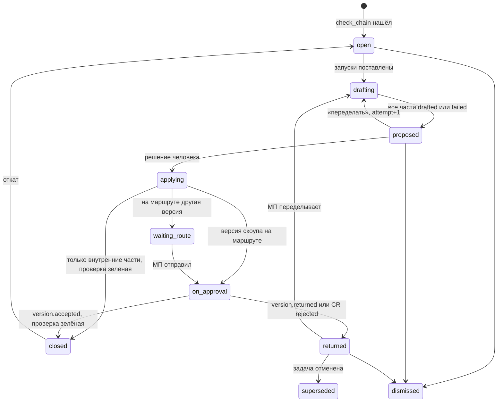

# 14. Граф артефактов, хронология изменений и обратная актуализация документации

Для разработчиков, без кода. Закрывает строки манифеста A32-A35 (бриф, запись 2026-10-23). Обязательны 05 §3, §6 и §7, ADR 08: при расхождении верны они. Сверено суперархитектором 2026-10-23 вечером (05 §7 С65-С109; ADR-63-ADR-66): номера инвариантов И-37-И-44 подтверждены и внесены в 03 §7; части стража, требующие запусков агентов, перенесены из C в E (С72); строки «видеть» таблицы §7 стали клетками матрицы прав 13 §4.7 (С69). Имена и стиль сущностей по 03. Новых модулей нет: пишут `cycle`, `delivery`, `bridge`, `knowledge`; `insight` строит проекции только для чтения; `agents` готовит предложения. Срез (05 §6.3, К 3.11) указан у каждого элемента. «Решение 14» значит решил автор раздела; «доп.» число-допущение для пилота P20; роли сокращены по 03 §4.1.

## 0. Решения раздела

| № | Решение | Основание |
|---|---|---|
| Р14-01 | Своей таблицы связей (`office_links`) нет. Ребро живёт в одном хранилище владельца: ссылка следа `office_trace_links` (`cycle`), ребро ядра `office_edges` (`knowledge`) или структурная колонка (`office_code_commits.task_id`, `office_task_links`, `office_mockups.req_version_ids`). Граф собирает проекция `insight` | Принцип 4 «один писатель» |
| Р14-02 | У ссылки следа появляются способ, уверенность, версия цели и история переходов `office_trace_link_history` | A32 «детализация до трассировки» |
| Р14-03 | Документы скоупа это семейство `spec`: `spec` (ТЗ), `spec:chtz-<слаг>` (ЧТЗ), `spec:ftt` (ФТТ); одна нумерация `REQ-NNN` | A33, A34; 05 §3.3 пути `f:k` |
| Р14-04 | Эксплуатационная документация это семейство `guide`: `guide:admin` (Руководство администратора), `guide:role-<актор>` (руководства по ролям); один `guide` остаётся режимом `single` | Бриф 2026-10-23; закрывает 10 В10-06 |
| Р14-05 | Версия требования знает причину (задача, изменение скоупа, разрыв, источник). Внешний ключ `tracker:<system>:<key>` показывается через `office_bridge_links`, источником не становится до двустороннего режима | A32; резерв 05 §3.3 цел |
| Р14-06 | Хронология: проекция `office_timeline_items` у `insight`; трассировка по времени к версии требования, действовавшей в момент изменения | A33, ADR-17 |
| Р14-07 | Коммит к задаче: ключ в сообщении, ветке, MR (`accepted`) и по смыслу (`proposed`) | P22 |
| Р14-08 | Страж цепочки: обнаружение в `cycle`, предложения существующими профилями агентов, запись только через MR, версии, маршруты; разрыв `office_chain_gaps`, закрывает только проверка | ADR-02, ADR-07, И-22 |
| Р14-09 | Страж не дублирует 09 §4 и 10 §8.1, а ставит их механизмы; режим `gate` держит только `→ handed` | A35; И-19 цел |

## 1. Место в архитектуре

`insight` читает вниз по графу модулей публичными операциями (`knowledge.graph`, `cycle.trace_matrix`, чтение `delivery`, `bridge`); 12 §4.1 уже делает его читателем «ниже по графу»; рёбра чтения `insight → cycle`, `insight → knowledge` записаны в 00 §3.3 (05 §7 С78). Запись с экранов идёт владельцам: ссылка `cycle.confirm_trace`, ребро ядра POST `/edges/{id}/decision` (есть), коммит `delivery.record_commit` (есть). Раздел расширяет матрицу и карточку (01 §6), граф Doublefy (01 §8, 12 §7.2), привязку коммитов (04 §2.1), макеты (10 §10), актуализацию (10 §8) и изменения скоупа (09 §4), не заменяя их.

| Требование | Где закрыто | Срез |
|---|---|---|
| A32-A35: размещение без новых модулей | §0, §1 | C-E |

## 2. Документы скоупа и эксплуатационные документы

### 2.1 Виды

| Вид | Что это | Путь в Git | Класс | Срез |
|---|---|---|---|---|
| `spec` | ТЗ (есть) | `spec.md` | скоуп | B |
| `spec:chtz-<слаг>` | ЧТЗ на подсистему или очередь | `spec/chtz-<слаг>.md` | скоуп | B |
| `spec:ftt` | ФТТ | `spec/ftt.md` | скоуп | B |
| `architecture:db-<слаг>` (Дополнение 2026-10-23, A41-A45, A42; 05 §9 С141, ADR-79) | Схема данных подсистемы или всей системы: сущности, таблицы, поля, связи, индексы, миграции (таблицы Markdown, `erDiagram`); пишет профиль «Архитектор» веткой и MR, маркеры `req:`; абзац сущности это цель ссылки следа `architecture_paragraph` с ролью `models` | `architecture/db-<слаг>.md` | проектный (скоуп не задаёт; `has_version` для P10 его не смотрит) | E |
| `addendum:*` | Допсоглашение (принятое меняет скоуп) | по 05 §3.3 | скоуп | G |
| `guide:admin` | Руководство администратора | `guide/admin.md` | эксплуатация | E |
| `guide:role-<актор>` | Руководство пользователя роли продукта (`office_role_model_items.actor_role`) | `guide/role-<актор>.md` | эксплуатация | E |
| `guide`, `role_model`, `as_built` | Есть (10 §7-8) | | эксплуатация | E |
| `gost34:*`, `gost19:*`, `presentation:*` | Производные (10 §15), скоуп не задают | | производный | H |

Класс задаётся кодом по виду. Маршрут у всех `spec*` один (`spec`), И-12 действует на документ. Требование имеет основной якорь в одном документе семейства; ссылка `spec_paragraph` уже несёт `document_id` (05 §3.10), поэтому новый вид цели не нужен. Абзац ФТТ или ЧТЗ, уточняющий пункт ТЗ, это та же ссылка с ролью якоря `refines`. `knowledge.has_version` для P10 смотрит вид `spec`, не семейство, иначе принятая ЧТЗ заблокирует тип раньше ТЗ. Нарезка (09 §3) принимает версию любого документа скоупа.

### 2.2 Стандартная цепочка

Эталон брифа: «сначала описываем требования, затем режем на задачи, меняем макеты интерфейсов в соответствии с UI KIT, реализуем в коде, проверяем автотестами, создаём и актуализируем эксплуатационную документацию». UI KIT это дизайн-система проекта (`spec.md` уточнение 13).

| № | Звено | Артефакт | Ребро к требованию | Где |
|---|---|---|---|---|
| 0 | Основание | Письмо, чат, созвон, файл | `cites` | 01 §2, §5 |
| 1 | Требование в скоупе | Абзац `spec`, `spec:chtz-*`, `spec:ftt` | `specified_in` | 01 §6 |
| 2 | Задача | `ABC-12` | `implements` | 09 §3 |
| 3 | Макет по UI KIT | Кадр `office_mockups` | `designs` | 10 §10 |
| 3а (Дополнение 2026-10-23, A41-A45, A42) | Схема данных | Абзац `architecture:db-*` (сущность, таблица) | `models` (требование → сущность данных); символ кода ↔ сущность по имени `proposed` (12 §5) | §2.1; 02 §2.1 |
| 4 | Код | Коммит, MR во внешнем хосте | `commits_to` к задаче | 04 §2.1 |
| 5 | Автотест | Сценарий, прогон | `verifies` | 10 §2, §6 |
| 6 | Документация | Раздел `guide:*`, пункт `role_model` | `documents`, `grants` | 10 §7-8, §2.3 |

Звено применимо не всегда: `non_code` без кода и теста, требование без интерфейса без макета, требование без аудитории без руководства пользователя (правило §6.1).

Дополнение 2026-10-26 (сверка 24, `23` §5). Цепочка получает звенья до требования и после документации: 0 «Основание» плюс абзацы ответов сессий проработки `elicitation:<id>`, отправки брифа заказчика и фрагменты источников стороны заказчика (`cites`); 0а решение журнала (`decided_in`, улика решения `cites` ответ); 1а пакет ИСР (`planned_in`); 1б полоса графика и веха от пакета без нового ребра; 7 статусный отчёт, акт фазы, итоговый отчёт (`reports_on`); 8 урок и карточка библиотеки (`learned_from`). Звенья 1а и 1б применимы только у крупного типа; 7 и 8 появляются в срезах F и G. Режим «Цепочка» экрана §3.8 рисует их колонками слева и справа от прежних.

Дополнение 2026-10-27 (сверка 32, С32-13, A79). В звене 7 дополнения сверки 24 «акт фазы» читается как акт этапа `act:stage-<веха>` (ключ вехи `MS-N`, `31` §6.8).

### 2.3 Руководство администратора и руководства по ролям

Руководство администратора раньше не называлось (10 §7 описывает одно `guide`). Состав эксплуатационной документации: Руководство администратора, руководства пользователей по ролям, ролевая модель, описание как построено.

| Документ | Из чего | Структура |
|---|---|---|
| `guide:admin` | Требования с аудиторией `admin`; пункты ролевой модели администратора продукта; разделы ТЗ и ФТТ об эксплуатации, установке, копиях, мониторинге; `as_built` (репозиторий, ветка, `stand_sha`); сценарии под ролью администратора; Дополнение 2026-10-23, A41-A45 (17 §2.6, §7.3; 05 §9 С126): `ops.admin_inputs(project) -> {environments, deploy_mode, services, alert_rules}` и `ops.deployed_scope` через `delivery.guide_inputs(audience=admin)` для разделов «Установка и обновление», «Мониторинг и журналы», «Что нового в версии N»; агент DevOps руководство не правит | О системе; Установка и обновление; Настройка; Пользователи и роли; Резервное копирование и восстановление; Мониторинг и журналы; Типовые неисправности; Что нового в версии N |
| `guide:role-<актор>` | Как 10 §7.1, но только требования, которые даёт роли пункт ролевой модели (`grants`) или аудитория, и сценарии под этой ролью | 10 §7.2 без чужих ролей |

Аудитория `office_requirements.audiences json` (роли продукта и `admin`) предлагается агентом или СА по пунктам ролевой модели, подтверждается СА или МП (срез E); до подтверждения разрыв «нет раздела» не открывается. Настройка `settings.guides_layout enum(single, per_role)`, умолчание `per_role` на обоих типах; `guide:admin` появляется при первом требовании с аудиторией `admin`. Правила 10 §7.3 и §8.1 действуют на каждый документ семейства (ключ `refresh:<project>:<doc>` уже по документу); `delivery.guide_inputs` получает фильтр `audience`. ГОСТ-аналог руководства администратора `gost19:sysprog_manual` (ГОСТ 19.503-79) по скилу; соответствие проверяет нормоконтролёр (10 В10-15).

| Требование | Где закрыто | Срез |
|---|---|---|
| A33: «документация, задающая скоуп работ (ТЗ, ЧТЗ, ФТТ)» | §2.1 | B |
| A34: стандартная цепочка до эксплуатационной документации | §2.2 | C-E |
| A34: «Руководство Администратора и руководства пользователей по ролям» | §2.3 | E |

## 3. Граф артефактов (A32)

### 3.1 Узлы

Идентификатор `<тип>:<ссылка>`; документ и макет с версией.

| Узел | Идентификатор | Владелец | Заказчику | Срез |
|---|---|---|---|---|
| Документ скоупа, абзац | `doc:spec:ftt@v4`, `para:<lineage>` | `knowledge` | версии своего профиля | C |
| Требование (версии внутри) | `req:REQ-012` | `cycle` | из видимых версий | C |
| Источник | `src:chat:<id>`, `src:letter:<ключ>`, `src:call:<id>` | `knowledge` | свои опубликованные | C |
| Задача, эпик | `task:ABC-12` | `cycle` | цветом у требования (P18) | C |
| Изменение скоупа; разрыв | `cr:CR-3`; `gap:GAP-4` | `cycle` | `CR` в `approved`; разрыв нет | D; C |
| Внешний тикет | `tracker:jira:PRJ-345` | `bridge` | нет | G |
| Макет, кадр; UI KIT | `mockup:<id>@<квитанция>`, `frame:<id>:<кадр>`; `kit:<id>` | `delivery`, `knowledge` | `chosen`, `approved` | D |
| Коммит, MR кода; символ | `commit:<sha>`, `codemr:<conn>:<iid>`; `sym:<путь>#<имя>` | `delivery`; `knowledge` (12 §5) | нет | E |
| Сценарий, прогон | `scenario:SC-7@r3`, `run:<id>` | `delivery` | цвет | E |
| Раздел руководства, пункт ролевой модели | `doc:guide:admin@v3`, `role:<id>` | `knowledge`, `cycle` | после публикации | E |
| Договор, пункт | `clause:<lineage>` | `knowledge` | подписант | G |

### 3.2 Рёбра

Типы из `spec.md` («Doublefy, уточнение»); новые помечены.

| Ребро | От → к | Хранилище | Создаёт обычно |
|---|---|---|---|
| `cites` | требование → фрагмент | `office_evidence` | извлечение, человек |
| `specified_in`, `refines` (нов.) | требование → абзац документа скоупа | ссылка `spec_paragraph` | маркер `req:` |
| `implements` | задача, символ → требование | ссылка `task`; `office_edges` | нарезка, человек, код |
| `designs` (нов. имя «оформляет»), `styles` | кадр → версия требования; макет → UI KIT | `req_version_ids`, ссылка `mockup`; `office_edges` | `register_mockup` |
| `commits_to`, `merges` | коммит → задача; MR → коммит | `office_code_commits`, `office_code_mrs` | ключ, человек, агент; вебхук |
| `verifies`, `recorded_in` | сценарий → требование; → демо | ссылки `scenario`, `demo` | тестировщик, раннер |
| `documents`, `grants`, `covers` | раздел руководства, пункт ролевой модели, пункт договора → требование | ссылки `guide_paragraph`, `role_item`, `contract_clause` | маркер, СА |
| `changes` (нов.) | пункт `CR` → версия требования | `office_change_requests.items` | система (09 §4.2) |
| `requested_in` (нов.) | задача → фрагмент, где её попросили | `office_tasks.origin_evidence_id` | человек, страж |
| `mirrors` (нов.) | задача → внешний тикет | `office_bridge_links` | адаптер трекера |
| `gap_of` (нов.) | разрыв → субъект | `office_chain_gaps` | страж |
| `models` (Дополнение 2026-10-23, A41-A45, A42) | требование → абзац схемы данных `architecture:db-*` (сущность); символ кода → сущность по имени (`proposed`) | ссылка `architecture_paragraph` (`anchor_role=models`); `office_edges` | маркер `req:` архитектора; ядро по коду |
| `mentions` (Дополнение 2026-10-23, A41-A45, 18 §4.5) | сообщение чата → требование, задача, `CR`, разрыв, `ASK-N`, документ скоупа по ключу в тексте | `office_chat_messages.keys` (проекция) | код |
| `deployed_to` (Дополнение 2026-10-23, A41-A45, 17 §2.6) | развёртывание → задача (по sha и `task_keys`); окружение → развёртывание | `office_ops_deployments.task_keys`, `current_deployment_id` (проекция) | `ops` по событиям хоста |
| `contradicts`, `duplicates`, `distinct`, `replaces`, `depends_on`, `blocks`, `discussed_in`, `decided_in`, `reply_to`, `attached` | как в 01 §8, 03 §2.7-2.8 | свои таблицы | |

Одно отношение в двух хранилищах (символ → требование в `office_edges` и через задачу) рисуется одним ребром с пометкой «два пути»; приоритет у ссылки следа: у неё статус и история.

Дополнение 2026-10-26 (сверка 24). Рёбра сквозного следа `23` §5 и версий артефактов `22` §4.4; новых хранилищ и новых значений `office_trace_links.target_type` нет (Р14-01, И-37).

| Ребро | От → к | Хранилище | Создаёт обычно |
|---|---|---|---|
| `decided_in` (есть, уточнено) | требование → решение журнала | `office_decisions.requirement_id`, `office_requirements.internal_decision_id` | ход `decision` сессии, МП |
| `planned_in` (нов.) | требование → пакет ИСР | ссылка `wbs_item` | `plan.draft_wbs`, МП |
| `reports_on` (нов.) | версия статусного отчёта, акта фазы, итогового отчёта → версии требований, база, снимки реестров | проекция `office_artifact_inputs` | аудитор, `draft_artifact` |
| `learned_from` (нов.) | урок → узлы проекта; карточка библиотеки → урок, итоговый отчёт, решение | `office_lessons.evidence`, `office_solutions.origin_refs` (идентификаторы узлов §3.1) | команда, МП, РПО |
| `derived_from`, `superseded_by`, `member_of` (нов.) | версия артефакта → версия входа; версия → следующая; версия → комплект | `office_artifact_inputs`; номера версий; `office_doc_sets.items` | код |

Имя `decided_by` для ребра не используется: это колонка ссылки следа из §3.4 (кто решил её судьбу). Новые узлы: `ans:<doc>#<lineage>` (абзац ответа, частный случай `para:`), `dec:<id>` (решение), `ver:<doc>@v<N>` (версия артефакта), `set:<n>` (комплект), `lsn:LSN-N`, `sol:SOL-N`; владельцы `knowledge`, `cycle`, `agents`; заказчику только версии и комплекты на его статусах, решения после публикации, уроки и карточки никогда.

Дополнение 2026-10-27 (сверка 32, С32-13, A79). В ребре `reports_on` «акт фазы» читается как акт этапа `act:stage-<веха>`, где `<веха>` это ключ `MS-N` реестра вех `office_gate_milestones` (`31` §6.8).

### 3.3 Источник, способ, уверенность

| Поле ребра | Значения | Правило |
|---|---|---|
| `source` | `code`, `agent`, `human` | `created_kind` ссылки (`system` показывается «код»); структурные колонки `code`; ребро ядра `proposed` от модели это `agent` |
| `method` | `marker`, `key_message`, `key_branch`, `key_mr`, `structural`, `slicing`, `register`, `semantic`, `manual`, `chain_guard` | Пишет владелец при создании |
| `confidence` | 0..1 | Код и человек 1; агент калиброванная близость или уверенность `check`; полосы «высокая» от 0,92, «средняя» 0,80-0,92 (пороги 01 §5 по `model_tag`) |
| `status` | 05 §3.4 (ссылка и ребро) | Показ: «принято», «предложено», «ждёт подтверждения», «будущее», «разорвано» |

Ниже 0,80 ребро не сохраняется: такие пары живут только в отчёте разрыва (§6.3).

### 3.4 Хранение

`office_trace_links` (`cycle`, плюс, срез C): `method`, `confidence real`, `requirement_version_n int`, `target_version_ref text` (sha документа, sha коммита, квитанция макета, ревизия сценария на момент связи), `anchor_role enum(primary, refines)?`, `run_id?`, `model_tag?`, `gap_id?`, `change_request_id?`, `decided_by?`, `decided_at?`; `target_type` плюс `code_symbol` (связь, подтверждённая человеком, 12 §5.5).

`office_trace_link_history` (новая, `cycle`, только добавление, срез C): `link_id`, `at`, `from_status?`, `to_status`, `actor_kind enum(user, agent, system)`, `actor_id?`, `run_id?`, `version_id?` (перенос по версии), `reason?`. Пишется в транзакции каждого перехода, включая перенос следа (01 §6). Без неё панель ребра не ответит, когда и почему связь пожелтела. `office_edges` не меняется.

### 3.5 Сборка

`insight.artifact_graph(project, actor, focus?, mode, filters) -> {nodes, edges, clusters, truncated, as_of_seq}`:

1. Область прав `tenancy.scope(actor)` до выборки: скрытый узел не попадает даже в счётчик (принцип 5).
2. Обход владельцев на глубину 1-3 (умолчание 2) или по цепочке §2.2; фильтры по рёбрам, затем удаление висячих узлов.
3. Свыше 300 узлов (доп., до 1500 настройкой) кластеры «12 коммитов ABC-12», раскрытие кликом.
4. Кэш по `(project, scope_hash, mode, focus, filters_hash, as_of_seq)`, сброс событиями `trace.*`, `task.*`, `commit.*`, `codemr.*`, `mockup.*`, `document.version_created`, `version.*`, `chain_gap.*`.

Фильтры: тип узла и ребра, статус, источник, уверенность от, версия документов (последняя принятая или последняя), период, часть требования, документ скоупа, эпик, спринт, пакет ИСР, роль продукта, `CR-N`, «только с разрывами».

Дополнение 2026-10-26 (сверка 24). К событиям сброса кэша п. 4 добавляются `actualization.step_done` с `step` равным `trace` или `inputs` (`22` §5) и `doc_set.created`; прежний список не сокращается: лишний сброс безвреден, пропущенный даёт устаревший граф.

Дополнение 2026-10-26 (сверка 27, У27-01; И-86). `scope_hash` в ключе кэша п. 4 включает маску разрешённых классов данных и список меток области (`chat:<id>`, `support:<project>`, `research:<id>`), которые отдаёт `tenancy.scope` (`01` §7.3, дополнение 27): узел документа класса `budget`, протокол ресёрча, улика из чата руководства скрыты по классу, а не только по виду, и пользователь с другой маской не получает чужой кэш. Узлы новых видов (`research:<id>`, версии результатов `26`) наследуют `data_classes` своей версии; панель ребра (§3.6) показывает цитату улики, только если её фрагмент проходит ту же маску. К событиям сброса добавляются `member.role_changed` и `role_permissions.changed` (новый отпечаток области и так даёт новый ключ; сброс освобождает память).

### 3.6 Детализация ребра

`insight.edge_detail(edge_ref, actor)`; `edge_ref` это `tl:<id>` (ссылка следа), `ke:<id>` (ребро ядра), `fk:<вид>:<id>` (колонка).

Панель: шапка (тип, концы с версиями, статус, источник, способ, уверенность); требование (версия на момент связи и текущая, при различии «изменилось после связи» и разница); доказательства (цитата абзаца с якорем и проверкой `verify_quote` при открытии; у коммита сообщение, ветка, MR, файлы, символы; у кадра имя и квитанция; у сценария шаги и последний прогон); история из `office_trace_link_history`; место в цепочке §2.2 с соседними звеньями и связанные `CR`, разрыв, противоречие; действия «Подтвердить», «Разорвать» с причиной, «Отклонить» по 03 §4.1 (агент только предлагает).

### 3.7 API и события

| Метод и путь | Вход → выход | Права | Ошибки |
|---|---|---|---|
| GET `/projects/{pid}/artifact-graph` | `?focus=&mode=neighborhood\|chain\|gaps\|overview&depth=&node_types=&edge_types=&status=&source=&min_confidence=&version=&from=&to=&part=&doc=&epic=&sprint=&cr=&limit=` → граф | К; З урезанно (§7) | 404 фокус вне области, 422 |
| GET `/graph-edges/{edge_ref}` | → §3.6 | К; З только `accepted` видимых | 404 |
| POST `/graph-edges/{edge_ref}/decision` | `{verdict: confirm \| reject \| break, reason?}` → маршрутизируется к `cycle` или `knowledge` | 03 §4.1 | 403, 409 `invalid_transition`, 422 без причины у `break` |

GET `/projects/{pid}/graph` (03 §5.7) остаётся синонимом режима `neighborhood` один выпуск. События `trace.link_created` (`link_id`, `requirement_key`, `target_type`, `target_ref`, `status`, `method`, `source`), `trace.link_decided` (`link_id`, `from`, `to`, `actor_kind`); пишет `cycle`; слушают `insight`, `channels`, WS. Пакетные `trace.links_pending`, `trace.link_broken` остаются.

### 3.8 Экран «Граф»

Вкладка `/office/:id/graph` (04 §7), Cytoscape.js (ADR-54).

Режимы: «Окрестность» (`fcose`, 1-3 шага от фокуса); «Цепочка» (`dagre` слева направо колонками звеньев §2.2 для требования, эпика или документа скоупа; применимое пустое звено рисуется пунктирной «дыркой» в красной рамке); «Разрывы» (субъекты открытых разрывов и соседи, клик по «дырке» открывает разрыв); «Обзор» (кластеры по документам скоупа и эпикам, вход без фокуса). Линия ребра по статусу (сплошная, штрих, пунктир, красная, жёлтая), метка источника `К`, `А`, `Ч`, толщина по уверенности; цвет дублируется словом (04 §10). Слева фильтры, справа панель ребра или карточка узла с переходами (карточка требования, задача, MR на хосте, версия документа, кадр). Поиск узла по ключу. Ползунок «граф на дату» по истории ссылок и датам версий (E). Список «узел → ребро → узел» для диктора (12 §7.2). Экспорт PNG, SVG, JSON; сохранение вида в каталог отчётов по правилам A29-A30. Телефон: цепочка одного требования вертикальным списком.

| Требование | Где закрыто | Срез |
|---|---|---|
| A32: «граф визуализации связей всех артефактов проекта» | §3.1, §3.2, §3.5, §3.8 | C, полный E |
| A32: «детализация каждой связи на уровне трассировки требований» | §3.3, §3.4, §3.6 | C |
| A28 (смежно): заказчик спрашивает о графе в чате в своих правах | §3.5 п. 1, §7 | срез чата |

Дополнение 2026-10-27 (проверка ИБ 29, УИБ29-28). Экспорт графа в PNG, SVG, JSON серверный через `ExportRenderer`: проверка `tenancy` по классам узлов, раскрытие меток по клеткам выгружающего с журналом `pii_reveal(purpose = export)`, колонтитул; из браузера выгружаются только метки.

## 4. История требования по тикетам (A32)

### 4.1 Причина версии

`office_requirement_versions` (плюс, `cycle`, C): `cause_kind enum(source, task, change_request, chain_gap, conflict, manual, import)`, `task_id?`, `change_request_id?`, `gap_id?`. Источник: `evidence_id` (есть); правка по ходу задачи (кандидат `task_edit`, ист. 61): `task_id`; пункт `CR`: `change_request_id`; дополнение стража: `gap_id` (обычно с `task_id` и `evidence_id`); `manual` только с текстом причины.

`office_tasks` (плюс, C): `origin` плюс `request` (поставлена по сообщению вне цепочки), `origin_evidence_id?` (цитата по 05 §3.10), `ui_impact enum(unknown, none, change, new)`. `office_evidence` плюс `task_id?`. `office_task_history.field` плюс `req_keys` (C) и `external_status` (G).

### 4.2 Ключи тикетов

Внутренний трекер главный (ADR-35): тикет это `ABC-12` и его `office_task_history`. Внешний трекер пилота (11 §7, срез G) получает принятую задачу; ключ его карточки лежит в `office_bridge_links` и показывается как `tracker:<system>:<key>` рядом с `ABC-12` (`cycle → bridge` разрешено графом). `bridge.pull_status` пишет `office_bridge_links.external_status`, `external_status_at` и событие `tracker_ticket.status_changed` (`task_key`, `system`, `external_key`, `status`, `revision`); `cycle` дописывает историю задачи с `field=external_status`. Комментарии и правки во внешнем трекере как основание версии требования: источник `tracker:<system>:<key>` после выпуска (долг ADR-26).

### 4.3 Лента изменений

`cycle.requirement_history(req, actor, cursor, kinds?)`, новые сверху. Записи: версия формулировки (разница, причина, улика с цитатой, `ABC-12` и `tracker:*`, `CR-N`, `GAP-N`); статус (`confirmed`, `replaced`, `out_of_scope`); запись в документ скоупа (документ, версия, коммит, метка `accepted/<doc>/vN`); задачи по требованию (создание, статусы внутренние и внешние, смена `req_keys`); связи макета, кода, теста, руководства (появилась, подтверждена, разорвана, кадр устарел); разрывы. Заказчик видит ленту только по видимым версиям и принятым `CR`, без задач, кода, кандидатов и внешних ключей (P18, A21).

| Метод и путь | Вход → выход | Права | Ошибки |
|---|---|---|---|
| GET `/requirements/{key}/history` | `?project=&cursor=&kinds=` → лента | К; З урезанно | 404 |

Карточка требования (ист. 57) получает вкладку «История»: лента и полоса времени этого требования (компонент §5.6 с фильтром по ключу); из графа пункт «История» у узла требования.

| Требование | Где закрыто | Срез |
|---|---|---|
| A32: «история изменения этих требований по тикетам в трекер-системе» | §4.1-§4.3 | C; внешний ключ G |
| A32: версия требования связана с `tracker:<system>:<key>` | §4.2 | G; источник после выпуска |

## 5. Хронология изменений и обратная трассировка (A33)

### 5.1 Слои

| Слой | На оси (откуда) | Срез |
|---|---|---|
| Каналы | Сообщение, письмо, реплика как улика или основание задачи (`office_evidence`, `origin_evidence_id`) | C |
| Документы скоупа | Слияние MR, версия, отправка, принятие по ТЗ, каждой ЧТЗ, ФТТ | C |
| Требования, задачи | Новая формулировка, `replaced`, `out_of_scope`; задача создана, передана, `done`, внешний статус | C, G |
| Макеты | Версия, выбор, подтверждение, утверждение, устаревание | D |
| Код, тесты | Коммит, MR открыт и слит; прогон, сценарий `verified` | E |
| Документация | Версии `guide:*`, `role_model`, `as_built` | E |
| Сборка и выкладка (`ops`; Дополнение 2026-10-23, A41-A45, 17 §2.6) | `deployment`, `rollback`, `incident`; `pipeline_red`, `pipeline_green` только при смене цвета ветки по умолчанию; видимость `team` | F, G |
| Каналы (Дополнение 2026-10-23, A41-A45, 18 §4.2, §4.4) | плюс `chat_decision`, `chat_request` с ребром `cites` к сообщению; решение внутреннего чата помечено «внутреннее обсуждение» | F |

Своего Git для кода нет (A14): слой «Код» строится из вебхуков и опроса GitHub или GitLab (04 §2.1); история до подключения догружается разовым опросом API хоста за 90 дней (доп.).

### 5.2 Связь коммита и MR с задачей

| № | Способ | Где ищется `ABC-12` | Результат |
|---|---|---|---|
| 1 | Сообщение | Текст коммита (есть, P22) | `accepted`, `key_message` |
| 2 | Ветка | Имя `ABC-12-<слаг>`, `agent/ABC-12-<слаг>` (05 §3.3); коммиты ветки MR без ключа в сообщении | `accepted`, `key_branch` |
| 3 | MR | Заголовок и описание MR; коммиты MR без своего ключа | `accepted`, `key_mr` |
| 4 | Вручную | Экран «Неразобранное», `delivery.record_commit` (Раз своих, Тим, ТЛ, МП) | `accepted`, `manual` |
| 5 | По смыслу | Фрагменты `commit:<sha>` и символы против задач и требований через `knowledge.search`; `delivery.suggest_commit_links` классом `extract`, спорные 0,80-0,92 классом `check` | `proposed`, `semantic`; ниже 0,80 кандидат в «Неразобранном» |

Сила: сообщение, ветка, MR; разные ключи в сообщении и ветке дают обе связи и пометку «два тикета» тимлиду. Коммит без связи после способов 1-3 даёт `commit.unlinked`. Способ 5 идёт заданием `commit_link_suggest:<sha>` после сканера секретов, не больше 200 коммитов в час на проект (доп.); при `export_ban` только с моделью по ключу компании или выключен (В14-08).

`office_code_commits` (плюс, `delivery`, E): `link_method enum(message, branch, mr, manual, agent)`, `link_confidence?`, `authored_at`, `author_external`, `files json`, `mr_id?`. `office_code_mrs` (плюс): `title`, `source_branch`, `target_branch`, `merged_at?`, `task_keys json`.

### 5.3 Макеты

Новая версия макета это новая квитанция `mockup:<id>` (10 §10.1); `delivery` пишет `mockup.version_added` (`mockup_id`, `receipt_id`, `frames_changed[]`, `req_version_ids`) (D). Кадр трассируется через `frames[].req_version_ids` (P14): без привязки он `orphan`, привязанный к старой версии требования `mockup.outdated` (есть). Элементы подтверждённой структуры кадра (10 §3.1) сравниваются по имени со списком компонентов дизайн-системы: «вне UI KIT» это подсказка без права держать задачу, как визуальная подсказка P14.

### 5.4 Обратная трассировка

`insight.back_trace(item_ref, actor) -> {chain[], state, flags[]}`:

1. Прямая связь: коммит → задача (§5.2); кадр → версии требований; версия руководства → изменённые абзацы → маркеры `req:`; прогон → сценарии → требования.
2. Задача → требования (`req_keys`, ссылки `task`).
3. Требование → версия, действовавшая в момент изменения (`authored_at` коммита, дата квитанции).
4. Версия требования → абзац документа скоупа (`spec_paragraph` с `requirement_version_n`) → версия и коммит документа → метка `accepted/<doc>/vN`, если есть.
5. По желанию: улика основания, `CR-N`, пункт договора.

| `trace_state` | Условие |
|---|---|
| `traced` | Дошли до принятой версии документа скоупа |
| `traced_draft` | Дошли до версии `draft`, `internal` или `customer` |
| `partial` | Задача есть, требования нет или оно не записано ни в один документ скоупа |
| `orphan` | Нет задачи (коммит, MR) или нет требования (кадр) |
| `ahead_of_scope` | Реализована версия требования новее последней принятой версии документа скоупа |
| `n_a` | Не про скоуп: служебный коммит, помеченный «вне скоупа» с причиной |

Флаги: «связь только предложена», «два тикета», «требование изменилось после коммита», «вне UI KIT». Прямую трассировку (требование → код) по-прежнему даёт карточка требования.

### 5.5 Проекция `office_timeline_items`

Писатель `insight` (новая, E); теряется без вреда, перестраивается заданием `timeline_rebuild:<project>`.

Поля: `project_id`, `at` (время в источнике), `layer enum(channel, scope_doc, requirement, task, mockup, code, test, ops_doc, ops)` (Дополнение 2026-10-23, A41-A45: `ops` дорожка «Сборка и выкладка», 17 §2.6), `kind` (`commit`, `codemr_merged`, `mockup_version`, `doc_accepted`, `req_version`, `task_status`, `test_run`, `guide_version`, `request` и т.п.), `ref` (идентификатор §3.1; уникально `(project_id, kind, ref)`), `title`, `actor_kind`, `actor_id?`, `author_external?`, `req_keys`, `task_keys`, `doc_refs` (json), `trace_state` (§5.4, пересчёт заданием со склейкой минута), `gap_id?`, `visibility enum(team, customer)`, `source_seq`.

Подписка: `commit.linked`, `commit.unlinked`, `codemr.*`, `mockup.version_added`, `mockup.approved`, `mockup.outdated`, `docmr.merged`, `document.version_created`, `version.*`, `requirement.version_changed`, `task.created`, `task.status_changed`, `tracker_ticket.status_changed`, `test_run.finished`, `trace.link_*`, `chain_gap.*`; идемпотентно по `(name, seq)`; ночная сверка с владельцами.

### 5.6 Экран «Хронология»

Вкладка `/office/:id/timeline` (E), команда. Горизонтальная ось с масштабом день, неделя, спринт, релиз и линиями принятых версий документов скоупа и границ спринтов. Дорожки сверху вниз по цепочке: Каналы, Документы скоупа (строка на ТЗ, каждую ЧТЗ, ФТТ), Требования, Задачи, Макеты, Код, Тесты, Документация. Точка окрашена по `trace_state` со значком, плотные участки счётчиком. Выбор точки рисует связки через дорожки до абзаца документа скоупа, справа цепочка §5.4 с цитатами и переходами (требование, коммит на хосте, версия документа, «открыть в графе»). Обратно: выбор абзаца или требования подсвечивает все коммиты, кадры, прогоны и разделы руководств, ведущие к нему. Фильтры: период, слои, требование, задача, документ скоупа, эпик, автор, `trace_state`, `CR-N`. Блок «Неразобранное»: `orphan` и `partial` с предложениями способа 5 и кнопками «привязать», «вне скоупа» с причиной, «открыть разрыв».

Решение 14: свой компонент React на SVG с `d3-scale` и `d3-zoom` (ISC), ленивая загрузка. Сравнивались vis-timeline (нет связок между дорожками, тяжёлый DOM), Vega-Lite (ADR-51, слаб в выборе и связках), Cytoscape.js по координатам «время, дорожка» (нет оси времени). Телефон: лента одной дорожки.

### 5.7 API и события

| Метод и путь | Вход → выход | Права | Ошибки |
|---|---|---|---|
| GET `/projects/{pid}/timeline` | `?from=&to=&layers=&req=&task=&doc=&epic=&author=&trace_state=&cr=&cursor=&limit=` → `{items, next_cursor, markers}` | К | 422 период больше 3 лет |
| GET `/timeline-items/{id}/back-trace` | → §5.4 и предложения привязки | К | 404 |
| POST `/code-commits/{id}/link` | `{task_key}` → связь `manual` | Раз (свои), Тим, ТЛ, МП | 404, 409 уже связан |
| POST `/code-commits/{id}/scope` | `{in_scope: false, reason}` → `n_a` | Тим, ТЛ, МП | 422 без причины |
| POST `/projects/{pid}/timeline/rebuild` | → задание | МП, Адм | 409 уже идёт |

Операции: `insight.change_timeline`, `insight.back_trace`, `insight.rebuild_timeline`; `delivery.suggest_commit_links`, `delivery.mark_out_of_scope`. События `commit.unlinked` (`sha`, `connection_id`, `branch?`, `mr_id?`), `mockup.version_added`; пишет `delivery`; слушают `insight`, `cycle` (страж), `channels` (тимлиду сводка неразобранного раз в день).

| Требование | Где закрыто | Срез |
|---|---|---|
| A33: хронология изменений кода | §5.1, §5.2, §5.6 | E |
| A33: хронология макетов интерфейсов | §5.3, §5.6 | D, E |
| A33: обратная трассировка на документы скоупа (ТЗ, ЧТЗ, ФТТ) | §5.4 | E |
| A14 в A33: код только из GitLab, GitHub | §5.1, §5.2 | E |

## 6. Страж цепочки (A34, A35)

### 6.1 Виды разрыва

`cycle.check_chain(subject, actor?, mode)`: детерминированно, кроме сопоставления §6.3 и оценки `ui_impact`.

| Вид | Субъект | Правило | Важность | Срез |
|---|---|---|---|---|
| `no_requirement` | задача | Нет `req_keys` или требования не `confirmed`, и §6.3 не нашёл требования выше T1; не для `bug` и подзадачи на расхождение (наследуют) | блокирующая | C |
| `requirement_not_in_scope` | задача, требование | Требование `confirmed`, нет подтверждённой ссылки `spec_paragraph` (стадия не `in_spec`); не при открытом `dropped_from_spec` | блокирующая | C |
| `scope_not_accepted` | требование | Записано только в непринятой версии, работа уже передана | значимая (крупный) | C |
| `no_mockup` | задача | `ui_impact` `change` или `new`, у версии требования нет кадра `chosen` или `approved`; есть макеты или UI KIT проекта | значимая | D, E |
| `mockup_outdated` | кадр | `mockup.outdated` у кадра требования переданной задачи | значимая | D |
| `no_test` | требование | Задачи `done` с `work_kind=code`, нет сценария `verifies` | значимая | E |
| `no_guide` | требование | `verified`, аудитория подтверждена, нет `guide_paragraph` в нужном `guide:*`, и правило 10 §8.1 запуск не поставило (режим `manual`, `final_only` или запуск упал) | подсказка; значимая после `sprint.closed` и перед конечным прогоном | E |
| `orphan_code` | коммит, MR | `commit.unlinked` или слитый MR без задачи, сутки без ручной привязки | значимая | E |
| `orphan_mockup_change` | кадр | Новая версия кадра без версии требования | значимая | D |
| `ahead_of_scope` | коммит, кадр | §5.4 дал `ahead_of_scope` | подсказка (крупный) | E |
| `no_data_model` (Дополнение 2026-10-23, A41-A45, A42; решение ремесла) | задача | `work_kind=code`, модель оценила `data_impact` `change` или `new` (как `ui_impact`, §6.3 п. 5), у требования нет абзаца `architecture:db-*` с ролью `models`, при этом вид `architecture:db-*` в проекте уже есть | подсказка | E |
| `request_untracked` (Дополнение 2026-10-23, A41-A45, 18 §4.3) | поручение | Принятое обещание из чата заказчика со `scope_impact` `changes` или `new` без задачи и без кандидата требования через 3 рабочих дня (доп.) | подсказка; строка МП | G |

Важность переопределяет МП. Виды одного субъекта объединяются в один разрыв с несколькими частями.

Дополнение 2026-10-26 (сверка 24, `23` §5). Два вида разрыва-подсказки, срез C (таск 68 с дополнением таска 97):

| Вид | Субъект | Правило | Важность | Срез |
|---|---|---|---|---|
| `requirement_without_basis` | требование | `confirmed`, нет улики звена 0 (`cites`); улика с причиной `manual` и текстом (И-42) считается основанием | подсказка | C |
| `decision_without_answer` | решение журнала | `accepted`, улика не ведёт на ответ сессии, реплику созвона, письмо или сообщение | подсказка | C |

Страж запускается и шагом `guard` цепочки актуализации (`22` §5) по требованиям, затронутым новой версией; правила §6.2 не меняются.

### 6.2 Триггеры

Постановка задачи: `task.created` любого `origin`, `task.submitted`, `task.handed`, смена `req_keys` (виды до макета). Требование: `requirement.confirmed`, `requirement.version_changed` при переданных задачах. `task.done` последней задачи требования (`no_test`). `test_run.finished`, `sprint.closed`, итог запуска актуализации (`no_guide`). `commit.unlinked`, `codemr.merged` без задачи через сутки (`orphan_code`). `mockup.version_added`, `mockup.outdated`. Кнопка «Проверить цепочку» и ночной проход (он же закрывает неактуальные). Задание `chain_check:<subject>` со склейкой 2 минуты (доп.).

### 6.3 Сопоставление с исходными требованиями

1. Код: текст задачи (название, описание, критерии, цитата основания); ключи `REQ-` в тексте, требования родителя и связанных задач, кандидаты `proposed` из того же источника.
2. Код: `knowledge.search` в области назначившего по абзацам документов скоупа с маркерами, требованиям и кандидатам (гибрид 01 §7).
3. Код и модель: от T1 (0,92) «покрыто REQ-x»; T2-T1 (0,80-0,92) класс `check` с отношением `same | refines | changes | new`; ниже T2 «в скоупе нет». Пороги дублей 01 §5 по `model_tag`.
4. Найден кандидат из того же источника: предложение «принять кандидата» вместо нового текста.
5. Модель: `ui_impact` классом `extract` (`{impact, screens[], roles[], quote}`, цитата через `verify_quote`); уверенность ниже 0,6 даёт `unknown` и вопрос человеку.
6. Целевой документ: где лежат ближайшие требования, иначе по части (`business` в ТЗ, `system` в ФТТ, подсистема в ЧТЗ по меткам разделов); человек меняет.
7. Код: разрыв и отчёт `match` одной транзакцией, `chain_gap.opened`.

«Покрыто REQ-x» разрыв не открывает: правка задачи (`task_edit` с `req_keys`) и ссылка `implements` `proposed`. `refines` или `changes` дают кандидата новой версии требования (`changed_by_customer`, если основание от заказчика), что по 09 §4.2 уже рождает пункт `CR`. Расход (доп., 02 §6.3): шаги 2-5 около 6 тыс. токенов быстрой модели на задачу, спорное сопоставление около $0,10; отдельная доля лимита `chain_guard` (02 §6.4); при исчерпании разрыв `open` с пометкой «лимит».

### 6.4 Предложения дополнений

Скил `chain_keeper` (`office_skills.scope=bundled`, включает админ компании, назначает МП; запуск правами назначившего, как 10 §8.1) слушает `chain_gap.opened` и ставит запуски существующих профилей 02 §2.1 с целью `{gap_id, part}` и ключом `gap:<gap_id>:<part>:<attempt>`. Это не модуль и не рантайм.

| Часть | Профиль | Что делает | Куда пишет | Срез |
|---|---|---|---|---|
| `requirement` | Аналитик (`draft_text`) | Формулировка с модальностью, цитатой, частью, аудиторией | Кандидат `cycle.propose_requirements` (флаг `scope_change` после принятого задания) | C |
| `scope_doc` | Аналитик | Абзац в целевом ТЗ, ЧТЗ или ФТТ с маркером `req:new-<gap>`, смежные `refines` | Ветка `agent/<run_id>/<doc>`, `import_agent_commits`, MR с трейлером `Office-Gap: GAP-N` | E (запуск агента, таск 32); в C аналитик предлагает только кандидата |
| `task_link` | код | `req_keys` и критерии | Кандидат `task_edit` | C |
| `mockup` | Дизайнер макетов (`design`) | Кадр или правка по UI KIT, проверка «вне UI KIT» | `register_mockup`, кадр `draft`, ссылка `proposed` | E; при одной Figma задача человеку (D) |
| `test` | Тестировщик (`browser_check`) | Черновик сценария 10 §2 | `save_scenario`, `candidate` (P08) | E |
| `guide_user`, `guide_admin` | Технический писатель | Раздел `guide:role-*`, `guide:admin` | Запуск 10 §8.1 `refresh:<project>:<doc>` с `gap_id` | E |
| `change_request` | система | Пункт родится по 09 §4.2, разрыв запомнит `change_request_id` | | D |

Дополнения к одному документу скоупа склеиваются в один MR (ключ `chain:<project>:<doc>`, окно 10 минут, доп.), иначе заказчик получит пять версий ТЗ за день; в описании MR перечислены разрывы, задачи и цитаты оснований, превью последствий по 01 §6. Агент не сливает, не принимает кандидата, не утверждает макет, не делает сценарий `verified`, не публикует (И-22). Когда у каждой части есть черновик или «не удалось» с причиной, разрыв `proposed`.

### 6.5 Подтверждение и запись

| Что | Кто подтверждает (03 §4.1) | Дальше автоматически |
|---|---|---|
| Требование | БА или СА своей части, иначе МП | `REQ-NNN` `confirmed`, `cause_kind=chain_gap`; `req:new-<gap>` заменяется ключом коммитом в ветку |
| Абзац документа скоупа | Одобрение MR человеком не автором и владельцами разделов; слияние МП или владелец документа | Версия `draft` через `office_git_intents`, ссылка `spec_paragraph` `confirmed`, ребро `future`, граф и хронология |
| Отправка заказчику | МП; флажок в решении при `auto_route` | Маршрут `spec`: внутренние шаги, затем заказные |
| Согласование, принятие | Пр на шаге, Подп (P09) | Метка `accepted/<doc>/vN`, рёбра `accepted`, `CR` по 09, закрытие разрыва |
| Правка задачи | МП | `req_keys`, критерии, история |
| Макет; сценарий; руководство | МП выбор, Пр подтверждение, Подп утверждение; Тест, `verified` после прогона (P08); слияние MR и публикация МП | Ссылки `mockup`, `scenario`, `guide_paragraph` `confirmed` |
| Снять разрыв | МП (`no_requirement`, `requirement_not_in_scope`); Тим, ТЛ (`orphan_code`); БА, СА прочее | `dismissed` с причиной («вне скоупа», «уже покрыто REQ-x», «отклонено заказчиком», «другое»), аудит |

Автоматически без человека: обнаружение, сопоставление, оценка интерфейса (вопрос только при `ui_impact=unknown`), черновики всех частей, склейка MR по документу, всё в правой колонке. Ждут человека только действия левой колонки.

Автор MR стража. Ветка агента получает `author_id` назначившего (03 §2.6), подписку назначил МП, поэтому по И-11 МП свой MR стража не одобряет: одобряет владелец части (БА, СА, Арх); без второго человека с правом правки `spec` действует соло (`solo_merge` в журнале). Вопрос В14-01.

Порядок записи: решение по кандидату → коммит в ветку с ключом → одобрение и `merge_doc_mr` (журнал намерений, версия `draft`) → `document.version_created` и перенос следа (ребро `future`) → маршрут → `version.accepted` (рёбра `accepted`) → `check_chain` → `chain_gap.closed`. Правила целостности версий и графа:

1. Только существующие операции владельцев: кандидат и требование `cycle`, ветка и версия `knowledge` с журналом намерений (05 §3.2 п. 3), след переносом по маркерам (01 §6), макет `register_mockup`, сценарий `save_scenario`. Прямой записи в `main`, след, задачи и маршрут у стража нет.
2. Одна слитая правка = одна версия `draft` (05 §3.2 п. 5); пакет даёт одну версию на окно.
3. На маршруте одна версия документа (И-12): слитое ждёт в `main`, разрыв `waiting_route`, уходит со следующей отправкой.
4. Метку принятой версии ставит только принятие подписантом.
5. Трейлер `Office-Gap` (новый к 05 §3.3) восстанавливает связь разрыва с версией после обрыва.
6. Откат (`revert_doc_mr`, `rollback_document`) даёт новую версию `draft`, ссылки новой версии `broken` по переносу следа, разрыв `chain_gap.reopened`; `agents.rollback_run` снимает непринятые черновики (И-24).
7. Разрыв закрывает только `check_chain`, увидевший все применимые звенья.

### 6.6 Таблицы

`office_chain_gaps` (`cycle`, новая, C):

| Поле | Тип и смысл |
|---|---|
| number | int, `GAP-N`, уникально `(project_id, number)`, без переиспользования |
| subject_type, subject_ref | enum(task, requirement, code_commit, code_mr, mockup_frame), text |
| kind, kinds, severity | enum §6.1; json всех вошедших видов; enum(blocking, significant, hint) |
| state | enum(open, drafting, proposed, applying, waiting_route, on_approval, returned, closed, dismissed, superseded) |
| detected_by, match | enum(rule, model, human); json отчёта §6.3 (`{requirement_id, similarity, relation}[]`, `ui_impact`, целевой документ, `model_tag`) |
| origin_evidence_id, requirement_id, target_document_id, change_request_id | ref?: основание, требование, целевой документ, пункт 09 |
| batch_key, owner_id, attempt | `chain:<project>:<doc>`; ответственный (умолчание МП); повторы до 3 (доп.) |
| decided_by, decided_at, dismiss_reason, dismiss_text, closed_at, closed_seq | без причины `dismissed` не сохраняется |

Уникально: один разрыв вне `closed`, `dismissed`, `superseded` на `(project_id, subject_type, subject_ref, kind)`.

`office_chain_gap_items` (`cycle`, новая, C): `gap_id`, `part enum(requirement, scope_doc, task_link, mockup, test, guide_user, guide_admin, change_request)`, `target_kind?` (`spec:ftt`, `guide:role-buyer`), `proposal_type enum(candidate, doc_mr, task_edit, mockup, scenario, agent_run, change_request)?`, `proposal_ref?` (ссылка на объект владельца, не копия), `run_id?`, `state enum(pending, drafting, drafted, failed, accepted, rejected, applied, not_needed)`, `reason?`, `decided_by?`, `decided_at?`.

`office_projects.settings.chain_guard` (`project`, C): `mode enum(off, warn, gate)`, `severity json`, `close_on enum(accepted, sent_to_customer)` (умолчание `accepted`), `auto_route bool` (умолчание `false`), `orphan_grace_hours` (24), `parts json`.

### 6.7 Автомат разрыва

Переходы пишут события §6.8; `proposed → applying` требует просмотра каждой части (как `not_viewed`, 03 §5.5). Частичное принятие: отклонённые части `rejected` с причиной; разрыв закроется, если оставшиеся звенья выполнены иначе (макет сделал человек), иначе `applying` с пометкой «не хватает: тест». Субъект отменён или поглощён другим разрывом: `superseded`.

### 6.8 События

Пишет `cycle` в `office_events` в транзакции изменения, аудитория команда. `chain_gap.opened` (`gap_id`, `number`, `kind`, `kinds`, `severity`, `subject_type`, `subject_ref`; слушают `agents`, `channels`, `insight`, WS); `chain_gap.proposed` (`items[{part, state, proposal_ref}]`; `channels`, WS); `chain_gap.decided` (`accepted[]`, `rejected[]`, `actor`); `chain_gap.applied` (`version_ids[]`, `requirement_key?`, `change_request_id?`); `chain_gap.closed` (`reason: verified \| superseded`; `channels`, `insight`); `chain_gap.dismissed` (`reason`, `actor`; метрика обхода); `chain_gap.reopened` (`cause`; `agents`, `channels`).

### 6.9 Автоматика и человек

Сведено в §6.5: правая колонка выполняется без людей, левая ждёт названной роли.

### 6.10 Связь с 09, 10 и 01 без дублирования

| Механизм | Связь | Страж не делает |
|---|---|---|
| `office_change_requests` (09 §4) | Требование из разрыва с флагом `scope_change` по 09 §4.2 ложится в открытый `CR`; разрыв хранит `change_request_id`; `CR rejected` даёт разрыву `returned` | Деньги, `CR`, свой маршрут |
| Таблица 10 §8.1 «событие → документ → кто правит» | Части руководства ставят тот же запуск `refresh:<project>:<doc>` с `gap_id`; в таблицу строка «`chain_gap.decided` с частью руководства → нужный `guide:*` → писатель → сразу» | Своего писателя; отставание считает `doc_staleness` |
| Нарезка (09 §3), находки (10 §5) | Их задачи рождаются с требованием или наследуют его; проверяются только звенья после задачи | Нарезку, дефекты |
| `dropped_from_spec`, кандидаты (01 §5-6) | Исключает `requirement_not_in_scope`; шаг 4 §6.3 берёт существующего кандидата | Противоречия, повторное извлечение |
| Матрица следа | Цвет это состояние, разрыв это действие; в колонке значок разрыва | Цвет |

### 6.11 Режимы

`off` не проверяет. `warn` (умолчание маленького типа) находит и предлагает, ничего не держит. `gate` (умолчание крупного) плюс запрет `awaiting_approval → handed` при открытом блокирующем разрыве раньше `on_approval`: 409 `chain_gap_open` со ссылкой; задача уходит в работу, когда версия отправлена заказчику, не дожидаясь принятия (В14-02). `gate` не трогает И-19 (согласия), `done` (держит сверка, И-21) и конечный прогон (`final_readiness`). «Принять риск» МП это снятие разрыва с причиной и записью в аудит.

### 6.12 Экран «Разрывы цепочки»

Вкладка `/office/:id/gaps` и виджет МП, БА, СА, Тим (C; части макета, теста, руководства с E). Список: номер, вид словом, субъект, важность, состояние, основание (канал, автор, дата), возраст, ответственный; фильтры по виду, важности, состоянию, документу скоупа, эпику, «мои решения». Карточка: слева мини-граф «Цепочка» с красными пустыми звеньями; в центре отчёт сопоставления (требования с близостью и цитатами); справа части: требование с цитатой, дифф абзаца документа скоупа (компонент 12 §7.1), правка задачи, превью кадра с «вне UI KIT», сценарий, дифф раздела руководства. Действия: по части «принять», «отклонить» с причиной; «переделать»; «снять разрыв»; флажок «отправить заказчику после слияния»; «открыть MR». На задаче значок «вне цепочки: GAP-N», в `gate` с пояснением.

### 6.13 API и операции

| Метод и путь | Вход → выход | Права | Ошибки |
|---|---|---|---|
| GET `/projects/{pid}/chain-gaps`; GET, PATCH `/chain-gaps/{id}` | `?state&kind&severity&doc&subject&cursor`; разрыв, части, отчёт, превью MR; PATCH `{owner_id}` | К; PATCH МП | 404 |
| POST `/tasks/{key}/chain-check` | → разрывы | К | 429 |
| POST `/chain-gaps/{id}/redraft`, `/views` | `{parts?, instruction?}` → запуски; `{item_ids}` | МП, БА, СА; К | 409 повторы исчерпаны, 429 |
| POST `/chain-gaps/{id}/decision` | `{items: [{item_id, verdict: accept \| reject, reason?}], target_document?, start_route?, expected_heads?}` → `applying` | §6.5 по частям | 403, 409 `not_viewed`, `stale_head`, `invalid_transition`; 423 даёт `waiting_route`; 422 |
| POST `/chain-gaps/{id}/dismiss` | `{reason, text?}` | §6.5 | 409, 422 |
| GET, PUT `/projects/{pid}/chain-guard`; GET `/chain-health` | настройки §6.6; `{open_by_kind, blocking, bypass_rate, orphan_share, median_age}` | К; запись МП, Адм | 422 |

Операции `cycle`: `check_chain`, `attach_gap_proposal(gap, part, proposal_type, proposal_ref, run?)` (зовут `agents`, `delivery`), `decide_chain_gap`, `dismiss_chain_gap`, `close_chain_gap` (только система), `chain_health`. `agents.plan_gap_runs(gap)` внутри скила. MCP (02 §7): `chain_gaps`, `chain_gap`, `trace_path`, `artifact_graph` только чтение.

Метрики каталога `insight` (12 §4.1): `chain_bypass_rate` (доля задач мимо цепочки), `chain_gaps_open`, `chain_gap_age_median`, `orphan_commit_share`, `trace_completeness`, `chain_dismiss_share` (высокая значит ложные разрывы; ориентир не выше 15%, доп.). Золотой набор (01 §9) плюс класс «сопоставление задачи»; отказы «уже покрыто REQ-x» калибруют T1, T2.

### 6.14 Сквозной пример: экранная форма из Telegram

1. Заказчик пишет в группу Telegram: «Добавьте экран, где менеджер видит возвраты по заказу». МП у сообщения жмёт «Создать задачу»: `ABC-57` `draft`, `origin=request`, цитата в `origin_evidence_id`.
2. Страж: близких требований нет, есть кандидат из того же сообщения, `ui_impact=new`, цель `spec:ftt` раздел «Заказы». `GAP-9` (`no_requirement`, `no_mockup`, `no_test`, `no_guide`), режим `gate`.
3. Запуски: аналитик (требование, абзац ФТТ, MR `!31` с `Office-Gap: GAP-9`), дизайнер (кадр по UI KIT), тестировщик (сценарий-кандидат), писатель (раздел `guide:role-store-manager`). `GAP-9` `proposed`.
4. БА принимает требование: `REQ-104`, по 09 §4.2 в `CR-5`. СА одобряет `!31`, МП сливает (ФТТ `v7` `draft`), принимает правку задачи, флажок «отправить заказчику»: `GAP-9` `on_approval`, `gate` отпускает `ABC-57`.
5. Кадр утверждён; коммиты ветки `ABC-57-returns` приходят из GitLab; хронология: сообщение → `REQ-104` → ФТТ `v7` → `ABC-57` → кадр → коммиты.
6. Подписант принимает ФТТ `v7` (`accepted/spec/ftt/v7`), сценарий зеленеет, раздел руководства опубликован; `check_chain` зелёный: `GAP-9` `closed`.

| Требование | Где закрыто | Срез |
|---|---|---|
| A34: «автоматическая сборка и актуализация проектной документации (обратная трассировка)» | §6.4, §6.5, §6.14 | C, E |
| A34: сообщение в Telegram → задача на экранную форму без требований в ТЗ, ЧТЗ, ФТТ | §6.1, §6.3, §6.14 | C |
| A35: сопоставление с исходными требованиями при постановке любой задачи | §6.2, §6.3 | C |
| A35: «предлагать дополнения» | §6.4, §6.12 | C, E |
| A35: «автоматически записывать изменения, сохраняя целостность версионности и графы связей» | §6.5, §6.7, §8 | C |
| A34: Руководство администратора в составе эксплуатационной документации | §2.3, §6.4 | E |

## 7. Права и видимость

| Операция | МП | РПО | БА | СА | Арх | Раз | Тест | Тим | ТЛ | Наб | Пр | Подп | Аг |
|---|---|---|---|---|---|---|---|---|---|---|---|---|---|
| Граф, ребро, лента требования | да | да | да | да | да | да | да | да | да | - | урез. | урез. | чтение |
| Хронология, разрывы: видеть | да | да | да | да | да | да | да | да | да | - | - | - | чтение |
| Подтвердить, разорвать ребро следа | да | - | да | да | ч | - | да | - | ч | - | - | - | предложить |
| Привязать коммит, «вне скоупа» | да | - | - | - | - | ч | - | да | да | - | - | - | предложить |
| Разрывы: решение по частям | да | - | ч | ч | ч | - | ч | - | - | - | - | - | - |
| Разрывы: снять | да | - | ч | ч | - | - | - | ч | ч | - | - | - | - |
| Настройки стража | да | - | - | - | - | - | - | - | - | - | - | - | - |

Строки «видеть» это клетки матрицы `office_role_permissions` (разделы `graph`, `timeline`, `chain_gaps`; 13 §4.7, 05 §7 С69); остальные строки это операции домена 03 §4.1, матрицей они не расширяются.

Урезанный граф заказчика: документы скоупа в статусах его профиля (03 §4.2), требования из видимых версий, принятые `CR`, опубликованные руководства, макеты `chosen` и `approved`, статус задач цветом у требования (P18); только рёбра `accepted`; нет кода, MR, внешних ключей, разрывов, кандидатов, предложенных и будущих рёбер, внутренних источников (A21). Тот же фильтр, когда заказчик спрашивает о графе в чате (A28). Наблюдатель видит только метрики §6.13.

| Требование | Где закрыто | Срез |
|---|---|---|
| A32, A33 по ролевой модели; A28 вопросы заказчика о графе | §7 | C, E |

Дополнение 2026-10-27 (проверка ИБ 29, УИБ29-09). Классы сверки 27 доходят до проекций: `office_evidence`, `office_candidates`, `office_timeline_items`, `office_chain_gaps` (включая поле сопоставления) несут `data_classes` и `scope_tags` источника; `requirement_history`, `back_trace`, `change_timeline`, API разрывов фильтруют по ним до выдачи; `cycle.check_chain` всегда получает явную область аудитории (`team` по умолчанию), без актора не запускается; описание MR стража код собирает из ключей и ссылок, без цитат.

## 8. Инварианты (И-37-И-44; номера подтверждены 05 §7 и внесены в 03 §7)

- И-37. Ребро графа хранится ровно в одном хранилище владельца; проекции `insight` не источник правды и перестраиваются.
- И-38. Каждый переход статуса ссылки следа пишет строку `office_trace_link_history` в той же транзакции.
- И-39. На субъект и вид не больше одного открытого разрыва.
- И-40. Разрыв становится `closed` только по `check_chain`; человек может лишь снять его с причиной.
- И-41. Страж и его агенты пишут документы только веткой агента и MR; в `main`, след, задачи и маршрут напрямую не пишут (продолжение И-22).
- И-42. Требование из разрыва имеет улику с дословной цитатой основания или причину `manual` с текстом (продолжение И-16).
- И-43. В режиме `gate` задача не уходит в `handed`, пока её блокирующий разрыв раньше `on_approval` и не снят.
- И-44. Коммит связан с задачей структурно только по ключу с префиксом проекта (сообщение, ветка, MR); связь по смыслу `proposed` до решения человека.

## 9. Срезы

B: виды `spec:*`, `has_version` по виду, трейлер `Office-Gap`. C: след с историей, причины версий, граф по данным C, лента требования, страж (обнаружение, сопоставление, части `requirement` и `task_link` одношаговыми вызовами домена, режимы `warn` и `gate`), экран разрывов, метрики. D: версии макета, разрывы макета по Figma, связь с `CR`. E: связи коммитов, хронология, обратная трассировка, полный граф и граф заказчика, части `scope_doc`, макета, теста, руководств запусками агентов (рантайм таска 32; 05 §7 С72), `guide:*`, `audiences`. G: внешний ключ и статус. H: сохранение видов в отчёты, ГОСТ-вариант руководства администратора. После выпуска: источник `tracker:*` в двустороннем режиме (ADR-26); межпроектные рёбра (D01).

## 10. Открытые вопросы

| № | Вопрос | Кому | До ответа |
|---|---|---|---|
| В14-01 | Может ли МП одобрять MR стража, запущенного по событию, а не им вручную (сейчас назначивший считается автором, И-11) | Пользователь | Одобряет владелец части; на маленьком соло |
| В14-02 | `gate` пускает задачу в работу после отправки версии заказчику или после принятия (аналог P17) | Пользователь | После отправки |
| В14-03 | `gate` по умолчанию на крупном типе | Пользователь | Да |
| В14-04 | ЧТЗ и ФТТ с общим маршрутом `spec` или своими | Пользователь | Общий |
| В14-05 | Руководства по ролям и на маленьком типе | Пользователь | Да, `single` настройкой |
| В14-06 | Видит ли заказчик хронологию (документы скоупа и макеты) | Пользователь | Нет, только историю изменений скоупа (09 §4.5) |
| В14-07 | Глубина догрузки истории кода при подключении | Пользователь | 90 дней |
| В14-08 | Связь коммита по смыслу отправляет дифф кода модели: допустимо ли при `export_ban` и у внешних поставщиков (продолжение Q12-4) | Юрист | При `export_ban` выключено |
| В14-09 | Цитата сообщения заказчика в улике и описании MR: персональные данные автора (152-ФЗ) | Юрист | Автор ссылкой на персону, не текстом в MR |
| В14-10 | Пороги T1 0,92, T2 0,80, `ui_impact` 0,6, окна склейки 2 и 10 минут, свёртка 300 узлов | Пилот P20 | Умолчания |
| В14-11 | Доля ложных разрывов и важность видов | Пилот P20 | §6.1 |
| В14-12 | Доля коммитов без ключа у студий, помогают ли ветка и MR | Пилот P20 | Способы 1-4 |
| В14-13 | Есть ли у пилотов UI KIT с именами компонентов для подсказки «вне UI KIT» | Пилот P20 | Только подсказка |

## 11. Предложения правок в 00-12

Статус: внесены сверкой 05 §7 (2026-10-23, вечер) точечно; принятое иначе и отклонённое в 05 §7.3. Текст правил в 00-04 не дублируется (ADR-57).

| # | Файл | Предложение |
|---|---|---|
| 1 | 00 §3.2-3.4, 05 §3.3, §6.3 | Ответственности `cycle` (разрывы, история ссылок) и `insight` (проекции); рёбра чтения `insight → cycle`, `insight → knowledge`; виды `spec:*`, `guide:*`; трейлер `Office-Gap` |
| 2 | 01 §2.2, §6, §8, §10 | Внешний ключ через `office_bridge_links`; поля и история ссылки, `refines`; граф проекцией `insight`; `has_version` по виду (P10) |
| 3 | 02 §2.1, §5.4, §6.4, §7 | Скил `chain_keeper`, запуски профилей с целью `{gap_id, part}`, доля `chain_guard`, MCP только чтение |
| 4 | 03 §2-§7, 05 §3.4, §3.6 | Таблицы и поля §12; проверка `→ handed` в `gate`, 409 `chain_gap_open`; права §7; пути; события; И-37-И-44; статусы разрыва, части, `trace_state` |
| 5 | 04 §7, 12 §7.3 | Вкладки «Хронология», «Разрывы цепочки», режимы «Графа», «История» карточки требования, «Неразобранное», виджеты |
| 6 | 09 §3.1, §4.2-4.3 | Нарезка по любому документу скоупа; `CR` от требования с `cause_kind=chain_gap`; `CR rejected` → разрыв `returned` |
| 7 | 10 §7, §8.1, §10, §16, §18 | `guide:admin`, `guide:role-*`, `guides_layout`; строка `chain_gap.decided` в таблице 10 §8.1; `guide_inputs(+audience)`; `mockup.version_added`; «вне UI KIT»; закрыть В10-06 |
| 8 | 12 §4.1 | Метрики §6.13 |
| 9 | 08 | Окончательные номера: ADR-63 граф проекцией без своей таблицы связей и история ссылки; ADR-64 семейства `spec*`, `guide*`; ADR-65 коммит к задаче (сообщение, ветка, MR, смысл) и хронология проекцией на d3; ADR-66 страж цепочки и `gate` |
| 10 | `manifest.md` | A32-A35 в `in-spec` после сверки |

## 12. Сводка нового

| Вид | Что (поля по ссылкам) | Писатель, срез |
|---|---|---|
| Новые таблицы | `office_chain_gaps`, `office_chain_gap_items` (§6.6), `office_trace_link_history` (§3.4) | `cycle`, C |
| Проекция | `office_timeline_items` (§5.5) | `insight`, E |
| Поля | `office_trace_links` (§3.4); `office_requirement_versions`, `office_requirements.audiences`, `office_tasks`, `office_evidence`, `office_task_history` (§4.1, §2.3) | `cycle`, C, E, G |
| Поля | `office_code_commits`, `office_code_mrs` (§5.2) | `delivery`, E |
| Поля | `office_bridge_links.external_status`, `external_status_at` (§4.2) | `bridge`, G |
| Настройки, виды | `settings.chain_guard`, `settings.guides_layout`; `spec:chtz-*`, `spec:ftt`, `guide:admin`, `guide:role-*` | `project`, `knowledge`, B-E |
| Операции | `cycle`: `check_chain`, `attach_gap_proposal`, `decide_chain_gap`, `dismiss_chain_gap`, `close_chain_gap`, `chain_health`, `requirement_history`, `trace_link_detail`; `insight`: `artifact_graph`, `edge_detail`, `change_timeline`, `back_trace`, `rebuild_timeline`; `delivery`: `suggest_commit_links`, `mark_out_of_scope`; `agents`: `plan_gap_runs` | C-E |
| API | §3.7 (граф, ребро), §4.3 (история), §5.7 (хронология, коммиты), §6.13 (разрывы, настройки) | C-G |
| События | `chain_gap.opened`, `.proposed`, `.decided`, `.applied`, `.closed`, `.dismissed`, `.reopened`, `trace.link_created`, `trace.link_decided` (`cycle`, C); `mockup.version_added` (`delivery`, D); `commit.unlinked` (`delivery`, E); `tracker_ticket.status_changed` (`bridge`, G) | C-G |
| Прочее | 409 `chain_gap_open`; трейлер `Office-Gap`; скил `chain_keeper`; доля лимита `chain_guard` | B-C |

| Требование | Где закрыто | Срез |
|---|---|---|
| A32 | §3, §4, §7 | C, E, G |
| A33 | §2.1, §5 | B, D, E |
| A34 | §2.2, §2.3, §6 | C, E |
| A35 | §6, §8 | C |
