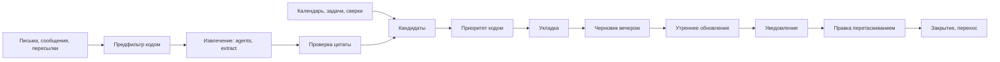

# 15. План дня из календаря, почты и мессенджеров; рабочее место в духе Claude Code

Для разработчиков, без кода. Закрывает A36 и A37 (бриф 2026-10-23). Сверено суперархитектором 2026-10-23 вечером (05 §7 С65-С109; ADR-67, ADR-68): входящие сообщения мессенджеров идут одним событием `channel_message.received` с `kind` (С65), вкладки центра получили вид `preview` (С70), вкладка ассистента как агента приходит в E (С71). Обязательны 05 §3, §6 и §7 (С1: план дня один, собирает `agents`, `office_day_plans`, `/me/day-plan`; С2: пояс и рабочие часы у `tenancy`) и 08. Опора: 09 §8, 11 §2, §5, §6, 04 §6-7, 12 §7, 01 §2.2. Параллельно: **13** (ассистент, импорт, превью и браузер, отчёты, матрица прав; A25-A31) и **14** (граф и трассировка; A32-A35), здесь только ссылки на них. Переработано 2026-10-23 по A38, A39, A40 (05 §8, ADR-70): центр рабочего места это браузер платформы (13 §3), вкладка `browser` строится в первом выпуске, внешний браузер пользователя остаётся сторонним программам, рядом с ним расширение «Ассистент офиса» (13 §3.9).

Соглашения 03 и 09: общие поля опущены, `day` это `YYYY-MM-DD` в поясе владельца; пути без `/api/office`; ошибки, повтор, листание по 05 §3.6; события `<сущность>.<событие>` в `office_events` в транзакции изменения. Новых модулей нет: план у `agents`, источники у `channels`, раскладки у `tenancy`, экраны у `ui` (своих таблиц у `ui` нет, 05 §3.1). «Отложено до: …» значит схема полная, включение позже.

## 0. Решения

| № | Решение | Основание |
|---|---|---|
| Р15-01 | Модель плана одна (09 §8, ADR-40): `office_day_plans`, `office_day_plan_items` расширяются. Новая `office_day_plan_candidates` это входящая очередь до попадания в план, не второй план | 05 С1 |
| Р15-02 | Черновик на следующий рабочий день собирается вечером в поясе владельца, утром обновляется и уходит уведомлением; утренняя сборка 09 §8.2 становится обновлением | A36 |
| Р15-03 | Намерения из писем и сообщений извлекает «Планировщик дня» одношаговым `routing.call` класса `extract` без инструментов; приоритет, укладку, конфликты считает код | 00 принцип 8 |
| Р15-04 | Читается только привязанное: папки ящика проекта (11 §5), группы проекта с ботом (01 §2.2), личные сообщения боту только явным действием (пересылка, `/plan`) при согласии. Личная переписка с третьими лицами не читается: ботовый API её не даёт, клиент от имени учётки не строится | A19, P03 |
| Р15-05 | Внешние календари читаются для плана адаптером 11 §2.5; до слова пользователя это D06, флаг возможности в `GET /me` | 11 §2.5, 05 С22 |
| Р15-06 | Чужой план видят МП (свои проекты) и руководство по ролевой модели; чужое маскируется до «занято»; чтение в `office_audit`. Пересматривает 09 §8.4 | A36 |
| Р15-07 | Перетаскивание это `agents.move_plan_item` с `expected_revision`; незакреплённые соседи сдвигаются кодом, закреплённые нет | A36 |
| Р15-08 | Пункт с проектом становится блоком занятости по кнопке: встреча вида `focus` у `channels`; без проекта нельзя (G31) | A36, 11 §2.1 |
| Р15-09 | Имя `day_plan.item.moved` из постановки по канону: `day_plan_item.moved` (как 05 С12) | 05 §3.8 |
| Р15-10 | Рабочее место одно ядро раскладки (зоны, панели, виджеты); три рабочих места 04 §6 это наборы по умолчанию и разрешённые виджеты | A37 |
| Р15-11 | Раскладка своей схемой JSON, писатель `tenancy` (`office_ui_layouts`), ключ «пользователь, рабочее место, устройство»; умолчания по роли у админа компании | A37 |
| Р15-12 | Каркас на dockview; сетка плана FullCalendar (стандартные модули); списки dnd-kit. Все MIT | 1.6, 2.7 |
| Р15-13 | Реестр виджетов это код, не таблица; сервер проверяет раскладку по реестру и `tenancy.can` при чтении | 00 принцип 5 |
| Р15-14 | Центр это браузер платформы: внутренние виды `document`, `preview`, `screen` рисует платформа, вид `browser` это серверный Chromium узла браузера (13 §3); одна адресная строка и вкладки для всех видов; внешний браузер только для сторонних программ (A38); контекст собирается онлайн по ходу работы в центре (A39) | A37, A38, A39; 13 §3; ADR-70 |

## 1. A36. План дня

### 1.1. Источники и правила сбора

| Источник | Что читается | Владелец сбора | Согласие | Срез |
|---|---|---|---|---|
| Календарь платформы | Экземпляры встреч пользователя, ответы `needs_action` (11 §2.6) | `channels.calendar_window`, `find_slots`, `meeting_context` | Не нужно | F |
| Google, Яндекс | Занятость; название только по флажку владельца | Адаптер 11 §2.5, `office_busy_blocks` | Подключение владельцем | D06 (Р15-05) |
| Почта: папки проекта | Письма, где пользователь в `To`/`Cc`; письма общего ящика проекта для МП | Источники `letter:<ключ>`, событие `source.indexed` | Привязка папки | F |
| Почта: папка «для плана» | Заголовок и до 4000 символов тела, в ядро не идёт | `channels` → `office_channel_inbox` | Режим `plan_only` и подтверждение | После ответа (4) |
| Группы Telegram, Макс проекта (Дополнение 2026-10-23, A41-A45, A44, 18; 05 §9 С131, С132) | Сообщения привязанного проектного чата (`office_project_chats`, виды `customer`, `internal`, `contractor`, `forwards`) | `channels` пишет `office_chat_messages` и абзац источника `chat` (абзац равен сообщению), `channel_message.received` с `kind=group` и `message_id`; кандидаты плана приходят из одного извлечения чата (`chat.assignment_detected`, `chat.request_opened`, 18 §4.1), второго вызова модели нет | Подтверждение кодом `/office_bind` и уведомление участников (18 §1.3-1.5) | F (Макс при боте, 11 §6.3; таск 86) |
| Личные сообщения боту | Пересланное боту, сообщение или голосовое с `/plan`; остальное идёт ассистенту офиса (13 §1.7); темы форум-группы остаются чатом Claude Code | `channels` → `office_channel_inbox` | Привязка (11 §6.2) и `capture_dm` | F, при боте |
| `cycle`, `delivery` | Задачи `handed`, `in_progress`, `code_review` со сроком завтра или просроченные; спринт; шаги маршрута; ревью MR; противоречия; обещания; риски `triggered` (МП); красные сверки | Чтение вниз (09 §8.1) | Не нужно | F |

Не читается никогда: письма вне привязанных папок (кроме `plan_only`), личные переписки в мессенджерах, чаты без бота и непривязанные группы, чужие календари. Заказчик плана не имеет.

**Бот в группе.** Чтобы видеть все сообщения, у бота Telegram выключен режим приватности; при привязке `channels` вызывает `getMe` и проверяет `can_read_all_group_messages`, при `false` экран предупреждает «бот видит только упоминания и ответы». Для Макса поведение в группах проверить по документации MAX; до проверки «только упоминания». Дополнение 2026-10-23, A41-A45: порядок привязки, проверки доступа (`read_scope`), состояния чата и согласие участников в 18 §1.3-1.5; здесь только то, что нужно плану.

**Адресат** считает код: `@логин` через `office_channel_bindings.external_user_id`, ответ на сообщение пользователя, `To`/`Cc`. Сообщение стороны заказчика в группе и письмо в общий ящик без адресата достаются МП проекта. Упоминание по имени без сопоставления даёт уверенность не выше 0,5.

| Требование | Где закрыто |
|---|---|
| A36 «сбора чтения событий в календаре и почте и мессенджерах» | 1.1; внешние календари D06 до ответа В15-01 |

### 1.2. Кандидат в план

Кандидат требует действия адресата в обозримый срок. Структурные (встречи, задачи, сверки) создаёт код; текстовые проходят предфильтр кодом и извлечение моделью.

| Намерение | Признак | Вид пункта, длительность по умолчанию |
|---|---|---|
| `meeting`, `meeting_prep`, `rsvp` | Встреча с участием; подготовка к встрече с заказчиком или демо; ответ `needs_action` | `meeting` (жёсткий); `meeting_prep` 15 мин; `rsvp` 5 мин |
| `request`, `assignment`, `question` | Просьба, поручение МП или тимлида, вопрос адресату в письме или сообщении | `mail_request` или `message_request`, 15 мин |
| `deadline` | Срок в тексте без просьбы | `promise` или срок у связанной задачи |
| `task_due`, `review`, `route_step`, `red_check`, `risk` | Структурные из `cycle`, `delivery` | `task` (остаток оценки, иначе 60), `review` 30, `route_step` 30, `check`, `risk` |
| `fyi` | Сообщение без действия | Не кандидат, отброшен с причиной |

Уверенность ниже 0,6 не встаёт на сетку сама, а лежит в лотке «Проверьте». Без цитаты, подтверждённой кодом, кандидат отбрасывается.

| Требование | Где закрыто |
|---|---|
| Постановка «встречи, письма с просьбой, сообщения с поручением, задачи со сроком, красные сверки» | 1.2 |

### 1.3. Конвейер



**Сбор событиями.** `agents` слушает (05 §6.3: слушать можно любое событие): `source.indexed` (`family=letter`), `channel_message.received` с `kind=group` и `kind=capture` (`channels`; один поток входящих с 13 §1.8, где `kind=assistant`; 05 §7 С65), `meeting.*` (конфликт, 1.6), `task.handed`, `task.status_changed`, `route.step_activated`, `docmr.review_requested`, `check.finished`, `risk.triggered` (пересчёт счёта, 09 §8.2 п. 1), `calendar.busy_synced` (D06). Задание `plan_extract:<user>` схлопывается 10 минут и берёт до 20 текстов адресата (доп., P20).

**Предфильтр кодом.** В модель идёт текст с адресатом, не от самого адресата (кроме пересылки), не короче 20 символов после вычистки цитат и подписей (04 §4), с новым для адресата за 14 дней отпечатком. При `settings.export_ban` проекта, несовместимом с поставщиком класса `extract`, и сверх лимита текст становится кандидатом `request` с уверенностью 0,3 и заголовком «Письмо от X: тема» без модели.

**Извлечение.** Дополнение 2026-10-23, A41-A45 (05 §9 С132): для сообщений привязанных чатов кандидаты рождаются из одного извлечения 18 §4.1 (`agents.extract_chat_items`, пункты `assignment`, `request`, `deadline` с якорем `message_id`), сюда они приходят событиями `chat.assignment_detected`, `chat.request_opened`; ниже путь писем и пересылок. `agents.extract_plan_candidates(user_id, items[])`, `max_turns=1` (ADR-04), текст блоком «материал источника» (04 §1.3). Выход строгой схемой: `intent`, `title` (до 80 символов, повелительно), `quote` (дословно), `due_at?` (относительные даты разрешает код по дате текста и поясу), `effort_min?`, `project_hint?`, `confidence`. Цитату проверяет код: `knowledge.verify_quote` для источников ядра (05 §3.10), тот же канон нормализации для `office_channel_inbox`. Нарушение схемы: один повтор, затем отказ. Резерв `routing.reserve` на проект источника; пересылки без проекта списываются с лимита компании `personal_planning`.

**Дедупликация и связь.** Одна просьба письмом и сообщением склеивается по отпечатку `(адресат, проект, title, due)` и сходству заголовков не ниже 0,9 (доп.). Ключ `ABC-12` в тексте связывает с задачей; иначе `knowledge.search` по семейству `ticket`, k = 3, порог 0,8 (доп.) даёт «похоже на ABC-12»: связанный кандидат поднимает счёт пункта задачи, а не создаёт свой. «Сделать задачей» только человек: черновик `cycle` с `origin=request` и `origin_evidence_id` (поля 14 §4.1); входящее без проекта сначала «Привязать к проекту», чтобы стать источником; покрытие требованиями проверяет страж цепочки 14 §6 (A34, A35).

**Приоритет кодом** (к 09 §8.2 п. 2, причина строкой из слагаемых; доп., P20): срок просрочен +4, завтра +3, до 3 дней +1; автор заказчик +2, МП или тимлид +1,5, команда +0,5; `assignment` и `request` +1, `question` +0,5; повторное обращение +1; у текстовых множитель `confidence`. Веса компании правит админ компании рядом с порогами светофора.

**Укладка.** Жёсткие интервалы: встречи `accepted`, `tentative`, `needs_action`, внешняя занятость (D06), закреплённые пункты. Окна: `work_hours` в `tz` (`tenancy`), праздники после D06. Жадно по счёту в сетке 15 минут; заполнение не выше 80% свободного времени (доп.); не поместившееся в лоток с причиной; короткие пункты без времени списком над сеткой.

**Расписание сборок** в поясе пользователя (`tzdata` фиксированной версии, 11 §2.4):

| Фаза | Когда | Что делает |
|---|---|---|
| `evening` | `evening_at`, умолчание конец рабочих часов плюс 30 минут | Черновик `draft` на следующий рабочий день; сводка модели один раз |
| `morning` | За 60 минут до начала рабочих часов (09 §8.2) | Новое за ночь; тронутое человеком не двигается |
| `event` | По событиям, схлопывание 2 минуты | Точечный пересчёт |
| `manual` | «Пересобрать» | Пересборка незакреплённого |
| `close` | Конец суток | `closed`; несделанное `moved` и новый пункт завтра с `moved_from_item_id` (09 §8.2 п. 6) |

Ключ задания `day_plan_build:<user>:<day>:<phase>`. Цикл процесса заданий раз в 5 минут выбирает пользователей, у которых наступило местное время фазы; случайная задержка до 10 минут разносит 300 пользователей (00 §7). План строится каждому участнику стороны `executor` с активным участием (`office_day_plan_prefs.enabled`, умолчание да); заказчику и наблюдателю с областью «проект» нет; РПО есть.

**Утреннее уведомление.** При `active` или в `notify_at` (умолчание за 15 минут до начала) `agents` пишет `day_plan.ready`; конвейер 11 §6.1 шлёт владельцу `immediate` во включённые каналы, тихие часы сдвигают. Текст: «План на 24.10: 3 встречи, 5 задач, 2 просьбы из почты. Первое: 10:00 Демо (ABC)» и ссылка; цитат нет (11 §6.1).

**Деградация.** Без модели план из структурных кандидатов, тексты низкой уверенностью, без сводки (00 принцип 10). Сбой источника не останавливает сборку: пометка «не учтены: почта (ошибка подключения)».

| Требование | Где закрыто |
|---|---|
| Постановка «сбор → извлечение намерений агентом → приоритизация кодом → черновик вечером по поясу → утреннее уведомление» | 1.3 |
| A36 «план работ менеджера на след день», «аналогичный план для каждого участника» | Фаза `evening`; абзац о составе |

### 1.4. Данные

Расширение 09 §8.3 (`agents`):

| Таблица | Поля плюс |
|---|---|
| `office_day_plans` | `state` плюс `off`; `revision`; `phase enum(evening, morning, event, manual)`; `accepted_at?`, `notified_at?`; `sources_state json`; `fill_ratio` |
| `office_day_plan_items` | `kind` плюс `mail_request`, `message_request`, `meeting_prep`, `rsvp`, `external_busy`; `state` плюс `proposed`; `candidate_id?`; `origin enum(auto, user, manager)`; `locked`; `duration_min`; `meeting_id?`; `moved_from_item_id?`; `flags json` (`outside_hours`, `overflow`, `conflict`); `updated_by`. Уникально `(plan_id, kind, ref)` у структурных |

Новые таблицы:

| Таблица | Писатель | Поля | Правила |
|---|---|---|---|
| `office_day_plan_candidates` | `agents` | `user_id`, `project_id?`, `intent`, `title`, `quote`, `anchor json` (якорь 05 §3.10 или `inbox_item_id` со смещениями), `source_refs json`, `due_at?`, `effort_min?`, `confidence`, `score`, `reason`, `related_ref?`, `state enum(new, planned, converted, dismissed, expired)`, `dedup_key`, `expires_at` | Уникально `(user_id, dedup_key)`; `expired` через 14 дней без срока или после срока |
| `office_day_plan_prefs` | `agents` | `user_id`, `enabled`, `evening_at?`, `notify_at?`, `auto_activate` (да), `sources json` (что учитывать), `default_focus_min`, `auto_block_calendar` (нет), `show_external_titles` | `user_id` уникален |
| `office_channel_inbox` | `channels` | `user_id`, `channel enum(telegram, max, mail)`, `external_ref`, `received_at`, `from_display`, `text` (до 4000), `voice_transcribed`, `project_hint_id?`, `state enum(new, extracted, attached, dismissed, expired)`, `expires_at` (14 дней) | Кэш внешней системы (05 С60): текст удаляется, у кандидата остаётся цитата до 300 символов. «Привязать к проекту» делает источник через `knowledge.ingest_source`; Дополнение 2026-10-23, A41-A45 (18 Р18-03, §2.2): только непривязанные пересылки и `/plan`; пересылка с выбранным проектом переносится в чат `forwards` владельца (`office_project_chats`), текст в кэше удаляется, строка становится `attached` с `attached_message_id` |

Поля чужих таблиц: `office_channel_bindings` плюс `capture_dm`, `capture_consent_at`, `capture_consent_text_version`; `office_mailbox_connections.project_rules` плюс `mode enum(project, plan_only)`, `consent_at`; `office_meetings.kind` плюс `focus`, поля `origin enum(user, day_plan)`, `plan_item_id?` (`channels`); `office_busy_blocks.title?` (D06); `office_limits` вид `personal_planning` (`tenancy`).

Состояния (к 05 §6.3): план `draft → active → closed`, `draft, active ↔ off`; пункт `todo → done, skipped, moved`, `proposed → todo` или удаление; кандидат `new → planned, converted, dismissed, expired`, `planned → new`; входящее `new → extracted → attached, dismissed`, любое `→ expired`.

| Требование | Где закрыто |
|---|---|
| Постановка «расширь office_day_plans и office_day_plan_items, не создавай параллельных» | 1.4; Р15-01 |

### 1.5. Права

Права это клетки матрицы `office_role_permissions` (13 §4.7): раздел `day_plan`, действия `view_others`, `edit_others`; умолчания ниже, правка на экране «Офис → Права» по правилам 13 §4.7.

| Кто | Чужой план | Правка чужого |
|---|---|---|
| Участник стороны `executor` | Нет | Нет |
| МП | Участники его проектов: пункты его проектов полностью, других проектов «Занято: другой проект», личные «Занято»; кандидаты только своего проекта, цитата если источник ему виден, пересылки боту никогда | Пункты своего проекта, не закреплённые владельцем; добавить задачу своего проекта; на закреплённое только `proposed` |
| РПО, наблюдатель с областью подразделение или компания | В области как у МП | Нет |
| Тимлид, технический лид | Нет; админ включает по проектам | Нет |
| Заказчик | Плана нет | Нет |
| Админ системы | Только `admin_as_role` (03 §4.3) | Нет |

Сводку модели, черновик к планёрке и цитаты из `office_channel_inbox` видит только владелец. Каждое чтение чужого плана и правка чужого пункта пишутся в `office_audit`; владелец видит «МП Петров перенёс пункт» и журнал «кто смотрел мой план» за 30 дней. `member.removed` закрывает доступ сразу, пункты того проекта у исключённого `skipped`.

| Требование | Где закрыто |
|---|---|
| «Чужой план видит только МП и руководство по ролевой модели» | 1.5; Р15-06 |

### 1.6. Экран плана дня

`/office/today` (04 §7) открывается вкладкой центра рабочего места (раздел 2); мини-виджет `day_plan_mini` в правой зоне.

```
[План на < чт 24.10 >  Сегодня | Завтра | Неделя | Список]  [Принять] [Пересобрать] [Проекты]
[Сводка · не учтены: почта (ошибка)]
| Лотки: Проверьте (3) | 09:00 [Подготовка: Демо ABC]           |
|  Не поместилось (2)  | 09:15 [ABC-12 Оплата картой 2ч  закреп] |
|  Без времени (4)     | 10:00 [Демо ABC  встреча, замок]        |
|  Не сегодня          | 11:00 [Ответить Петрову про смету  письмо] |
```

Виды: «День» (сетка, лотки), «Неделя» (5 рабочих дней колонками, до 14 вперёд), «Список» (порядок без сетки; основной на телефоне и для клавиатуры). Карточка: вид, цвет проекта (11 §2.7), заголовок, длительность, причина при наведении, значки «закреплено», «из письма», «из Telegram», «МП предложил», «в календаре». Клик открывает объект с контекстом (09 §8.2 п. 4).

**Жесты и данные:**

| Жест | Запрос | Что меняется | Событие |
|---|---|---|---|
| По сетке | PATCH `/me/day-plan/items/{id}` `{starts_at, expected_revision}` | Время по 15 мин, `locked=1`, сдвиг соседей, флаги; при `meeting_id` `channels.update_meeting` | `day_plan_item.moved` (`changes`, `reflowed[]`) |
| Нижний край | `{duration_min}` | 15-480 мин; сдвиг; оценка задачи не меняется | то же |
| В списке | `{order}` | Порядок, `locked=1` | то же |
| В другой день | `{move_to_day, starts_at?}` | Старый `moved`, новый в плане дня (создаётся `draft`) с `moved_from_item_id` | то же с `from_plan_id`, `to_plan_id` |
| Из лотка на сетку | POST `/me/day-plan/items` `{candidate_id, starts_at?}` | Пункт `origin=user`; кандидат `planned` | `day_plan_item.added`, `day_plan_candidate.decided` |
| В «Не сегодня» | PATCH `{state: skipped}` | Кандидат снова `new` | `day_plan_item.state_changed` |
| Задача из дерева слева | POST `{ref: "task:ABC-12", day}` | Пункт `origin=user` | `day_plan_item.added` |
| Встреча | Организатор: «Перенести для всех?» с `find_slots`, затем `update_meeting(scope=this)`; иначе запрет и «Предложить время» (11 §2.7) | Встреча | `meeting.updated` |

Сервер (`agents.move_plan_item`): права (1.5) → `expected_revision` (иначе 409 `stale_head` с текущим планом) → границы (не прошлое, не дальше 14 дней, внутри суток пояса; вне рабочих часов с флагом) → сдвиг незакреплённых: пересекающие пункты по порядку встают вплотную после перенесённого, вышедшие за рабочие часы получают `overflow`, закреплённые не двигаются, их пересечение даёт `conflict: self_overlap` → вызовы `channels` для блоков занятости → одна транзакция (пункты, `revision`, событие). Сбой `channels` откатывает правку: блок и пункт не расходятся. Клиент оптимистичный; при 409 перечитывает и повторяет правку один раз, если пункт не менялся. `Mod+Z` отправляет обратный PATCH из стека клиента. Пересборка берёт `revision` в начале и при чужой правке повторяется поверх, трогая только незакреплённое. Правка МП идёт той же операцией с `origin=manager`, владельцу `day_plan_item.moved` сразу в веб.

**Конфликт с календарём.** `meeting.*` по встрече пользователя ставит `day_plan_reconcile:<user>:<day>` (2 минуты): встреча поверх незакреплённого сдвигает его; поверх закреплённого или `focus` даёт `conflict: meeting` и `day_plan.conflict_detected` (уведомление `immediate`, если сегодня и меньше 2 часов, иначе значок); отмена даёт `skipped` и кнопку «Заполнить окно»; перенос двигает пункт встречи; событие своей же правки (`origin=day_plan`, тот же `plan_item_id`) пропускается.

**Командный вид** `/office/:id/plans` (МП) и `/office/people/:uid/plan` (руководство): строки люди, столбцы часы; чужое серым, конфликты и `fill_ratio` выше 1 подсвечены; МП тащит пункты своего проекта и задачи бэклога в строку человека (`origin=manager`), на закреплённое диалог «Предложить владельцу».

**Библиотеки.** Сетка «День» и «Неделя» (и экран календаря 11 §2.7): FullCalendar 6, стандартные модули MIT (`timegrid`, `daygrid`, `list`, `interaction`, пояс через `luxon`): шаг, растяжение, внешние лотки, рабочие часы, именованные пояса, касание; ресурсный вид «люди × время» платный и не берётся. Список, лотки, командный вид: dnd-kit (MIT, датчики клавиатуры и касания). Отклонены react-big-calendar (слабее пояса и касание); pragmatic-drag-and-drop (Apache-2.0) запасной для dnd-kit.

**Клавиатура** (замена каждого жеста, 04 §10): стрелки выбор; `Alt+↑/↓` порядок или ±15 минут; `Alt+←/→` другой день; `Shift+↑/↓` длительность ±15; `Enter` открыть; `Space` сделано; `L` закрепить; `T` в календарь; `Delete` в «Не сегодня». Меню карточки «Перенести…» с полями дня, времени, длительности. Статусы словом и значком.

| Требование | Где закрыто |
|---|---|
| A36 «визуальной корректировки путем перетаскивания» | 1.6 |
| «Порядок, перенос на другой день, длительность по сетке; что с данными; события; конфликт с календарём» | Таблица жестов, абзацы «Сервер», «Конфликт»; Р15-09 |

### 1.7. Обратная связь в календарь

Кнопка «В календарь» у пункта с проектом: `agents.block_in_calendar(item_id)` вызывает `channels.schedule_meeting(project_id, {kind: focus, title, starts_at, duration_min, tz, attendees: [владелец], origin: day_plan, plan_item_id})`; пункт получает `meeting_id`, событие `day_plan_item.blocked`. Правила: владелец видит «Фокус: ABC-12…», другие в поиске окна и в календаре проекта (фильтр «фокус-блоки», по умолчанию скрыт) «Иван: занят»; `find_slots` считает `focus` занятостью; перенос пункта двигает встречу в той же операции; «Убрать из календаря» и перенос на другой день без блока дают `cancel_meeting` (`cancelled`, без удаления, A20); `auto_block_calendar` ставит блоки при принятии плана; наружу только экспортом 11 §2.5 в режиме `busy` (D06); пункт без проекта блокировать нельзя (G31); заказчик `focus` не видит.

| Требование | Где закрыто |
|---|---|
| «Пункт плана становится блоком занятости по кнопке» | 1.7; Р15-08 |

### 1.8. API, события, расход

| Метод и путь | Вход → выход | Права | Ошибки |
|---|---|---|---|
| GET `/me/day-plan?day=&projects=` (09); нов. GET `/me/day-plans?from=&to=` | план с `revision`, лотками, `sources_state`; до 14 дней | владелец | 422 окно |
| PATCH `/me/day-plan/items/{id}` (расширен); нов. POST `/me/day-plan/items` | `{order?, starts_at?, duration_min?, move_to_day?, state?, pinned?, expected_revision}`; `{candidate_id? \| ref?, day, starts_at?}` | владелец | 409 `stale_head`, 422, 409 `conflict` |
| нов. POST `/me/day-plan/accept`; PUT `/me/day-plan/day-off`; POST `/me/day-plan/rebuild` (09) | `{day, expected_revision}`; `{day, off}`; `{day}` | владелец | 409, 429 |
| нов. GET `/me/day-plan/candidates`; POST `/day-plan-candidates/{id}/dismiss`, `/propose-task` | кандидаты; `{reason}`; черновик задачи `origin=request` (14 §4.1) | владелец; задача участнику с правом | 403, 409 |
| нов. POST, DELETE `/me/day-plan/items/{id}/calendar-block` | блок `focus` | владелец | 409 без проекта |
| нов. GET, PUT `/me/day-plan/prefs`; PUT `/me/channels/{telegram\|max}/capture`; PUT `/me/mailbox/bindings` (поле `mode`); POST `/inbox-items/{id}/attach-project` | настройки; `{dm}` с версией согласия; привязки; источник ядра | владелец | 409 канал не привязан, 422 |
| нов. GET `/projects/{pid}/day-plans?day=`; GET `/users/{uid}/day-plan?day=` | маскированные планы | МП, руководство | 403; 404 вне области (И25) |
| нов. PATCH `/users/{uid}/day-plan/items/{id}`; POST `/users/{uid}/day-plan/items`; POST `/day-plan-items/{id}/decision` | правка МП; добавление; `{accept \| reject}` у `proposed` | МП; владелец | 403, 409 `conflict` (ответ предлагает `propose=true`) |

| Событие | Пишет | Нагрузка | Слушают |
|---|---|---|---|
| `day_plan.built` (расширено) | `agents` | `plan_id`, `day`, `phase`, `revision`, `counts` | WS |
| `day_plan.ready` | `agents` | `plan_id`, `day`, `counts` без заголовков | `channels`, WS |
| `day_plan.accepted`, `day_plan.closed`, `day_plan.conflict_detected` | `agents` | `plan_id`, `revision`; `item_id`, `meeting_id` | WS; `channels` (конфликт) |
| `day_plan_item.added`, `.moved`, `.state_changed`, `.removed`, `.blocked`, `.unblocked` | `agents` | `item_id`, `actor_id`, `origin`; у `moved` `changes`, `reflowed[]`, `from_plan_id?`, `to_plan_id?` | WS; `channels` (владельцу при чужом `actor`) |
| `day_plan_candidate.extracted`, `.decided` | `agents` | `candidate_id`, `intent`, `state` | WS |
| `channel_message.received` (общее с 13 §1.8) | `channels` | `kind enum(assistant, capture, group)`, `channel`, `external_message_id`; при `group`: `source_id`, `message_key`, `project_id`, `author_side`, `addressed_user_ids[]`; при `capture`: `inbox_item_id`, `user_id`; при `assistant`: по 13 §1.8 | `agents` (по `kind`) |
| `channel.capture_changed` | `channels` | `user_id`, `channel`, `dm`, версия согласия | `agents`; аудит |

Аудитория событий плана `user`: WS отдаёт их по личной подписке, смотрящим с правом с маскировкой (2.10).

Расход (доп., масштаб 02 §6.3): пачка до 20 текстов `extract` 6 тыс. вход и 1 тыс. выход около $0,001; сводка `draft_text` около $0,001; участник с 50 адресованными текстами в день около $0,004, команда 20 человек около $0,08 в день.

| Требование | Где закрыто |
|---|---|
| Постановка «события day_plan.item.moved», API плана, права чужого плана | 1.8; имя по канону Р15-09 |

### 1.9. Срезы

| Срез | Что входит |
|---|---|
| F (как 09 §8) | Поля и таблицы 1.4 кроме `office_channel_inbox`; фазы сборки, `day_plan.ready`; календарь платформы, задачи, сверки, риски; извлечение из писем проектных папок и групп Telegram; экран День, Неделя, Список; `focus`; права МП и руководства с аудитом; командный вид |
| F, при боте компании | Группы Макса; пересылки боту, `office_channel_inbox`, `capture_dm`, голосовые через `knowledge.transcribe` |
| D06 до ответа В15-01 | Внешние календари в плане |
| После ответа В15-02, В15-12 | Папка `plan_only` |
| После P20 | Веса, пороги, доля заполнения, метрика «доля выполненного плана» в `insight` |

| Требование | Где закрыто |
|---|---|
| A36 целиком, срезы | 1.1-1.9 |

## 2. A37. Рабочее место

### 2.1. Каркас

```
+--+-----------------+-------------------------------------+----------------+
|П | Проекты, файлы  | [Ассистент][Превью][spec v6]       | План дня       |
|о | > ABC Оплата    |                                     | Ждёт решения   |
|л |   > Документы   |  активная вкладка; у превью и        | Красные сверки |
|о |     > Задание   |  документа справа панель чата       | Граф (14)      |
|с |       v6, !12   |  по значку                          | Подсказки      |
|а |   > Задачи      |                                     | Статус проекта |
+--+-----------------+-------------------------------------+----------------+
| Нижняя зона (скрыта): терминал, журнал агентов, разрывы цепочки (14)       |
```

| Зона | Содержимое | Аналог |
|---|---|---|
| Полоса действий | Виды левой зоны: Проекты и файлы, Поиск, Почта, Календарь, Чаты кода (по роли), Отчёты (13) | Activity Bar |
| Левая | Активный вид, по умолчанию дерево (2.6) | Primary Side Bar |
| Центр | Браузер платформы (13 §3): одна адресная строка и ряд вкладок; вкладки видов ассистент (13 §1, маршрут `/office/assistant`), превью (13 §3.1), документ (12 §7.1), экраны (план, календарь, доска, граф и разрывы 14, отчёт 13), `browser` (серверный Chromium: стенд, GitLab и GitHub, трекер, сайты белого списка; 13 §3.3). У превью, браузера и документа значок «Чат» открывает панель того же разговора внутри центра (`Alt+C`), сторона и ширина запоминаются; у вкладки `browser` панель показывает «На этой странице: …» (совпадения с артефактами, 13 §3.7); «Открыть сбоку» делит центр | Editor area; чат Cursor; браузер Cursor |
| Правая | Виджеты стопкой со сворачиванием | Secondary Side Bar |
| Нижняя | Терминал (роли с `chat_code/use`), журнал агентов (МП), разрывы цепочки (14 §6) | Panel |

Маршруты 04 §7 сохраняются и открывают вкладку центра; адрес отражает активную вкладку, каркас между переходами не перерисовывается.

| Требование | Где закрыто |
|---|---|
| A37 «слева панель с проектами и файлами, по центру чат либо встроенный браузер с иконкой панели чата, справа виджеты, подсказки» | 2.1; ассистент и браузер по 13: центр это браузер платформы со значком панели чата; внутренние виды с C, вкладка `browser` с E (13 §3.11) |
| A38 «единое рабочее место со своим собственным браузером» | 2.1, 2.2, 2.5; 13 §3 |

### 2.2. Модель раскладки

| Элемент | Поля |
|---|---|
| Раскладка | `schema_version`, `workplace enum(team, client, portfolio)`, `zones`, `center`, `floating[]` (срез H), `hotkeys{}` |
| Зона `left`, `right`, `bottom` | `visible`, `size` (доля окна), `collapsed`, `mode enum(stack, tabs)`, `panels[]` |
| Панель | `panel_id`, `type enum(view, widget)`, `view_id?` (`tree`, `search`, `mail`, `calendar`, `code_chats`, `reports`, `terminal`, `agent_log`, `chain_gaps`) или `widget_id?`, `params{}`, `share`, `collapsed` |
| Центр | `tabs[]` (`kind enum(chat, preview, browser, document, screen)`, `ref`), `active`, `chat_side {visible, side, size}`, `address_bar` (видимость); `preview` это превью источника 13 §3.1; `browser` это вкладка серверного Chromium узла браузера (`ref` = `office_browser_tabs.tab_id`, адрес и заголовок восстанавливаются с сервера, 13 §3.3; после A38 строится в E, не резерв); режим `watch` трансляции запуска агента тем же видом с `ref` = `run_id` (H) |

Ограничения: центр не пуст (последняя вкладка закрывается в чат); боковая зона от 200 пикселей, центр от 360; окно уже 1200 сворачивает правую зону в значки, уже 768 включает мобильный вид; раскладка до 32 КБ.

| Таблица (`tenancy`) | Поля | Правила |
|---|---|---|
| `office_ui_layouts` | `scope enum(user, role)`, `user_id?`, `role?`, `workplace`, `device_key` (у пользователя случайный идентификатор браузера или `class:<…>`; у роли `class:<…>`), `device_class enum(desktop, tablet, phone)`, `layout json`, `schema_version`, `revision`, `updated_by` | Уникально `(scope, user_id или role, workplace, device_key)` |

**Выбор при входе:** пользователь и устройство → пользователь и тот же класс, последняя (новый браузер получает копию) → умолчание компании для роли → встроенное умолчание кода. Роль при нескольких: МП, РПО, тимлид, технический лид, архитектор, системный, бизнес-аналитик, разработчик, тестировщик, наблюдатель; у заказчика подписант, затем представитель.

**Проверка при чтении:** виджеты вне реестра или без права (`tenancy.can`) уходят в `hidden[]` с причиной, строка не меняется, виджет вернётся с правом. Старая `schema_version` мигрирует чистой функцией клиента; новее текущей (откат релиза) даёт встроенное умолчание без потери строки.

**Сохранение:** копия в локальном хранилище для мгновенной отрисовки; PUT через 1 секунду после окончания жеста с `expected_revision`; 409 `stale_head` (вторая вкладка) решается повтором своей последней операции поверх серверной.

**Сброс и умолчания:** «Сбросить» удаляет строку устройства, «Сбросить везде» все строки рабочего места. Админ компании правит умолчание роли в «Офис → Раскладки» (каркас в режиме «умолчание для роли X», `scope=role`); пользователям роли подсказка «Обновлено умолчание: применить?», без принуждения.

| Требование | Где закрыто |
|---|---|
| «Модель раскладки, таблица office_ui_layouts, настройка по роли, сброс; на пользователя и устройство» | 2.2; Р15-11 |

### 2.3. Реестр виджетов

Код, общий для сервера и клиента; `GET /me/ui/widgets` отдаёт разрешённое. Запись: `widget_id`, рабочие места, право, зона по умолчанию, размеры, источник, события WS, контекст (`none`, `project`, `object`), приоритет на телефоне, срез.

| Виджет | Кому | Данные, события | Срез |
|---|---|---|---|
| `day_plan_mini` | Команда | GET `/me/day-plan`; `day_plan*` | F |
| `team_plans` | МП, руководство | GET `/projects/{pid}/day-plans`; `day_plan_item.moved` | F |
| `pending_decisions` | Все | GET `/me/pending` (12 §7.3, расширен на команду); `route.step_activated`, `docmr.review_requested` | C |
| `red_checks` | Разработчик, тестировщик, тимлид, МП | нов. GET `/me/checks?state=red`; `check.finished` | E |
| `graph_context`; `chain_gaps` | Команда (заказчик без скрытых узлов); МП, БА, СА, тимлид | GET `/projects/{pid}/artifact-graph?focus=&mode=neighborhood&depth=1` (14 §3.7), `trace.link_*`; виджет разрывов 14 §6 и `chain_gap.*` | C, полный E (14) |
| `hints` | Все | нов. GET `/me/hints?project=&ref=`; `metric.updated`, `day_plan.conflict_detected` | E |
| `project_status` | Команда, наблюдатель; заказчику статус по требованиям | GET `/projects/{pid}/health`; `metric.updated` | C |
| `candidates`, `conflicts`, `usage_limit` | МП, аналитики; МП, админ компании | 12 §7.3; `candidate.batch_proposed`, `conflict.opened`, `usage.threshold` | C |
| `upcoming_meetings`, `notifications`, `requirement_context` | Все по правам | `/me/calendar`, `/me/notifications`, `/requirements/{key}` | C, F |
| `import_status`, `recent_reports` | По 13 (A31 для отчётов) | По 13 | По 13 |
| `customer_waiting` | Заказчик | GET `/me/pending`; `version.sent_to_customer` | C |
| `ops_status`, `pipelines_mine`, `ops_alerts`, `platform_health` (Дополнение 2026-10-23, A41-A45, 17 §5.6) | Команда; Раз, Тест, Тим, ТЛ; Адм, ТЛ, Тим, контакты окружения; АП, Адм | GET `/projects/{pid}/ops`, `/me/pipelines`, `/ops/alerts`, `/ops/platform/health`; `pipeline.*`, `deployment.*`, `environment.*`, `ops_alert.*`, `platform_module.health_changed` | B (`platform_health`), F, G |
| `chat_requests_mini` (Дополнение 2026-10-23, A41-A45, 18 §3.5) | Команда по разделу `chats` | GET `/me/chat-requests`; `chat.request_opened`, `chat_request.*`, `chat_reply_draft.ready` | F |

Подсказки считаются при чтении без таблицы: отставание документации (`cycle.doc_staleness`, 10 §8), открытые разрывы цепочки объекта (14 §6), конфликт плана, кандидаты низкой уверенности; каждая ведёт на действие.

**Контекст выбора.** Каркас держит `{project_id, ref}`: его меняют дерево, активная вкладка, выделенный абзац. Виджеты `object` перечитываются по нему; ассистент 13 получает ссылку на объект. Перетаскивание между зонами несёт `application/x-office-ref` `{kind, ref, project_id}`: из дерева в план, в чат ассистента (вложить контекст, 13), в центр (открыть).

| Требование | Где закрыто |
|---|---|
| «Виджеты: план дня, красные сверки, граф из 14, подсказки, статус проекта; реестр виджетов» | 2.3; Р15-13 |

### 2.4. Три рабочих места на одном ядре

| | Команда | Заказчик | Наблюдатель |
|---|---|---|---|
| Полоса действий | Проекты и файлы, Поиск, Почта, Календарь, Чаты кода (по 04 §7), Отчёты (A31) | Проекты и документы, Календарь | Портфель, Отчёты (A31) |
| Левая | Дерево проекта | Дерево контура заказчика: документы профиля, требования контура, опубликованные созвоны, выбранные макеты | Подразделения → проекты |
| Центр | Чат ассистента (13), «Сегодня» | Лента проекта (04 §6.1), чат в правах заказчика (13, A28) | Портфель (04 §6.3), чат только чтение (13) |
| Правая | Виджеты главной по роли (04 §6.2) плюс `day_plan_mini`, `hints` | `customer_waiting`, `project_status`, `upcoming_meetings` | `project_status`, `recent_reports` |
| Нижняя | Терминал, журнал агентов, разрывы цепочки | Нет | Нет |
| Запрет реестра | | Терминал, чаты кода, файлы рабочих копий, журнал агентов, кандидаты, планы, бюджет, ключи, MCP (00 §6) | Правка, планы вне `day_plan/view_others` |

Превью и браузер у всех по 13 §3: внутренние виды у всех трёх рабочих мест; вкладка `browser` по клетке `browser/use` (заказчику закрыта по умолчанию, 13 §3.10). Во внешнем браузере рядом с человеком работает расширение «Ассистент офиса» (13 §3.9), вне каркаса, но с тем же диалогом и протоколом. Админ системы переключает рабочее место в шапке (04 §6); у каждого своя раскладка.

| Требование | Где закрыто |
|---|---|
| «Одно ядро раскладки, разные наборы виджетов и панелей для 04 §6» | 2.4; Р15-10 |

Дополнение 2026-10-26 (сверка 27, С27-22; `27` §7). Новые экраны разделов 21-26 по трём рабочим местам:

| | Команда | Заказчик | Наблюдатель |
|---|---|---|---|
| Полоса действий | Плюс «На ревью» (`25` §6.3, значок по `25` П-13) и «Результаты» (`26` §8) | Без изменений; результаты в «Документах» | Без изменений; управленческие ревизии в «Отчётах» |
| Левая | Дерево проекта плюс узлы «Артефакты», «Реестры», «Гант», «Актуализация» по клеткам | Без изменений | Без изменений |
| Центр | Ревью по пунктам, протоколы ресёрча, конвейер результата, вкладка чата руководства для участников | Центр уведомлений в шапке: только виды с аудиторией `customer` | Чат руководства только счётчиками до ответа `25` В25-3 |
| Правая | Виджеты `review_queue_mini` (МП, ответственные), «Готово к утверждению» (МП) | Без изменений | Недельная сводка портфеля без денег, кроме видящих бюджет |
| Запрет реестра | | Плюс очередь ревью, протоколы ресёрча, пакеты фактов и контекста, наложения, чаты, реестры, Гант вне опубликованного снимка | Правка, ревью, наложения |

Пункт плана дня из чата руководства виден только владельцу, который видит чат; в чужом плане с маскировкой такой пункт скрыт целиком (`25` §5.2).

### 2.5. Центр

Ассистент, импорт, превью и браузер принадлежат 13. Каркас даёт: одна адресная строка на все виды (внутренний адрес открывает вкладку своего вида, адрес белого списка вкладку `browser`, адрес вне списка карточку заявки; 13 §3.1), одна активная вкладка, порядок перетаскиванием; панель чата у превью, браузера и документа показывает тот же разговор ассистента, не новый; панель «Спросить» 04 §7 становится этой панелью (13 §1); документ открывается редактором или просмотром по правам (12 §7.1), файлы импорта превью 13 §3.1 (`GET /sources/{id}/preview`); вкладка `browser` рисует кадры трансляции и шлёт ввод по WS (13 §3.3), перетаскивание файла из дерева в неё подставляет файл в форму страницы (`set_file_inputs`), перетаскивание ссылки со страницы в чат вкладывает контекст.

| Требование | Где закрыто |
|---|---|
| A37 «встроенный браузер с иконкой отображения диалоговой панели с чатботом» | 2.5, 2.1; браузер и превью по 13 §3 |

### 2.6. Дерево проекта

Ленивое: `GET /projects/{pid}/tree?node=&cursor=` собирает узлы чтениями модулей в правах актора (`tenancy.scope` до выборки); ответ `[{node_id, kind, title, ref, has_children, badge?, route}]`.

| Узел | Дети | Кто видит |
|---|---|---|
| Документы | Бриф, задание, страницы (09 §2.1), архитектура, руководство, ролевая модель, протоколы, договоры | По профилю; договоры МП и подписанту |
| Документ | Версии (`v6 draft`, `v5 accepted`), MR документа | Заказчик только версии профиля (05 §3.2 п. 8) |
| Требования | Ключи с цветом следа | Команда; заказчик контур |
| Задачи | «Мои», «Текущий спринт», «Доска» | Команда |
| Источники и импорт | `file:`, письма, созвоны, чаты, импорт 13 с ходом разбора | Команда; заказчик свои загрузки |
| Чаты (Дополнение 2026-10-23, A41-A45, 18 §3.5) | Проектные чаты со значками состояния и счётчиками запросов, сводки, «Мои запросы» | По разделу `chats`; заказчику нет |
| Эксплуатация (Дополнение 2026-10-23, A41-A45, 17 §5.6) | Пайплайны, окружения (стенд, прод), выкладки, контейнеры, мониторинг; у Адм серверы и оповещения | По клеткам `ops`, `ops.infra`; заказчику нет |
| Макеты; Отчёты; Граф | Варианты и утверждённые; каталог 13; вход в граф 14 | По 10 §11, A31, 14 |

Действия узла: открыть, открыть сбоку, спросить ассистента, в план дня (задачи). Быстрый переход `Mod+P`: нов. `GET /me/quick-open?q=` по названиям документов, ключам требований и задач всех проектов пользователя.

| Требование | Где закрыто |
|---|---|
| «Дерево проекта: документы ядра знаний, версии, файлы импорта, задачи» | 2.6 |

### 2.7. Библиотека раскладки

«По положению на экране» значит перенос панелей между зонами и вкладки, а не только размеры: это класс библиотек докинга.

| Критерий | react-resizable-panels | dockview | rc-dock |
|---|---|---|---|
| Лицензия, React 18 (в проекте 18.3.1) | MIT, да | MIT без зависимостей, да | Apache-2.0, да |
| Размеры, сворачивание | Да, лучшая клавиатура и ARIA разделителей | Да | Да |
| Перенос панелей между зонами, вкладки | Нет | Да | Да |
| Боковая стопка как Side Bar | Нет | Paneview | Нет |
| Плавающие и вынесенные окна | Нет | Да | Плавающие |
| Сериализация | Только размеры | Полная | Полная |
| Развитие, стилизация | Активно | Активно, темы переменными CSS | Медленно, стили тяжелее |

**Выбор: dockview.** Одна библиотека даёт сетку зон, стопку виджетов (Paneview) и вкладки центра, плюс окна на срез H. Схема 2.2 переводится в её модель и обратно чистыми функциями: смена библиотеки не трогает сохранённое. Темы на токенах проекта (`--bg-canvas`, `--border-subtle`). Нехватку клавиатуры у разделителей закрывают команды «шире», «уже», «переместить в левую, правую, нижнюю зону» в палитре и меню панели плюс живой регион для диктора. **Запасной путь**, если на срезе C не пройдут проверка доступности или вес: зоны на react-resizable-panels, свои вкладки, перенос только меню «Переместить в…»; модель 2.2 та же. FlexLayout (MIT) рассмотрен как второй кандидат докинга: у него края-панели, но нет стопки как Paneview. Версию и лицензию зафиксировать при добавлении зависимости.

| Требование | Где закрыто |
|---|---|
| «Сравни 2-3 варианта для React, выбери и обоснуй» | 2.7; Р15-12 |

### 2.8. Мобильный вид и горячие клавиши

**Телефон** (уже 768): докинга нет, зоны стопкой; нижняя полоса «Файлы», «Чат» (центр по 13), «Виджеты» (карточки по приоритету и порядку пользователя), «План» (команда). Раскладка телефона отдельной строкой (`device_class=phone`): видимость и порядок виджетов, вкладка по умолчанию. План на телефоне видом «Список», перетаскивание долгим нажатием (dnd-kit). Заказчику первой лента «ждёт решения» (04 §6.1). **Планшет** (768-1199): левая зона значками с выезжающей панелью, правая выезжающим ящиком.

**Клавиши.** `Mod` это `Ctrl` или `Cmd`. Не используются неперехватываемые или браузерные (`Ctrl+W`, `Ctrl+T`, `Ctrl+N`, `Ctrl+Tab`, `Ctrl+L`, `Ctrl+Shift+P` в Firefox, `Alt+D`, `Alt+F`, `Alt+E`) и сочетания редактора (`Mod+B` жирный в TipTap).

| Клавиши | Действие | Аналог |
|---|---|---|
| `Mod+K`; `Mod+P` вне редактора | Палитра команд; быстрый переход | Command Palette; Quick Open |
| `Mod+Shift+L` | Фокус в чат ассистента | `Mod+L` в Cursor |
| `Alt+C` | Панель чата у превью, браузера или документа | |
| `Alt+L`; `Alt+N` | Фокус в адресную строку; новая вкладка центра | `Ctrl+L`, `Ctrl+T` в браузере (сами не перехватываются) |
| `Alt+1..4`; `Alt+Shift+1, 3, 4` | Фокус зоны; показать или скрыть левую, правую, нижнюю | `Mod+B`, `Mod+Alt+B`, `Mod+J` в VS Code |
| `Alt+[`, `Alt+]`, `Alt+W` | Вкладки центра; закрыть вкладку | |
| `Alt+P`; `Alt+Shift+0` | План дня; сброс раскладки с подтверждением | |
| `Enter`, `Mod+Enter` | Отправка по `sendKey.ts` | |

Переопределения в `layout.hotkeys`; тест в Chrome, Firefox, Safari на macOS и Windows (`Alt` с цифрой в macOS читается по `code`).

| Требование | Где закрыто |
|---|---|
| «Мобильный вид (панели стопкой), горячие клавиши» | 2.8, клавиши плана 1.6 |

### 2.9. Что переиспользуется из AI-Workspace

| Есть (`web/src/components`, `CLAUDE.md` «Что есть в интерфейсе») | Решение |
|---|---|
| `Sidebar.tsx`, `NewChatDialog.tsx` | Целиком как вид «Чаты кода» левой зоны для ролей с чатом кода; страница `/` остаётся |
| `files/FileTree.tsx`, `FileViewer.tsx`, `FileEditor.tsx`, `FileSearch.tsx` | `FileTree` обобщается до дерева с поставщиком узлов; дерево 2.6 на нём, данные новые |
| `files/RichViewers.tsx`, `SheetTable.tsx`, `lib/Markdown.tsx` | Просмотр файлов импорта во вкладке центра |
| `artifacts/ArtifactsPanel.tsx` | Остаётся в чате кода; образец каталога отчётов 13 |
| `TerminalPanel.tsx`, `SshSettingsPanel.tsx` | Вид нижней зоны для ролей с чатом кода |
| `Chat.tsx`, `MessageInput.tsx`, `events/*`, `ContextGauge.tsx` | Берёт чат ассистента по 13 |
| `ResizeHandle.tsx`, `lib/usePanelWidth.ts` | В офисе заменяются dockview и `office_ui_layouts`; в чате кода остаются |
| `lib/useMediaQuery.ts`, `theme.ts`, `reducedMotion.ts`, `api/ws.ts` | Переиспользуются; `ws.ts` образец клиента `/api/office/ws` |
| `office/OfficeProjectView.tsx`, `passport/`, `brief/`, `spec/` | Вкладки центра без переписывания; `OfficePage.tsx` заменяется каркасом |
| `AdminPage.tsx`, `admin/*` | Рядом вкладка «Офис → Раскладки» |

**Заново:** каркас зон на dockview и перевод схемы; реестр и хост виджетов; данные офисного дерева; полоса действий; палитра и быстрый переход; мобильная стопка; контекст выбора; экран плана с сеткой и лотками; командный вид; админка раскладок; личная подписка WS.

| Требование | Где закрыто |
|---|---|
| «Что из AI-Workspace переиспользуется, что строится заново» | 2.9 |

### 2.10. Карта «экран → API», события, WebSocket

Дополняет 12 §7.3 (и 1.8); всё «нов.».

| Экран | Чтение | Действия |
|---|---|---|
| Каркас | GET `/me` (флаги возможностей); GET `/me/ui/layout?workplace=&device=` → `{layout, revision, source, hidden[]}`; GET `/me/ui/widgets?workplace=` | PUT `/me/ui/layout` `{workplace, device_key, device_class, layout, expected_revision}`; POST `/me/ui/layout/reset` `{workplace, device_key?, everywhere?}`; POST `/me/ui/layout/copy` |
| Дерево | GET `/me/tree`; GET `/projects/{pid}/tree?node=&cursor=`; GET `/me/quick-open?q=` | Пути 12 §7.3 |
| Виджеты | По 2.3; GET `/me/checks?state=red`, `/me/hints`; `/me/pending` расширен | По виджету |
| План, командный вид, настройки источников | 1.8 | 1.8 |
| Админка «Офис → Раскладки» | GET `/admin/ui/layout-defaults?workplace=` | PUT, DELETE `/admin/ui/layout-defaults/{workplace}/{role}/{device_class}` |
| Админка «Офис → Права» | По 13 §4.7 | Клетки `day_plan/view_others`, `day_plan/edit_others` |

Права: `/me/*` о себе; `/admin/ui/*` админ компании. Ошибки: 409 `stale_head`; 422 (раскладка больше 32 КБ, неизвестное рабочее место); 404 вне области.

| Событие | Пишет | Слушают |
|---|---|---|
| `ui_layout.saved`, `ui_layout.reset` (`user_id`, `workplace`, `device_key`, `revision`) | `tenancy` | WS владельцу: другие вкладки устройства перечитывают |
| `ui_layout_default.changed` (`workplace`, `role`, `device_class`, `actor_id`) | `tenancy` | WS пользователям роли (подсказка), аудит |

WebSocket (к 03 §5.9): кроме подписки на проект `{"subscribe": {"me": true}, "last_seq": N}` даёт события с `audience=user` о себе (план, кандидаты, раскладка, уведомления); `{"subscribe": {"day_plan_of": uid, "day": …}}` после проверки `day_plan/view_others`, нагрузка маскируется по 1.5. Каркас держит одно соединение и раздаёт кадры виджетам; при пропуске номера виджет перечитывает источник.

**Нефункциональное (доп., P20):** первая отрисовка каркаса из локальной копии до 300 мс; отклик перетаскивания кадр 16 мс; PATCH пункта и PUT раскладки p95 до 300 мс (00 §7); вечерняя сборка без модели до 5 с; dockview с каркасом, FullCalendar и dnd-kit с вкладкой плана, Cytoscape.js с графом лениво. **Тесты:** сборка на записанных ответах модели; маскировка чужого плана; без согласия пересылка не создаёт записи; летнее время у вечерней сборки; сдвиг соседей и закреплённые пункты; нет петли «пункт двигает встречу, встреча пункт»; виджет без права в `hidden`; Playwright: перетаскивание мышью и клавиатурой.

| Требование | Где закрыто |
|---|---|
| «Карта экран → API для новых экранов, события» | 2.10, 1.8 |

### 2.11. Срезы

| Срез | Что входит |
|---|---|
| C | Каркас на dockview, схема 2.2, `office_ui_layouts`, встроенные умолчания ролей, дерево (документы, версии, источники, требования), виджеты `pending_decisions`, `project_status`, `candidates`, `conflicts`, `usage_limit`, `notifications`, `requirement_context`, палитра, клавиши, мобильная стопка, личная подписка WS; вкладки паспорта, брифа, задания в центре |
| E | Узел «Задачи», `red_checks`, `hints`, умолчания роли от админа, нижняя зона |
| F | `day_plan_mini`, `team_plans`, `upcoming_meetings`; рабочие места заказчика и наблюдателя на каркасе (до F прежние экраны 04 §6) |
| По 13 и 14 | Вкладка превью и панель «Спросить» на `knowledge.ask` (C), вкладка ассистента как агента (E, 05 §7 С71), вкладка `browser` с адресной строкой, трансляцией и панелью «На этой странице» (E, 13 §3.11, таски 77, 78), значок чата, `import_status` (C), `recent_reports` (G), `graph_context` (C), `chain_gaps` (C, E); режим `watch` (H) |
| H | Плавающие и вынесенные окна |

| Требование | Где закрыто |
|---|---|
| A37 целиком, срезы | 2.1-2.11 |

## 3. Сводка новых таблиц, API, событий

| Таблица | Новая или правка | Писатель | Срез |
|---|---|---|---|
| `office_day_plans`, `office_day_plan_items` | Поля 1.4 | `agents` | F |
| `office_day_plan_candidates`, `office_day_plan_prefs` | Новые | `agents` | F |
| `office_channel_inbox` | Новая | `channels` | F при боте |
| `office_channel_bindings`, `office_mailbox_connections.project_rules`, `office_meetings` | Поля 1.4 (`capture_*`, `mode`, `focus`, `origin`, `plan_item_id`) | `channels` | F |
| `office_busy_blocks` | `title?` | `channels` | D06 |
| `office_limits` | Вид `personal_planning` | `tenancy` | F |
| `office_ui_layouts` | Новая (поле центра `address_bar`, вид `browser` живой) | `tenancy` | C |
| `office_browser_sessions`, `office_browser_tabs`, `office_browser_events`; `office_browser_allowlist`, `office_browser_extensions` | Новые, по 13 §3.10 (A38) | `agents`; `tenancy` | E; G |

**Операции.** `agents`: `extract_plan_candidates`, `move_plan_item`, `add_plan_item`, `accept_day_plan`, `close_day_plan`, `reconcile_day_plan`, `block_in_calendar`, `unblock_in_calendar`, `decide_plan_proposal`; `build_day_plan` с фазой. `channels`: `capture_inbox_item`, `set_capture`; `schedule_meeting` с `focus`. `tenancy`: `get_layout`, `save_layout`, `reset_layout`, `set_layout_default`. `cycle`: черновик задачи `origin=request`.

**API:** 1.8 и 2.10. **События:** `day_plan.ready`, `.accepted`, `.closed`, `.conflict_detected`; `day_plan_item.added`, `.moved`, `.state_changed`, `.removed`, `.blocked`, `.unblocked`; `day_plan_candidate.extracted`, `.decided` (`agents`); `channel_message.received` с `kind` (`group`, `capture`; общее с 13), `channel.capture_changed` (`channels`); `ui_layout.saved`, `.reset`, `ui_layout_default.changed` (`tenancy`); `day_plan.built` расширен. **Права:** клетки `day_plan/view_others`, `day_plan/edit_others` в `office_role_permissions` (13 §4.7). **Фронт:** dockview, FullCalendar 6 (стандартные модули), dnd-kit.

| Требование | Где закрыто |
|---|---|
| «Список новых таблиц/API/событий» | 3 |

## 4. Открытые вопросы

| № | Кому | Вопрос | До ответа |
|---|---|---|---|
| В15-01 | Пользователь | A36 возвращает чтение внешних календарей в первый выпуск или это D06 | D06, флаг выключен |
| В15-02 | Пользователь | Нужна ли папка личного ящика «только для плана» | Не строится |
| В15-03 | Пользователь | МП правит чужой план или только предлагает | Правит незакреплённое своего проекта |
| В15-04 | Пользователь | Видят ли тимлид и технический лид планы разработчиков | Нет, включает админ |
| В15-05 | Пользователь | Время вечерней сборки и уведомления; активировать план утром самому | Конец часов плюс 30 минут; за 15 минут до начала; да |
| В15-06 | Пользователь | Видят ли коллеги фокус-блоки; раскладка на устройство или общая | Да, без названия; на устройство с копированием |
| В15-07 | Пользователь | Плавающие и вынесенные окна в первом выпуске | Срез H |
| В15-08 | Юрист | Просмотр планов сотрудников руководством как контроль работника (ТК РФ гл. 14, 152-ФЗ) | Право по роли, маскировка, журнал «кто смотрел» |
| В15-09 | Юрист | Пересылка боту сообщений третьих лиц, хранение 14 дней | Только явным действием и с согласием |
| В15-10 | Юрист | Бот без режима приватности в группе с представителями заказчика | Сообщение в группе при привязке обязательно |
| В15-11 | Юрист | Вывоз текста писем и сообщений к поставщику модели | `export_ban` соблюдается (1.3) |
| В15-12 | Юрист | Режим `plan_only` для личной почты | Не строится |
| В15-13 | Пилот P20 | Веса, порог 0,6, заполнение 80%, длительности; точность извлечения на золотом наборе 02 §11 | Умолчания 1.3 |
| В15-14 | Пилот P20 | Объём адресованных текстов на человека; пачка 20 и окно 10 минут | 1.3 |
| В15-15 | Пилот P20 | Читает ли бот Макса все сообщения группы | «Только упоминания» |
| В15-16 | Пилот P20 | Доступность dockview с диктором; сетка или список чаще | Запасной путь 2.7 |

| Требование | Где закрыто |
|---|---|
| Постановка «открытые вопросы (пользователь/юрист/пилот)» | 4 |

## 5. Предложения правок в 00-12

Статус: внесены сверкой 05 §7 (2026-10-23, вечер) точечно; принятое иначе в 05 §7.3. Текст правил в 00-04 не дублируется (ADR-57).

| Файл, место | Правка | Почему |
|---|---|---|
| 00 §3.2, §8; 03 §2.0, §2.11, §2.12, §6; 05 §6.3 | Таблицы, поля, статусы (`off`, `proposed`, кандидат, входящее), операции, события раздела 3 | 05 §3 |
| 01 §2.2 «Чат Telegram, Макс» | Сообщение сразу фрагментом «чата за день», `chat_message.received`, проверка `can_read_all_group_messages` | 1.1 |
| 02 §2.1 «Планировщик дня» | Вход плюс письма, сообщения, пересылки; класс `extract`; вечерняя сборка | Р15-03 |
| 03 §4.1, §5.9 | Права плана по 1.5; личная подписка WS | Р15-06 |
| 04 §6, §7, §10 | Каркас ссылкой на 15 §2, «Виджеты главной» как умолчания правой зоны; маршруты `/office/:id/plans`, `/office/people/:uid/plan`, маршруты открывают вкладки центра, «Сайдбар» ссылкой на 15 §2.9; клавиатурные замены | Р15-10 |
| 08 | ADR-67 «план на завтра через кандидатов» и ADR-68 «раскладка своей схемой на dockview»; внесены | Р15-01-13 |
| 09 §8.2-8.4 | Фазы сборки; поля 1.4; «не чужие планы» заменить ссылкой на 15 §1.5 | Р15-02, Р15-06 |
| 11 §2.1, §2.2, §2.5, §2.7 | `focus`, `origin`, `plan_item_id`; чтение для плана (D06 до В15-01); «Предложить время» и для команды; FullCalendar | 1.6, 1.7 |
| 11 §5, §6.2, §6.4 | `plan_only` после ответа; личные боту только пересылкой и `/plan`; `immediate` для `day_plan.ready`, `day_plan.conflict_detected`, `day_plan_item.moved` при чужом `actor` | Р15-04 |
| 12 §7.3, М-10, ADR-54; 07 | Строки 1.8 и 2.10; dockview, FullCalendar, dnd-kit; перепроверить `ui` и п. 44 | Р15-12 |
| 13 §3, 02 §9, 10 §13, 00 §4-6, 12 §8 | Дополнение 2026-10-23, A38: центр как браузер платформы, вкладка `browser` в E, узел браузера, `BrowserHost`; внесено (05 §8) | Р15-14 |

| Требование | Где закрыто |
|---|---|
| «Открытые вопросы, предложения правок в 00-12» | 4, 5 |
