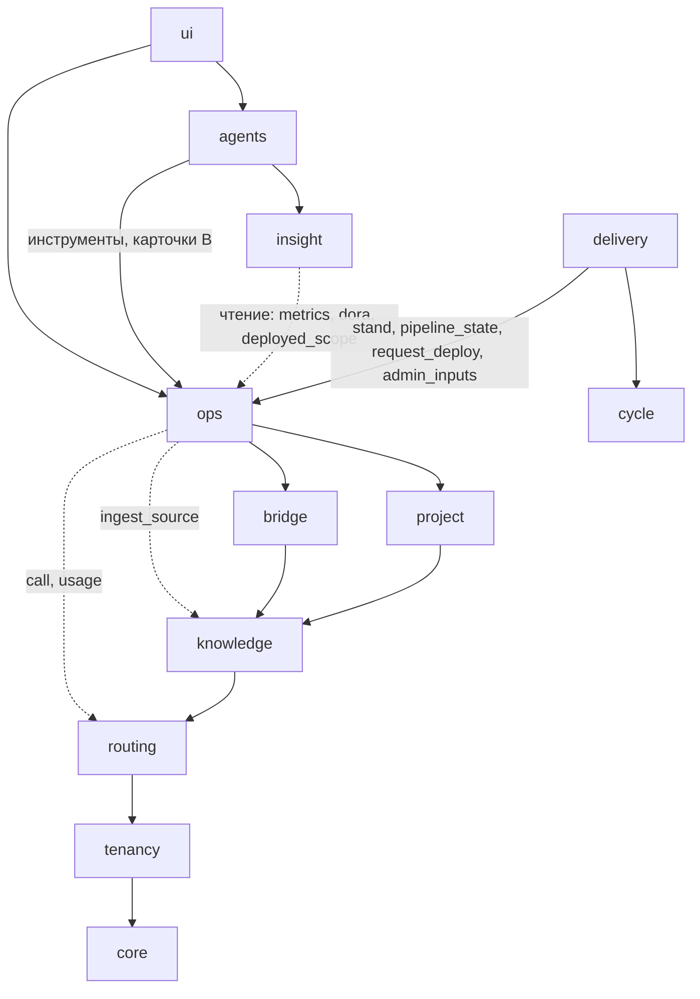

# 17. Эксплуатация: CI/CD, Docker, серверы, мониторинг (модуль `ops`)

Для разработчиков, без кода. Закрывает A43 (бриф 2026-10-23): «CI/CD процессы + работа с докер-контейнерами, VPS-серверами мониторинг состояния железа и составных модулей - отдельный модуль платформы». Обязательны 05 §3, §6.3, §7.2, §8.2 и §9 и ADR 08: при расхождении верны они. Сверено суперархитектором 2026-10-23 (05 §9, С124-С152; ADR-73-ADR-76): правки §14 приняты с поправками С125 (срезы: пробы в B, CI/CD и агент DevOps в F, серверы и режим `platform` в G), С126 (руководство администратора пишет технический писатель из `ops.admin_inputs`, не агент DevOps), С127 (`telemetry.db` исключение из Н17), С128 (разбор событий сборки переезжает из `delivery` в `ops` миграцией `ops_ci`), С130 (агенту DevOps плюс `search`, `get_fragment`). **Решение 17**: решил автор раздела.

Опоры: A14 (код только во внешнем GitHub или GitLab), A20 (хранение без срока), A23 (песочница), A41, A42 (работа и ответы внутри платформы), P01 (стенд разворачивает внешний CI), P07 (автослияние при зелёной сборке), P22 (бот пишет только в `agent/*`), P23 (браузер агента только на стенд). Права как 03 §4.1: МП, БА, СА, Арх, Раз, Тест, Тим, ТЛ, РПО, Набл; К команда; Адм админ компании; АП администратор платформы (`users.is_admin`).

Термины. **Окружение**: `stand`, `prod`, `preview-*` проекта. **Шим**: скрипт на сервере с белым списком глаголов, запускаемый принудительной командой SSH-ключа платформы.

## 0. Решения раздела

| № | Решение | Почему |
|---|---|---|
| Р17-01 | Пятнадцатый модуль `ops`, `src/office/ops/`: над `bridge`, `project`, `knowledge`, `routing`, под `delivery`, `insight`, `agents` | A43; вызовы только вниз |
| Р17-02 | Своего раннера нет: сборка, тесты, образ, выкладка во внешнем GitLab CI или GitHub Actions; платформа читает, запускает, повторяет, отменяет, одобряет | A14 по смыслу; чужой код не исполняется рядом с данными офиса |
| Р17-03 | Своего реестра образов нет: реестр хоста кода или OCI компании, только чтение | Как Р17-02 |
| Р17-04 | Два режима выкладки: `ci` (умолчание, P01) и `platform` (`docker compose` по SSH через шим, образы по дайджестам) | P01 цел; стенд и у студий без задания выкладки |
| Р17-05 | Сервер доступен шимом с принудительной командой и метками проекта; терминал отдельным ключом, только человеку, с записью | Наименьшие права, журнал |
| Р17-06 | Ключ хоста закрепляется подтверждением Адм, несовпадение блокирует сервер | Сейчас в терминале `known_hosts=None` |
| Р17-07 | Метрики шимом по SSH без демона; `push_agent`, `prometheus` за швом позже | Ни служб, ни портов |
| Р17-08 | Ряды в отдельном SQLite: сырые 14 дней как кэш (С60), 5 минут 30 дней, час и сутки без срока | Объём §5.3; A20 агрегатами |
| Р17-09 | Здоровье модулей платформы реестром проб в `core` | Иначе вызов вверх |
| Р17-10 | События хоста о сборке и выкладке разбирает `ops`; `delivery` слушает `pipeline.finished`, `deployment.succeeded` | Один писатель |
| Р17-11 | Агент DevOps пишет CI, `Dockerfile`, compose веткой `agent/ABC-12-<слаг>` и MR, чинит красные сборки классов `config`, `dependency`, `image`, `lint`; секретов, SSH, прода не видит | Принцип 6 |
| Р17-12 | Класс падения считает код, сводку пишет `routing.call` по маскированной выдержке | Принцип 8, `export_ban` |
| Р17-13 | DORA и доступность стенда пишет `insight` снимками; риск «стенд недоступен» по 09 §5 | Один движок метрик |
| Р17-14 | Логи контейнеров не хранятся: живой просмотр, фрагмент по кнопке; у красного задания CI выдержка до 8 КБ | Объём при A20, секреты |

## 1. Место в архитектуре

| Модуль | Ответственность | Выставляет | Прячет | Зависит от |
|---|---|---|---|---|
| `ops` | Пайплайны и задания CI, окружения, развёртывания, реестры, серверы и выдачи, шим, контейнеры, терминал, журнал команд, ряды, оповещения, здоровье модулей; швы `CiProvider`, `ServerTransport`, `MetricsSource`, `RegistryClient` | §7.3 | Протоколы CI и реестра, SSH, упаковку рядов | `bridge` (подключения, вебхуки), `project` (префикс тикета, тип, участники), `knowledge` (только `ingest_source`), `routing` (сводка, расход), `tenancy`, `core` |

Модулей 15: `core`, `tenancy`, `routing`, `knowledge`, `bridge`, `project`, `cycle`, `plan`, `contracts`, `delivery`, `channels`, `insight`, `agents`, `ops`, `ui`.

| Где был бы вызов вверх | Как снят |
|---|---|
| Здоровье модулей выше `ops` | `core.register_probe(module, name, fn, every_s)` при старте; `ops` зовёт `core.run_probes()` |
| Красная сборка → агент | Событие `pipeline.finished` с `failure_class`, триггер скила `agents` |
| Сборка у MR кода | `delivery` слушает `pipeline.finished` и пишет свой `office_code_mrs.ci_state` |

Фон в `ai-workspace-office-worker` через `office_jobs`: `ops_collect:<server>`, `ops_probe:<env>` (60 с), `ops_rollup`, `ops_ci_poll:<connection>`, `ops_triage:<job>`, `deploy:<env>`.

| Шов | Контракт | Варианты |
|---|---|---|
| `CiProvider` | `parse_hook`, `list_pipelines(cursor)`, `get_pipeline`, `jobs`, `job_log(job, tail)`, `trigger(ref, variables)`, `retry`, `cancel`, `lint(path, content)`, `pending_approvals(env)` | `gitlab_ci`, `github_actions` |
| `ServerTransport` | `run(verb, args, stdin?) -> {exit, stdout_sha, head}`, `stream`, `host_key()`, `open_pty` (терминал) | `ssh_shim` (asyncssh), `local` |
| `MetricsSource` | `collect(target) -> {ts, schema, values[], containers[], events[]}` | `ssh_shim`, `local_proc`; позже `push_agent`, `prometheus` |
| `RegistryClient` | `tags(repo)`, `digest(repo, tag)`, `check()` | `oci_v2` |

У каждого подделка для тестов, как 00 §4.1.

## 2. CI/CD

### 2.1. Свой раннер или внешний CI

| Критерий | А. Внешний CI хоста | Б. Свой раннер в платформе | В. Раннер хоста на сервере компании |
|---|---|---|---|
| A14 | Совпадает | Половина хостинга кода | Совпадает |
| Безопасность | Чужой код вне платформы | `docker build` чужого кода рядом с базой и ключами; Docker в bwrap требует привилегий | Вне платформы |
| Ресурсы (4 ядра, 16 ГБ) | Не тратятся | Отнимает у эмбеддингов и агентов | Сервер компании |
| Функции | Кэши, артефакты, окружения, одобрения хоста | Писать заново | Как А |

**Решение:** А в первом выпуске; В после выпуска мастером «поставить раннер» (шим ставит `gitlab-runner` или `actions-runner`, токен регистрации вводит человек); Б отклонён. Закрытый контур это свой GitLab компании, тоже А.

### 2.2. Подключение и события хоста

Второго подключения нет: `office_ops_project_settings` ссылается на строку `office_bridge_connections` подключения кода `delivery` и добавляет секрет `ci_trigger_token` (GitLab: токен запуска или проекта с `api`; GitHub: App или детальный токен с `actions:write`, `deployments:read`). Бот P22 пишет только в `agent/*` и пайплайн на `main` не запустит; без токена модуль только читает.

`bridge` проверяет подпись на `/api/office/hooks/{connection_token}` и отдаёт событие обработчику по паре (система, вид), зарегистрированному `bridge.register_handler(system, kinds, fn)`: коммиты, MR, ревью у `delivery`; Pipeline Hook, Job Hook, `workflow_run`, `workflow_job` (чужие CI через `check_suite`, `status` только состоянием) и Deployment Hook, `deployment`, `deployment_status` у `ops`. Без публичного адреса опрос раз в 5 минут, до 50 пайплайнов за проход (04 §1.2).

### 2.3. Стадии

Задание относится к стадии по префиксу имени `office:` (шаблоны агента DevOps) или по `stage_map` проекта, иначе `other`: `build`, `test` (счётчики JUnit, если хост отдаёт), `image` (пуш с тегом `sha`, дайджесты в развёртывание), `deploy_stand` (проба, подтверждение sha для сверки), `deploy_prod` (ручное, защищённое окружение хоста, ворота §2.5), `rollback` (необязательно).

### 2.4. Пайплайн, задача, требование, запуск

`office_ops_pipelines` рождается первым событием или опросом и обновляется по ревизии хоста. Ключи `ABC-12` берутся кодом из ветки (`ABC-12-<слаг>`, `agent/ABC-12-<слаг>`) и заголовка MR по префиксу проекта; пайплайн ветки по умолчанию получает ключи коммитов от прошлого зелёного (сравнение хоста, до 200). Требование `ops` не хранит: цепочку «пайплайн или выкладка → sha → задача → требование → абзац документа скоупа → принятая версия» строит `insight.back_trace` (14 §5.4). Карточка требования получает колонку «Развёрнуто: стенд, прод» проекцией `insight` (не цвет матрицы, ворота 10 §6 прежние).

Из платформы: запуск на ветке (GitLab `POST /pipeline`, GitHub `workflow_dispatch`), повтор пайплайна или задания, отмена, ручное задание стенда. Переменные только из `allowed_variables`, без секретов. Запуск пишет аудит и `pipeline.created`.

### 2.5. Выкладка, одобрение, откат

Автомат `office_ops_deployments`: `requested` → `running` (стенд) или `awaiting_approval` → `approved` → `running`; `running` → `succeeded | failed`; `awaiting_approval` → `canceled`; `succeeded` → `rolled_back`, когда его заменило развёртывание с `rollback_of`.

- **`ci`.** Развёртывание рождает событие хоста или задание `deploy_*`; `ops` дописывает дайджесты и задачи диапазона. «Развернуть» запускает задание выкладки нужного пайплайна, «откатить» повторяет задание выкладки прошлого успешного развёртывания (тот же sha и образы).
- **`platform`.** `deploy:<env>` берёт compose из репозитория на sha (токеном бота на чтение), добавляет `office.override.yaml` с метками `office.project`, `office.env`, `office.deployment` и образами по дайджестам, передаёт секреты окружения `.env` через stdin шима, зовёт `compose_pull`, `compose_up`; итог решает проба. Откат: `compose_up` прошлого развёртывания. Тег без дайджеста: 422 `image_not_pinned`.
- **Прод.** `protected=1` (прод по умолчанию) требует одобрения не запросившим с `ops/approve_prod`; на маленьком типе соло с `solo_deploy` в аудите. Защита окружения хоста остаётся вторым слоем («ждёт одобрения на хосте»), бот ревьюером не бывает. Агенты и ассистент прод не запрашивают и не одобряют (уровень C 13 §1.5). Заморозка `freeze_until`: 423 `env_frozen`.
- **По одной.** `deploy:<env>`; прогон сверки (`stand:<project>`, 10 §6) и выкладка стенда не пересекаются: 409 `deploy_in_progress`.

### 2.6. Состав выкладки и хронология

`ops.deployed_scope(env)`: sha, образы, задачи с прошлого успешного развёртывания, через `insight` требования. Отсюда разница «на стенде есть, на проде нет», «Что нового в версии N» (10 §7.2) через `delivery.guide_inputs`, `stand_sha` в `as_built` (10 §8.3). К 14 §5: `office_timeline_items.layer` плюс `ops` (дорожка «Сборка и выкладка»); на ось идут `deployment`, `rollback`, `pipeline_red` и `pipeline_green` только при смене цвета ветки по умолчанию, `incident` (§5.4); видимость `team`.

### 2.7. Агент DevOps (к 02 §2.1, §2.2)

| Агент | Вход | Выход | Принимает | Срез |
|---|---|---|---|---|
| DevOps-инженер (`devops`) | Задача вида `ops` или с требованиями эксплуатации (аудитория `admin`, разделы ФТТ и ЧТЗ об установке, производительности, доступности, 14 §2.3); `Dockerfile`, `compose*.yaml`, `.gitlab-ci.yml`, `.github/workflows/*` из временного клона; окружения и факты серверов без адресов и секретов; при починке выдержка и класс; контекст проекта через `knowledge.search` (A45) | Ветка `agent/ABC-12-<слаг>`: CI по стадиям §2.3, многоступенчатый `Dockerfile` с непривилегированным пользователем и `HEALTHCHECK`, compose с пределами ресурсов и `${ИМЯ}` вместо значений; MR от бота с ключами `REQ`; при новом окружении руководство администратора агент DevOps не правит: `ops.admin_inputs` попадает в пакет `delivery.guide_inputs(audience=admin)`, раздел пишет технический писатель по правилу 10 §8.1 (05 §9 С126) | ТЛ или Тим; на маленьком МП | F (05 §9 С125) |

Может: git во временном клоне, MCP только чтение (`search`, `get_fragment` в правах назначившего, как у всех профилей 02 §2.2; `list_pipelines`, `job_log`, `environments`, `server_facts`, `lint_ci`). Запрещено: пуш, слияние, SSH, шим, защищённые ветки, выкладка, секреты, правила защиты. Проверка без модели: `ops.lint_ci` (GitLab CI Lint API, `actionlint` вне джейла), `hadolint`, `docker compose config` без сети, сканер секретов; зелёный пайплайн MR это условие приёмки, не одобрение. Джейл как у агента разработки (02 §4.4), демона Docker нет. Класс `code`; скилы `bundled`: `ci_gitlab`, `ci_github`, `dockerfile`, `compose`, `ci_triage`. Агент разработки CI по-прежнему не правит.

**Починка красной сборки.** Триггер: `pipeline.finished` `failed` с классом `config`, `dependency`, `image` или `lint` на ветке по умолчанию или ветке задачи агента. Один запуск на `(ref, failure_signature)`; после двух неудач подряд автозапуск на ветке выключен до решения ТЛ; доля лимита как у планировщика (P19); при `devops_autofix=propose` (умолчание) только карточка ТЛ. `test`, `build` идут агенту разработки или человеку, `infra`, `secret_missing` оповещением ТЛ.

### 2.8. Разбор падения

`ops_triage:<job>`: хвост лога до 400 строк, маска §3.4, выдержка до 8 КБ. Класс по правилам (стадия, код выхода, шаблоны строк, версия правил): `config`, `dependency`, `build`, `test`, `lint`, `image`, `deploy`, `infra` (раннер, место, OOM, таймаут), `secret_missing`, `unknown`; `failure_signature` это хэш имени задания и нормализованной первой строки ошибки. Сводку в 2-3 предложения пишет `routing.call` классом `extract` с кэшем по подписи; при `export_ban=all_external` только правила. Выдержка и сводка идут источником `pipeline:<id>` (вне Git, допуск «команда»; Markdown с фронтматтером `pipeline_id`, `ref`, `sha`, `failure_class`, `task_keys` и телом «сводка, выдержка», A45): ассистент отвечает «почему упала сборка» с цитатой (A42). Событие `pipeline.triaged` несёт только ссылки, не текст (00 §2 принцип 17).

## 3. Docker

### 3.1. Реестр образов

Реестр хоста (GitLab Container Registry, ghcr.io; доступность из РФ проверить) это **умолчание**; OCI компании (Harbor, Yandex Container Registry, Selectel) **поддержан** тем же `oci_v2`; свой `registry:2` (диск, TLS, копии на сервере платформы) **отклонён**. `office_ops_registries` с `registry_credential` на чтение; экран: теги, дайджест, пайплайн сборки, окружения, где стоит («не удалять»); очистка политикой реестра.

### 3.2. Стенд как стек и шим

Окружение `platform` это проект compose `office-<pid>-<env>` в `/srv/office/<pid>-<env>/` на сервере с выдачей (§4.3): `compose.yaml` на sha, `office.override.yaml`, `.env` (0600). Метки `office.project`, `office.env`, `office.deployment`, `office.service`; шим отказывает в действиях над чужими контейнерами (И17-2). Сервисы compose это составные модули стенда: ожидаемые против фактических дают `missing`, `restarting`, `unhealthy`, `exited`. Kubernetes вне рамок до слова пользователя.

Шим `office-ops-shim` (POSIX sh и `docker` CLI) лежит в релизе `scripts/ops/`; ключ в `authorized_keys` с `restrict,command="/usr/local/lib/office-ops/shim"`; шим читает `SSH_ORIGINAL_COMMAND`, отвечает JSON.

| Глагол | Что | Право |
|---|---|---|
| `version`, `facts`, `metrics` | ОС, ядра, память, диски, Docker, NTP; `/proc`, `df`, `docker stats --no-stream`, `docker ps -a`, события Docker | Система |
| `ps <env>`, `logs <env> <service> --since --tail [--follow]` | Контейнеры и логи окружения | `ops/view`, `ops/view_logs` |
| `restart <env> <service>` | Перезапуск | `ops/restart_stand`, `ops/restart_prod` |
| `compose_pull <env>`, `compose_up <env>` | Выкладка `platform`, файлы через stdin | Только `deploy:<env>` |
| `prune [--dry-run]`, `rotate_key` | Очистка образов; смена ключа | `ops.infra/manage_servers` |

`down`, `exec`, `run`, удаление томов и произвольные команды это терминал человека (§4.2).

### 3.3. Журнал контейнеров, перезапуск, логи

`office_ops_container_events` (старт, остановка, падение с кодом, OOM, перезапуск, `health`) приходит событиями Docker в снимке; 3 перезапуска за 10 минут дают оповещение. Перезапуск с экрана или карточкой ассистента (B, стенд) пишет `office_ops_commands`, `container.restarted`, аудит. Логи идут WebSocket `/api/office/ops/ws/logs` с `follow`, маска построчно до отправки; «сохранить фрагмент» кладёт выделенное в `BlobStore` и источник `log:<sha>` с привязкой к задаче или оповещению. Хранилища логов (Loki и подобных) нет.

### 3.4. Секреты и песочница

| Секрет | Хранение | Кто видит значение |
|---|---|---|
| Ключи SSH к серверам | `ssh_private_key` (новый вид `office_credentials`), `SecretBox` с `CONNECTIONS_SECRET_KEY`; пару генерирует платформа | Процесс заданий на время соединения |
| Токен запуска CI, учётка реестра | `ci_trigger_token`, `registry_credential` | Адаптер в процессе заданий |
| Секреты окружения приложения | `deploy_secret`, имя и ссылка в `office_ops_env_secrets` | Никто через API: только запись; на сервер через stdin |
| Переменные CI хоста | На хосте | Платформа не читает и не пишет |

Секрет не попадает в чат, ассистента, ядро, события, аудит (там имя и отпечаток), каталог агента и Git. Лог перед показом и сохранением проходит маску значений секретов окружения (в процессе заданий) и сканер секретов (И54). Агент пишет только `${ИМЯ}`, литерал сканер отклоняет. Поворот ключа SSH: обе пары до подтверждения, старая снимается `rotate_key`.

Песочница (A23): чат Claude Code данных `ops` не видит, личный терминал панели остаётся личным. Агенты ходят в `ops` инструментами MCP с правами «человек ∩ профиль» (13 §1.3), глаголы шима исполняет процесс заданий по подтверждённой человеком операции. Браузер агента (P23) берёт адрес стенда из `office_ops_environments`.

## 4. Серверы (VPS)

### 4.1. Реестр, подготовка, роли, журнал

`office_ops_servers` (компания): адрес, порт, назначение `stand, prod, runner, platform, other`, метки, подразделение, поставщик, факты, отпечаток ключа хоста, версия шима, состояние `draft → checking → active`, `degraded` (3 сбора не прошли), `unreachable` (10 минут), `blocked` (ключ хоста не совпал), `retired`. Сервер платформы заводит установщик (`purpose=platform`, `local`).

Подготовка: платформа генерирует пару ed25519 и показывает команду, которую человек выполняет на сервере под `root` сам (пароль root платформа не получает): пользователь `office-ops`, шим, ключ с `restrict,command=`, по выбору группа `docker` (предупреждение: это права root; rootless Docker в `guide:admin`). «Проверить» даёт `facts` и отпечаток ключа хоста; Адм сверяет его с консолью поставщика и подтверждает, до этого сбора нет. Смена ключа позже: `blocked`, `server.host_key_changed` Адм и АП, разблокировка повторным подтверждением с причиной.

Серверы видят Адм и АП; участники проекта только серверы с выдачей своему проекту и только через окружение, без адреса; заказчику закрыто (00 §6). `office_ops_commands` пишется до исполнения (глагол, аргументы без секретов, актор, путь `ui, assistant, agent_card, system, deploy_job`) и дописывается итогом; сбор `metrics` в журнал не пишется; действия людей дублируются в `office_audit` (принцип 14).

### 4.2. Терминал: переиспользование

Терминал панели (`src/ssh/`, `routes_ssh.py`, `TerminalPanel.tsx`): asyncssh, профиль `user_ssh_profiles` под `SecretBox`, мост `bridge_ssh_websocket`, два соединения на пользователя, проверка Origin и cookie. Берём всё. Меняем: ключ из `office_credentials` (пользователь `office-admin` без `command=`); закреплённый `known_hosts` вместо `known_hosts=None` (предлагается и личному терминалу); право `ops/terminal_stand` или `ops/terminal_prod` и причина; запись вывода asciicast v2 в `BlobStore` кусками по 10 с, ввод не пишется (пароли `sudo`), команды видны эхом; сессия до 60 минут, простой 15 минут (доп.); закрытие при исключении участника и `blocked`; вход `/api/office/ops/ws/terminal`, вкладка `terminal` каркаса 15 §2.2. «Взять ключ из моего профиля» копирует его в `office_credentials` с аудитом.

Дополнение 2026-10-27 (проверка ИБ 29, УИБ29-73). `ops` и таск 123 вне первого выпуска, а личный терминал панели остаётся: в первом выпуске он закрыт клеткой `terminal/use` (по умолчанию выключена), ходит только на адреса из списка компании с закреплённым ключом хоста, с причиной и записью вывода; правило ОС запрещает пользователю сервиса подсети узла моделей, хранилища копий и шлюза (таск 139).

### 4.3. Выдача стенда, поставщики

Адм выдаёт сервер проекту на окружение (`office_ops_server_grants`); ТЛ или МП создаёт окружение `stand` с сервером, режимом, адресом, путём пробы, учётками ролей (`stand_account`, P01). Сервер держит стенды нескольких проектов: изоляция метками и шимом, ресурсы пределами compose. Отзыв выдачи переводит окружение в `retired`, стек снимает Адм задачей.

Поставщики: ручной ввод и поле `provider` со ссылкой в консоль. Timeweb Cloud, Selectel, Yandex Cloud **отложено до: слова пользователя после пилота** (адаптер у `bridge` с `describe, check, pull`; создание, удаление, снимки, баланс; `connector_secret`; создание только человеком с записью стоимости).

## 5. Мониторинг железа и составных модулей

### 5.1. Что и чем собираем

| Цель (раз в 60 с) | Ряды | Состояния |
|---|---|---|
| Сервер | CPU user, system, iowait, steal; load 1, 5, 15; память, swap; на точку монтирования занято % и inode %, ввод-вывод; сеть и ошибки; процессы; смещение NTP | Перезагрузка, отказавшие юниты systemd, демон Docker |
| Контейнер | CPU %, память и доля предела, сеть, ввод-вывод, перезапуски | Журнал, `health` |
| Окружение | Проба HTTP `url + health_path` (5 с): код, задержка; срок TLS раз в сутки | `down` после 3 провалов, `up` после 2 успехов, `degraded` |
| Платформа | Железо (`local`), модули §5.2 | `platform_module.health_changed` |
| Расход моделей | Токены и стоимость в час по проекту и классу из `routing.usage` | Пороги остаются `usage.threshold` |

Сравнение: node_exporter и cAdvisor требуют Prometheus рядом, порты 9100, 8080 и свою TSDB вне `tenancy`; толкающий демон работает за NAT, но живёт на каждом сервере и требует публичного адреса платформы; шим по SSH без служб и портов, права и журнал в `tenancy`, за NAT не работает. **Решение:** шим по SSH, пул соединений с keepalive, до 8 параллельных сборов, одна команда в минуту на сервер. После выпуска `push_agent` для NAT, чтение Prometheus компании, экспорт OpenMetrics `/api/office/ops/metrics`.

### 5.2. Здоровье модулей платформы

Модули при старте регистрируют пробы в `core` (ответ за 2 с: `ok | degraded | down`, значение, пояснение); каждый процесс исполняет свои; `core` пишет `office_heartbeats` раз в 30 с, нет сердцебиения процесса заданий 2 минуты, значит `down` его модулей. Пробы: `core` очередь `office_jobs` (глубина, возраст, падения), отставание подписчиков от `office_events`, WAL и ожидание записи, возраст копии; `tenancy` самопроверка `SecretBox`; `routing` поставщики и лимиты; `knowledge` намерения Git `pending`, отставание индекса, `Embedder`, `SpeechRecognizer`, ffmpeg; `bridge` подключения `degraded`; `channels` отправители; `delivery` Playwright в джейле; `agents` bwrap, долгие запуски; `insight` отставание метрик; `ops` опоздание сбора; `ui` p95, доля 5xx, WS.

### 5.3. Хранение и объём

Ряды пишет только `ops` в `<данные>/office/ops/telemetry.db` (SQLite WAL): строка на цель и минуту, `schema_id` (имена рядов цели, новый при смене набора контейнеров), значения float32 упакованы. Пример: 20 серверов по 10 контейнеров, 104 значения, около 500 байт на строку.

| Уровень | Строк в сутки | Объём | Срок | Размер |
|---|---|---|---|---|
| 1 мин | 28 800 | 14 МБ в сутки | 14 дней (кэш, С60) | около 200 МБ |
| 5 мин: min, avg, max | 5 760 | 7,5 МБ в сутки | 30 дней | около 225 МБ |
| 1 час: плюс p95 | 480 | 0,7 МБ в сутки | Без срока (A20) | плюс 250 МБ в год |
| 1 сутки | 20 | 10 МБ в год | Без срока | |

У студии с 3 серверами в 7 раз меньше. Строки уровня удаляются только после записи свёртки их интервала (И17-8). Отдельный файл: минутная запись не удлиняет ожидание записи основной базы, согласованная копия 00 §5 не пухнет; телеметрия копируется раз в сутки только свёртками часа и суток. Оповещения, развёртывания, пайплайны, журналы лежат в основной базе без срока. Трактовку «сырые ряды это кэш» подтверждает пользователь (В17-05).

### 5.4. Пороги и оповещения

`office_ops_alert_rules`: область (`company, server, environment, project`), ряд или состояние, оператор, порог, `for_minutes`, важность `info, warning, critical`, получатели. Умолчания (доп.): окружение `down` 3 минуты стенд, 1 минута прод, critical; диск или inode меньше 10 % critical, 20 % warning; память меньше 5 % 10 минут или OOM critical; steal больше 20 % или load 15 больше 2 × ядер 15 минут warning; 3 перезапуска за 10 минут warning; сертификат 14 дней warning, 7 critical; NTP больше 2 с warning; ветка по умолчанию красная 24 часа warning; `unreachable`, `blocked`, модуль `down`, копия старше 36 часов, очередь старше 15 минут critical.

`office_ops_alerts`: `firing` → `acknowledged` → `resolved` (норма 2 прохода подряд); `silenced` тишиной с причиной и сроком; одна строка на `(rule, target)` до `resolved`. Critical окружения дольше 10 минут создаёт источник `incident:<id>` и точку хронологии. Доставка только конвейером 11 §6.1 через `ops_alert.fired`: critical `immediate` в обход тихих часов (как `usage.threshold` 100 %), warning в сводку, `resolved` пишет «восстановлено». Получатели: `contacts` окружения, ТЛ, Тим, Адм; для платформы АП и Адм; заказчику нет.

### 5.5. Риски и метрики проекта

`insight` читает `ops.metrics`, `ops.dora` и пишет `office_metric_snapshots`: `stand_down_minutes` (по `environment.*`, схлопывание 1 минута, 09 §5.3), `stand_availability_7d`, `default_branch_red_hours`, DORA прода `deploy_frequency_7d`, `lead_time_hours` (от первого коммита задачи до прода), `change_failure_rate`, `mttr_hours`.

| Кандидат риска (к 09 §5.2) | Критерий | Почему |
|---|---|---|
| Стенд недоступен | `stand_down_minutes` больше 60 | Сверки и прогоны падают `stand_unconfirmed` (10 §3.4), демо под угрозой |
| Сборка красная | `default_branch_red_hours` больше 24 | Задачи не проходят `check`, P07 стоит |
| Нестабильные выкладки | `change_failure_rate` больше 0,3 за 30 дней | Качество поставки |

Кандидат `candidate`, принимает МП; `insight` зовёт только `cycle.trigger_risk`, `observe_risk`; агент рисков получает ряд и оповещения как материал.

### 5.6. Экраны, виджеты, ассистент

**`/office/ops`** (Адм, АП; РПО и Набл компании «Обзор» без адресов): Обзор (серверы, прод, модули, оповещения, расход моделей, DORA портфеля), Серверы (подготовка, выдачи, графики час, сутки, неделя, месяц, контейнеры), Оповещения, Реестры, Платформа, Журнал (команды, проигрывание сессий).

**`/office/:id/ops`**: Пайплайны (задания по стадиям, класс и сводка, «повторить», «отменить», «починить агентом»), Окружения (sha, образы, состав, разница стенд и прод, «развернуть», «откатить», секреты на запись), Контейнеры, Мониторинг, Выкладки. Графики Vega-Lite (ADR-51), обновление по WS.

Виджеты к 15 §2.3: `ops_status` (команда, E), `pipelines_mine` (Раз, Тест, Тим, ТЛ, E), `ops_alerts` (Адм, ТЛ, Тим, контакты, F), `platform_health` (АП, Адм, C); узел дерева «Эксплуатация»; палитра «Запустить пайплайн», «Развернуть на стенд», «Перезапустить сервис», «Открыть логи». Ассистент (13 §1.4, A42): MCP только чтение `ops_status`, `pipeline_failure`, `deployed_scope`, `environment_metrics`, `active_alerts`; карточки B `trigger_pipeline` (незащищённые ветки), `retry_pipeline`, `deploy_stand`, `restart_service` (стенд), `ack_alert`; прочее уровень C.

## 6. Данные

Писатель `office_ops_*` это `ops`; `office_heartbeats` пишет `core`.

| Таблица | Поля | Срез |
|---|---|---|
| `office_ops_project_settings` | `project_id` PK, `ci_provider enum(gitlab_ci, github_actions, none)`, `bridge_connection_id`, `ci_trigger_credential_id?`, `stage_map json`, `allowed_variables json`, `devops_autofix enum(off, propose, auto)` | E |
| `office_ops_pipelines` | `project_id`, `connection_id`, `external_id`, `ref`, `sha`, `source enum(push, merge_request, schedule, web, api, platform, agent)`, `mr_external_id?`, `task_keys json`, `state enum(created, pending, running, success, failed, canceled, skipped, manual)`, `stages json`, времена, `triggered_by_kind enum(human, agent, host, schedule)`, `triggered_by_id?`, `failure_class?`, `failure_signature?`, `summary?`, `revision`; уникально `(connection_id, external_id)` | E |
| `office_ops_pipeline_jobs` | `pipeline_id`, `external_id`, `name`, `stage enum(build, test, image, deploy_stand, deploy_prod, rollback, other)`, `state`, `allow_failure`, времена, `tests json?`, `failure_excerpt?`, `rules_version?` | E |
| `office_ops_environments` | `project_id`, `name`, `kind enum(stand, prod, preview, other)`, `url`, `health_path`, `deploy_mode enum(ci, platform)`, `server_id?`, `compose_path?`, `host_env_name?`, `protected`, `freeze_until?`, `contacts json`, `stand_account_ids json` (P01), `state enum(unknown, up, degraded, down, retired)`, `state_since`, `current_deployment_id?`, `cert_expires_at?`; уникально `(project_id, name)` | E |
| `office_ops_deployments` | `environment_id`, `sha`, `ref`, `images json [{service, repo, tag, digest}]`, `mode`, `pipeline_id?`, `state enum(requested, awaiting_approval, approved, running, succeeded, failed, canceled, rolled_back)`, `requested_by_kind`, `requested_by`, `approved_by?`, `solo`, `reason?`, `rollback_of?`, `task_keys json`, времена, `error?` | E, G |
| `office_ops_env_secrets`, `office_ops_registries` | `environment_id`, `name`, `credential_id`, `updated_by`, `updated_at`; `kind enum(gitlab, ghcr, generic_oci)`, `url`, `credential_id?`, `state` | G |
| `office_ops_servers` | `name`, `host`, `port`, `ssh_user`, `credential_id`, `terminal_credential_id?`, `host_key_fingerprint?`, `host_key_confirmed_by?`, `provider enum(manual, timeweb, selectel, yandex_cloud, other)`, `provider_ref?`, `purpose enum(stand, prod, runner, platform, other)`, `labels json`, `department_id?`, `facts json`, `shim_version?`, `transport enum(ssh_shim, local)`, `state enum(draft, checking, active, degraded, unreachable, blocked, retired)`, `last_seen_at?` | F |
| `office_ops_server_grants` | `server_id`, `project_id`, `env`, `granted_by`, `granted_at`, `revoked_at?` | F |
| `office_ops_components` | `target_kind enum(platform, environment)`, `target_id`, `name`, `expected json`, `state enum(ok, degraded, down, missing, unknown)`, `state_since`, `detail` | C, F |
| `office_ops_container_events` | `server_id`, `environment_id?`, `container`, `service?`, `action enum(start, stop, die, oom, restart, health)`, `exit_code?`, `at`; только добавление | F |
| `office_ops_alert_rules`, `office_ops_alerts`, `office_ops_silences` | Правило: `scope`, `scope_id?`, `metric`, `op`, `threshold`, `for_minutes`, `severity`, `recipients json`, `enabled`, `origin enum(default, user)`. Оповещение: `rule_id`, `target_kind`, `target_id`, `project_id?`, `state enum(firing, acknowledged, resolved, silenced)`, `fired_at`, `acked_by?`, `resolved_at?`, `last_value`, `incident_source_id?`. Тишина: цель или правило, `until`, `reason` | C, F |
| `office_ops_commands` | `server_id`, `environment_id?`, `verb`, `args json`, `actor_kind`, `actor_id?`, `via enum(ui, assistant, agent_card, system, deploy_job)`, `action_id?`, `started_at`, `finished_at?`, `exit_code?`, `output_sha?` | F |
| `office_ops_terminal_sessions` | `server_id`, `user_id`, `reason`, `opened_at`, `closed_at?`, `close_reason enum(user, idle, limit, revoked, blocked)?`, `transcript_sha?` | F |
| `office_heartbeats` (`core`) | `process enum(web, worker)`, `host`, `pid`, `version`, `at` | C |
| `telemetry.db` | `ops_series_schema (schema_id, target_kind, names json)`; `ops_samples (target_kind, target_id, ts, schema_id, values blob)`; `ops_rollups` плюс `resolution enum(5m, 1h, 1d)`, `min`, `avg`, `max`, `p95?`, `n` | C, F |

Новые значения: `office_credentials.kind` плюс `ssh_private_key`, `ci_trigger_token`, `registry_credential`, `deploy_secret`; вид задачи плюс `ops`; `office_timeline_items.layer` плюс `ops`; источники вне Git `pipeline:<id>`, `incident:<id>`, `log:<sha>`; агент `devops`.

## 7. API

Префикс `/api/office`, правила 05 §3.6. Новые коды: 409 `deploy_in_progress`, `approval_required`, `same_person`, `host_key_mismatch`, `not_granted`, `run_in_progress`; 422 `image_not_pinned`, `variable_not_allowed`; 423 `env_frozen`; 503 `server_unreachable`, `ci_unavailable`, `registry_unavailable`.

### 7.1. Проект

| Метод и путь | Вход → выход | Права | Ошибки |
|---|---|---|---|
| GET `/projects/{pid}/ops`; PUT `.../ops/settings` | Сводка; `{ci_provider, stage_map, allowed_variables, devops_autofix}` | `ops/view`; ТЛ, МП | 422 |
| GET `/projects/{pid}/pipelines`, `/pipelines/{id}`, `/me/pipelines` | `?ref=&state=&task=&source=` | `ops/view` | 404 |
| POST `/projects/{pid}/pipelines`; `/pipelines/{id}/retry`, `/cancel`; `/pipeline-jobs/{id}/retry` | `{ref, variables?}` → `created` | `ops/trigger_pipeline`; отмена автор, Тим, ТЛ | 422, 409, 503 |
| GET `/pipeline-jobs/{id}/log`; POST `.../save-log` | `?tail=400` → маскированный текст; `{from_line, to_line, link?}` → `log:<sha>` | `ops/view_logs` | 413, 503 |
| POST `/pipelines/{id}/autofix` | → запуск DevOps или карточка ТЛ | Тим, ТЛ | 409 `run_in_progress`, 422 |
| GET, POST `/projects/{pid}/environments`; PUT `/environments/{id}` | `{name, kind, url, health_path, deploy_mode, server_id?, compose_path?, protected, contacts, freeze_until?}` | ТЛ, МП | 409 `not_granted`, 422 |
| PUT, DELETE `/environments/{id}/secrets/{name}` | `{value}` → `{name, updated_at}` | `ops/manage_env_secrets` | 422 |
| GET `/environments/{id}/deployments`, `/deployments/{id}/scope`, `/environments/diff?from=&to=` | История, состав, разница | `ops/view` | |
| POST `/environments/{id}/deployments` | `{sha \| pipeline_id, reason?}` → `requested` или `awaiting_approval` | `ops/deploy_stand`, `deploy_prod` | 409, 423, 422 |
| POST `/deployments/{id}/approve`, `/reject` | `{reason?}` | `ops/approve_prod` | 409 `same_person` |
| POST `/environments/{id}/rollback` | `{to_deployment_id, reason}` | Как выкладка | 409, 422 |
| GET `/environments/{id}/containers`; POST `.../services/{service}/restart` | Список; `{reason?}` | `ops/view`; `restart_stand`, `restart_prod` | 503 |
| WS `/api/office/ops/ws/logs` | `{environment_id, service, since?, tail?, follow}` | `ops/view_logs` | 1008 |
| GET `/environments/{id}/metrics`; `/projects/{pid}/dora` | `?series=&from=&to=&step=`; `?period=` | `ops/view_metrics` | 422 |

### 7.2. Компания

| Метод и путь | Вход → выход | Права | Ошибки |
|---|---|---|---|
| GET, POST `/ops/servers`; PUT `/ops/servers/{id}` | `{name, host, port, purpose, labels, provider}` → `draft` и команда подготовки (один раз) | `ops.infra/manage_servers` | 422 |
| POST `/ops/servers/{id}/verify`, `/confirm-host-key`, `/rotate-key`, `/retire` | Факты и отпечаток; `{fingerprint}` → `active` | то же | 409 `host_key_mismatch`, 503 |
| POST `/ops/servers/{id}/grants`; DELETE `/ops/server-grants/{id}` | `{project_id, env}` | `ops.infra/grant_server` | 409 |
| GET `/ops/servers/{id}/metrics`, `/containers`, `/container-events` | | `ops.infra/view` | |
| WS `/api/office/ops/ws/terminal` | `?server_id=&reason=` → PTY | `ops/terminal_stand`, `terminal_prod` | 1008 |
| GET `/ops/commands`, `/ops/terminal-sessions/{id}/transcript` | Фильтры | `ops.infra/view_journal` | |
| GET, POST `/ops/registries`; GET `.../{id}/tags?repo=` | | Адм; теги `ops/view` | 503 |
| GET `/ops/alerts`; POST `/ops/alerts/{id}/ack`; GET, POST, PUT `/ops/alert-rules`; POST `/ops/silences` | | По области; `ops/ack_alert`; `ops.infra/manage_alerts`, проектные ТЛ | 409, 422 |
| GET `/ops/platform/health`, `/ops/overview` | Модули, процессы, очередь, копии; светофор портфеля | АП, Адм; Адм, РПО, Набл компании | |

### 7.3. Операции (к 05 §3.7)

`ops`: `link_ci(project, settings, actor)`, `on_ci_event(connection, event)`, `poll_ci(connection, cursor)`, `list_pipelines(project, filter, actor)`, `pipeline_state(project, sha) -> {state, pipeline_id}`, `trigger_pipeline(project, ref, variables, actor)`, `retry_pipeline(target, actor)`, `cancel_pipeline`, `job_log(job, tail, actor)`, `save_log(source, range, actor) -> source_id`, `triage(job)`, `lint_ci(project, path, content) -> {ok, errors[]}`, `put_environment(project, spec, actor)`, `stand(project) -> {url, sha, state, deploying, accounts_ref}`, `request_deploy(env, sha | pipeline, actor, reason?)`, `approve_deploy`, `reject_deploy`, `rollback(env, to_deployment, actor, reason)`, `deployed_scope(env | deployment)`, `environment_diff(a, b)`, `put_env_secret(env, name, value, actor)`, `register_server(spec, actor) -> {server, bootstrap}`, `verify_server`, `confirm_host_key(server, fingerprint, actor)`, `grant_server(server, project, env, actor)`, `revoke_grant`, `containers(env)`, `restart_service(env, service, actor, via)`, `container_logs(env, service, since, tail, follow, actor)`, `open_terminal(server, reason, actor)`, `collect(target)`, `metrics(target, series, from, to, step)`, `put_alert_rule`, `ack_alert`, `silence`, `platform_health()`, `dora(project, period)`, `admin_inputs(project) -> {environments, deploy_mode, services, alert_rules}`. `core`: плюс `register_probe`, `run_probes`, `heartbeat`. `bridge`: плюс `register_handler`.

## 8. События

По 05 §3.8, идемпотентно по `(name, seq)`; аудитория `team`, кроме отмеченных `admin`.

| Событие | Нагрузка | Слушают |
|---|---|---|
| `pipeline.created`; `pipeline.finished` | `pipeline_id`, `ref`, `sha`, `source`, `task_keys`; плюс `state`, `mr_external_id?`, `failure_class?`, `failure_signature?`, `is_default_branch` | `delivery` (`ci_state`, P07), `agents` (DevOps), `insight`, `channels`, WS |
| `pipeline.triaged` | `pipeline_id`, `job_id`, `failure_class`, `has_summary` | `agents` (ассистент), WS |
| `deployment.requested`, `.awaiting_approval`, `.approved`, `.rejected` | `deployment_id`, `environment_id`, `env_kind`, `sha`, `actor` | `channels`, WS |
| `deployment.succeeded`, `.failed`, `.rolled_back` | плюс `images`, `task_keys`, `rollback_of?` | `delivery` (стенд подтвердил sha, `check.queued`), `insight`, `agents` (писатель «Что нового»), `channels`, WS |
| `environment.down`, `.up`, `.degraded` | `environment_id`, `env_kind`, `since`, `reason` | `insight`, `delivery`, `channels`, WS |
| `container.restarted`, `container.unhealthy` | `environment_id`, `service`, `actor_kind`, `exit_code?` | `channels`, WS |
| `server.registered`, `.state_changed`, `.host_key_changed` (`admin`); `server.granted`, `.grant_revoked` | `server_id`, `from`, `to`; `project_id`, `env` | `channels`, WS |
| `ops_alert.fired`, `.acknowledged`, `.resolved` | `alert_id`, `rule_id`, `severity`, `target_kind`, `target_id`, `project_id?`, `value` | `channels`, `insight`, `agents`, WS |
| `terminal_session.opened`, `.closed`; `env_secret.changed` (оба `admin`) | `session_id`, `server_id`, `user_id`, `reason`; `environment_id`, `name` | аудит, `channels` |
| `platform_module.health_changed` (`admin`) | `module`, `probe`, `from`, `to`, `detail` | `channels`, WS |

К 11 §6.4 (`immediate`): critical `ops_alert.fired`, `deployment.awaiting_approval`, `deployment.failed`, `deployment.succeeded` прода, `environment.down` стенда, красный `pipeline.finished` ветки по умолчанию, `server.host_key_changed`; прочее в `digest`.

## 9. Права (матрица `office_role_permissions`, 13 §4.7)

| Раздел / действие | Умолчание | Закреплено |
|---|---|---|
| `ops/view`, `view_metrics` | К, РПО; Набл проекта сводка | Заказчику нет (00 §6) |
| `ops/view_logs` | Раз, Тест, Тим, ТЛ, Арх, МП | Заказчику нет |
| `ops/trigger_pipeline` | Раз, Тест, Тим, ТЛ; МП на маленьком | Агенту только пайплайн MR своей ветки |
| `ops/deploy_stand`, `restart_stand` | Тест, Тим, ТЛ; Раз `restart_stand`; МП на маленьком | |
| `ops/deploy_prod` (запрос) | ТЛ, Тим | Агенту и ассистенту нет |
| `ops/approve_prod`, `restart_prod` | ТЛ, МП | Не запросивший (И17-3); агенту и ассистенту нет |
| `ops/manage_env_secrets` | ТЛ, Адм | Только запись |
| `ops/terminal_stand`; `terminal_prod` | ТЛ, Тим; Адм и ТЛ при включении Адм | Причина обязательна; заказчику и агентам нет |
| `ops/ack_alert` | Получатели, ТЛ, Тим | |
| `ops.infra/view` | Адм; РПО, Набл компании «Обзор» без адресов | |
| `ops.infra/manage_servers`, `grant_server`, `manage_alerts` | Адм | Заказчику нет |
| `ops.infra/view_journal` | Адм; ТЛ своих серверов | |

Профили `devops` и `assistant`: чтение и карточки B §5.6, остальное закреплённым запретом.

## 10. Срезы

Первый выпуск по 05 это A-G. Предложение (решает пользователь, В17-01):

| Срез | Что | Почему |
|---|---|---|
| B | Разделы матрицы `ops`, `ops.infra`; виды `office_credentials` | Матрица и секреты в B |
| C | Пробы `core`, `office_heartbeats`, `local_proc` платформы, `telemetry.db`, экран «Платформа», правила платформы (до F только веб), `platform_health` | Дёшево; очередь, джейл и копии видны на пилоте |
| E | `CiProvider` GitLab CI и GitHub Actions, вебхуки и опрос, пайплайны, стадии, запуск, логи, разбор; окружения `ci`, выкладки по событиям хоста, проба, перенос стенда; `delivery` на событиях `ops`; слой хронологии; агент DevOps; `ops_status`, `pipelines_mine` | Код, агенты и сверка в E нуждаются в стенде и сборке |
| F | Серверы, шим, ключ хоста, выдачи, контейнеры, логи, терминал с записью, журнал, ряды, оповещения через 11 §6, `ops_alerts` | Конвейер уведомлений в F |
| G | Режим `platform`, откат, ворота прода, заморозка, секреты окружения, реестры, DORA и риски, набор отчётов `ops` (13 §4.3) | Вместе с отчётами |
| После | Поставщики серверов, `push_agent`, Prometheus и OpenMetrics, мастер раннера, `preview-*` на MR, самовосстановление карточкой, Kubernetes (отложено до: слова пользователя) | |

Если `ops` уйдёт после выпуска, разбор событий сборки и выкладки всё равно нужен в E (P07, 04 §2.1): тогда он временно живёт в `delivery` и переезжает миграцией без смены API.

Дополнение 2026-10-23, A41-A45 (05 §9 С125, принято иначе). Срезы C и E стоят на верхней границе яруса T3 (16 тасков), поэтому раскладка сверки: **B** таск 81 (пробы `core`, `office_heartbeats`, `telemetry.db`, `local_proc`, экран «Платформа», `platform_health`; рядом с таском 07, где строятся `office_jobs`, события и аудит); **E** только дополнения к таскам 31 (`bridge.register_handler`; до F `delivery` разбирает `check_suite`, `status`, Pipeline Hook сам, как уточнение 20 spec), 32 (профиль `devops` в каталоге, схема), 36 (инструменты MCP чтения `ops`), 64 (клетки `ops`, `ops.infra`); **F** таски 82 (CI/CD: `CiProvider`, вебхуки и опрос, пайплайны, стадии, запуск, логи, разбор, окружения `ci`, выкладки по событиям хоста, проба, перенос стенда, `delivery` на `pipeline.finished`, слой хронологии, `ops_status`, `pipelines_mine`) и 83 (агент DevOps, автопочинка, карточки B ассистента); **G** таски 84 (серверы, шим, ключ хоста, выдачи, контейнеры, логи, терминал с записью, журнал, ряды, оповещения через 11 §6, `ops_alerts`, экран `/office/ops`) и 85 (режим `platform`, откат, ворота прода, заморозка, секреты окружения, реестры, DORA и риски, набор отчётов `ops`). Абзац выше о временном разборе в `delivery` действует в срезе E словами уточнения 20 spec; миграция `ops_ci` (§11) переключает источник `ci_state` в F без смены API.

Дополнение 2026-10-26 (сверка 27, С27-03). Номера 81-85 этой раскладки в `plan.md` так и не появились: с 2026-10-24 их заняли коннекторы, библиотека MCP и аудитор (`19` §7, `20` §4). Таски `ops` получили номера 120-124 без смены состава: **120** (B: пробы `core`, `office_heartbeats`, `telemetry.db`, `local_proc`, экран «Платформа», `platform_health`; было 81), **121** (F: CI/CD и окружения `ci`, в том числе таблица окружений, где `26` заводит `demo_stand`; было 82), **122** (F: агент DevOps; было 83), **123** (G: серверы, шим, ряды, оповещения, `ops_alerts`, экран `/office/ops`; было 84), **124** (G: режим `platform`, откат, ворота прода, секреты окружений, реестры, DORA, набор отчётов `ops`; было 85). Срезы F и G переполнены, поэтому сверка 27 предлагает 121, 122 в подсрез F2 и 123, 124 в G2 (`27` §9, вопрос 2). Ответ пользователя на В17-01 «после выпуска» уносит 120-124 в срез H вместе с таском 118 отчёта о нагрузке (`26`) и видами К19 уведомлений (`25`).

## 11. Миграция

Механизм 03 §8, шаги `NNNN_ops_*` в своём срезе, только добавлением.

| Шаг | Что | Срез |
|---|---|---|
| `ops_matrix` | Клетки `ops`, `ops.infra`, закреплённые | B |
| `ops_core_probes` | `office_heartbeats`, `telemetry.db`, сервер платформы (`platform`, `local`, `active`) | C |
| `ops_ci` | Настройка для проектов с `office_code_repo_connections` (`ci_provider` по `host`, та же строка `bridge`); подсказка ТЛ включить события пайплайна и выкладки на хосте; опрос пайплайнов за 14 дней (доп.) | E |
| `ops_environments` | Из `office_projects.settings` (адрес стенда и учётки ссылками, 03 §2.4) окружение `stand` в режиме `ci`; настройка проекта только на чтение один выпуск; `delivery` читает стенд через `ops.stand`; источник `ci_state` меняется на `pipeline.finished` | E |
| `ops_servers`, `ops_deploy_platform` | Серверы, выдачи, журналы, оповещения, правила `default`; секреты окружений, реестры | F, G |

Личные `user_ssh_profiles` не переносятся. Выключение: флаг `ops` в `GET /me`, пути не регистрируются (05 §6.3), разбор событий сборки остаётся.

## 12. Инварианты (номера присвоены сверкой 05 §9: И17-1 это И-48, далее по порядку до И-55 в 03 §7)

| № | Правило | Проверка |
|---|---|---|
| И17-1 | Значение `ssh_private_key`, `ci_trigger_token`, `registry_credential`, `deploy_secret` не попадает в API, события, аудит, лог на экране, выдержку, ядро, каталог агента, чат, Git | Тест маски; поиск по базе и `BlobStore` |
| И17-2 | Глагол шима действует только на контейнеры с метками своего проекта и окружения; без выдачи сервер не виден | Тест чужой метки; 404 |
| И17-3 | Защищённое окружение только после одобрения другим человеком или соло маленького типа; агент и ассистент не запрашивают и не одобряют | 409 `same_person` |
| И17-4 | Соединение только при совпадении ключа хоста, иначе `blocked` | Тест подмены |
| И17-5 | Одна выкладка на окружение; сверка и выкладка стенда не пересекаются | Ключи заданий |
| И17-6 | Платформа не собирает код и не хранит образы | Нет глагола сборки |
| И17-7 | Команда и сессия записаны до исполнения | Тест обрыва |
| И17-8 | Строки уровня удаляются только после свёртки их интервала | Тест счётчика |

## 13. Открытые вопросы

| № | Вопрос | Кому | До ответа |
|---|---|---|---|
| В17-01 | `ops` в первом выпуске по §10 или после (кроме разбора событий сборки) | Пользователь | По §10 |
| В17-02 | Нужен ли режим `platform` | Пользователь, пилот | Строится в G, умолчание `ci` |
| В17-03 | Одобряет прод один не запросивший или двое на крупном типе | Пользователь | Один |
| В17-04 | Видит ли заказчик состояние стенда | Пользователь | Нет; «Что нового» через руководство |
| В17-05 | Сырые ряды кэшем 14 дней, свёртки без срока: годится ли как A20 | Пользователь | Да |
| В17-06 | Терминал на прод из платформы | Пользователь | Выключен, включает Адм |
| В17-07 | Первый поставщик серверов и срок | Пользователь | Ручной ввод |
| В17-08 | Автопочинка `propose` или `auto` | Пользователь, пилот | `propose` |
| В17-09 | Kubernetes и облачные контейнерные сервисы | Пользователь | Вне рамок |
| В17-10 | Запись вывода терминала администраторов: ПД, контроль работника (ТК РФ гл. 14) | Юрист | Запись с баннером, доступ Адм, АП |
| В17-11 | Логи стенда и прода с ПД: показ, фрагменты в ядро, выдержка внешней модели | Юрист | Фрагменты прода только Адм; сводка только по логам CI; `export_ban` |
| В17-12 | Хранение студией ключей SSH к серверам заказчика | Юрист | Только по письменному согласию заказчика |
| В17-13 | CI студий пилота, дадут ли `ci_trigger_token` | Пилот P20 | Только чтение |
| В17-14 | Доступность ghcr.io и Docker Hub из сети студий, зеркала | Пилот | OCI компании или зеркало |
| В17-15 | Достижимость серверов по SSH, доля за NAT | Пилот | NAT ждёт `push_agent` |
| В17-16 | Пороги, ложные оповещения, нагрузка сбора на 20 серверах, точность классов падений | Пилот | Умолчания §5.4, §2.8 |
| В17-17 | Нужна ли тринадцатая роль участия «DevOps-инженер» или хватает клеток `ops` у ТЛ, Тим и Адм (ADR-23: 12 ролей) | Пользователь | Без новой роли; клетки §9 (05 §9 С151) |

## 14. Предложения правок в 00-16

Статус: внесены сверкой 05 §9 (2026-10-23) точечно с пометкой «Дополнение 2026-10-23, A41-A45»; принято иначе: срезы (С125), писатель `guide:admin` (С126); ADR-73-ADR-76. Перенос текста правил в 00-04 не делается (ADR-57).

| Файл | Правка |
|---|---|
| `00` §3 | Строка `ops`, рёбра графа §1, «14 модулей» на 15; внешние системы процесса заданий: серверы компании (шим), внешний CI и реестр |
| `00` §4-§6, §8 | Строка «Телеметрия» (`telemetry.db`, писатель `ops`, без нового сервиса); швы §1; шим в релизе `scripts/ops/`, копия телеметрии отдельно свёртками; строка изоляции «Серверы и выкладка»; события `pipeline.*`, `deployment.*`, `environment.*`, `ops_alert.*` |
| `02` §2.1, §2.2, §7 | Профиль DevOps (§2.7); инструменты MCP §5.6 |
| `03` §2-§8 | Таблицы §6, `office_heartbeats` у `core`, виды секретов; источник `ci_state`; адрес стенда уходит из `settings`; API, события, инварианты, миграции строками-ссылками (ADR-57) |
| `04` §1.4, §2.1 | Строки «GitLab CI», «GitHub Actions» (`ops`, E, `ci_trigger_token`), «Реестр OCI» (G), «Поставщики серверов» (после); события сборки и выкладки к `ops`; P01: «стенд разворачивает внешний CI или платформа в режиме `platform`» |
| `05` §3 | Строка `ops`; источники `pipeline:`, `incident:`, `log:`; статусы пайплайна, выкладки, окружения, сервера, оповещения; события §8 |
| `08` | ADR по Р17-01, Р17-02 и Р17-03, Р17-04 и Р17-05, Р17-07 и Р17-08, Р17-11 (номера после занятых разделами A38-A42) |
| `09` §5.2 | Кандидаты §5.5, метрики в каталог 03 §2.11 |
| `10` §1, §6-8 | Стенд из `ops.stand`; ключи `stand:` и `deploy:` не пересекаются; «Что нового» и `as_built` из `ops.deployed_scope` |
| `11` §6.4; `12` §7.3 | Правила §8; экраны §5.6 |
| `13` §1.4, §4.3, §4.7 | Инструменты и карточки B; набор отчётов `ops`; разделы матрицы §9 |
| `14` §2.3, §5 | `guide:admin` из `ops.admin_inputs`; слой `ops` |
| `15` §2.3, §2.6 | Виджеты, узел «Эксплуатация», вкладка `terminal` |
| `README`, `manifest.md`, `plan.md` | Строка файла 17; A43 в `in-spec` после сверки; таски по §10 с первого свободного номера (77+) |

## 15. Требование → где закрыто

| Требование | Где | Срез |
|---|---|---|
| A43 «отдельный модуль платформы» | §1: `ops`, 15-й модуль, место в графе | B-G |
| A43 «CI/CD процессы» | §2.1-2.6, §2.8 | E, G |
| A43, агент CI/CD | §2.7: DevOps, починка красных сборок через MR | E |
| A43 «докер-контейнерами» | §3 | F, G |
| A43 «VPS-серверами» | §4 (API поставщиков отложено) | F |
| A43 «мониторинг состояния железа» | §5.1, §5.3, §5.4 | C, F |
| A43 «и составных модулей» | §5.2 модули платформы; §3.2 сервисы стека | C, F |
| A14; A20; A23 | §2.1, §3.1; §5.3; §3.4, §2.7 | Все |
| A41, A42 | §5.6; источники `pipeline:`, `incident:`, `log:` | E, F |
| P01, P07, P22 | §2.5 режим `ci`, §11 перенос стенда; §8 `pipeline.finished` для `delivery`; §2.2 отдельный токен | E |
| 09 §5 «стенд недоступен» | §5.5 | G, метрики C-F |
| 11 §6, 15 §2.3 | §5.4, §8; §5.6 | C-F |
| A41 (карта 05 §9.5) | §4.2 терминал, §5.6 экраны и палитра, §2.4 запуск и повтор пайплайна, §2.5 выкладка и одобрение: работа DevOps внутри платформы; снаружи остаются консоль поставщика VPS до адаптера (В17-07) и однократная команда подготовки сервера под `root` | F, G |
| A42 (13 §1.9) | §5.6 инструменты чтения и карточки B ассистента; источники `pipeline:`, `incident:`, `log:` в ядре | F, G |
| A45 (00 §2 принцип 17) | §2.8 сводка падения и инцидент документами источников с фронтматтером; события §8 несут ссылки, не текст | F |

Дополнение 2026-10-26 (ответ пользователя на В17-01). Модуль `ops` не входит в первый выпуск: «Он не нужен на первом выпуске. Оставь на вторую или третью фазу» (пользователь, бриф 2026-10-26, восьмая запись). Таски 120-124 (номера после сверки 27) и отчёт о нагрузке 118 стоят в срезе H. Схемы этого раздела не кладутся заранее, кроме того, что `00` уже относит к `core`.

Дополнение 2026-10-27 (пользователь, бриф 2026-10-27, девятая запись): из `ops` в первый выпуск возвращён только таск 120 (пробы `core`, `office_heartbeats`, `telemetry.db`, экран «Платформа»), срез B. CI/CD, серверы, контейнеры, DevOps-агент и режим `platform` (121-124) остаются в срезе H.
