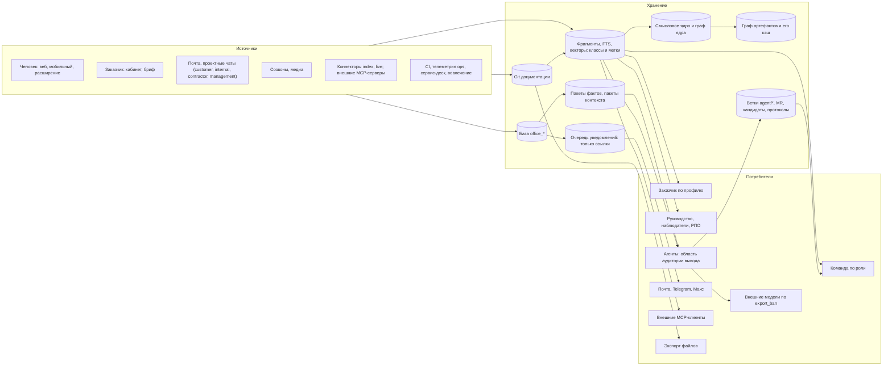

# 27. Сверка суперархитектора: права доступа, роли, рабочие места и пути утечки

Дата: 2026-10-26. Основание: третья запись брифа 2026-10-26 и строки A65-A72 `manifest.md`. Мерило дословно: «При каждой итерации добавления нового функционала общая архитектура не должна повреждаться или быть уязвимой. При каждом прогоне суперархитектор должен заострять внимание на правах доступа, ролях и рабочих местах, чтобы не было утечки данных. Преимущество RAG-системы и симонтического ядра не должно стать слабым звеном с точки зрения прав доступа внутренних агентов и агентов к данным. Все потоки данных должны четко следовать своим правам в зависимости от настроенной ролевой модели.» (A71, A72).

Предмет: новые разделы `25-uvedomleniya-i-ruchnoe-revyu.md` и `26-otchety-i-prezentacii.md`, применённые ответы пользователя `24` §10, строки тасков 89-119 и блок «Дополнение 2026-10-26, третья запись» `plan.md`; против них весь комплект `00`-`24`, `interfaces.md`. Кода нет. Решения `05` §3, §6-§9 и `24` обязательны; этот раздел дополняет их так же, и при расхождении `21`-`26` с ним верен он. Номер «С27-NN» это расхождение, «У27-NN» это путь утечки.

Сокращения: МП менеджер проекта (`project_manager`), РПО руководитель проектного офиса (`pmo_head`), БА и СА бизнес- и системный аналитик, Арх архитектор, Раз разработчик, Тест тестировщик, Тим тимлид, ТЛ технический лид, Наб наблюдатель (область проект, подразделение или компания), Пр и Подп представитель и подписант заказчика, АдмК администратор компании (`is_company_admin`), АдмП администратор платформы (`users.is_admin`), Аг агент. RAG это поиск по ядру знаний с подстановкой найденных фрагментов в подсказку модели (`01` §7). Смысловое ядро это выжимка, сущности и выведенные связи версии документа (`01` §8). MCP это протокол инструментов для моделей (`02` §7). Класс данных это метка чувствительности (`team`, `customer`, `budget`, `internal_text`, `code`, `usage`, `personal`, `13` §4.5; `showcase`, `26`; `management_chat`, этот раздел). Аудитория это круг читателей вывода (`26` §2.1).

## 1. Метод

1. Прочитаны целиком `25`, `26`, `24`, блоки 2026-10-26 `plan.md`; прицельно `00` §2, §3, §6; `01` §2.2, §3.4, §7.1-§7.7, §8; `02` §2, §4, §5.2, §7, §8, §10; `03` §2.0, §2.2, §2.5, §4, §6, §7; `04` §6; `13` §1.3-§1.7, §4.1-§4.7; `14` §3.4-§3.5, §7; `15` §1.5, §2.4; `17` §10, §12; `18` §2.5, §6.4, §6.7; `19` §1, §2, §4; `20` §1-§3; `21` §3; `22` §2, §6.4; `23` §3, §4, §6, §7; `interfaces.md` последние разделы; строки A41-A72 `manifest.md`; `state.js` (раздел замечаний).
2. Построена карта потоков (§3): каждый переход «источник → хранение → потребитель» проверен вопросами «где проверка прав», «в чьей области», «в какой момент», «что при смене роли или исключении между постановкой и доставкой».
3. Отдельно разобраны RAG и смысловое ядро: что хранит метку класса и что фильтрует только объявлением в тексте раздела.
4. Ролевая матрица собрана из `24` (дополнение `03` §4.3), `25` §10.5, `26` §6.6 по 12 ролям, заказчику, АдмК и агенту (§6); найдены клетки, умолчание которых не роль, а связь с объектом.
5. Целостность: имена таблиц, событий, операций, клеток, видов, классов; один писатель; направление зависимостей `05` §3.1; нумерация инвариантов и тасков; `Blocked by` против срезов (подсчёт по таблицам `plan.md`).
6. Правки: прямо в `21`-`26` и в блоке тасков 89-124 `plan.md`; в `00`-`20` и `interfaces.md` только дописанными блоками «Дополнение 2026-10-26 (сверка 27)». `manifest.md`, бриф, `state.js`, `spec.md`, `architecture/README.md` не тронуты.

## 2. Вердикт

До правок архитектура была уязвима в одном месте, ровно там, куда указал пользователь: **классы данных объявлены, но не хранятся там, где работает RAG**. `office_fragments` знает `visibility`, `family`, `version_status`; ни класса `budget` у вида с деньгами (`21` §3.2 `data_class`), ни класса чата руководства (`25` §5.2), ни классов фактов результата (`26` §2.3 п. 8), ни классов протокола ресёрча (`25` И-85) поиск не видел. Второе слабое место: агент пишет ветку и MR для команды в правах назначившего МП, у которого шире права (бюджет, чат руководства), и до слияния человеком этот текст уже виден команде. `26` решил это для результатов функцией `tenancy.audience_scope`, но остальные агенты остались без неё.

Найдено 23 пути утечки, все закрыты правками или правилом (один закрыт ограничительным умолчанием до ответа пользователя, У27-10). Найдено 27 расхождений: 5 блокируют, 14 значимы, 8 подсказок; закрыто правками 24, частично 3 (два ждут слова пользователя, §9; одно за владельцем манифеста, §12). После правок (принципы 18 и 19 дописаны в `00` §2): права проверяются до ранжирования по классам и меткам у каждого фрагмента, вектора, ядра и узла графа; любой вывод агента строится в области аудитории вывода; внешние каналы и внешние клиенты не получают классов `budget` и `management_chat`; поиск не выходит за проект ни у одного результата; роль меняет права одной клеткой матрицы, без второго источника.

## 3. Карта потоков данных

### 3.1. Схема

### 3.2. Переходы и проверки

| № | Переход | Где проверка | Чья область | Когда | Смена роли или исключение до доставки |
|---|---|---|---|---|---|
| 1 | Источник → фрагмент, вектор, FTS | `knowledge.ingest_source`: классы и метки области ставятся при приёме (И-86) | проект | приём | Фрагменты остаются (И-27); доступ решается при чтении |
| 2 | Фрагмент → человек (поиск, ассистент, карточки) | `tenancy.scope` до ранжирования, внутри FTS и KNN, по классам и меткам (`01` §7.3, дополнение 27) | человек | каждый запрос | Новая область; кэш ответа ключуется отпечатком области с классами и метками |
| 3 | Фрагмент, набор → агент | `tenancy.audience_scope` токена запуска на каждом вызове MCP и поиска (И-87) | запустивший ∩ профиль агента ∩ аудитория вывода | каждый вызов | Идущие запуски исключённого отменяются (И-102); роль пересчитывается на вызове |
| 4 | Агент → ветка, MR, кандидат, комментарий | `knowledge.import_agent_commits`: источник каждой цитаты виден аудитории вида (`02` дополнение 27) | аудитория вида | импорт коммита | Отказ импорта при невидимом источнике |
| 5 | Версия → смысловое ядро, граф ядра | ядро и рёбра наследуют классы версии; обход не входит в скрытый узел (`01` §7.3, §8) | читатель | каждое чтение | Как п. 2 |
| 6 | Проекции `insight` → граф артефактов | `insight.artifact_graph` по `tenancy.scope`; кэш по `scope_hash` с классами и метками (`14` дополнение 27) | читатель | чтение | Новый `scope_hash`, старый кэш недостижим |
| 7 | Наборы → пакет фактов | `insight.collect_facts` в `audience_scope`; пакет заморожен с классами (`26` И-91) | запустивший ∩ аудитория | сбор | Утверждение и отправка проверяют человека заново (И-101) |
| 8 | Пакет фактов → сценарист, контент-менеджер, ревьюер | только пакет и поиск в области аудитории; замечания ревьюера вне области агенту не возвращаются (`26` §5.1) | аудитория | шаги 3-5 | Новый пакет только `refresh-facts` |
| 9 | Результат → получатель | `tenancy` по `data_classes` версии и состоянию жёстких проверок `cycle` при сохранении, утверждении, публикации, экспорте, отправке (И-93, И-101) | получатель и действующий человек | каждое действие | Действие отказывает; выгруженный файл не отзывается, у него колонтитул и запись в аудите |
| 10 | Пакет контекста ресёрча → участники, арбитр | `agents.build_context_pack` в области инициатора ∩ профиль ∩ аудитория предмета; без инструментов (И-82, И-87) | инициатор ∩ аудитория | сборка | Применение решения проверяет инициатора заново; протокол и пакет читают только видящие каждый класс (И-85) |
| 11 | Событие → уведомление | `channels.may_deliver` при отправке и показе (`25` П-1, П-2) | получатель | доставка | Ожидающие строки отменяются (П-12, И-102); роль пересчитывается при доставке |
| 12 | Уведомление → почта, Telegram, Макс | уровень детализации, потолок классов, закрытый контур (`25` §2.2) | получатель | доставка | Уже отправленное не отзывается, поэтому текст без содержимого |
| 13 | Ассистент → ответ во внешнем канале | права владельца на каждом вызове; планка классов как у уведомлений (`13` дополнение 27, И-88) | владелец диалога | ответ | Следующий ход в новой области |
| 14 | Запуск → внешняя модель | `routing.resolve` по `export_ban` (`12` §2.4), закрытый контур (`20` §3) | проект | вызов | Не зависит от роли |
| 15 | Данные → внешний MCP-клиент (Claude Code, Cursor) | токен пользователя (`02` §7); при `export_ban ≠ none` содержательные инструменты выключены (И-88) | пользователь ∩ проект | вызов | Исключение сразу сужает токен |
| 16 | Агент → внешний MCP-сервер, коннектор `live` | библиотека, список инструментов, граница связанного пространства проекта (`19` дополнение 27, И-105) | запустивший ∩ пространство | вызов | Как п. 3 |
| 17 | Черновик ответа → внешний чат | только человек из подписи, `params_sha` (И-56); черновик в профиле аудитории чата (И-57) | отправитель ∩ аудитория чата | отправка | Отправка проверяет отправителя |
| 18 | Чат руководства → поиск, сводки, кандидаты, план дня | класс `management_chat` и метка `chat:<id>` до ранжирования (`25` §5.2, И-79) | участник или `chats/view_management` | чтение | Участие по `left_at`; клетка по матрице |
| 19 | Опыт проектов → МП, агенты, пресейл | карточки `approved` без денег; агрегаты по проектам без доступа зрителя от порога (И-72, И-100) | зритель | чтение | Пересчёт раз в сутки |
| 20 | Вовлечение, тикеты → наборы → заказчик | агрегаты, порог k у всех аудиторий, вторичное подавление; тексты тикетов класс `personal` (И-95, И-99, И-100) | аудитория | сбор | Как п. 7 |
| 21 | Телеметрия `ops` → отчёт нагрузки | свёртки, вариант без адресов (`26` §4.2) | аудитория | сбор | Как п. 7 |
| 22 | Версия → экспорт файла | только утверждённая версия, классы зрителя, колонтитул, аудит (`26` §2.3 п. 16, И-101) | зритель | выгрузка | Файл живёт вне платформы: это последний рубеж, поэтому проверка до выгрузки |
| 23 | Подписка (результат, сохранённый вид, расписание) → выпуск | права `on_behalf_of` на момент запуска (`02` §8, `26` §5.6) | назначивший | запуск | Исключение снимает подписку (И-102) |

## 4. Пути утечки

| № | Путь | Где проверка теперь | Что сделано |
|---|---|---|---|
| У27-01 | **RAG отдаёт фрагменты закрытых классов.** Класс `budget` вида (`plan:procurement`, `final_report:finance`), класс чата руководства, классы фактов результата и протокола ресёрча объявлены в `21`-`26`, но `office_fragments`, векторы, ядро версии и узлы графа их не хранят; фильтр `01` §7.3 знает только `visibility`, `family`, `version_status`. Разработчик или агент разработчика находит сумму закупки или реплику руководства обычным поиском | `tenancy.scope` и `audience_scope` отдают разрешённые классы и метки; FTS и KNN фильтруют внутри запроса | Колонки `data_classes`, `scope_tags` у фрагмента, в метаданных vec0, у ядра версии и узла; версия получает `data_classes` (класс шаблона ∪ классы фактов ∪ классы процитированных источников); кэш ответа и графа ключуется ими. `01` §7.3, `03` §2.5, `14` §3.5 (дополнения 27); И-86 |
| У27-02 | **Вывод агента шире аудитории.** Аналитик, писатель, `draft_artifact`, страж цепочки, ревьюер документов, применение ресёрча работают в правах назначившего; у МП это бюджет и чат руководства; ветка и MR видны команде до слияния (`02` §3.2: видны после `succeeded`) | Токен запуска несёт аудиторию вывода; поиск и инструменты в `audience_scope`; при импорте коммита источник каждой цитаты виден аудитории вида | Принцип 18 в `00`; `audience_scope` из `26` Р26-02 обобщён на все запуски; `02`, `21` §3.3, `25` §8.2, `26` Р26-02; И-87 |
| У27-03 | **Межпроектный поиск через результат руководству.** `26` §2.2 у области отдела и компании даёт `projects[]` и `knowledge.search(..., audience)`: это поиск по нескольким проектам, отложенный D01 (И-26, И-32) | `audience_scope` у области шире проекта отдаёт пустой фильтр поиска | Результаты отдела и компании строятся только из наборов и агрегатов; цитаты только фактами пакета. `26` §2.2, `01` §7.7 дополнение; И-89 |
| У27-04 | **Агрегаты похожих проектов раскрывают проект.** МП с доступом к двум из трёх проектов группы вычисляет третий; разность агрегатов до и после закрытия нового проекта даёт его числа | `insight.similar_projects` | Порог три считается по проектам без доступа зрителя; доступные показываются ссылками отдельно; медианы и доли с округлением до 5 процентных пунктов (калибровка, не цель); пересчёт раз в сутки. `23` §4.2; И-100 |
| У27-05 | **Деньги в карточках библиотеки.** `office_solutions.numbers {estimate, actual, unit}` читают все сотрудники компании (`23` §7), единица может быть рублём (A22) | сканер обезличивания и детектор валют при предложении карточки | В карточке только часы, дни, штуки, доли; денежная единица 422. `23` §4.1 |
| У27-06 | **Вовлечение: дополнение до родителя.** Подразделение с одним активным сливается в «прочие», но «прочие» равно родителю минус видимые дети; команда видит ячейки меньше k | `insight` при сборе набора `adoption` | Вторичное подавление (скрывается и вторая наименьшая ячейка, если скрыта одна); порог k у всех аудиторий, включая команду. `26` §4.3; И-95, И-100 |
| У27-07 | **Тексты тикетов в поиске заказчика.** Режим `index` кладёт текст обращения в ядро; `knowledge.search` аудитории `customer` его находит, а там личные данные пользователей заказчика (152-ФЗ) | класс `personal`, метка `support:<project>`, клетка `support/view_texts` | Источник `support_ticket:<id>` класса `personal`; в аудитории `customer`, `prospect` не входит; тексты видит `support/view_texts` (МП, ТЛ). `26` §4.1, §6.6 |
| У27-08 | **Замечания ревьюера уходят в текст заказчику.** Ревьюер ищет «сглаживание» по внутренним расхождениям аудитора; его замечания возвращаются контент-менеджеру результата `customer` (шаг 5 → 4) | конвейер `agents` | Агенту возвращаются только замечания, построенные в области аудитории; замечания по внутренним данным видит только МП в MR. `26` §5.1 |
| У27-09 | **Аудитор до G3 пишет статус команде из базы с деньгами.** Таск 85 (F) читает в правах МП базу с `bac`; `status_report` видят все (`20` §1.2) | `draft_artifact`-подобная проекция `plan` | До G3 аудитор берёт `plan` проекцией без денег; отклонение по стоимости только в виде класса `budget`. `20` дополнение, `plan.md` 98; И-73 |
| У27-10 | **Чат руководства читают наблюдатели.** `25` §5.2 даёт `chats/view_management` наблюдателям отдела и компании, а `18` §2.5 им даёт только счётчики | матрица | До ответа В25-3: участники чата и РПО; наблюдателям счётчики. `25` §5.2, §10.5 (частично: ждёт слова пользователя) |
| У27-11 | **Ответ ассистента во внешнем канале.** Форма `no_quotes` «своими словами» может нести суммы и пересказ чата руководства через серверы Telegram, Макса, почты, а уведомлениям это запрещено (`25` П-4, И-77) | `agents` при сборке ответа канала | Если в ответе использованы классы `budget` или `management_chat`, внешний канал получает `link_only`. `13` §1.7 дополнение, `25` П-14; И-88 |
| У27-12 | **Закрытый контур и мессенджеры.** `20` обещает «данные не покидают сервер», а уведомление `minimal` уносит код проекта, ключ объекта и имя в Telegram и Макс | `channels.render` | При закрытом контуре и `export_ban = all_external` Telegram и Макс выключены, почта только SMTP внутри контура, уровень `link_only`. `25` §2.2, `20` дополнение; И-88 |
| У27-13 | **Внешний MCP-клиент выносит данные.** Сотрудник подключает Claude Code или Cursor токеном `mcp` к проекту с `export_ban` и читает документы: текст уходит поставщику модели клиента мимо `routing` | `tenancy` при выдаче и на вызове токена | При `export_ban ≠ none` содержательные инструменты токена `mcp` к проекту выключены (остаются метаданные, ссылки и статусы). `02` §7 и `20` §3.3 дополнения; принцип 19 в `00`; И-88 |
| У27-14 | **Внешние MCP-серверы и коннекторы `live`.** Вызов идёт токеном компании (`19` §1.1), видит всё пространство системы, в том числе чужих заказчиков; ответ попадает в результат заказчику | адаптер и файрвол инструментов | Вызов в границах связанного внешнего пространства проекта (адаптер подставляет фильтр области, иначе отказ); ответ это материал класса `internal_text`, в аудитории `customer` и `prospect` не входит без сохранения в ядро. `19` дополнение, `26` §2.2; И-105 |
| У27-15 | **Повторная проверка при публикации и экспорте результата** звала бы `insight.verify_deliverable` из `cycle` и `knowledge` (вызов вверх) или пропускалась бы | `tenancy` по `data_classes` версии и `office_deliverable_checks` (`cycle`) | `26` §2.2, §5.3; И-101 (и С27-05) |
| У27-16 | **Утверждает человек без класса.** Пакет собран с `budget`, утверждающий потерял `plan.budget/view` | `tenancy` при утверждении, слиянии, публикации, экспорте, отправке | Действующий человек сам видит каждый класс версии, иначе 403. И-101 |
| У27-17 | **Запуск агента после исключения назначившего.** Токен запуска «живёт до конца запуска» (`02` §7) | `agents` по `member.removed`, `member.role_changed` | Идущие запуски исключённого отменяются, созданное снимается; токен перепроверяет участие на вызове. `02` дополнение; И-102 |
| У27-18 | **Снятие одной роли.** Участие хранится строками `(project, user, role)`; снятие одной роли выглядело бы как `member.removed` (письмо «доступ закрыт», отмена всех уведомлений), а смена роли без `member.role_changed` не сужала бы поиск | `project` | `member.removed` только при снятии последней роли; иначе `member.role_changed`; слушатели пересчитывают область. `03` §4.3 дополнение; И-102 |
| У27-19 | **Пакет контекста ресёрча** (список ссылок, классы, отпечатки) читается любым видящим запуск; API не задавал | `agents` | Пакет и его список ссылок читают только читатели протокола. `25` §8.2, И-85 |
| У27-20 | **Подсказки ввода.** Упоминания `@`, ключи `REQ` и `ABC`, поиск узла по ключу, поиск в шапке не описаны: список мог бы перечислять скрытое | `tenancy.scope` вводящего | Подсказки строятся той же областью; заказчику только люди и ключи, открытые профилем. `03` §4.3 дополнение |
| У27-21 | **Внутренние пометки проверяются по несуществующему классу.** `25` П-2, И-77 и `22` §2.3 называют класс `customer.internal`, а класс в `13` §4.5 это `internal_text`; код проверял бы пустое множество | один реестр классов | Переименовано в `internal_text`; `customer.internal` остаётся разделом матрицы (клетки `view_internal_marks`, `view_contract_column`). `25`, `22` §2.3, `03` §2.5 дополнение |
| У27-22 | **Два пути наружу смешаны.** Уведомление (`25` П-4: без содержимого) и отправка утверждённого результата почтой с вложением (`26` §5.1 шаг 7); О1 «сообщение в канал» | `channels` | Уведомление всегда ссылкой; вложение уходит только операцией `deliverables/send_external` человека с проверкой получателей (И-93, И-101); О1 это уведомление `report.shared` ссылкой. `25` П-4, `26` §3.2, §5.1 |
| У27-23 | **Пресейл: получатель вне платформы.** Проверка «получатель видит класс» невозможна для адреса без учётки | состав классов и аудит | В результат `prospect` входят только `showcase` и `customer` своего пресейл-проекта; адрес получателя и выгрузка пишутся в аудит. `26` §2.1 |

Проверено, утечки нет: кэш эмбеддингов `(model_tag, text_hash)` отдаёт вектор только по точному отпечатку того же текста и не ищется по сходству; одинаковый текст в двух проектах раскрывает только то, что у обоих он есть, а это не наблюдаемо извне; `notification.failed` идёт только в веб (`25` К16), петли сбоев нет; ресёрч у разных поставщиков подчиняется `export_ban` через `routing.resolve`; письмо «Вам закрыт доступ к проекту ABC» раскрывает исключённому только код, который он знал.

## 5. Расхождения

Важность: **блокирует** (нарушает обязательное решение, слова пользователя или делает таск неисполнимым); **значимо** (ломает часть поведения, право или след); **подсказка** (имя, пометка, удобство).

| № | Где | Суть | Важность | Решение | Где закрыто |
|---|---|---|---|---|---|
| С27-01 | `01` §3.4, §7.3; `21` §3.2; `25` §5.2, §10.1; `26` §2.3 п. 8 | У27-01: классы и метки не хранятся там, где работает RAG | блокирует | Колонки и фильтр; версия с `data_classes`; ключи кэшей | `01`, `03`, `14` дополнения; И-86 |
| С27-02 | `02` §2.2, §4.2; `21` §3.3; `25` §8.2; `20` §1.2 | У27-02: агент пишет для аудитории шире своего контекста | блокирует | `audience_scope` у каждого запуска, аудитория вида по умолчанию `internal`; проверка цитат при импорте | `00` принцип 18; `02` дополнение; `21` §3.3; `25` §8.2; `26` Р26-02; И-87 |
| С27-03 | `plan.md`; `17` §10; `18` §6.7; `05` §9.8; `25` §11; `26` §9 | Таски `ops` (A43) и чатов (A44) в `plan.md` не заведены вовсе: `05` §9.8 объявил синхронизацию «таски 81-88», но номера 81-88 потом заняли коннекторы, аудитор, PowerPoint, MS Project, закрытый контур. Таски 102 (К1, К19), 103, 118 ждут несуществующих тасков | блокирует | Чаты получили 107-109 (резерв `25`, родство с К1 и 103), `ops` получил 120-124; строки добавлены; 103 ждёт 107, 118 ждёт 123, 102 по частям 107, 108, 121, 123 | `plan.md`; `17` §10, `18` §6.7, `05` §9.8 дополнения; `25` §11, §12, §14; `26` §9 |
| С27-04 | `26` §2.2 | У27-03: межпроектный поиск через аудиторию `management` | блокирует | Поиск только в одном проекте | `26` §2.2; `01` §7.7 дополнение; И-89 |
| С27-05 | `26` §5.3, И-93 | Проверка при публикации и экспорте результата вызывала бы `insight` из `cycle` и `knowledge` (вызов вверх, `05` §3.1) | блокирует | `tenancy` по `data_classes` версии и состоянию `office_deliverable_checks` у `cycle`; `insight.verify_deliverable` зовёт только `agents` | `26` §2.2, §5.3, §7; И-101 |
| С27-06 | `25` Р25-04, Р25-07, П-2, §5.2, §10.1, И-77, И-79; `26` §2.1; `22` §2.3 | Имя `management` значит у `26` аудиторию, у `25` класс данных, у `18` вид чата; `customer.internal` у `25`, `22` значит класс, которого в реестре классов нет (У27-21) | значимо | Класс `management_chat`; вид чата и аудитория `management` остаются; класс `internal_text` | `25`, `26` §2.1, `22` §2.3, `03` §2.5 дополнение |
| С27-07 | `26` §4.5, §5.5, §6.1, §9 | Значение `office_ops_environments.kind = demo` совпадает с семейством `demo` (ролик) и видом встречи `demo` (обзор спринта) | подсказка | `demo_stand` | `26` |
| С27-08 | `25` §5.2, §10.5; `18` §2.5 | У27-10: умолчание `chats/view_management` против `18` §2.5 | значимо | До ответа В25-3 участники и РПО, наблюдателям счётчики | `25` §5.2, §10.5, §14 |
| С27-09 | `25` §8.6, В25-4 | Порог РПО 20 долларов выше потолка запуска 5 долларов: подтверждение РПО никогда не наступает | значимо | `rpo_threshold_usd` 3 доллара (калибровка, не цель), проверка «порог не выше потолка» (422) | `25` §8.6, §10.1, §14 |
| С27-10 | `plan.md` | Ярус T3 до 16 тасков: E стал 17 (105), F стал 18 (102, 103), с тасками чатов и `ops` F 22, G 19 | значимо | Предложение по утверждённому правилу подсрезов: E2 (105), F2 (102, 103, 107, 108, 121, 122), G2 (101, 109, 123, 124); B 13 тасков без подсреза | `plan.md` (частично: ждёт слова пользователя, вопрос 2 §9) |
| С27-11 | `25` П-2, §3.3 | Шаг 1 «участие в проекте» подавлял бы виды для РПО и наблюдателей с областью (`digest.weekly_portfolio`, `baseline.waiting`, `research.confirm_needed`, `review.stale`): они не участники | значимо | Шаг 1 это `tenancy.open_project` (участие или область наблюдателя); содержимое по профилю наблюдателя; РПО вне проекта подтверждает ресёрч экраном оценки без текста пунктов | `25` П-2, §8.6 |
| С27-12 | `25` §6.1, §6.4, §10.1, §10.5; `26` §6.1, §6.6; `22` §6.4 | Два источника истины: `settings.review.bulk_accept` и клетка `review/bulk_accept`; поля шаблона `review_owner_role`, `approver_role` без связи с клетками; «выдача МП» в проекте (`gantt/edit`, `create_customer`) вне матрицы, которая не знает проекта (`13` §4.7) | значимо | Право включает только клетка; поля шаблона и выдача МП сужают круг среди ролей с клеткой (422 `role_not_permitted`); `bulk_accept` только клеткой; выдача Ганта списком `office_gantt_settings.editors` | `25` §6.1, §6.4, §10.1; `26` §6.6; `22` §6.4; `13` §4.7 дополнение; И-103 |
| С27-13 | `25` §10.5; `26` §6.6; `03` §4.3 (24); `13` §4.7 | Новые клетки разнесены по трём файлам; умолчания «ответственный», «делегат», «автор документа», «назначенный рецензент», «владелец строки», «МП пресейла» это связи с объектом, а не роли; остатки формата через точку (`reports.create`, `chats.manage`) | значимо | Одна сводная таблица в `13` §4.7 (матрица таска 64): роль даёт клетку, связь с объектом проверяет операция домена; точечные имена это синонимы старой редакции | `13` §4.7 дополнение; §6 здесь |
| С27-14 | `25` §3.3, §6.1; `26` §4.1, §6.5 | `deliverable.ready_for_approval` без вида уведомления и с дублем `review.ready`; ревизии каталога вне очереди ревью; события `support_sla.*`, `deliverable.failed`, `deliverable_subscription.stopped` без видов; у видов результатов нет умолчания `review_policy`, хотя `none` для видов заказчику запрещено | значимо | Вид `deliverable.ready` только для ревизий каталога, для Git дубль склеивается с `review.ready`; виды `support.sla_at_risk`, `support.sla_breached`, `deliverable.failed`, `deliverable.stopped`; умолчания политики для видов `26` | `25` §3.3, §6.1 |
| С27-15 | `25` П-4; `26` §3.2, §5.1 | У27-22: уведомление и отправка результата смешаны | значимо | Разведены | `25` П-4; `26` §3.2, §5.1 |
| С27-16 | `26` §5.6 | Подписка `on_event` на `version.accepted` срабатывает на принятие собственного результата: петля выпусков | значимо | События версий видов результатов подписок не будят; `event` называет вид источника | `26` §5.6; И-104 |
| С27-17 | `25` П-12, §10.4; `03` §2.4 | У27-18: `member.removed` против снятия одной роли | значимо | Семантика событий | `03` §4.3 дополнение; И-102 |
| С27-18 | `plan.md` 102, 103, 111, 114, 116, 118; `25` §11; `26` §9 | `Blocked by`: 111 без очереди ревью 104 (шаг 6 конвейера) и перепроверки 105; 114 без окружения `ops` для демо-стенда и раннера 34; 116 без договоров 44 для набора `contracts_acts`; 118 «ряды `ops`» без номера; 103 без привязки чатов; 102 К1, К19 без источников событий | значимо | Дописаны с частями и поведением «данных пока нет» | `plan.md`; `25` §11; `26` §9 |
| С27-19 | `03` §7; `25` §10.7; `26` §7 | И-75..И-85 и И-90..И-99 не внесены в `03` §7; И-86..И-89 свободны | значимо | Итоговые номера §8; новые И-86..И-89 и И-100..И-105 | `03` §7 дополнение |
| С27-20 | `26` §2.1 | Аудитории `internal` и `management` не содержат класса `customer`, поэтому внутренний отчёт не мог бы взять `adoption`, `system_modules`, хотя «команда видит тот же агрегат» | значимо | `customer` добавлен обеим | `26` §2.1 |
| С27-21 | `interfaces.md` | Нет имён `25`, `26` и правок сверки | подсказка | Дополнение | `interfaces.md` |
| С27-22 | `25` §4.5, §6.3; `26` §8; `15` §2.4 | Новые экраны не разложены по рабочим местам `15` §2.4: «На ревью» у команды, центр уведомлений у заказчика, чат руководства, витрина и наложения | подсказка | §7 здесь | `15` §2.4 дополнение |
| С27-23 | `25` §7, §8.1 | Подсказка `min_tier` при `export_ban = foreign` (модели Anthropic иностранные для компании в России) | подсказка | `resolve` не обходит запрет; нет разрешённой старшей модели: кнопка неактивна с пояснением | `25` §7 |
| С27-24 | `25` §6.1, §9.2 | Ответственный за ревью или делегат потерял доступ: ревью висит | подсказка | Ревью возвращается МП событием `artifact_review.reassigned` | `25` §6.1 |
| С27-25 | `23` §6 | Порядок сборки не показывает очередь ревью для видов `manual_items` с C2 и поведение до C2 | подсказка | Абзац под таблицей | `23` §6 |
| С27-26 | `26` §9; `25` §12, §14 | Фраза «102-109 у раздела уведомлений» и хвосты «свести номера» | подсказка | Обновлены | `26` §9; `25` §12, §14 |
| С27-27 | `05` §9.8; `manifest.md` | `05` §9.8 объявил «`manifest.md` (A41-A45 в `in-spec`)», но в манифесте A41-A45 `open`; таски A43, A44 теперь есть | подсказка | Отметка в `05`; статусы правит владелец манифеста (этому проходу запрещено) | `05` §9.8 дополнение; §12 здесь (частично) |

Итог: 27 расхождений; блокирует 5 (С27-01..05), значимо 14 (С27-06, С27-08..20), подсказка 8 (С27-07, С27-21..27). Закрыто правками 24; частично 3 (С27-08 ограничительным умолчанием до ответа на В25-3, С27-10 предложением подсрезов до слова пользователя, С27-27 за владельцем манифеста).

## 6. Сводная ролевая матрица новых клеток

Формат `13` §4.7 «раздел/действие». Обозначения: «да» умолчание разрешено; «о» разрешено роли, но операция домена пускает только при связи с объектом (ответственный, делегат, назначенный рецензент, владелец строки, свой запрос, МП этого пресейл-проекта, редактор из списка МП); «сч» только счётчики и агрегаты; «-» нет, админ может открыть; «з» закреплено нет. Наб разделён: «Наб п» область проекта, «Наб о/к» подразделение и компания. АдмП (`users.is_admin`) проходит любую клетку с записью `admin_as_role` (`13` §4.7 п. 1). Агент действует правами назначившего, но в области аудитории вывода (И-87) и без запрещённого (`03` §4.1).

| Клетка | МП | РПО | БА | СА | Арх | Раз | Тест | Тим | ТЛ | Наб п | Наб о/к | Пр | Подп | АдмК | Аг |
|---|---|---|---|---|---|---|---|---|---|---|---|---|---|---|---|
| `templates/manage` | - | да | - | - | - | - | - | - | - | - | - | з | з | да | з |
| `artifacts/create` | да | - | да | да | - | - | - | - | - | - | - | з | з | - | назн. |
| `registers/view` | да | да | да | да | да | да | да | да | да | - | - | з | з | - | назн. |
| `registers/edit` | да | - | о | о | о | о | о | о | о | - | - | з | з | - | кандидат |
| `gantt/edit` | да | - | - | - | о | - | - | о | о | - | - | з | з | - | з |
| `elicitation/run` | да | - | да | да | - | - | - | - | - | - | - | з | з | - | назн. |
| `elicitation/customer` | да | - | - | - | - | - | - | - | - | - | - | з | з | - | з |
| `library/propose` | да | - | - | - | - | - | - | - | - | - | - | з | з | - | кандидат |
| `library/approve` | - | да | - | - | - | - | - | - | - | - | - | з | з | - | з |
| `notifications/manage_policy` | - | - | - | - | - | - | - | - | - | - | - | з | з | да | з |
| `notifications/view_delivery_log` | - | - | - | - | - | - | - | - | - | - | - | з | з | да | з |
| `notifications/subscribe_others` | да | - | - | - | - | - | - | - | - | - | - | з | з | - | з |
| `review/view_project_queue` | да | да | - | - | - | - | - | - | - | - | - | з | з | - | з |
| `review/review_items` | да | - | о | о | о | - | - | - | о | - | - | з | з | - | з |
| `review/delegate` | да | - | - | - | - | - | - | - | - | - | - | з | з | - | з |
| `review/reject` | да | - | о | о | о | - | - | - | о | - | - | з | з | - | з |
| `review/bulk_accept` | - | - | - | - | - | - | - | - | - | - | - | з | з | - | з |
| `review/recheck` | да | - | о | о | о | - | - | - | о | - | - | з | з | - | карточка B |
| `review/council_run` | да | - | - | - | - | - | - | - | - | - | - | з | з | - | карточка B |
| `review/council_confirm_high` | - | да | - | - | - | - | - | - | - | - | - | з | з | - | з |
| `review/view_research` | да | да | да | да | да | о | о | да | да | - | - | з | з | - | з |
| `review/request_review` | да | - | да | да | да | - | - | - | да | - | - | з | з | - | з |
| `review/respond_review` | о | о | о | о | о | о | о | о | о | - | - | з | з | - | з |
| `chats/view_management` | о | да | - | - | - | - | - | - | - | - | сч | з | з | - | по актору |
| `deliverables/create_internal` | да | - | да | да | да | - | - | да | да | - | - | з | з | - | назн. |
| `deliverables/create_customer` | да | - | - | - | - | - | - | - | - | - | - | з | з | - | назн. |
| `deliverables/create_management` | да | да | - | - | - | - | - | - | - | - | да | з | з | - | назн. |
| `deliverables/create_presale` | о | да | - | - | - | - | - | - | - | - | - | з | з | - | назн. |
| `deliverables/approve` | да | да | - | - | - | - | - | - | - | - | - | з | з | - | з |
| `deliverables/send_external` | да | - | - | - | - | - | - | - | - | - | - | з | з | - | з |
| `deliverables/manage_schedule` | да | - | - | - | - | - | - | - | - | - | - | з | з | - | з |
| `deliverables/overlays_project` | да | - | - | - | - | - | - | - | - | - | - | з | з | - | з |
| `deliverables/overlays_company` | - | да | - | - | - | - | - | - | - | - | - | з | з | да | з |
| `deliverables/override_soft` | да | да | - | - | - | - | - | - | - | - | - | з | з | - | з |
| `support/view` | да | да | да | да | да | да | да | да | да | - | сч | з | з | - | назн. |
| `support/view_texts` | да | - | - | - | - | - | - | - | да | - | - | з | з | - | только `internal` |
| `support/manage` | да | - | - | - | - | - | - | - | да | - | - | з | з | - | з |
| `support/connect`, `adoption/connect` | - | - | - | - | - | - | - | - | - | - | - | з | з | да | з |
| `adoption/view` | да | да | да | - | да | - | - | - | - | - | сч | з | з | - | назн. |
| `adoption/org_units` | да | - | - | - | - | - | - | - | - | - | - | з | з | - | з |
| `showcase/propose` | да | - | - | - | - | - | - | - | - | - | - | з | з | - | кандидат |
| `showcase/approve` | - | да | - | - | - | - | - | - | - | - | - | з | з | - | з |

«назн.» значит агент действует по назначению человека, у которого клетка есть; «кандидат» значит агент только предлагает строку, решает человек; «по актору» значит контекст агента получает чат руководства, только если его видит назначивший и аудитория вывода ограничена видящими (И-87). Пр и Подп: все клетки закреплены «нет»; заказчик получает опубликованное через профиль видимости `03` §4.2, вопросы сессии и уведомления только видом с аудиторией `customer` уровнем `link_only`. Источник истины один: таблица `13` §4.7 (дополнение 27), таск 64.

## 7. Рабочие места

| Экран | Команда | Заказчик (Пр, Подп) | Руководство: РПО, Наб | АдмК | АдмП |
|---|---|---|---|---|---|
| «На ревью»: моя очередь, ревью по пунктам | Полоса действий, значок по `25` П-13; ответственные МП, БА, СА, Арх, ТЛ; рецензенты запросов любой роли команды | Нет никогда (И-13) | РПО: очередь проекта, где он участник; иначе счётчики в портфеле | Нет (входит участником) | `admin_as_role` |
| «Исследования», протоколы ресёрча | По `review/view_research` и И-85 | Нет | РПО | Нет | `admin_as_role` |
| «Артефакты», «Актуализация», «Реестры» | По клеткам `artifacts/create`, `registers/*` | Нет; опубликованные документы в разделе «Документы» | Нет (РПО участником) | Шаблоны (`templates/manage`) | все |
| Гант | Без денег; правка `gantt/edit` с редакторами МП | Снимок без денег по решению МП (`22` §6.4) | Вехи в портфеле; деньги видящим бюджет | Нет | все |
| Результаты `/office/:id/deliverables` | Каталог видов по клеткам `deliverables/create_*`; виджет «Готово к утверждению» у МП | Опубликованные результаты в «Документах»; раздел «Отчёты» закрыт | `/office/reports`: управленческие и портфельные ревизии (`26` §8) | Наложения компании, подключения сервис-деска и аналитики | все |
| Центр уведомлений, настройки | Все виды по П-2 | Только виды с аудиторией `customer`, уровень `link_only` во внешних каналах | Недельная сводка портфеля без денег, кроме видящих бюджет | Политика, журнал доставки без текстов | Журнал доставки |
| «Чаты проекта», вкладка чата руководства | Участники чата; МП только участником | Нет (A21) | РПО; Наб о/к счётчики до ответа В25-3 | Нет | `admin_as_role` с уведомлением МП (`25` К18) |
| План дня | Пункты из чата руководства только владельцу, видящему чат; в чужом плане скрыты целиком (`25` §5.2) | Плана нет | По `day_plan/view_others` с тем же сокрытием | Нет | `admin_as_role` |
| Поддержка, вовлечение | Агрегаты; тексты тикетов по `support/view_texts` | В результатах: счётчики, SLA, агрегаты от порога k | Счётчики | Подключения | все |
| Витрина пресейла | МП предлагает карточку | Будущий заказчик получает файл, не доступ | РПО одобряет `external_use` | Нет | все |

Рабочие места соответствуют `15` §2.4: новая запись полосы действий у команды «На ревью» и «Результаты», у наблюдателя «Отчёты» без изменений, у заказчика нового раздела нет (центр уведомлений есть у всех в шапке). Запрет реестра заказчика `15` §2.4 дополнен: очередь ревью, протоколы ресёрча, пакеты фактов, наложения, чаты.

## 8. Последовательность сборки и петли

### 8.1. Порядок по срезам

| Конвейер | Где строится | Что работает до этого среза |
|---|---|---|
| Ручное ревью по пунктам (104), запросы участникам (106) | C2 | В B2 прямые версии `draft_artifact` идут на маршрут с прежней проверкой «предположение модели» (`03` §3.2); с C2 предмет `version`; предмет `doc_mr` с агентом с E (таск 32); уведомления К3, К4 колокольчиком с E (60), внешними каналами с F2 (102) |
| Перепроверка и коллегиальный ресёрч (105) | E2 | Кнопки неактивны с пояснением «появится после среза E» |
| Уведомления по каталогу (102), чат руководства (103), чаты (107, 108), CI и DevOps (121, 122) | F2 | В F работает конвейер таска 40 (`11` §6.1) с классами `immediate`, `digest` и строками без текста |
| Опыт проектов (101), импорт истории чатов (109), серверы и мониторинг (123), режим `platform` (124) | G2 | Без 123 нет рядов нагрузки |
| Отчёты и презентации (110-119) | G3 | Статус заказчику по таску 98 (аудитор, проверка МП) без денег (У27-09) |

Порядок `23` §6 согласован со срезами: шаги «кто принимает» для видов с `review_policy = manual_items` с C2 проходят очередь `25` §6 (дописано в `23` §6). Если пользователь вынесет `ops` после выпуска (`17` В17-01), строки 120-124 и 118 уходят в срез H целиком, виды К19 и набор `ops_load` там же; остальное не меняется.

### 8.2. Петли

| Цепочка | Почему конечна |
|---|---|
| Ревью → слияние → новая версия → актуализация → новое ревью зависимых | Слияние даёт `draft`; `auto_draft` зависимых только на принятую версию входа (И-66); граф видов ацикличен (И-64); новый раунд того же MR не открывает второго ревью (ключ `(subject_type, subject_ref)`) |
| Применение ресёрча → коммит агента → новый раунд | Тот же MR и то же ревью; запуск только по действию МП (И-81) |
| Ревьюер результата ↔ контент-менеджер | Не больше 2 кругов на действие человека (`26` §5.1) |
| Подписка `on_event` → результат → `version.accepted` результата → подписка | Разорвана: события версий видов результатов подписок не будят (И-104) |
| Уведомление → действие → уведомление | Свои действия не уведомляют (`25` §4.3); повторы просрочек ограничены; `notification.failed` только в веб |
| Страж цепочки → MR → слияние → страж | Каждый круг требует слияния человеком; один открытый разрыв на субъект (И-39) |

## 9. Что требует слова пользователя

| № | Вопрос | Рекомендация | До ответа |
|---|---|---|---|
| 1 | В25-3. Кто видит чат с руководством компании без участия в нём | РПО; наблюдатели подразделения и компании только счётчики, как `18` §2.5; МП только участником | Участники и РПО (ограничительно) |
| 2 | Подсрезы E2 (105), F2 (102, 103, 107, 108, 121, 122), G2 (101, 109, 123, 124) по правилу, утверждённому 2026-10-26: состав выпуска тот же, меняется очерёдность | Да | Таски стоят в срезах `25`, `26`, `17`, `18` с пометкой предложения |
| 3 | Может ли агент переносить содержимое чатов заказчика и подрядчика в документы проекта, видимые разработчикам и тестировщикам, которые эти чаты не видят (смежно `18` В18-06) | Да, только с цитатой-ссылкой: текст цитаты скрыт тем, кто чат не видит; без этого ядро теряет главный источник требований | Разрешено (как в `18` §4), чат руководства исключён всегда |
| 4 | В25-4 с исправленными числами: подтверждение РПО выше 3 долларов на запуск при потолке 5 долларов и доле проекта 5 % | Да (калибровка, не цель) | 3 и 5 долларов |
| 5 | `17` В17-01: `ops` в первом выпуске (таски 120-124) | По `17` §10 | Таски заведены со срезами `17` §10; при ответе «после» уходят в H с 118 |
| 6 | `26` В26-1: подсрез G3 в первом выпуске | G3 внутри первого выпуска | G3 |

Решено без пользователя, потому что только закрывает данные: мессенджеры выключены в закрытом контуре и при `all_external` (У27-12); токены `mcp` без содержимого при `export_ban` (У27-13); ответ ассистента ссылкой при классах `budget`, `management_chat` (У27-11); порог k у всех аудиторий (У27-06); деньги вне карточек библиотеки (У27-05).

## 10. Инварианты: итоговые номера

Полный текст в `03` §7 (дополнение сверки 27).

| № | Кратко | Источник |
|---|---|---|
| И-75..И-85 | Уведомления по ссылкам, проверка при доставке, внешние каналы без содержимого, личные каналы, чат руководства, ревью по пунктам, ресёрч совет, пакет в правах, подтверждение оценки, рецензент видит предмет, протокол наследует классы | `25` §10.7 |
| И-86 | Классы и метки у фрагмента, вектора, ядра, узла; фильтр и ключи кэшей по ним | С27-01 |
| И-87 | Вывод агента в области аудитории вывода; `management_chat` ни в одной аудитории, кроме видящих чат | С27-02 |
| И-88 | Внешние каналы и клиенты без `budget`, `management_chat`; закрытый контур и `export_ban` | У27-11..13 |
| И-89 | Поиск по ядру только в одном проекте; результаты шире проекта из наборов | С27-04 |
| И-90..И-99 | Результаты: область аудитории, пакет фактов, числа, классы, пресейл, вовлечение, наложения, жёсткие проверки, снимки, тикеты | `26` §7 |
| И-100 | Порог агрегата по недоступным зрителю единицам, вторичное подавление | У27-04, У27-06 |
| И-101 | Действующий человек видит каждый класс версии; проверка через `tenancy` | С27-05, У27-16 |
| И-102 | Исключение и снятие последней роли отменяют ожидающее и идущее | У27-17, У27-18 |
| И-103 | Право включает только клетка матрицы; поля шаблона и выдача МП сужают | С27-12 |
| И-104 | События версий результатов подписок не будят | С27-16 |
| И-105 | Внешние MCP и `live` в границах пространства проекта; ответ класса `internal_text` | У27-14 |

## 11. Нумерация тасков

| Было | Стало | Что | Срез |
|---|---|---|---|
| `18` §6.7: 86, 87 | 107, 108 | Чаты: привязка, сообщения, извлечение, запросы, сводки; черновики, отправка, журнал | F (F2 предложен) |
| `18` §6.7: 88 | 109 | Импорт истории чатов, набор `chats`, `request_untracked` | G (G2 предложен) |
| `17` §10: 81 | 120 | Пробы `core`, `office_heartbeats`, `telemetry.db`, экран «Платформа» | B |
| `17` §10: 82, 83 | 121, 122 | CI/CD; агент DevOps | F (F2 предложен) |
| `17` §10: 84, 85 | 123, 124 | Серверы, шим, ряды, оповещения; режим `platform`, ворота прода, DORA | G (G2 предложен) |

Номера 81-88 остаются за коннекторами, библиотекой MCP, аудитором, PowerPoint, MS Project, закрытым контуром (`plan.md` с 2026-10-24). 102-106 у `25`, 110-119 у `26`. Свободных номеров между 89 и 124 нет. У A65-A71 есть таски: A65 (102, 103, 107, 108), A66 (104, 105), A67 (106), A68 (110, 114, 116), A69 (111, 112), A70 (110, 113, 115, 117, 118, 119), A71 (102-106, 110-112, 114, 119 и этот раздел); A72 это требование к процессу, выполняется этим документом.

## 12. Что осталось владельцам вне этого прохода

- `manifest.md`: A41-A45 стоят `open`, хотя `05` §9 их принял и таски A43, A44 теперь заведены (С27-27); обновить статусы и ссылки на таски 107-109, 120-124.
- `spec.md`: имена правок (`management_chat`, `internal_text`, `demo_stand`, `support/view_texts`, `deliverable.ready`, события `artifact_review.reassigned`, `member.role_changed` с новой семантикой); подсрезы E2, F2, G2 после ответа.
- `state.js`: счётчики расхождений, открытых вопросов, тасков (124).
- `architecture/README.md`: строка файла 27; «Модулей 15» верно.
- Каждый следующий прогон суперархитектора начинается с §3 и §4 этого раздела (A72): новый модуль добавляет свои переходы в карту и проверяет их четырьмя вопросами.

## 13. Ответы пользователя 2026-10-26 (восьмая запись брифа)

«На все рекомендации утверждаю, кроме модуля эксплуатации. Он не нужен на первом выпуске. Оставь на вторую или третью фазу.»

| № §9 | Решение | Где |
|---|---|---|
| 1 | Чат руководства без участия видит только РПО; наблюдателям счётчики | `25` §5.2, §14; `18` §2.5 |
| 2 | Подсрезы E2 (105), F2 (102, 103, 107, 108), G2 (101, 109); 121-124 ушли вместе с `ops` | `plan.md` |
| 3 | Перенос текста чатов заказчика в документы разрешён, цитата скрыта от не видящих чат; чат руководства никогда | `18`, принцип 18 `00` |
| 4 | Потолок 5 долларов, порог РПО 3 доллара (калибровка, не цель) | `25` §8.6 |
| 5 | **Не по рекомендации:** `ops` (таски 120-124) и отчёт о нагрузке (118) после первого выпуска, срез H | `17` (дополнение), `plan.md` |
| 6 | G3 внутри первого выпуска | `plan.md` |

С27-08 и С27-10 закрыты. Пробы здоровья самой платформы (таск 120: очередь, джейл, резервные копии) ушли вместе с `ops`; в первом выпуске остаётся то, что `00` уже кладёт в `core` без экрана.

Дополнение 2026-10-27 (пользователь, бриф 2026-10-27, девятая запись): таск 120 (пробы здоровья платформы и экран «Платформа») возвращён в срез B первого выпуска; 121-124 и 118 остаются в H.
