# 28. Суверенность данных: размещение у компании, локальные модели, псевдонимы персональных данных

Документ для разработчиков. Кода нет. Источник: бриф, шестая и седьмая записи 2026-10-26; строки A73, A74, A75, P02, P03, A52 `manifest.md`. Мерило дословно: «вопросы юристу по 152-ФЗ открыт - данные вопросы решаются анонимизацией персональных данных при загрузке артефактов и проектных документов, а также о суверенности данных путем разворачивания он-премиса решения на локальных серверах и инфраструктуре самой компании. То есть LLM-модели будут развернуты, выполняться и эксплуатироваться внутри закрытого контура компании и не выходить наружу. Общение с внешним миром будет защищено.» Ответы на два вопроса агента: модели «локально по умолчанию» (облачную модель админ компании может включить сам, только для обезличенных данных и с журналом); обезличивание «псевдонимы с ключом» (метки вместо персональных данных при загрузке, таблица соответствия зашифрована внутри контура, настоящие имена видят только роли с правом).

Строится поверх `20` §3 (закрытый контур), `00` §2 (принципы, включая 18 и 19), §4-§6, `01` §2 (приём), §4.2 (эмбеддинги), §7 (поиск, права до ранжирования), `02` §4 (рантайм, джейл, прокси ключа), §6 (классы, `routing`), §7 (MCP), `12` §1-§3 (ключ, поставщики, автовыбор), `22` §5 (цепочка актуализации), `25`, `26`, `27` (последняя сверка: `data_classes`, `scope_tags`, И-86..И-105, карта потоков). Решения `05` §3 и `27` обязательны. Проверку информационной безопасности по всем модулям (A75) делает отдельный проход суперархитектора (`29`); здесь проект, а не проверка.

Уточнения оркестратора 2026-10-26, учтены: модуль эксплуатации `ops` (`17`, таски 121-124) и отчёт о нагрузке (таск 118) вне первого выпуска (срез H); таск 120 (пробы здоровья `core`, `office_heartbeats`, `telemetry.db`, экран «Платформа») возвращён в срез B; подсрезы E2, F2, G2, G3 утверждены; чат руководства без участия видит только РПО. Поэтому обновления, копии и здоровье узла моделей в первом выпуске держатся на установщике, `core` и таске 120, без `ops`.

Термины. **Он-премис** (on-premises): платформа установлена на серверах и в сети самой компании, поставщик платформы к ним доступа не имеет. **Контур** это сеть и серверы компании, внутри которых живут данные и модели. **Персональные данные (ПД)** по 152-ФЗ это любая информация, относящаяся прямо или косвенно к определённому или определяемому человеку (субъекту). **Псевдоним, метка** это замена значения ПД устойчивым обозначением вида `⟦Участник-17⟧`. **Таблица соответствия** это зашифрованное хранилище «метка → настоящее значение». **Раскрытие** это подстановка настоящего значения вместо метки при показе или выгрузке. **Криптоудаление** это уничтожение ключа шифрования, после которого шифртекст прочитать нельзя. **Слепой индекс** это HMAC (код аутентификации сообщения с секретным ключом) от нормализованного значения: по нему можно найти совпадение, но нельзя восстановить значение. **AEAD** это шифрование с проверкой целостности (например AES-256-GCM). **KEK** (ключ шифрования ключей) это ключ компании, которым обёрнуты ключи субъектов; **DEK** (ключ шифрования данных) это ключ одного субъекта или одного файла. **Сервер вывода моделей** это программа, которая держит веса модели в памяти GPU и отвечает на запросы (например vLLM, llama.cpp server; не проверено). **NER** это распознавание именованных сущностей (имена, адреса) моделью. **Шлюз исходящего трафика** это единственный процесс, через который платформа выходит наружу. **ОПД** это ответственный за организацию обработки ПД (152-ФЗ ст. 22.1), флаг учётки. **Ц-В1** это замер качества локальной модели до выпуска (`20` §5). Сокращения ролей как в `27`: МП, РПО, БА, СА, Арх, Раз, Тест, Тим, ТЛ, Наб, Пр, Подп, АдмК, АдмП, Аг.

Числа без источника помечены «калибровка, не цель». Внешние продукты, модели, библиотеки и правовые выводы без проверки помечены «не проверено». Это не юридическое заключение: правовые места собраны в §11 для юриста.

## 0. Решения раздела

| № | Решение | Почему |
|---|---|---|
| Р28-01 | Он-премис единственная поставка: платформа, модели, хранилища и ключи на серверах компании. Облачной поставки (SaaS) нет. Закрытый контур из режима «выключен по умолчанию» (`20` А-07) становится основой: исходящий трафик закрыт, каждый выход наружу это именованное правило шлюза | A74; A52 пересмотрен пользователем |
| Р28-02 | Установка и обновление только из подписанного офлайн-пакета (код, собранный фронт, колёса Python, бинарные зависимости, веса моделей, словари). Без GitHub, PyPI, npm, ACME. Контролируемый канал обновлений это одно правило шлюза на зеркало поставщика; подпись и отпечатки проверяются до установки | Сейчас `scripts/install.sh` клонирует GitHub, ставит Claude Code из npm и берёт сертификат по ACME: в контуре это невозможно |
| Р28-03 | Узел моделей отдельной машиной (при минимальной поставке той же) в отдельном сегменте сети без выхода наружу; принимает запросы только от платформы по взаимному TLS (mTLS) или токену; не пишет на диск тексты запросов | Модель внутри контура и наружу не выходит (A74) |
| Р28-04 | У поставщика модели появляется признак `deployment enum(local, cloud)`. Умолчание каждого класса задач локальное. Адаптер `openai_http` (`12` §2.1) перестаёт быть отложенным: это основной путь к серверу вывода | A74; ADR-50 пересмотрен |
| Р28-05 | Многоходовые запуски, которым не нужна оболочка (ассистент, аналитик, писатель, аудитор, ревьюер документов, страж цепочки, сценарист, контент-менеджер, ревьюер результатов, секретарь чатов), в локальном режиме исполняет `LocalLoopRunner` в `agents`: цикл вызова инструментов поверх `ModelGateway`, инструменты только MCP платформы и правка документа разделами. Claude Code остаётся рантаймом классов `code`, `browser_check`, `design` и любых запусков при включённом облаке | Claude Code ходит в API Anthropic (`20` §3.2); работа Claude Code с чужой моделью и его условия при этом не проверены; без оболочки у инъекции меньше рычагов |
| Р28-06 | Класс задач включается на локальной модели только после зелёного Ц-В1 на золотом наборе с метками для этой модели и этого железа; у компании после установки идёт приёмочный прогон на поставляемом синтетическом наборе | `20` Ц-В1; данные компании наружу для замера не уходят |
| Р28-07 | Облачную модель включают двое: АдмК предлагает, ОПД подтверждает. Включение действует только для перечисленных классов задач и классов данных, только для текста с метками после выходного сканера; каждый вызов в журнале; отказ по умолчанию; аварийное закрытие одним действием | A74 «только для обезличенных данных и с журналом»; разделение обязанностей |
| Р28-08 | ОПД это флаг учётки `office_company_users.is_privacy_officer`, а не тринадцатая роль участия. В маленькой студии флаги АдмК и ОПД может нести один человек: двойное подтверждение тогда пишется записью «один человек в двух ролях» | 152-ФЗ ст. 22.1 требует ответственного (не проверено юристом); роли участия проектные, а ОПД ответственен за компанию |
| Р28-09 | Псевдонимизация живёт в `tenancy` (подпакет `pii`), новый модуль не вводится. Её зовут `knowledge`, `routing`, `channels`, `bridge`, `agents`; ниже `routing` стоит только `tenancy`, а `tenancy` уже прячет шифрование (`00` §3.2) | Зависимости только вниз (`05` §3.1); отклонён шестнадцатый модуль `privacy`: он встал бы между `tenancy` и `routing` и менял бы граф модулей ради одной функции |
| Р28-10 | Субъект (человек) один на компанию, метка своя в каждом проекте | Один запрос субъекта закрывает все проекты разом; метки разных проектов не связывают человека между проектами в моделях, индексах и выгрузках; поиск и так в одном проекте (И-89) |
| Р28-11 | Форма метки `⟦Слово-N⟧`: один счётчик на проект для всех видов ПД; номер это ключ, слово (`Участник`, `Телефон`, `Почта`, `Адрес`, `Паспорт`, `СНИЛС`, `ИНН`, `Счёт`, `Карта`, `Дата`) только подсказка читателю и модели | Модель может склонить слово («Участнику-17»); раскрытие ищет `⟦…-N⟧` по номеру и не ломается |
| Р28-12 | Значение ПД хранится шифртекстом AEAD ключом субъекта (DEK); DEK хранится только обёрнутым ключом компании (KEK) в отдельном файле хранилища ключей; KEK вне базы за швом `KeyVault`. Сопоставление и поиск по слепым индексам HMAC отдельным ключом | Криптоудаление одного субъекта без переписывания истории; утечка базы без KEK не даёт значений |
| Р28-13 | Обнаружение слоями: структурный (известные поля), код (шаблоны, контрольные суммы), словари и морфология, локальная NER, локальная модель для спорного. В сомнении значение заменяется: полнота важнее точности; ложное срабатывание снимает человек | Пропуск ПД хуже лишней метки |
| Р28-14 | Раскрытие только у человека: уровни `contact`, `identity`, `financial`; особые категории (`special`, 152-ФЗ ст. 10) не раскрываются, фрагмент с ними в карантине до решения ОПД. Агент, MCP-токен, токен расширения, внешний канал не раскрывают никогда | A73 «настоящие имена видят только роли с правом»; принцип 18 |
| Р28-15 | Оригиналы файлов хранятся зашифрованно ключом файла, открываются клеткой `pii/reveal_original`; проект может выбрать «не хранить оригиналы» | Без оригинала нельзя исправить пропуск задним числом и доказать «что прислали» (`01` §2.1); выбор остаётся компании |
| Р28-16 | Git документации, фрагменты, FTS, векторы, кэш эмбеддингов, ядро версии, граф, конституция, пакеты фактов и контекста, журналы запусков содержат только метки. Автор коммита Git это псевдоним учётки `user-<id>`, не имя и не почта | История Git неизменяема (ADR-05, ADR-30): настоящее имя в ней неудаляемо |
| Р28-17 | Пропуск в индексах исправляется подцепочкой `pii_fix` цепочки актуализации (`22` §5). Пропуск в истории Git исправляется вычисткой ADR-30; это единственный оставшийся повод для вычистки | Удаление по запросу больше не требует вычистки (Р28-18) |
| Р28-18 | Удаление по запросу субъекта это криптоудаление после пересканирования сырых форм; метки остаются в Git и индексах, но больше не раскрываются. Копии хранилища ключей живут не дольше 30 дней (калибровка, не цель), восстановление из копии повторяет журнал стираний | Закрывает ADR-30 без переписывания истории |
| Р28-19 | Всё исходящее идёт через шлюз `core` с белым списком; соединение пишется в журнал; содержимое проверяет модуль до отправки (шлюз видит адрес и объём, не содержимое TLS). Вход извне только по опубликованным маршрутам и с проверкой подписи | A74 «общение с внешним миром будет защищено» |
| Р28-20 | Распознавание речи, обнаружение ПД (класс `pii_check`) и эмбеддинги текста до псевдонимизации только локально. Аудио, видео, голос наружу не уходят ни в каком режиме; внешнее распознавание речи (A24) в он-премис не предлагается | Голос нельзя заменить меткой |
| Р28-21 | Внешние MCP-клиенты и расширение получают только текст с метками и только при настройке компании `external_clients_content = pseudonymized`; умолчание `metadata_only` | Клиент шлёт прочитанное своему поставщику модели мимо шлюза (У27-13) |
| Р28-22 | Мессенджеры, облачные коннекторы, облачная видеосвязь, внешняя почта выключены по умолчанию и включаются правилом шлюза; внешние уведомления только `link_only` (`25` §2.2) | Закрытый контур стал основой (Р28-01) |
| Р28-23 | Чат Claude Code и Telegram-бот базовой панели AI-Workspace это облачная функция: без включённого облака выключены, при включённом идут через прокси `routing` с выходным сканером и журналом | Чат не проходит псевдонимизацию: в нём файлы пользователя и свободный текст |
| Р28-24 | Маленькая студия без GPU выбирает при установке один из четырёх вариантов (§2.3); без GPU и без облака работает режим «слова и граф» и короткие одношаговые операции на процессоре | Честная деградация вместо недоступной поставки |

Проверка ИБ 29 (`29`) уточнила решения: Р28-03 (только mTLS, узел без swap, хэш весов по файлам, `local` только с `node_id`), Р28-07 и Р28-08 (две разные учётки, флаг ОПД операцией двух людей, АдмП не обходит), Р28-12 (KEK, ключ слепых индексов и секреты панели у хранителя ключей под своим пользователем ОС), Р28-19 (правила шлюза подписаны, клиенты по сокетам, назначения `browser`, `stand`, `package_mirror`), Р28-21 (умолчание расширения `metadata_only`), Р28-23 (чат и форум-бот панели вне комплекта). Правки ниже помечены «проверка ИБ 29».

## 1. Что пересматривается

| Было | Где | Стало |
|---|---|---|
| P02: только API-ключ компании, открыто до юриста | `spec.md`, `00` §6, `02` §6.1, ADR-03, ADR-49 | Закрыто пользователем: локальные модели по умолчанию, ключ не нужен; облачный ключ только компании и только после двойного включения (Р28-07). Личная подписка участника (`12` В4, М-02) в он-премис не предлагается: флаг `OFFICE_ALLOW_SUBSCRIPTION` установщик не выставляет. Режим `shared_subscription` остаётся зарезервированным (снимать требование может только пользователь) |
| P03: «только текст», согласие, отпечатков нет, до юриста | `spec.md`, `00` §6, ADR-29, ADR-47 | Закрыто пользователем для текста: ПД заменяются метками при загрузке. Умолчание «только текст», согласие каждого до записи и запрет голосовых отпечатков остаются: псевдонимы не отменяют основания для записи голоса (§6.5) |
| A52, `20` §3: закрытый контур это флаг компании, выключен по умолчанию до юриста (Ц-В6) | `20` А-07, А-08, §3.1-§3.4 | Контур всегда; флага нет. Самопроверка `20` §3.3 становится экраном «Контур» (§7.1). Список `20` §3.3 из «выключено» превращается в «выключено по умолчанию, включается правилом шлюза» (кроме Р28-20, который не включается) |
| `20` §3.2: классы через Claude Code недоступны в контуре | `20` §3.2 | Уточнено Р28-05: недоступны `code`, `browser_check`, `design`; остальные многоходовые идут `LocalLoopRunner` |
| ADR-03: `routing` шлюз; ключ компании; источник ключа ждёт юриста | `08` | Принято; источник ключа закрыт Р28-07; `routing.resolve` проверяет `deployment` и состояние облака |
| ADR-13: внешний сервис эмбеддингов и речи включает админ, вывоз ждёт юриста | `08`, `01` §4.2 | Речь только локально (Р28-20). Внешние эмбеддинги допустимы только как облачный вызов по Р28-07, над текстом с метками, с журналом; умолчание локальное |
| ADR-29: режим записи ждёт юриста | `08` | Режимы те же; форма согласия остаётся юристу (§11) |
| ADR-30: удаление по 152-ФЗ вычисткой Git, ждёт юриста | `08`, `01` K2 | Удаление по запросу криптоудалением (Р28-18); вычистка только для пропусков в Git (Р28-17). Что остаётся: §6.4 |
| ADR-50: `openai_http` отложен до О1, О2 | `08`, `12` §2.1 | Основной путь к локальному серверу (Р28-04); к внешнему поставщику формата OpenAI только по Р28-07 |
| ADR-04, `02` §4.1: каждый вызов модели через `ClaudeBridge` | `02` §4.1, `01` §7.8 | Одношаговые вызовы локально через `openai_http`; `ClaudeBridge` только для облака |
| `00` принцип 13 «один сервер» | `00` §2 | Один сервер платформы плюс узел моделей (§2.1); шов тот же (`ModelGateway`) |
| `00` §5 установщик | `00` §5, `AI-Workspace/CLAUDE.md` | §2.4: офлайн-пакет, сертификат компании, закрытый исходящий трафик, вопрос «ключ Claude» убран из установки |
| `00` §6 абзац «152-ФЗ и запись» | `00` §6 | §5, §6 этого раздела |
| `01` §2.1 цепочка приёма | `01` | Шаг `pseudonymize` между извлечением текста и версией Markdown; сырой извлечённый текст не сохраняется (§5.2) |
| `27` §3 переход 14 «запуск → внешняя модель» | `27` | §8.3: плюс состояние облака, классы к вывозу, выходной сканер, журнал |
| `27` И-88 «при закрытом контуре» | `27`, `25`, `02` §7 | Условие «закрытый контур» теперь всегда истинно, кроме явно открытых правил шлюза |
| Таск 88 «Закрытый контур» | `plan.md` | Поглощён тасками 125 (шлюз, экран «Контур») и 126 (локальный шлюз модели); номер остаётся за 88 с пометкой «поглощён» (решает владелец плана) |
| Таск 52 «Поставщики моделей» | `plan.md` | Плюс `deployment`, локальный поставщик по умолчанию, `openai_http` основной (§9.1) |
| Таск 09 «Секреты, маршруты, лимиты» | `plan.md` | KEK ПД отдельно от `CONNECTIONS_SECRET_KEY` за `KeyVault`; маршруты по умолчанию на локального поставщика; облачные ключи вводятся только после 134 |
| Таск 101 «сканер обезличивания» | `plan.md`, `23` §4.1 | Заменён общим детектором `tenancy.pii_detect` (один детектор на платформу) |
| К14: дамп стенда обезличенный | `00` §5 | Дамп без хранилища ключей обезличен автоматически (метки без соответствия); остаётся риск пропусков, поэтому дамп проходит `pii_rescan` перед выдачей |

## 2. Размещение у компании

### 2.1. Что ставится

| Узел | Что на нём | Сеть |
|---|---|---|
| Узел платформы | Юниты `ai-workspace` (веб), `ai-workspace-office-worker` (задания), `ai-workspace-office-browser` (браузер платформы, срез E), новый `ai-workspace-egress` (шлюз, §7.1); Caddy с сертификатом компании; SQLite с FTS5 и sqlite-vec; голые репозитории Git документации; `BlobStore` (зашифрованные оригиналы, медиа, экспорт); файл хранилища ключей ПД `<данные>/office/keys/pii_keys.db` на отдельном томе; `telemetry.db` (таск 120); детектор ПД (код и NER на процессоре); эмбеддинги bge-m3 на процессоре, если на узле моделей нет места | Внутренняя сеть компании; наружу только `ai-workspace-egress`; публикация во внешний мир только через обратный прокси компании (§7.3) |
| Узел моделей | Сервер вывода с интерфейсом Chat Completions (кандидаты vLLM, llama.cpp server, SGLang; не проверено), веса в форматах safetensors или GGUF (не pickle: загрузка pickle исполняет код), модель распознавания речи, переранжирование, при желании эмбеддинги на GPU; проба здоровья для таска 120 | Отдельный сегмент; вход только с узла платформы; выхода наружу нет; журнал запросов сервера вывода выключен (проверить у выбранного сервера, не проверено) |
| Хранилище копий | Сетевое хранилище компании (NAS) или отдельный диск; офлайн-копия раз в неделю (калибровка, не цель) | Только запись с узла платформы |
| Каталог обновлений | Папка или внутренний сервер компании, куда кладут подписанные пакеты | Без выхода наружу; либо одно правило шлюза к зеркалу поставщика (Р28-02) |

Кто чем владеет: узлы, сеть, NAS, сертификаты и ключи держит компания. Поставщик платформы поставляет пакеты и поддержку без удалённого доступа; удалённый доступ поставщика, если компания его даёт, это отдельное правило шлюза и учётка с журналом (`00` §6, терминал только человеку с правом).

Проверка ИБ 29 (УИБ29-73). Личный SSH-терминал панели (`src/web/routes_ssh.py`) это выход с узла платформы мимо шлюза: в первом выпуске он закрыт клеткой `terminal/use` (по умолчанию выключена), ходит только на адреса из списка компании с закреплённым ключом хоста, с причиной и записью вывода; правило ОС запрещает пользователю сервиса подсети узла моделей, хранилища копий и шлюза. Удалённый доступ поставщика идёт только так.

### 2.2. Размеры

Калибровка, не цель; не проверено; уточняется замером Ц-В2 (`20` §5). Цифры ниже показывают порядок, а не обещание.

| Узел | Минимум (студия до 10 человек) | Рекомендуемо (до 50 человек) | Что влезает |
|---|---|---|---|
| Платформа | 8 ядер, 32 ГБ памяти, 500 ГБ SSD | 16 ядер, 64 ГБ, 2 ТБ SSD | Прежний ориентир `00` §5 (4 ядра, 16 ГБ, 100 ГБ) мал: добавились детектор и NER на процессоре, шифрование оригиналов, браузер платформы |
| Модели | Один GPU с 24 ГБ видеопамяти, 16 ядер, 64 ГБ, 1 ТБ NVMe | Два GPU по 48 ГБ или один на 80 ГБ, 32 ядра, 256 ГБ, 2 ТБ NVMe | Минимум: одна модель класса около 14 млрд параметров в 4 битах на все текстовые классы и распознавание речи по очереди. Рекомендуемо: быстрая и сильная модели (класс 30-70 млрд в квантовании) одновременно, речь, переранжирование |
| Копии | Объём данных × 3 | Объём данных × 5 | Ночные наборы и инкременты (`00` §5) |

Пропускная способность GPU это очередь: при нехватке задания ждут, а не уходят в облако. Поставка GPU в РФ, модели карт и сроки поставки решает компания с поставщиком оборудования (`20` §3.4, услуга внедрения).

### 2.3. Маленькая студия без GPU

| Вариант | Что работает | Цена | Данные |
|---|---|---|---|
| 1. Только процессор | Слова и граф (`01` §4.2 «без поставщика»), эмбеддинги bge-m3 на процессоре, детектор ПД, распознавание речи малой моделью медленно, одношаговые `extract`, `search_answer` моделью около 7-8 млрд в 4 битах через llama.cpp (единицы токенов в секунду, калибровка, не цель). Агенты, ревью, отчёты практически недоступны | Без нового железа; время людей на ожидание | В контуре |
| 2. Рабочая станция с потребительским GPU 16-24 ГБ | Как минимум §2.2 с одной моделью, медленнее | Разовая покупка железа | В контуре |
| 3. Выделенный GPU-сервер в дата-центре РФ по договору компании | Как рекомендуемый узел моделей | Ежемесячная аренда по прайсу поставщика (не проверено) | Вне помещения компании, но в её договоре; считать ли это «инфраструктурой компании», решает юрист (§11) |
| 4. Облако по включению (§4) | Почти всё, включая агента разработки | Оплата токенов | Наружу уходит только текст с метками и разрешённых классов |

Не предлагается: общий узел моделей интегратора для нескольких клиентов. Это выход данных за контур компании.

Установщик спрашивает вариант и показывает таблицу §3.6 «что не будет работать». Вариант меняется позже без переустановки: это строки поставщиков и правила шлюза.

### 2.4. Установка и обновления без интернета

Как ставится сейчас (`AI-Workspace/CLAUDE.md`): `scripts/install.sh` клонирует репозиторий с GitHub, ставит Claude Code CLI из npm, спрашивает домен, ключ Claude и токен бота, поднимает Caddy с TLS по домену или sslip.io (сертификат по ACME), открывает файрвол и проверяет доступность снаружи. В контуре ни один из этих шагов не работает.

Пакет выпуска (`office-release-<версия>.tar`): исходники по `git archive` (как `scripts/make-release.sh`), собранный фронт, колёса Python под целевую ОС, бинарные зависимости (sqlite-vec, bubblewrap, git, ffmpeg из пакетов ОС через локальное зеркало пакетов компании или приложенные `.deb`), словари pymorphy3, модели CPU (bge-m3, NER), манифест с sha256 каждого файла и подпись манифеста. Пакеты весов моделей отдельные (`office-models-<имя>-<версия>.tar`): веса, карточка модели, лицензия, sha256, результат Ц-В1 поставщика на эталонном железе. Пакет Claude Code CLI отдельный и ставится только при включённом облаке.

| Шаг | Правило |
|---|---|
| `install.sh --offline <пакет>` | Проверка подписи и отпечатков до распаковки; без сети; роль узла `--role platform` или `--role models` |
| Сертификат | Сертификат компании или внутреннего удостоверяющего центра (`tls` из файлов в Caddy); самоподписанный только для стенда; ACME не используется |
| Файрвол | Исходящий трафик узла платформы запрещён всем процессам, кроме пользователя ОС шлюза (`nftables`, правило по владельцу сокета); DNS только внутренний резолвер; узел моделей без маршрута наружу |
| Ключи | Генерация `CONNECTIONS_SECRET_KEY` (как сейчас), KEK ПД и ключа слепых индексов через `KeyVault`; вывод долей KEK для хранения у людей (§5.5) |
| Вопросы установщика | Домен внутренней сети, вариант моделей (§2.3), путь к пакетам весов. Ключ Claude и токен бота не спрашиваются: это правила шлюза после установки |
| `update.sh --offline <пакет>` | Подпись, отпечатки, проверка версии «не ниже установленной» (откат только явным флагом), прогон миграций (`00` §5), пробы таска 120 до приёма запросов; пакет весов ставится рядом, переключение модели только после Ц-В1 (§3.5) |
| Контролируемый канал | Правило шлюза `purpose = update` к зеркалу поставщика; скачанный пакет проходит тот же `update.sh`; автоматической установки нет |

Учёт установленных пакетов: `office_update_bundles` (`core`, §9.1). Подпись: ключ поставщика (вид подписи, ГОСТ или нет, вопрос §11). Обновления безопасности ОС компания ставит своим порядком; пакет выпуска перечисляет требуемые версии.

Проверка ИБ 29 (УИБ29-35, -75, -83, -91, -92, -97):

- Корень доверия: открытый ключ поставщика ставится при внедрении отдельным каналом со сверкой отпечатка по бумаге; новый пакет проверяет `update.sh` уже установленной версии, а не скрипт из самого пакета; в каждом пакете список отозванных версий и ключей; откат не ниже `min_safe_version` и с подтверждением АдмК; подпись у поставщика двумя людьми в аппаратном модуле (И-136).
- Распаковка в пустой каталог с отказом на `..`, абсолютные пути, символические и жёсткие ссылки, устройства; колёса `pip --no-index --require-hashes` по `requirements.lock`; SBOM (перечень компонентов с версиями и отпечатками) в пакете; после загрузки sqlite-vec `enable_load_extension(False)`; у пакета Claude Code CLI автообновление и необязательный трафик выключены.
- Первый админ: создаётся один раз одноразовым паролем со сменой при первом входе и вторым фактором; `ADMIN_PASSWORD` из `.env` удаляется, автосоздание при старте после инициализации выключено.
- Секреты панели: `WEB_JWT_SECRET` и `CONNECTIONS_SECRET_KEY` держит хранитель ключей (§5.5), `.env` 0600 root без секретов; ключ подписи cookie с идентификатором и двумя действующими для ротации; Fernet с ротацией и фоновым перешифрованием.
- Он-премис-пакет не содержит `fetch_stand_dump.sh`, личных ключей Anthropic (`src/apikeys`), личных «Подключений» и подписки; `update.sh` удаляет `ANTHROPIC_API_KEY`, `CLAUDE_CODE_OAUTH_TOKEN` и `.credentials.json` прежней установки.
- Время: внутренний источник времени компании (второй фактор и окна вебхуков требуют точного времени); проба таска 120 на смещение.

### 2.5. Резервные копии внутри контура

Набор `00` §5 и `01` §11 остаётся (база, бандлы Git, квитанции, манифест), плюс:

- Хранилище ключей ПД копируется отдельно и хранится не дольше 30 дней (калибровка, не цель; срок равен сроку исполнения удаления, §6.2). Так через 30 дней после криптоудаления ни одна копия не содержит ключа субъекта.
- Журнал стираний `office_pii_erasures` лежит в основной базе. Восстановление: база, бандлы, хранилище ключей из последней копии, затем повтор журнала стираний (уничтожить ключи стёртых субъектов) до приёма запросов (И-116).
- KEK в копии не попадает. Без KEK копия даёт только текст с метками: потеря KEK не теряет проектные данные, только раскрытие. Поэтому KEK хранится долями у людей (§5.5).
- Копии шифруются, ключ копий хранится отдельно (как `00` §5). Здоровье копий (возраст последнего набора, возраст копии хранилища ключей, результат ежемесячной проверки) пробами таска 120 на экране «Платформа».

- Проверка ИБ 29 (УИБ29-61, -86, -87). Каждое стирание сразу дублируется в журнал «только добавление» на томе ключей и на хранилище копий; восстановление применяет объединение всех журналов стираний и исправлений (И-135). Опись ключей восстановления: KEK (доли), ключ слепых индексов (в тех же долях), ключ копий, ключ меток Git, у кого и где хранится; без ключа слепых индексов копия теряет сопоставление субъектов. Копии на хранилище с неизменяемыми снимками (WORM), чтобы шифровальщик не стёр их с узла платформы. Проверка восстановления только на изолированном узле внутри контура. Дамп для стенда собирает скрипт компании внутри контура: копия, вычистка чатов, учёток, секретов, `office_pii_*`, журналов, затем `pii_rescan` до выдачи; на стенде свои секреты.

### 2.6. Здоровье узла моделей

Таск 120 регистрирует пробы `core.register_probe`: доступность сервера вывода (`/health`, если сервер его даёт; иначе пробный вызов на 1 токен), загруженная модель и её `weights_sha256` против реестра, очередь и время ответа p95, свободная видеопамять (если сервер её отдаёт; не проверено). Без модуля `ops` (срез H) температура, диски и память самой машины узла моделей не собираются: это открытый вопрос §11 (О28-07).

Проверка ИБ 29 (УИБ29-72). Узел моделей принимает запросы только по mTLS (токена недостаточно: его читает любой процесс пользователя сервиса); на узле прокси с белым списком путей сервера вывода (без `/metrics` и служебных путей); swap и дампы памяти выключены, временные файлы в tmpfs; `weights_sha256` считается по файлам весов, а не со слов сервера. Узел видит сырые ПД (`pii_check` до замены, аудио для речи), поэтому входит в периметр ИСПДн (`29` §13 п. 5).

## 3. Локальные модели

### 3.1. Шов `ModelGateway`

| Адаптер | Куда | Классы | Когда |
|---|---|---|---|
| `openai_http` | Сервер вывода в контуре (`deployment = local`); внешний поставщик формата OpenAI только по §4 | Одношаговые и `LocalLoopRunner` | Срез B3 (таск 126) |
| `claude_code` | API Anthropic через прокси `routing` (`02` §4.1) | `code`, `browser_check`, `design`, любые при облаке | Только при включённом облаке (таск 134) |
| `anthropic_http` | Как в `12` §2.1 | Одношаговые | Отложен, как был |

Поля поставщика (`office_model_providers`, писатель `tenancy`): плюс `deployment enum(local, cloud)`, `node_id` (для локального), `capabilities json` (инструменты, структурный ответ, длина контекста, поток; заполняется `describe()` и подтверждается Ц-В1). `export_class` остаётся (`local` у локального всегда). Поставщик без структурного ответа к `extract` и `check` не допускается (`12` §2.2).

`routing.resolve` (`12` §3.2, шаг 2) отбрасывает кандидата `cloud`, если хотя бы одно: облако компании не включено; класс задачи не в списке разрешённых; классы данных полезной нагрузки не в списке разрешённых; проект с `export_ban` против `export_class`; аварийное закрытие. Отказ даёт «класс недоступен локально» с пояснением, а не тихий уход наружу.

`routing.call` перед любым адаптером (локальным тоже) прогоняет полезную нагрузку через `tenancy.pii_scan_outbound` (кодовые слои; для облака ещё NER). У локального вызова найденное заменяется метками на лету и пишется событием `pii.miss_detected` (сеть безопасности: значит, пропуск при приёме); у облачного вызова найденное даёт отказ до отправки (И-112).

Проверка ИБ 29 (УИБ29-39). Поставщик `deployment = local` обязан ссылаться на `node_id` зарегистрированного узла моделей во внутреннем сегменте с mTLS; адрес вне сегмента для `local` отклоняется (422). Иначе АдмК один заводит «локального» поставщика на внешний адрес и правило `model` к нему и получает облако без ОПД, а сканер заменяет найденное вместо отказа.

### 3.2. Классы задач и локальные модели

Кандидаты моделей не проверены: Qwen 2.5 и 3, Llama 3.x, Mistral, открытые веса GigaChat Lite и YandexGPT Lite, T-pro и T-lite (дообученные на русском), их лицензии и качество на русском не проверены. Выбор делает Ц-В1 и Ц-В2.

| Класс (`02` §6.2) | Локальная модель по умолчанию | Если не прошла Ц-В1 |
|---|---|---|
| `extract`, `search_answer`, `draft_text`, `assistant` | Быстрая (класс 7-14 млрд, калибровка, не цель) | Класс выключен; поиск отдаёт фрагменты без ответа (`01` §7.4) |
| `check`, `doc_review`, `report` | Сильная (класс 30-70 млрд или смесь экспертов, калибровка, не цель); на минимальном узле та же, что быстрая | Сверка только правилами и словами; ревью и отчёты по кнопке недоступны |
| `pii_check` (новый) | Малая модель для спорных фрагментов при приёме; только `local`, облако запрещено закреплённо | Спорное идёт в очередь человеку (§5.3) |
| `code`, `browser_check`, `design` | Нет в первом выпуске | Только облако по §4; локальный кодовый агент после отдельного набора Ц-В1 по коду (вне первого выпуска) |

Липкость, нижняя граница качества, цены (`12` §3) работают так же; у локального поставщика цена это ноль денег и учёт времени GPU в `office_usage` (`gpu_ms`), лимиты по долям считаются в токенах.

Проверка ИБ 29 (УИБ29-51, -56). Таблица дополняется классами `elicitation` (как `draft_text`), `senior_check` и `council_member` (сильная), `council_arbiter` (самая сильная локальная; при одной модели ресёрч недоступен), `embed` (локально всегда, наружу только по §4); `routing.resolve` на класс без строки отвечает отказом. Потолки, доли, `cap_usd` и порог РПО у локальных моделей считаются и в токенах и `gpu_ms` (калибровка, не цель). Очередь GPU взвешенная по долям проектов, с отдельным слотом `pii_check` и `extract`, чтобы поток одного проекта не останавливал приём всех (И-107).

### 3.3. Эмбеддинги, переранжирование, речь, обнаружение

| Шов | Локально | Наружу |
|---|---|---|
| `Embedder` | bge-m3 int8 (`01` §4.2), на процессоре или GPU | Только текст с метками по §4 (класс `embed` в списке облака); умолчание и рекомендация: нет |
| Переранжирование | bge-reranker-v2-m3 (`01` §7.2), выключено по умолчанию как было | Нет |
| `SpeechRecognizer` | Модель семейства Whisper или GigaAM, разметка говорящих (pyannote: лицензия и загрузка весов без сети не проверены) | Никогда (Р28-20) |
| Детектор ПД | Код, словари, морфология, NER на процессоре (Natasha или Slovnet: качество и лицензия не проверены), `pii_check` на узле моделей | Никогда |

Эмбеддинги считаются по тексту с метками (после `pseudonymize`), поэтому вектор не несёт имени. Кэш `(model_tag, text_hash)` ключуется отпечатком текста с метками.

Проверка ИБ 29 (УИБ29-93). Правило «не pickle» действует на все модели пакета, включая модели процессора (bge-m3, NER) и речи: поставщик конвертирует веса в safetensors, загружаются только веса; модели грузит отдельный процесс без доступа к хранителю ключей. Сервер вывода работает без `trust_remote_code`, шаблон чата берётся из подписанного пакета (И-136).

### 3.4. Многоходовые запуски: `LocalLoopRunner` и Claude Code

`LocalLoopRunner` это второй рантайм `AgentRunner` (`02` §4.1) с той же машиной состояний, журналом, откатом, резервом и токеном запуска в `audience_scope` (И-87).

| Что | Правило |
|---|---|
| Цикл | `ModelGateway.complete` с описанием инструментов в формате Chat Completions; ход модели, вызов инструмента, результат, следующий ход; потолок ходов по профилю (12 по умолчанию, калибровка, не цель) и потолок токенов класса |
| Инструменты | MCP платформы (`02` §7) токеном запуска; правка документа: `doc_outline`, `doc_read_section`, `doc_replace_section(expected_sha)`, `doc_add_section`, которые пишут в ветку агента через `knowledge.commit_to_branch` (с шагом `pseudonymize`) |
| Чего нет | Оболочки, файловой системы, сети, браузера. Джейл не нужен, потому что нет исполнения кода; процесс заданий не даёт модели ничего, кроме инструментов |
| Профили | Ассистент, аналитик, писатель, аудитор, ревьюер документов, страж цепочки, сценарист, контент-менеджер, ревьюер результатов, секретарь чатов, исполнитель сессий проработки (`23`) |
| Выбор рантайма | Профиль с классом `code`, `browser_check`, `design` всегда `claude_code`; остальные `local_loop`, если строка маршрута локальная, и `claude_code`, если облачная |

Альтернатива «Claude Code против локальной модели через переводчик формата Anthropic» (например прокси LiteLLM; не проверено) остаётся экспериментом Ц-В1: один рантайм был бы проще, но большая системная подсказка Claude Code и её требования к вызову инструментов под локальные модели не проверены, условия использования Claude Code с чужой моделью не проверены.

Агенты разработки на Claude Code: по умолчанию недоступны, экран задачи пишет «агент разработки требует облачной модели; включает администратор компании с подтверждением ответственного за ПД». При включённом облаке и классе `code` в списке: Claude Code в джейле ходит на прокси `routing` (`ANTHROPIC_BASE_URL`), прокси подставляет ключ, прогоняет каждый запрос через выходной сканер (кодовые слои и NER), пишет журнал и блокирует запрос с находкой ПД уровня `identity`, `financial`, `special`. Код и тестовые данные репозитория могут содержать ПД, которые детектор в коде ловит хуже: это остаточный риск, названный на экране включения.

Проверка ИБ 29 (УИБ29-36, -37, -40):

- Токен запуска несёт профиль (инструменты, режим, документ-цель, проект), сервер MCP проверяет его на каждом вызове: у `LocalLoopRunner` нет PreToolUse, у Claude Code PreToolUse обходится прямым запросом. В джейл токен не кладётся, заголовок подставляет прокси вне джейла.
- Правки `LocalLoopRunner` идут не путём человека (`commit_to_branch`), а тем же шлюзом, что `import_agent_commits`: автор `agent-<run_id>`, трейлеры, сканер секретов, проверка, что источник каждой цитаты виден аудитории вида (И-87); инструменты `doc_*` привязаны к документу запуска.
- Прокси `routing` для Claude Code пропускает поля запроса по белому списку: серверные инструменты поставщика (поиск, загрузка адреса), удалённые MCP в теле запроса и иные поля, позволяющие поставщику самому сходить к третьему адресу, вырезаются; WebFetch и WebSearch запрещены файрволом в запусках и в чате (И-131).

### 3.5. Замер Ц-В1 до выпуска

| Шаг | Где | Что |
|---|---|---|
| Наборы | Поставщик платформы | Золотые наборы `01` §9 (поиск, извлечение, след, инъекции), `02` §11 (протокол, правка задания, ревью), `26` (жёсткие проверки чисел), новый набор инструментов для `LocalLoopRunner` (50 сценариев ассистента и писателя, калибровка, не цель), набор детектора ПД (500 документов на русском с размеченными спанами, синтетические ПД, калибровка, не цель). Все наборы с метками: модель в работе видит метки, замер тоже. Сверка 32 (`32` У32-12): набор предвзятости `31` §7.2 тоже с метками, без имён; пары варьируют признаки, которые переживают псевдонимизацию |
| Пороги | Наборы | Абсолютные из `01` §9 (точность извлечения не ниже 0,70, цитаты 100% посимвольно, Recall@10 не ниже 0,95) и относительные: не ниже 0,9 от эталонной облачной модели на том же наборе (калибровка, не цель). Порог пишется в набор до прогона |
| Эталонный прогон | Поставщик, эталонное железо | Результат кладётся в пакет весов; без зелёного результата пакет весов не выпускается для этого класса |
| Приёмочный прогон | Компания после установки, без сети | Тот же набор на её железе: подтверждает качество и время ответа; `office_model_evals` (`routing`); АдмК нажимает «применить» (`12` §3.3) |
| Свой набор | Компания, по желанию | Набор из решений людей проекта (`01` §9) остаётся внутри |
| Смена модели или квантования | Компания | Новый прогон до включения (И-118) |

### 3.6. Что деградирует в полностью локальном режиме

| Функция | Что происходит |
|---|---|
| Агент разработки, ревью кода моделью (`code`) | Недоступны; слияние кода, сверка раннером, MR кода людей работают |
| Черновик сценария сверки, починка локатора, разведка (`browser_check`) | Недоступны; раннер без модели работает (`10` Р10-01) |
| Макеты через pen CLI (`design`) | Недоступны; Figma по ссылке и загрузка макетов работают |
| Качество извлечения, ревью, отчётов, ответов | Ниже облачного на величину, которую покажет Ц-В1; класс, не прошедший порог, выключен с пояснением |
| Ассистент и агенты документов | Через `LocalLoopRunner`; надёжность вызова инструментов ниже (не проверено) |
| Коллегиальный ресёрч разными поставщиками (`25` §7-§8) | Только локальные модели; при одной модели недоступен (`20` §3.3) |
| Перепроверка старшей моделью (`min_tier`) | Старшая это самая сильная локальная; на минимальном узле недоступна |
| Автовыбор модели `auto` | Только среди локальных кандидатов |
| Длинный контекст | Окно локальной модели меньше; бюджеты `01` §7.5 (6000 токенов) влезают, потолок `report` 150 тыс. может не влезть: отчёт собирается разделами |
| Скорость | Очередь на GPU; ответы дольше; пиковые часы ждут |
| Облачная видеосвязь, облачные коннекторы, Telegram, Макс, внешняя почта | Выключены до правила шлюза (Р28-22); загрузка записи вручную работает |
| Внешние MCP-клиенты | Только метаданные (Р28-21) |
| Чат Claude Code и бот базовой панели | Выключены (Р28-23) |
| Распознавание речи | Только локальное; на процессоре медленно |
| Обновления | Пакетами, реже |

### 3.7. Чат и бот базовой панели

Чат Claude Code (`AI-Workspace/CLAUDE.md`, `src/claude/bridge.py`) и бот это не офис: они не проходят `routing`, а данные офиса и так не видят (A23). В он-премис чат включается только вместе с облаком (Р28-23) и с настройкой «чат разрешён», трафик идёт через прокси `routing` со сканером и журналом. Вариант «чат на локальной модели через `ANTHROPIC_BASE_URL`» не проверено и не обещается.

Проверка ИБ 29 (УИБ29-74, -75, -76):

- Форум-чат Claude Code и бот панели в он-премис вне комплекта: включаются флагом установки только вместе с облаком (до слова пользователя, `29` §12 п. 2). Правило шлюза `messenger` открывает только транспорт офиса, который поднимается отдельным входом с токеном из `office_credentials`; если форум включён, Telegram ID привязан к учётке офиса и её правам, ответы только ссылкой.
- `src/apikeys`, личная подписка и личные «Подключения» MCP в он-премис выключены флагом установки; мост не вычищает прокси-переменные, а ставит прокси джейла и `ANTHROPIC_BASE_URL` на прокси `routing`.
- Чат панели считается внешним клиентом: любой токен `mcp`, подключённый к чату, подчиняется `external_clients_content` (И-119); «Подключения» чата только из библиотеки `19` §2 правилом `mcp_server`.

## 4. Облако по включению админа

### 4.1. Включение двумя

| Шаг | Кто | Что видит |
|---|---|---|
| Предложение | АдмК (`sovereignty/enable_cloud`), повторный пароль | Поставщик (строка `office_model_providers` с `deployment = cloud`), классы задач, классы данных, проекты-исключения, срок действия (умолчание 90 дней, калибровка, не цель), экран «что уйдёт наружу» с остаточными рисками |
| Подтверждение | ОПД (`sovereignty/confirm_cloud`), повторный пароль | То же плюс отметка «трансграничная передача: уведомление подано или не требуется» (§4.6) |
| Действует | `tenancy` | С момента подтверждения до срока; продление тем же порядком |
| Выключение | Любой из двоих одним действием | Идущие облачные вызовы доживают до ответа; новые получают отказ |

Ключ облачного поставщика вводится в `office_credentials` только после подтверждения. Проект с `export_ban` сужает дальше (`12` §2.4).

Проверка ИБ 29 (УИБ29-01, -02, -39). Подтверждающий не равен предлагающему: другая учётка и другой второй фактор (409 `same_person`); АдмП шагом 1 матрицы эти клетки не проходит (И-122). Флаг ОПД ставит операция `tenancy.set_privacy_officer` с подтверждением вторым АдмК или руководителем компании, уведомлением всех АдмК и ОПД и аудитом; между сменой флага и первым подтверждением облака проходят сутки (калибровка, не цель). `same_person = true` допустим только в компании, где одна учётка исполнителя с флагом АдмК; экран «Контур» показывает это баннером. Правило шлюза `purpose = model` к внешнему адресу создаёт только `confirm_cloud`; шлюз отклоняет `model` без действующей строки `office_cloud_enablements` (И-128).

### 4.2. Что можно вывозить

| Классы данных (`03` §2.5) | Наружу |
|---|---|
| `team`, `customer`, `internal_text`, `code`, `showcase` | Можно, если перечислены при включении |
| `budget`, `management_chat`, `personal`, `usage` | Никогда, закреплено (принцип 19, И-88) |
| Значения ПД | Никогда: наружу уходят только метки |
| Аудио, видео, изображения, оригиналы файлов | Никогда (Р28-20) |

Классы задач по умолчанию в предложении пусты; `pii_check` закреплённо вне списка.

### 4.3. Проверка на каждом вызове

Порядок в `routing.call` для `deployment = cloud`: (1) облако действует и не закрыто аварийно; (2) класс задачи в списке; (3) объединение `data_classes` всех фрагментов, документов и фактов в полезной нагрузке (провенанс собирает `knowledge` и пакеты `26`) в списке; (4) `export_ban` проекта; (5) выходной сканер не нашёл ПД; (6) правило шлюза к адресу поставщика есть; (7) запись в `office_egress_log` со статусом `pending`; (8) отправка; (9) запись итога. Отказ на любом шаге до (8) это 403 `egress_denied` с причиной и событие `egress.blocked`; запуск агента уходит в `paused` с причиной.

Проверка ИБ 29 (УИБ29-38). Шаг (3) работает, только если классы известны до модели: для облачной строки токен запуска получает область `audience_scope` ∩ классы данных включения облака, поиск и инструменты MCP фильтруют по ней до выдачи модели (иначе агент `code` взял бы `personal` и `budget` поиском, а прокси видит только тело). Каждый результат инструмента пишет провенанс и классы в журнал запуска; облачный вызов, чью полезную нагрузку нельзя свести к провенансу, отклоняется (И-131).

### 4.4. Журнал

`office_egress_log` (`core`, §9.1) хранит для модели: поставщика, модель, класс, проект, актора и `on_behalf_of`, `data_classes`, итог сканера (версия детектора, число находок по видам), sha256 тела запроса, провенанс (идентификаторы фрагментов, версий, фактов), токены и байты, решение. Текст запроса не хранится: он восстанавливается по провенансу (тексты с метками и так в ядре). Журнал видят АдмК и ОПД; срок хранения как у `office_audit`.

Проверка ИБ 29 (УИБ29-88). `office_egress_log` ведёт шлюз в своём файле «только добавление» (`core` импортирует его в базу для экранов); голова цепочки журналов (`office_audit`, журнал вывоза, журнал раскрытий) раз в час (калибровка, не цель) и при каждом облачном вызове и раскрытии `identity` подписывается хранителем ключей и уходит на хранилище копий с неизменяемыми снимками и ОПД; удаления и правки нет ни у кого (И-134).

### 4.5. Аварийное закрытие

`sovereignty/emergency_close` есть у АдмК и ОПД. Одно действие: шлюз перечитывает правила с «запрещено всё внешнее» (внутренние адреса компании остаются), `routing` обрывает идущие облачные вызовы, агенты на облачных маршрутах уходят в `paused` с причиной `egress_emergency` (`02` §10 `pause_agents`), очередь внешних уведомлений держится (не теряется), токены MCP теряют содержимое. Событие `egress.emergency_closed`; уведомление всем АдмК и ОПД. Открыть снова могут только двое (предложение и подтверждение), И-113.

### 4.6. Правовые оговорки (не юридическое заключение)

- Текст с метками у оператора, хранящего таблицу соответствия, вероятно, остаётся ПД (обезличенные данные с возможностью сопоставления). Если так, вывоз к иностранному поставщику это трансграничная передача (152-ФЗ ст. 12) с уведомлением Роскомнадзора. Не проверено, за юристом; поэтому отметка у ОПД при подтверждении.
- Метод «псевдонимы с ключом» соответствует методу введения идентификаторов из требований к обезличиванию; действующая редакция требований и методов после поправок 2024-2025 годов не проверена.
- Контекст вокруг метки (должность, организация, событие) может узнавать человека; выходной сканер это не ловит. Риск назван на экране включения.

## 5. Псевдонимы при загрузке

### 5.1. Где появляются ПД

| Раздел | Что | Как обрабатывается |
|---|---|---|
| `03` участники и учётки | ФИО, почта, телефон сотрудников и заказчика | Справочник учёток (`office_company_users`, `users`) не псевдонимизируется: это система учёта оператора под правами. Каждая учётка при создании регистрирует субъект (§5.5); везде в содержимом (авторы фрагментов, упоминания, исполнители в тексте) стоит метка |
| `22` реестр заинтересованных сторон | `name`, `role_text`, `comm_needs`; `office_vendors.inn` ИП | `name` хранится меткой; ИНН ИП 12 цифр меткой; ИНН юрлица 10 цифр не ПД |
| `18` проектные чаты | Имя, ник, телефон автора; текст | Автор из данных платформы мессенджера структурным слоем; текст детектором |
| `11` почта | Заголовки, подписи, тело, вложения | Заголовки структурно; тело и вложения детектором |
| `04`, `11`, `13` созвоны | Реплики, говорящие, запись | Говорящий через привязку к субъекту; расшифровка детектором; аудио §5.9 |
| `26` тикеты и вовлечение | Тексты обращений пользователей заказчика; учётки для агрегатов | Детектор; класс `personal` остаётся; вовлечение считает по меткам и подразделениям |
| `26` отчёты, презентации | Пакеты фактов, тексты | Только метки; раскрытие при показе и выгрузке (§5.6) |
| `23` библиотека решений, витрина | Карточки | Меток быть не должно: проверка при предложении, 422 `pii_label_in_card` (метка проекта вне проекта бессмысленна) |
| `44` договоры | Подписант, реквизиты ИП | Метки; раскрытие уровня `financial` при выгрузке договора подписанту |
| `13` §3, `15` браузер и расширение | Контекст страницы, импорт страниц | Детектор до передачи ассистенту и до сохранения |
| `19` коннекторы, внешние MCP | Ответы `live`, импорт `index` | `bridge` прогоняет ответ через `pii_pseudonymize` до модели и до ядра |
| `12` §5, `58` код | Тестовые данные, логи в репозитории | Детектор на фрагментах кода (полнота ниже, §5.3) |
| `09` §8 план дня | Тексты пунктов | Только метки |
| Логи и журналы | `office_search_log`, журналы запусков, `office_audit`, журнал раскрытий, события | Только метки или слепой индекс (§5.8, проверка ИБ 29, УИБ29-58); `office_events.payload` несёт ссылку на зашифрованный временный объект, а не текст личного сообщения |
| Имена и заголовки (проверка ИБ 29, УИБ29-57) | Имена загруженных файлов, названия и повестки встреч, названия чатов, заголовки и адреса страниц и вкладок браузера, темы писем, имена веток | Детектор до записи; показ через `pii_render`; участники встреч справочником с регистрацией субъекта |
| Свободный текст доменных таблиц (проверка ИБ 29) | Задачи (название, описание, критерии), запросы на изменение, риски, ИСР, заметки затрат, ответы брифа, сохранённые виды, описания MR, `author_external` коммитов кода | Детектор до записи по реестру текстовых колонок (§5.2) |
| Метаданные Git и пути (проверка ИБ 29) | Сообщения коммитов, трейлеры, слаги путей (`spec:chtz-<слаг>`), имена меток | Код собирает их из ключей без пользовательского текста |
| Шапка фрагмента для эмбеддинга (проверка ИБ 29) | Документ, раздел, автор, сторона (`01` §4.1) | Только метки и псевдонимизированные заголовки; автор меткой или ролью |
| Журнал приложения (проверка ИБ 29) | structlog, journald, трассировки, временные файлы разборщиков, swap, дампы памяти | Белый список полей журнала без текстов и имён файлов; трассировки без локальных переменных; срок journald и доступ только root; временные каталоги в tmpfs, `LimitCORE=0`, шифрованный swap |

### 5.2. Конвейер приёма

```mermaid
flowchart LR
  IN["Вход: файл, письмо, сообщение, запись, тикет, ответ коннектора, правка в редакторе"] --> RC["Квитанция: sha256; оригинал шифруется ключом файла"]
  RC --> EX["Извлечение текста в памяти"]
  EX --> D1["Слой 1: структурные поля"]
  D1 --> D2["Слой 2: код и контрольные суммы"]
  D2 --> D3["Слой 3: словари и морфология"]
  D3 --> D4["Слой 4: NER на процессоре"]
  D4 --> D5{"Спорное?"}
  D5 -- да --> LLM["pii_check: локальная модель"]
  D5 -- нет --> RS
  LLM --> RS["Сопоставление с субъектами по слепым индексам"]
  RS --> LB["Выдача меток проекта"]
  LB --> MD["Версия Markdown с метками"]
  MD --> PR["Абзацы, фрагменты, FTS, векторы, ядро, граф"]
  LB --> OC["Вхождения: метка → объект"]
  D5 -- "особая категория" --> Q["Карантин до решения ОПД"]
```

Правила:

- Сырой извлечённый текст не пишется ни в базу, ни в Git, ни в журнал: он живёт в памяти задания до шага `pseudonymize`. Обрыв задания повторяет извлечение из зашифрованного оригинала (`01` §11).
- Детектор недоступен: источник стоит в `office_sources.status = pii_pending`, обхода нет (закрыто при отказе).
- `office_fragments.pii_state enum(pseudonymized, quarantined)` и `detector_version`. Фрагмент `quarantined` не индексируется и в модель не идёт (И-107).
- Тот же шаг на всех путях: `knowledge.ingest_source`, `ingest_file`, `commit_to_branch` (правки людей и агентов), комментарии, строки реестров `cycle`, ответы `bridge`, тексты, которые `channels` сохраняет, результаты `agents`.

- Проверка ИБ 29 (УИБ29-57): «все пути» значит любая колонка свободного текста и любое имя. У `tenancy` реестр текстовых колонок и копий текста (таблица, колонка, писатель, путь `pseudonymize`); тест схемы валит сборку, если текстовая колонка не внесена в реестр; `pii_rescan` и `apply_pii_fix` обходят весь реестр (И-133).

### 5.3. Обнаружение

| Вид ПД | Уровень | Чем обнаруживается | Полнота (калибровка, не цель) |
|---|---|---|---|
| ФИО на русском | `contact` | Структурно (учётки, заголовки писем, авторы чатов, участники встреч, реестр сторон); словари имён и морфология pymorphy3 (граммемы имени, фамилии, отчества; не проверено); шаблоны «Фамилия И. О.», «И. О. Фамилия»; NER; спорное моделью | 0,95; точность 0,85 |
| Имена латиницей, транслит | `contact` | NER, словарь транслитерации | Ниже; замер |
| Телефон | `contact` | Код: форматы +7, 8, местные; библиотека phonenumbers (не проверено) | 0,99 |
| Почта, ник мессенджера, ссылка на профиль | `contact` | Код | 0,99 |
| Адрес проживания | `identity` | NER, контекст («проживает», «адрес»), спорное моделью; справочник адресов офлайн не проверено | 0,85 |
| Дата рождения | `identity` | Код плюс контекст | 0,95 |
| Паспорт РФ | `identity` | Код (4 и 6 цифр) плюс контекст «паспорт», «серия» | 0,95 |
| СНИЛС | `identity` | Код с контрольной суммой | 0,99 |
| ИНН физлица (12 цифр), ОГРНИП | `identity` | Код с контрольной суммой | 0,99 |
| Полис, водительское удостоверение | `identity` | Код плюс контекст | Ниже; замер |
| Банковская карта | `financial` | Код, алгоритм Луна | 0,99 |
| Расчётный счёт и БИК | `financial` | Код с проверкой ключа счёта по БИК | 0,99 |
| Здоровье, убеждения, судимость и другие особые категории (ст. 10) | `special` | Локальная модель по фрагменту | Замер; при сомнении карантин |
| Голос | вне меток | Не обрабатывается как биометрия: отпечатков нет (ADR-47) | |
| Лица и рукописный текст на изображениях | вне меток | В первом выпуске не обнаруживаются (О28-05) | |
| Должность, организация (квазиидентификаторы) | вне меток | Не заменяются; учитываются при удалении (§6.2) | |

Неоднозначные имена (Роза, Надежда, Вера, Любовь, Лев) размечает контекст и `pii_check`. Правило «в сомнении заменить» (Р28-13): спан выше нижнего порога уверенности заменяется сразу с пометкой `confidence = low` во вхождении; человек с `pii/review` может сказать «это не ПД», и слово вернётся через подцепочку `pii_fix` (§5.10). Ручная проверка: очередь «Проверка ПД» с низкоуверенными заменами и выборкой 1% новых фрагментов (калибровка, не цель) на пропуски; без проверки работа не стоит, кроме карантина.

### 5.4. Метки

- Форма `⟦Слово-N⟧` (Р28-11): скобки U+27E6, U+27E7 в обычном тексте не встречаются, токенизатор FTS видит `Участник-17` одним словом (`01` §4.4: дефис внутри слова), `verify_quote` сверяет текст с метками.
- Подсказка модели: «метки `⟦…-N⟧` переписывай без изменений; не догадывайся о настоящих значениях». Склонённое слово в метке раскрытие понимает по номеру.
- Область: субъект на компанию, метка на проект (Р28-10). Одно значение в проекте даёт одну метку навсегда; номер не переиспользуется после стирания (И-108).
- Слияние субъектов (один человек под двумя записями): обе метки проекта остаются и раскрываются одинаково; текст не переписывается. Ошибочное слияние разделяется человеком с `pii/manage_subjects` с ручным разбором вхождений.
- Склонение при раскрытии теряется: «передать ⟦Участник-17⟧» раскрывается в именительном падеже «Иванов Иван Петрович». Точная форма доступна только в оригинале. Принято.

### 5.5. Таблица соответствия и ключи

| Что | Где | Чем защищено |
|---|---|---|
| Субъекты, значения, метки, вхождения | `office_pii_*` в основной базе (`tenancy`) | Значения только шифртекстом AEAD (AES-256-GCM или XChaCha20-Poly1305; выбор библиотеки за таском 128, `cryptography` уже в стеке для Fernet) с привязкой к `(company_id, subject_id, value_id)` как присоединённым данным, чтобы шифртекст нельзя было переставить |
| Ключ субъекта (DEK) | `pii_keys.db` на отдельном томе | Обёрнут KEK; копии не дольше 30 дней (§2.5) |
| Ключ файла оригинала (DEK файла) | `pii_keys.db` | Обёрнут KEK |
| KEK | Шов `KeyVault`: `file` (файл на отдельном томе, права 0400 пользователя сервиса), `kms` (KMS или HSM компании по PKCS#11; не проверено), подделка для тестов | В базе, Git, копиях, журналах, окружении джейла и узле моделей KEK нет (И-109) |
| Ключ слепых индексов | `KeyVault` | HMAC-SHA-256 нормализованных форм (лемма, нижний регистр, ё как е, телефон в E.164); утечка ключа позволяет перебор телефонов, поэтому ключ хранится как KEK |
| Резерв KEK | Доли по схеме Шамира 2 из 3 (библиотека не проверена) у АдмК, ОПД, руководителя компании, при установке | Потеря KEK теряет только раскрытие, не данные проектов |

Раскрывает только `tenancy` внутри процессов веба и заданий. Процессы джейла, `LocalLoopRunner`, узел моделей, узел браузера ключей не получают. ГОСТ-шифрование и сертифицированные средства криптозащиты (СКЗИ) для информационных систем ПД определённого уровня защищённости: вопрос юристу и проверке ИБ (§11).

Проверка ИБ 29 (УИБ29-82, -86). Вариант `file` шва `KeyVault` не означает «файл того же пользователя ОС»: KEK, ключ слепых индексов, `WEB_JWT_SECRET`, `CONNECTIONS_SECRET_KEY`, ключ меток Git, ключ подписи правил шлюза и якоря журналов держит хранитель ключей, отдельный процесс под своим пользователем ОС; веб и задания вызывают у него только «обернуть», «развернуть», «подписать» по Unix-сокету с проверкой вызывающего (или ключи приходят учётными данными systemd); джейл, `LocalLoopRunner`, Chromium, разбор файлов, загрузка моделей и MCP-серверы сокета не видят (И-127). Выдача файлов панели и офиса идёт с `O_NOFOLLOW` и проверкой `realpath` внутри корня проекта, имя проекта по белому шаблону: иначе символическая ссылка из джейла на файл ключа отдаётся файловым менеджером. Доли Шамира выводятся по одной каждому держателю отдельным шагом, не в журнал установки; у одного человека не больше одной доли; операция `rotate_kek` перешифровывает DEK новым KEK и пересоздаёт доли при уходе держателя; пробная сборка KEK из долей раз в год (калибровка, не цель).

### 5.6. Раскрытие

| Случай | Как | Журнал |
|---|---|---|
| Показ в интерфейсе | API отдаёт текст с метками и карту `pii_render {N: показ}` только для уровней, открытых клетками зрителя; фронт рисует метку плашкой (узел TipTap для редактора); остальные метки показаны как есть | Сводно: зритель, объект, день, число раскрытий по уровням |
| Явное раскрытие `identity`, `financial` | Кнопка «показать» с причиной | Каждое действие |
| Правка в редакторе | Метки неделимые узлы; новое набранное ПД ловит `commit_to_branch` | Как показ |
| Выгрузка файла (`knowledge.export`, `ExportRenderer`) | Раскрытие по клеткам выгружающего; колонтитул и аудит (И-101) | Каждая выгрузка |
| Отправка наружу (`deliverables/send_external`, ответ в чат, письмо человека) | Раскрытие по праву получателя: учётка заказчика по её клеткам; адрес без учётки (`prospect`) без раскрытия, метка заменяется ролью («представитель заказчика») или остаётся меткой | Каждая отправка с получателем |
| Агент, MCP-токен, токен расширения, уведомление во внешнем канале | Никогда | |
| `admin_as_role` АдмП | Проходит клетку с записью и уведомлением ОПД | Каждое действие |

Кэш ответов и графов (`01` §7.6, `14` §3.5) хранит только текст с метками; раскрытие идёт после кэша, поэтому разные роли по-прежнему не делят раскрытое. Аномалия: больше 50 явных раскрытий `identity` за день одним человеком (калибровка, не цель) даёт событие `pii.reveal_anomaly` ОПД.

Проверка ИБ 29 (УИБ29-21, -22). Отправка наружу: получатели это все адреса письма (кому, копия) и все участники группы мессенджера, привязанные и нет; раскрывается только уровень `contact` субъектов из этого набора и субъектов реестра заинтересованных сторон, видимых аудитории результата; любая иная метка блокирует отправку со списком нераскрытого; `identity` и `financial` в мессенджер не уходят никогда; перед отправкой выходной сканер (И-139).

### 5.7. Оригиналы

Решение Р28-15: хранить зашифрованно. Почему: (1) без оригинала пропуск нельзя исправить повторным разбором; (2) квитанция это доказательство «что прислали» (`01` §2.1); (3) выгрузка оригинала адресату, которому положено (например подписанный договор). Против: оригинал содержит все ПД в исходном виде. Поэтому: ключ на файл, клетка `pii/reveal_original`, каждое открытие в журнале, модели и индексы оригиналов не видят, удаление субъекта уничтожает оригиналы с его вхождениями (кроме удержания по закону, §6.2). Настройка проекта `originals = keep_encrypted | drop_after_ingest`: при `drop_after_ingest` остаётся sha256 квитанции, исправление пропусков работает только по тексту с метками и Git.

### 5.8. Поиск по настоящему имени

`tenancy.pii_resolve_query(actor, project, query)`: токены запроса нормализуются, по слепым индексам находятся значения, у которых есть метки в этом проекте, и только тех уровней, что открыты актору; запрос переписывается в «метка ИЛИ исходное слово». Исходное слово остаётся, чтобы найти пропуски: попадание по сырому имени ставит фрагмент на пересканирование (`pii.miss_detected`). Человеку без клетки запрос не переводится: иначе поиск стал бы оракулом «есть ли такой человек в проекте» (И-117). В `office_search_log` пишутся только метки и слепые индексы найденных значений, исходное слово не пишется; попадание по сырому слову даёт `pii.miss_detected` без текста; вектор запроса (`embed_query`) не кэшируется (проверка ИБ 29, УИБ29-58: у человека без клетки запрос не переводится, но и в журнал сырым не пишется). Подсказки ввода `@` (`03` §4.3) ищут так же.

### 5.9. Голос, аудио, изображения

- Режим записи «только текст» (ADR-29) остаётся умолчанием: аудио после локального распознавания удаляется.
- В режиме с записью аудио хранится оригиналом (шифрование ключом файла, `pii/reveal_original`), модели не получают аудио, наружу не уходит никогда (Р28-20).
- Говорящий: привязка `bind_speaker` (`11`) указывает субъект; в расшифровке `**[чч:мм:сс] ⟦Участник-5⟧ (заказчик):**`.
- Изменение голоса (обезличивание звука) не проверено и не строится.
- Изображения: распознанный текст проходит детектор; само изображение это оригинал, наружу не уходит; лица не обнаруживаются (О28-05).

### 5.10. Пропуски: как ловить и исправлять задним числом

| Как ловится | Что делает |
|---|---|
| Выходной сканер `routing.call` (§3.1) | Заменяет на лету, событие `pii.miss_detected` с объектом |
| Новый субъект или новая форма значения | Задание `pii_rescan(project, forms)`: FTS по сырой колонке `text` (`01` §4.4) ищет формы во всех фрагментах проекта и в `main` Git документации |
| Новая версия детектора | Фоновое пересканирование по `detector_version` |
| Человек: «здесь ПД» (`pii/report_miss`) или «это не ПД» (`pii/review`) | Пункт очереди, решение человеком с `pii/review` |
| Поиск по сырому слову (§5.8) | Как сканер |

Исправление: `knowledge.apply_pii_fix(project, refs)` ставит подцепочку цепочки актуализации `22` §5 с ключом `actualize:<project>:<doc>:v<N>:pii_fix`. Для источников вне Git: замена текста фрагментов, шаг `index` (FTS, векторы; записи кэша эмбеддингов с отпечатком старого текста удаляются: вектор сырого текста тоже утечка), шаг `core_graph` (ядро версии и узлы пересобираются, если в `core_json` была форма), шаг `trace` (якоря по `lineage`). Для документа в Git: новая версия с заменой через MR системы на `main`, затем та же цепочка; старые коммиты содержат сырое значение, поэтому ОПД получает пункт «вычистка истории» (ADR-30): переписывание затронутых коммитов с таблицей соответствия старых и новых sha для `office_document_versions.commit_sha` и меток `accepted/*`, с аудитом. Вычистка нарушает принцип 7 только для истории, поэтому она ручная и редкая; цель Ц-В1 по полноте детектора её минимизирует.

Проверка ИБ 29 (УИБ29-59, -60):

- Пересканирование и исправление обходят весь реестр копий текста (§5.2), а не только фрагменты и `main`: `office_evidence.quote`, кандидаты, тексты версий требований, Markdown и абзацы прежних версий, комментарии, `office_register_history`, `office_brief_submissions`, `office_git_intents.payload`, отчёты разрывов, все ссылки Git (`edit/*`, `import/*`, `refs/closed`, `refs/quarantine`). Таблицы «только добавление» получают текст сразу с метками. Физические остатки: FTS5 `'delete'` со старым текстом, `secure_delete=ON`, `wal_checkpoint(TRUNCATE)`, VACUUM, в Git `reflog expire` и `gc --prune=now` (`01` §11, дополнение проверки ИБ 29).
- Вычистка истории: код допускает в переписанных коммитах только замену найденных отрезков метками (дифф проверяется); вычистку подтверждает второй человек, МП или АдмК (И-123); все держатели sha (цитаты, входы версий, якоря, `set/v<n>`, хронология, `accepted/*`) переписываются одним заданием; старые и новые sha пишутся в аудит с якорем; подписанные версии не вычищаются без решения юриста, до него блокируются.

### 5.11. Git документации и редактор

- `knowledge.commit_to_branch` и `import_agent_commits` прогоняют каждый блоб через `pseudonymize` до записи (И-107).
- Автор и коммитер `user-<id> <user-<id>@office.invalid>` (проверка ИБ 29, УИБ29-95: один домен с `01` §3.2; `.local` занят многоадресным DNS); имя показывается из справочника учёток (И-117).
- Импорт Word (таск 14), `.pptx` (`20` §2), MSPDI (`20` §2.2): тот же шаг; ресурсы MS Project («ресурсы как роли») уже без имён.
- Метки в тексте документа это обычные символы Markdown: Git, слияние, дифф и `verify_quote` их не различают.

## 6. Права субъекта по 152-ФЗ

### 6.1. Запросы

`office_pii_requests` (`tenancy`): `kind enum(access, rectify, erase, block, withdraw_consent)`, ссылка на субъект, `received_at`, `due_at`, состояние, исполнитель, итог. Личность заявителя проверяет компания вне платформы. Срок ответа ставится настройкой (умолчание 10 рабочих дней, срок по закону не проверен, §11); за 2 дня до срока событие `pii.request_due` ОПД.

| Запрос | Что делает платформа |
|---|---|
| Доступ | Отчёт ОПД: какие значения, в каких проектах, сколько вхождений, основания и согласия; выдача субъекту делается компанией |
| Уточнение | Новое значение того же вида у субъекта; старое помечено `superseded`; метки не меняются, раскрываются новым |
| Блокирование | Состояние субъекта `blocked`: раскрытие запрещено всем, кроме ОПД с причиной; метки остаются |
| Удаление, отзыв согласия | Криптоудаление §6.2, если нет удержания |

### 6.2. Криптоудаление: порядок

1. ОПД (`pii/handle_requests`) находит субъект по слепым индексам и видит охват: проекты, число вхождений, оригиналы, удержания.
2. Удержание: источник с `retention_basis` (договор, бухгалтерский документ; основание и срок по закону решает юрист) не удаляется, а блокируется до конца срока удержания.
3. Пересканирование сырых форм субъекта по всей компании (§5.10) и исправление найденного, включая вычистку Git, если пропуск в истории. Только после этого шага, потому что после уничтожения ключа формы для поиска будут потеряны (И-115).
4. Проверка контекста (по желанию ОПД): вхождения, где рядом с меткой стоят квазиидентификаторы, показываются списком для ручной правки текста через MR.
5. Уничтожение: DEK субъекта затирается в `pii_keys.db`, шифртексты и слепые индексы значений удаляются, метки получают состояние `erased` и показываются «⟦Участник-17⟧ (данные удалены)», оригиналы с вхождениями субъекта уничтожаются (DEK файла затирается, sha256 квитанции остаётся), аудио его созвонов в режиме с записью тоже, запись в `office_pii_erasures`.
6. Через 30 дней (срок хранения копий хранилища ключей) итог «удалено во всех копиях» в карточке запроса.

### 6.3. Копии

Основная копия базы содержит шифртексты, но не ключи. Копия хранилища ключей старше 30 дней удаляется. Восстановление повторяет `office_pii_erasures` до приёма запросов (И-115). Ежемесячная проверка восстановления (`00` §5) проверяет и повтор стираний.

Проверка ИБ 29 (УИБ29-61). `office_pii_erasures` в основной базе недостаточно: стирание после ночной копии потерялось бы вместе с узлом, а DEK остался бы в копии `pii_keys.db`. Каждое стирание сразу дублируется в журнал «только добавление» на томе ключей и на хранилище копий; восстановление берёт объединение всех журналов (И-135). Тест таска 133: «стирание после копии, гибель узла, восстановление: субъект не раскрывается».

### 6.4. Что закрыто и что остаётся

| ADR | Закрыто | Остаётся |
|---|---|---|
| ADR-03 | Источник ключа (локально ключ не нужен; облако ключом компании после двух подтверждений) | Законный маршрут поставки облачного поставщика для российского юрлица, если компания включит облако (юрист) |
| ADR-13 | Распознавание речи только локально; эмбеддинги локально по умолчанию; внешние только по Р28-07 над метками | Трансграничная передача текста с метками (§4.6) |
| ADR-29 | Текст с ПД заменяется метками | Основание и форма согласия на запись голоса и видео; режим «только текст» остаётся умолчанием |
| ADR-30 | Удаление по запросу без переписывания Git (криптоудаление); сроки без ограничения (A20) для текста с метками сохраняются | Вычистка Git при пропуске детектора; признаёт ли закон уничтожение ключа уничтожением ПД; срок хранения таблицы соответствия при достижении целей обработки (152-ФЗ ст. 5 ч. 7) против A20 (§6.5); удержание по закону; квазиидентификаторы |

### 6.5. Согласия, основания, сроки хранения

- `office_pii_consents` (`tenancy`): субъект, цель, основание (`consent`, `contract`, `legal_obligation`, иное по ст. 6), даты дачи и отзыва, ссылка на доказательство. Согласия участников созвонов остаются в `office_call_participants` (ADR-47) и дублируются ссылкой.
- Платформа не решает, есть ли основание: она хранит его и показывает субъекты без основания в отчёте ОПД.
- Когда компания обрабатывает ПД пользователей заказчика (тикеты, вовлечение, `26`), оператором может быть заказчик, а компания действует по поручению (ст. 6 ч. 3); это фиксируется в карточке проекта полем `pii_role enum(operator, processor)` и меняет текст отчёта ОПД (не проверено, юрист).
- Срок хранения: текст с метками без срока (A20). Таблица соответствия: настройка компании `pii_retention enum(unlimited, after_project_closed)` с параметром лет; умолчание `unlimited` по A20 до ответа юриста. `after_project_closed` запускает криптоудаление субъектов, у которых нет вхождений в открытых проектах и нет удержания. Так A20 и требование закона уничтожать ПД по достижении цели сходятся без удаления проектной истории.

## 7. Защищённое общение с внешним миром

### 7.1. Шлюз исходящего трафика

- Процесс `ai-workspace-egress` (часть `core`, `src/office/_core/egress/`): прямой прокси HTTP CONNECT и SMTP-ретранслятор на локальном адресе. Прокси джейла (`02` §4.1), прокси узла браузера (`13` §3.4) и все модули выходят только через него; ОС не пускает наружу никого другого (§2.4).
- `office_egress_rules` (`tenancy`): адрес или шаблон, порт, `purpose enum(model, mail, messenger, video, connector, mcp_server, webhook_out, update, vendor_support)`, модуль, `data_level enum(metadata, link_only, pseudonymized, human_sent)`, кто включил, срок. Умолчание: правил нет.
- Шлюз проверяет адрес, имя сертификата, TLS 1.2 и выше; содержимое TLS не видит, поэтому содержимое проверяет модуль до отправки (§4.3, `channels.render`).
- Каждое соединение пишется в `office_egress_log` до ответа (И-111): правило, адрес, модуль, байты, решение; модельные вызовы дописывают поля §4.4 по `request_id`.
- Экран «Контур» (вместо самопроверки `20` §3.3): правила, исходящие соединения за 24 часа, отказы, состояние облака, кнопка аварийного закрытия, список функций, выключенных из-за отсутствия правила.

- Проверка ИБ 29 (УИБ29-29, -69, -70, -71, -78, -80, -89):
  - Правила шлюза подписываются хранителем ключей и проверяются шлюзом перед применением; строка в базе без подписи не исполняется (И-128). Журнал шлюза ведётся в своём файле «только добавление», `core` импортирует его пачками: общая база не держит блокировку записи на каждом соединении.
  - Клиенты приходят к шлюзу через Unix-сокеты на модуль с проверкой пользователя ОС; модуль не называет себя сам, поэтому процесс браузера не пользуется правилами `model` и `messenger`.
  - Назначения `purpose` плюс `browser` (строки из `office_browser_allowlist`), `stand` (стенд вне контура включают двое) и `package_mirror` (только внутреннее зеркало, зависимости с хэшами); все с `data_level = metadata`; шаблон `*` запрещён. Прокси узла браузера и `browser.egress_proxy` выходят только через назначение `browser`; инфраструктура контура закрыта всегда (И-137).
  - Правило с `data_level` от `pseudonymized` подтверждает ОПД; каждое изменение правил даёт неотключаемый вид `privacy.egress_rule_changed` АдмК и ОПД.
  - DNS: узел платформы резолвит только внутреннюю зону, рекурсию наружу делает только шлюз (иначе любой процесс выносит данные запросами DNS через резолвер компании); таблица `nftables` семейства `inet` с запретом по умолчанию для IPv4 и IPv6 и явным списком внутренних сетей; проба таска 120 раз в 5 минут (калибровка, не цель) проверяет, что TCP и DNS наружу от пользователя сервиса падают, иначе красный статус и аварийное закрытие.
  - Корень Минцифры только в наборе доверия адаптера Макса; шлюз сверяет имя сертификата по своему набору без него.

### 7.2. Каналы

| Канал | Что уходит наружу | Что приходит | Защита |
|---|---|---|---|
| Почта (`11`, `25`) | Уведомления `link_only`; письмо, написанное человеком, с раскрытием по его праву; вложения только `send_external` (И-93) | Письма из корпоративных ящиков опросом IMAP | SMTP и IMAP только к серверу компании правилом `mail`; внешний почтовый сервис отдельным правилом |
| Telegram, Макс | Уведомления `link_only`; ответ человека в проектный чат (И-56) | Сообщения проектных чатов | Правило `messenger`; вебхук с секретом §7.3; класс `budget`, `management_chat` никогда (И-88) |
| Кабинет заказчика | Страницы по профилю видимости, раскрытие `contact` по клеткам Пр, Подп | Комментарии, согласования | Публикуется обратным прокси компании; вход паролем и вторым фактором для учёток с внешним доступом (§7.3) |
| Расширение браузера | Только ответы ассистента с метками (раскрытия нет: И-110) | Контекст страницы, импорт | Токен `extension` (`02` §7); контекст через детектор до модели |
| Внешние MCP-клиенты | `metadata_only` по умолчанию; `pseudonymized` настройкой (Р28-21); `budget`, `management_chat` никогда | Вызовы инструментов | Токен `mcp`, журнал каждого вызова |
| Облачная модель | Текст с метками разрешённых классов (§4) | Ответ | §4.3 |
| Видеосвязь (Телемост, Толк, Zoom, Meet) | Создание встречи | Запись, расшифровка | Правило `video`; полученное идёт через детектор |
| Облачные коннекторы, внешние MCP-серверы (`19`) | Запросы с метками, без раскрытия | Ответы | Правило `connector` или `mcp_server`; ответ через `pii_pseudonymize` |
| GitHub, GitLab (`31`) | Пуш веток агента | Вебхуки, архивы кода | Правило `connector`; вебхук с подписью |
| Обновления | Запрос пакета | Подписанный пакет | Правило `update`; подпись до установки |

### 7.3. Вход извне

- Обратный прокси компании публикует наружу только: кабинет заказчика, `/api/office/hooks/{connection_token}`, `/api/office/mcp` (если компания разрешила внешних клиентов), конечные точки расширения. Админка, `/admin/*`, экран «Контур», экраны ОПД доступны только из внутренней сети (сопоставление по сети источника в Caddy, настройкой).
- Вебхуки: проверка подписи или секрета поставщика до разбора тела (GitHub: заголовок подписи HMAC-SHA-256; GitLab: секретный токен; Telegram: заголовок секретного токена, заданный при `setWebhook`; Макс, видеосвязь: не проверено, без проверяемой подписи только опрос). Окно времени 5 минут (калибровка, не цель) там, где поставщик даёт метку времени; повтор отсекается ключом идемпотентности (`00` §8). Без проверки 401 и запись в журнал (И-120).
- Второй фактор (TOTP, одноразовый код приложения) обязателен для АдмК, АдмП, ОПД, всех учёток заказчика и любой учётки, входящей из внешней сети; для остальных настройкой. Проверка ИБ 29 (УИБ29-31): строится в подсрезе B3 таском 138, а не в F2; «внешняя сеть» определяется только меткой обратного прокси компании, которую клиент подделать не может, без метки вход считается внешним; фильтр внутренних маршрутов по префиксам `/api/office/admin/`, `/api/admin/` и экранам, а не только `/admin/*`; `X-Forwarded-For` принимается только от прокси компании.
- Узел моделей извне недоступен никогда.

## 8. Связь с правами

### 8.1. Две оси

1. **Видит ли человек фрагмент.** `data_classes`, `scope_tags`, профиль видимости, участие (И-86, `tenancy.scope`). Не меняется.
2. **Раскрываются ли метки в видимом фрагменте.** Уровень метки (`contact`, `identity`, `financial`) против клеток `pii/reveal_*` зрителя. Применяется после первой оси.

Класс `personal` (тексты тикетов) остаётся осью 1: он о том, кто читает обращение. Псевдонимы не заменяют классы: текст обращения без имён всё ещё может быть чувствительным.

### 8.2. Аудитория, уведомления, агенты

- `audience_scope` (`26`, принцип 18): агент строит вывод в области аудитории и всегда с метками. Раскрытие происходит при показе каждому читателю его правами и при выгрузке адресату правами получателя. Пакет фактов (`26` И-91) замораживается с метками.
- Уведомления (`25`): строки без содержимого; заголовки объектов в веб-центре раскрываются по правам получателя при показе (П-2); во внешних каналах метки не раскрываются и обычно не попадают (`link_only`).
- Агенты (принцип 18): токен запуска не имеет раскрытия ни на каком уровне; инструменты принимают метку как ссылку на человека (например «назначить ⟦Участник-3⟧» разрешается `tenancy` в `user_id` без возврата значения).
- Библиотека решений и опыт проектов (`23`): меток быть не должно (§5.1).
- Матрица (`13` §4.7, И-103): клетки `pii/*` и `sovereignty/*` включают право; настройки проекта только сужают (например `originals = drop_after_ingest`).

### 8.3. Новые переходы в карту `27` §3

| № | Переход | Где проверка | Чья область | Когда | Смена роли или исключение до доставки |
|---|---|---|---|---|---|
| 24 | Вход → текст с метками | `tenancy.pii_pseudonymize` на каждом пути приёма (И-107) | субъект компании, метка проекта | приём | Не зависит от роли |
| 25 | Текст с метками → показ человеку | `tenancy.pii_render` по клеткам уровня | зритель | каждый показ | Следующий показ в новых правах; кэш раскрытого не хранится |
| 26 | Версия → выгрузка или отправка с раскрытием | `tenancy.pii_reveal` по клеткам выгружающего и праву получателя | выгружающий ∩ получатель | действие | Как `27` п. 9, 22 |
| 27 | Полезная нагрузка → модель (любая) | `routing.call`: выходной сканер; для облака §4.3 | проект | вызов | Не зависит от роли |
| 28 | Модуль → внешний адрес | шлюз `core` по правилу; содержимое проверил модуль | компания | соединение | Аварийное закрытие действует сразу |
| 29 | Запрос по имени → метка | `tenancy.pii_resolve_query` по клеткам уровня (И-117) | актор | запрос | Следующий запрос в новых правах |
| 30 | Запрос субъекта → криптоудаление | `tenancy.pii_erase` после пересканирования (И-115) | компания | исполнение | Не зависит |
| 31 | Внешний вызов → вебхук | подпись и окно до разбора (И-120) | подключение | вход | Отозванное подключение 404 |
| 32 | Копия → восстановление | повтор `office_pii_erasures` до приёма запросов | компания | восстановление | Не зависит |
| 33 | Событие → WebSocket (проверка ИБ 29) | фильтр той же функцией, что `channels.may_deliver`; история не раньше вступления (И-126) | получатель | каждый кадр | Эпоха сессии гаснет, подписка закрывается |
| 34 | Токен клиента → API (проверка ИБ 29) | `mcp` только на `/api/office/mcp`, `extension` только на своих путях; REST, WS, раскрытие только сессии человека (И-124) | владелец токена ∩ режим | каждый вызов | Исключение сразу сужает токен |
| 35 | Браузер платформы → адрес (проверка ИБ 29) | прокси узла браузера, затем шлюз с назначением `browser`; инфраструктура контура закрыта (И-137) | компания ∩ проект | соединение | Новая сессия в новых правах |
| 36 | Аргументы инструмента → внешний сервер или репозиторий (проверка ИБ 29) | детектор ПД и сверка n-грамм с классами вне аудитории (И-132) | аудитория запуска ∩ `data_level` правила | вызов, пуш | Как `27` п. 3 |
| 37 | Вывод модели или недоверенный текст → показ (проверка ИБ 29) | единый санитайзер (И-129) | зритель | показ | Не зависит |
| 38 | Клон агента → голый репозиторий (проверка ИБ 29) | только бандл, разбор без конфигов и хуков (`01` §3.2, дополнение проверки ИБ 29) | запуск | импорт | Отмена запуска отклоняет бандл |

## 9. Схема

### 9.1. Таблицы

| Таблица | Писатель | Поля |
|---|---|---|
| `office_pii_subjects` | `tenancy` | `id`, `company_id`, `user_id?`, `state enum(active, merged, blocked, erased)`, `merged_into?`, `key_id`, `created_at`, `erased_at?` |
| `office_pii_values` | `tenancy` | `id`, `subject_id`, `kind enum(name, phone, email, handle, address, birth_date, passport, snils, inn_person, ogrnip, policy, driver_license, card, bank_account, other)`, `tier enum(contact, identity, financial, special)`, `ciphertext`, `display_ciphertext`, `lookup_hashes json`, `state enum(active, superseded, erased)`, `first_seen_ref`, `created_at` |
| `office_pii_labels` | `tenancy` | `project_id`, `n`, `value_id`, `subject_id`, `word`, `tier`, `state enum(active, erased)`, `created_at`; уникально `(project_id, n)` и `(project_id, value_id)` |
| `office_pii_occurrences` | `tenancy` | `project_id`, `label_n`, `ref_type enum(source, receipt, version, fragment, register_row, message, ticket, comment)`, `ref_id`, `count`, `confidence enum(high, low)`, `detector_version` |
| `office_pii_keys` (файл `pii_keys.db`) | `tenancy` | `key_id`, `owner_type enum(subject, file)`, `wrapped_dek`, `kek_version`, `state enum(active, destroyed)`, `destroyed_at?` |
| `office_pii_reveal_log` | `tenancy` | `actor_id`, `project_id`, `purpose enum(view, explicit, edit, export, send, original, search, admin_as_role)`, `object_ref`, `tiers json`, `count`, `reason?`, `recipient?`, `day`, `at` |
| `office_pii_review_items` | `tenancy` | `project_id`, `ref`, `span`, `kind_guess`, `confidence`, `detector`, `origin enum(low_confidence, sample, report_miss, outbound_hit, special)`, `state enum(open, confirmed, rejected)`, `decided_by?`, `decided_at?` |
| `office_pii_requests` | `tenancy` | §6.1 |
| `office_pii_erasures` | `tenancy` | `subject_id`, `key_id`, `request_id`, `at`, `originals_destroyed json` |
| `office_pii_consents` | `tenancy` | §6.5 |
| `office_egress_rules` | `tenancy` | §7.1 |
| `office_egress_log` | `core` | §4.4, §7.1: `request_id`, `purpose`, `rule_id`, `module`, `destination`, `bytes_out`, `bytes_in`, `decision`, `reason`, `usage_key?`, `provider_id?`, `task_class?`, `data_classes`, `pii_scan json`, `payload_sha256`, `provenance json`, `actor_id`, `on_behalf_of?`, `project_id?`, `at` |
| `office_cloud_enablements` | `tenancy` | `provider_id`, `task_classes`, `data_classes`, `projects_excluded`, `proposed_by`, `confirmed_by`, `same_person bool`, `transborder_note`, `valid_until`, `state enum(proposed, active, expired, disabled, emergency_closed)` |
| `office_model_releases` | `tenancy` | `provider_id`, `model`, `weights_sha256`, `license`, `bundle_id`, `state enum(candidate, approved, retired)` |
| `office_model_evals` | `routing` | `release_id`, `task_class`, `suite enum(quality, bias, injection)` (сверка 32 по `31` §7.2, таски 127, 142, 147), `gold_set_version`, `metrics json`, `thresholds json`, `passed`, `hardware`, `run_at`, `applied_by?` |
| `office_update_bundles` | `core` | `bundle_id`, `kind enum(platform, models, detector)`, `version`, `sha256`, `signature_ok`, `installed_at`, `installed_by` |
| Поля | | `office_companies.settings.sovereignty {external_clients_content, pii_retention, retention_years?, chat_allowed}`; `office_projects.settings.originals`, `.pii_role`; `office_company_users.is_privacy_officer`; `office_model_providers.deployment`, `.node_id`, `.capabilities`; `office_fragments.pii_state`, `.detector_version`; `office_sources.status` плюс `pii_pending`, `.retention_basis`; `office_receipts.key_id`; `office_usage.gpu_ms` |

### 9.2. Операции

| Модуль | Операция | Смысл |
|---|---|---|
| `tenancy` | `pii_detect(text, context) -> spans` | Слои 1-4 без модели |
| `tenancy` | `pii_pseudonymize(project, text, spans, ref) -> text, occurrences` | Сопоставление, метки, вхождения |
| `tenancy` | `pii_render(actor, project, labels) -> map` | Показ по клеткам, сводный журнал |
| `tenancy` | `pii_reveal(actor, project, labels, purpose, recipient?, reason?) -> values` | Выгрузка, отправка, явное раскрытие |
| `tenancy` | `pii_resolve_query(actor, project, query) -> query` | §5.8 |
| `tenancy` | `pii_scan_outbound(payload, depth) -> hits` | Выходной сканер |
| `tenancy` | `pii_register_subject`, `pii_merge_subjects`, `pii_split_subject`, `pii_review_decide` | Ведение |
| `tenancy` | `pii_erase(request)`, `pii_block(request)`, `pii_replay_erasures()` | §6 |
| `tenancy` | `open_original(actor, receipt) -> stream` | §5.7 |
| `tenancy` | `propose_cloud`, `confirm_cloud`, `disable_cloud`, `emergency_close`, `reopen`, `set_egress_rule` | §4, §7 |
| `core` | `record_egress`, процесс шлюза | §7.1 |
| `routing` | `resolve` (плюс `deployment`), `call` (плюс сканер и §4.3), `evaluate_release(release, gold_set)` | §3 |
| `knowledge` | шаг `pseudonymize` в приёме и `commit_to_branch`; `pii_rescan(project, forms or detector_version)`; `apply_pii_fix(project, refs)`; `put_original(stream, key_id)` | §5 |
| `cycle` | подцепочка `pii_fix` в `office_actualizations` | §5.10 |
| `agents` | `LocalLoopRunner` | §3.4 |
| `bridge` | ответы `live` через `pii_pseudonymize` | §5.1 |
| `channels` | раскрытие человеческой отправки по праву получателя; проверка подписи вебхуков | §7 |

### 9.3. API

Префикс `/api/office`, ошибки и повтор по `00` §8.

| Метод и путь | Права | Ошибки |
|---|---|---|
| GET `/admin/sovereignty` (контур, правила, облако, функции без правила) | АдмК, ОПД | |
| PUT `/admin/sovereignty/egress-rules` | `sovereignty/manage_egress`, повторный пароль | 422 |
| POST `/admin/sovereignty/cloud/proposals`; POST `/.../{id}/confirm`; POST `/admin/sovereignty/cloud/disable` | `sovereignty/enable_cloud`; `sovereignty/confirm_cloud`; любой из двух | 409 `cloud_not_proposed`, 422 `class_forbidden` |
| POST `/admin/sovereignty/emergency-close`; POST `/admin/sovereignty/reopen` (предложение и подтверждение) | `sovereignty/emergency_close` | 409 |
| GET `/admin/egress-log?purpose=&from=&project=` | `sovereignty/view_egress_log` | |
| GET `/admin/model-releases`; POST `/admin/model-releases/{id}/evaluate`; POST `/.../{id}/approve` | `models/manage_local` | 409 `regression_required` |
| GET `/projects/{pid}/documents/{did}/versions/{n}` (плюс `pii_render`) | как было, раскрытие по клеткам | |
| POST `/projects/{pid}/pii/reveal` `{object_ref, labels, purpose, reason}` | `pii/reveal_identity` или `_financial` | 403 |
| GET `/projects/{pid}/receipts/{rid}/original` | `pii/reveal_original` | 403, 410 `original_destroyed` |
| GET `/projects/{pid}/pii/review`; POST `/pii/review/{id}/decide` | `pii/review` | 409 |
| POST `/projects/{pid}/pii/report-miss` `{object_ref, span}` | `pii/report_miss` | |
| GET, POST `/admin/pii/requests`; GET `/admin/pii/requests/{id}/scope`; POST `/.../{id}/execute` | `pii/handle_requests` | 409 `rescan_pending` |
| POST `/admin/pii/subjects/{id}/merge`, `/split` | `pii/manage_subjects` | 409 |
| GET `/admin/pii/reveal-log` | `pii/view_reveal_log` | |

MCP: инструменты возвращают метки; нового инструмента нет. Вебхуки: прежний путь, плюс проверка подписи.

### 9.4. События

| Событие | Пишет | Слушает |
|---|---|---|
| `pii.miss_detected`, `pii.miss_reported`, `pii.review_opened`, `pii.review_decided` | `tenancy`, `routing` | `knowledge` (пересканирование, `apply_pii_fix`), `channels` (ОПД сводкой) |
| `pii.fix_applied` | `knowledge` | `cycle` (подцепочка), `insight` |
| `pii.request_received`, `pii.request_due`, `pii.subject_erased`, `pii.subject_blocked` | `tenancy` | `channels` (ОПД), `knowledge` (уничтожение оригиналов) |
| `pii.reveal_anomaly` | `tenancy` | `channels` (ОПД) |
| `cloud_models.proposed`, `cloud_models.enabled`, `cloud_models.disabled`, `cloud_models.expired` | `tenancy` | `routing`, `channels` (АдмК, ОПД), `insight` |
| `egress.rule_changed`, `egress.blocked`, `egress.emergency_closed`, `egress.reopened` | `tenancy`, `core` | `routing`, `agents` (пауза), `channels` (очередь держится), `ui` |
| `model_release.evaluated`, `model_release.approved` | `routing`, `tenancy` | `routing`, `channels` |
| `update_bundle.installed` | `core` | `channels` (АдмК), экран «Платформа» |

Виды уведомлений `25` §3.3: `privacy.cloud_proposed`, `privacy.egress_blocked` (сводкой), `privacy.request_due`, `privacy.emergency_closed`, `privacy.reveal_anomaly`, `privacy.review_backlog`; только веб и почта внутри контура. Проверка ИБ 29 (УИБ29-29, -88): плюс `privacy.egress_rule_changed` (сразу, неотключаемый, АдмК и ОПД) и событие `audit.chain_broken` (`core`; слушает `channels`: АдмК, ОПД).

### 9.5. Клетки ролевой матрицы

Формат `27` §6; добавлен столбец ОПД (флаг, Р28-08). «з» закреплено нет; «п» с причиной в журнале на каждое действие (проверка ИБ 29, УИБ29-94: было «о», которое в `27` §6 значит «связь с объектом»).

| Клетка | МП | РПО | БА | СА | Арх | Раз | Тест | Тим | ТЛ | Наб п | Наб о/к | Пр | Подп | АдмК | ОПД | Аг |
|---|---|---|---|---|---|---|---|---|---|---|---|---|---|---|---|---|
| `pii/reveal_contact` | да | да | да | да | да | да | да | да | да | да | да | да | да | - | да | з |
| `pii/reveal_identity` | п | - | - | - | - | - | - | - | - | - | - | з | з | - | да | з |
| `pii/reveal_financial` | п | - | - | - | - | - | - | - | - | - | - | з | з | - | да | з |
| `pii/reveal_original` | п | - | п | - | - | - | - | - | - | - | - | з | з | - | да | з |
| `pii/review` | да | - | да | да | - | - | - | - | - | - | - | з | з | - | да | з |
| `pii/report_miss` | да | да | да | да | да | да | да | да | да | да | да | да | да | да | да | авто |
| `pii/manage_subjects` | - | - | - | - | - | - | - | - | - | - | - | з | з | - | да | з |
| `pii/handle_requests` | - | - | - | - | - | - | - | - | - | - | - | з | з | - | да | з |
| `pii/view_reveal_log` | - | - | - | - | - | - | - | - | - | - | - | з | з | сч | да | з |
| `sovereignty/manage_egress` | - | - | - | - | - | - | - | - | - | - | - | з | з | да | - | з |
| `sovereignty/enable_cloud` | - | - | - | - | - | - | - | - | - | - | - | з | з | да | - | з |
| `sovereignty/confirm_cloud` | - | - | - | - | - | - | - | - | - | - | - | з | з | - | да | з |
| `sovereignty/emergency_close` | - | - | - | - | - | - | - | - | - | - | - | з | з | да | да | з |
| `sovereignty/view_egress_log` | - | - | - | - | - | - | - | - | - | - | - | з | з | да | да | з |
| `models/manage_local` | - | - | - | - | - | - | - | - | - | - | - | з | з | да | - | з |

«авто»: агент клетку не имеет, но выходной сканер и `pii_check` сами открывают пункты очереди. Пр и Подп раскрывают `contact` по умолчанию (вопрос 1 §12). Источник истины один: таблица `13` §4.7 (таск 64). АдмП проходит клетки `pii/*` только через `admin_as_role` с уведомлением ОПД.

Проверка ИБ 29 (УИБ29-01, -03). Шаг 1 матрицы (`users.is_admin`) не действует на клетки `sovereignty/*`, `models/manage_local`, `pii/*` (кроме `report_miss`) и на правку ревизии по ним; все клетки этой таблицы закреплены (`lock_reason` A73, A74, Р28-07), правку ревизии по `pii/*` подтверждает ОПД; строка `privacy_officer` в схеме матрицы `13` §4.7 (И-122). Пара «предложил и подтвердил» проверяется по разным `user_id` и разным вторым факторам (И-123).

### 9.6. Инварианты

| № | Инвариант |
|---|---|
| И-106 | Модели (локальные и облачные), FTS, векторы, кэш эмбеддингов, смысловое ядро, граф, конституция, пакеты фактов и контекста, журналы запусков, Git документации получают только текст с метками; значение ПД возвращает только `tenancy` при показе человеку с клеткой или выгрузке адресату с правом |
| И-107 | Каждый путь записи текста (приём всех каналов, коммит в Git, правка в редакторе, комментарий, строка реестра, ответ коннектора, результат агента) проходит `pseudonymize` до записи; фрагмент `quarantined` или источник `pii_pending` не индексируется и не идёт в модель; детектор недоступен: запись ждёт |
| И-108 | Одно значение ПД в проекте это одна метка навсегда; номер метки не переиспользуется, в том числе после стирания |
| И-109 | Значение ПД хранится только шифртекстом ключа субъекта; ключ субъекта только обёрнутым KEK; KEK и ключ слепых индексов не лежат в базе, Git, копиях базы, журналах, окружении джейла, на узле моделей |
| И-110 | Раскрытие только у действующего человека с клеткой уровня в момент действия; агент, токены `mcp` и `extension`, внешние уведомления не раскрывают; каждое раскрытие в журнале |
| И-111 | Ни одно соединение наружу не идёт мимо шлюза; правило по умолчанию «запрещено»; соединение пишется в `office_egress_log` до ответа |
| И-112 | Облачный вызов только при: облако включено двумя и не истекло, класс задачи и все классы данных нагрузки разрешены, `export_ban` проекта пускает, выходной сканер пуст; иначе отказ до отправки |
| И-113 | После `egress.emergency_closed` шлюз отклоняет всё внешнее, идущие облачные вызовы обрываются; открыть снова могут только двое |
| И-114 | Распознавание речи, `pii_check`, аудио, видео, изображения, оригиналы файлов и голос не уходят наружу ни в каком режиме |
| И-115 | Ключ субъекта уничтожается только после пересканирования его сырых форм и исправления пропусков; после уничтожения удалены шифртексты и слепые индексы, оригиналы с вхождениями уничтожены или заблокированы удержанием; восстановление из копии повторяет журнал стираний до приёма запросов |
| И-116 | Копия хранилища ключей ПД не старше срока, заданного компанией (30 дней, калибровка, не цель); проба таска 120 краснеет при нарушении |
| И-117 | Запрос по настоящему значению переводится в метку только для человека с клеткой уровня; автор коммита Git и поля авторов фрагментов хранят псевдоним учётки |
| И-118 | Класс задач на локальной модели включён только после зелёного Ц-В1 этой модели на этом железе; смена модели или квантования требует нового прогона |
| И-119 | Внешний MCP-клиент (включая чат Claude Code панели, проверка ИБ 29, УИБ29-76) и расширение получают текст только с метками и только при `external_clients_content = pseudonymized`; классы `budget`, `management_chat`, `personal` никогда |
| И-120 | Входящий вебхук обрабатывается только после проверки подписи или секрета и окна времени; иначе 401 и запись в журнал |
| И-121 | Платформа и веса моделей ставятся и обновляются только из пакета с проверенной подписью и отпечатками; установка не требует выхода в интернет |

Продолжение: И-122..И-139 (`29` §10, полный текст в `03` §7, дополнение проверки ИБ 29).

## 10. Срезы и таски

Новый подсрез B3 «Суверенность и псевдонимы» после приёмки B, до начала C: срез C грузит реальные материалы, и до B3 в платформу идут только обезличенные данные P20. Подсрез C3 после приёмки C (параллельно C2; таск 132 ждёт 97 из C2). Таск 135 в E2, 137 в F2. Правило подсрезов утверждено пользователем 2026-10-26.

| Таск | Сложность | Срез | Blocked by | Требования | Что сможет пользователь |
|---|---|---|---|---|---|
| 125 Шлюз исходящего трафика, правила, журнал вывоза, аварийное закрытие, экран «Контур» (поглощает самопроверку таска 88) | T3 | B3 | 07, 09, 64, 120 | A74, A52, A71 | Видеть и открывать каждый выход наружу; закрыть всё одним действием |
| 126 Локальный сервер моделей за `ModelGateway`: `deployment`, `openai_http` к узлу, реестр релизов, классы по умолчанию локальные, выходной сканер в `routing.call`, пробы узла в 120 (поглощает шлюз локальной модели таска 88) | T3 | B3 | 52, 125, 128 | A74, A52, P02 | Работать на моделях внутри контура |
| 127 Замер Ц-В1: наборы с метками по классам, ворота включения, приёмочный прогон у компании | T2 | B3; наборы поиска и извлечения после 19, 20 | 126; части: 19, 20 | A74, A52 | Видеть, какие функции локальная модель тянет на своём железе |
| 128 Хранилище псевдонимов: субъекты, значения, метки, вхождения, `KeyVault`, хранилище ключей, слепые индексы, раскрытие и журнал, кодовые слои детектора, флаг ОПД, клетки `pii/*`, `sovereignty/*` | T3 | B3 | 07, 08, 09, 64 | A73, P03, A71 | Видеть настоящие имена только по праву |
| 129 Обнаружение ПД: морфология и словари, локальная NER, класс `pii_check`, карантин особых категорий, очередь проверки, версия детектора, набор оценки детектора | T3 | B3 | 128, 126 | A73 | Загружать документы, не думая о ПД; разбирать спорное |
| 130 Псевдонимы в Git, редакторе и экспорте: коммит через детектор, метки узлами редактора, авторы коммитов псевдонимами, раскрытие при показе и выгрузке по получателю | T3 | B3; выгрузка в Word и PDF после 23 (C) | 128, 129, 11, 12, 14; части: 23 | A73, A10 | Править и выгружать задание с именами по праву, хранить без имён |
| 131 Приём всех каналов с псевдонимами: шаг `pseudonymize`, `pii_state` фрагмента, оригиналы зашифрованно, поиск по настоящему имени | T3 | C3 | 129, 17, 18, 19 | A73, A71 | Искать по фамилии и получать ответы без ПД в моделях |
| 132 Пропуски задним числом: пересканирование, «здесь ПД», «это не ПД», подцепочка `pii_fix`, вычистка Git при пропуске | T3 | C3 | 131, 97, 11 | A73, A61 | Исправить пропущенное имя во всех индексах и истории |
| 133 Права субъекта: запросы, криптоудаление, блокирование, удержание, повтор журнала стираний, согласия и основания, срок хранения соответствия | T3 | C3 | 132, 128, 120 | A73, A20, P03 | Исполнить запрос субъекта по 152-ФЗ без переписывания истории |
| 134 Облако по включению: предложение и подтверждение, классы к вывозу, проверка на каждом вызове, прокси Claude Code со сканером, чат и бот панели как облачная функция | T3 | B3 | 125, 126, 128 | A74, P02, A71 | Включить облачную модель для обезличенных данных с журналом |
| 135 `LocalLoopRunner`: локальные многоходовые запуски с инструментами MCP и правкой документа разделами | T3 | E2 | 32, 36, 126, 127 | A74, A52 | Пользоваться ассистентом и агентами документов без облака |
| 136 Офлайн-поставка: подписанный пакет, `install.sh --offline`, `update.sh --offline`, пакеты весов, сертификат компании, закрытый исходящий трафик ОС, копии хранилища ключей, доли KEK | T3 | B3 | 10, 07, 120; части: 126 | A74, A23 | Установить и обновить платформу без интернета |
| 137 Внешний периметр: подписи вебхуков и окно повтора, опубликованные маршруты, второй фактор, MCP-токены и расширение только с метками, мессенджеры и почта правилами шлюза | T2 | F2 | 125, 40, 36; части: 31, 76, 107 | A74, A71 | Подключить внешний мир, не открывая контур |

Подсрез B3: 8 тасков (125-130, 134, 136), ярус T3. C3: 3 таска. Расширяются: 09, 52 (§1), 17 и 18 (шаг `pseudonymize` и `pii_state` через 131), 26 (только локальное распознавание), 27 и 28 (говорящие метками), 33 (агент разработки только при облаке), 38 (заголовки писем метками), 40 и 102 (внешние каналы правилами шлюза), 41 и 107 (авторы чатов метками), 64 (клетки §9.5), 70 (ассистент на `LocalLoopRunner` после 135, до того облаком или недоступен), 75 и 110 (выгрузка с раскрытием), 81 и 84 (выход через шлюз, ответы `live` через псевдонимы), 101 (детектор вместо своего сканера), 117 (тикеты), 120 (пробы узла моделей, шлюза, возраста копии хранилища ключей). Таск 88 поглощён 125 и 126.

Проверка ИБ 29 (`29` §11): строки 120, 125-137 расширены в `plan.md`; добавлены таски 138 (вход и сессии), 139 (разделение привилегий и хранитель ключей), 140 (санитайзер), 141 (неизменяемые журналы), 143 (набор регрессии ИБ) в подсрез B3 и 142 (защита агентов от внедрения команд) в E2. B3 становится 13 тасков; второй фактор переезжает из 137 в 138.

## 11. Открытые места

| № | Вопрос | Кому | Что стоит до ответа |
|---|---|---|---|
| О28-01 | Остаются ли текст с метками и таблица соответствия ПД; трансграничная передача текста с метками; признаётся ли криптоудаление уничтожением; действующие требования и методы обезличивания | Юрист | Облако выключено по умолчанию; отметка ОПД при включении; криптоудаление строится |
| О28-02 | Срок хранения таблицы соответствия по достижении цели против A20; удержание договоров и бухгалтерии; роль компании (оператор или поручение) по ПД пользователей заказчика; сроки ответа на запросы | Юрист | `pii_retention = unlimited`; `pii_role = operator`; 10 рабочих дней настройкой |
| О28-03 | Нужны ли сертифицированные СКЗИ и ГОСТ-шифрование (хранилище ключей, TLS, подпись пакетов) для уровня защищённости ИСПДн заказчиков | Юрист, проверка ИБ (`29`) | AES-256-GCM, TLS 1.2+, подпись поставщика |
| О28-04 | Выделенный GPU-сервер в дата-центре РФ по договору компании: «инфраструктура компании» или нет | Юрист | Вариант 3 предлагается с пометкой |
| О28-05 | Обнаружение лиц и рукописного текста на изображениях | Пользователь после пилота | Не обнаруживается; изображения наружу не уходят |
| О28-06 | Модели и сервер вывода, железо, лицензии весов (Ц-В2) | Пользователь, поставщик оборудования, эксперимент | Платформа не привязана к модели; кандидаты §3.2 |
| О28-07 | Без `ops` (срез H) не собираются температура, диски и память узла моделей; нужен ли минимальный сбор в первом выпуске пробой таска 120 | Пользователь | Только пробы сервера вывода (§2.6) |
| О28-08 | Качество вызова инструментов локальными моделями для `LocalLoopRunner`; эксперимент «Claude Code против локальной модели через переводчик формата» | Эксперимент Ц-В1 | Классы, не прошедшие порог, выключены |
| О28-09 | Подпись вебхуков Макса и видеосвязи | Сборка тасков 51, 27 | Без проверяемой подписи только опрос |
| О28-10 | Уровень защищённости ИСПДн клиента, сертификация шлюза как межсетевого экрана, узел моделей в ИСПДн (проверка ИБ 29, `29` §13) | Юрист, специалист по ИБ | Меры `29` как базовые |

## 12. Вопросы пользователю

| № | Вопрос | Рекомендация | До ответа |
|---|---|---|---|
| 1 | Видят ли представитель и подписант заказчика настоящие ФИО и рабочие контакты (уровень `contact`) в открытых им документах | Да для `contact`; паспорт, СНИЛС, реквизиты нет | Да для `contact` |
| 2 | Хранить оригиналы загруженных файлов зашифрованно или не хранить | Хранить зашифрованно по умолчанию, проект может выключить | Хранить |
| 3 | Telegram и Макс выключены по умолчанию и включаются администратором правилом шлюза (уведомления только ссылкой) | Да | Выключены |
| 4 | Какой путь предлагать маленькой студии без GPU по умолчанию | Установщик спрашивает; рекомендовать выделенный GPU-сервер в РФ или облако по включению с метками; только процессор для пробы | Спрашивать |
| 5 | Облако включают двое (администратор компании и ответственный за ПД), в студии из одного человека один с пометкой | Да | Двое |

## 13. Требование → где закрыто

| Требование | Где | Статус |
|---|---|---|
| A73 «анонимизацией персональных данных при загрузке артефактов и проектных документов»; «псевдонимы с ключом» | §5, §6, §9; таски 128-133 | Спроектировано |
| A74 «он-премис ... на локальных серверах и инфраструктуре самой компании» | §2; таск 136 | Спроектировано |
| A74 «LLM-модели ... внутри закрытого контура компании и не выходить наружу»; «локально по умолчанию» | §3; таски 126, 127, 135 | Спроектировано; качество ждёт Ц-В1 |
| A74 облако админом «только для обезличенных данных и с журналом» | §4; таск 134 | Спроектировано |
| A74 «Общение с внешним миром будет защищено» | §7; таски 125, 137 | Спроектировано |
| A75 проверка ИБ по всем модулям | `29` | Вне этого раздела |
| P02, P03 | §1, §6.4 | Закрыты пользователем; правовые остатки §11 |
| A52 | §1, §2, §3 | Пересмотрен: контур основа |

## Ответы пользователя 2026-10-27

Ответы пользователя 2026-10-27 (бриф, десятая запись): «утверждаю». Применено как решения, ограничительные умолчания сняты там, где рекомендация совпадала с ними:

| Вопрос | Решение |
|---|---|
| ФИО и контакты заказчику | Представители заказчика видят ФИО и рабочие контакты; паспорт, СНИЛС, реквизиты нет |
| Оригиналы файлов | Хранятся зашифрованно; проект может выключить хранение |
| Telegram и Макс | Выключены по умолчанию; включает админ компании правилом шлюза |
| Студия без GPU | При установке вопрос; совет: выделенный GPU-сервер в РФ; облако только по правилам §облако |
| Облако вдвоём | Да; в компании из одного человека включает один, с пометкой `solo_confirm` в журнале |

