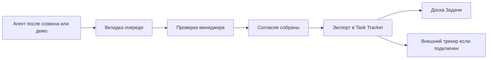
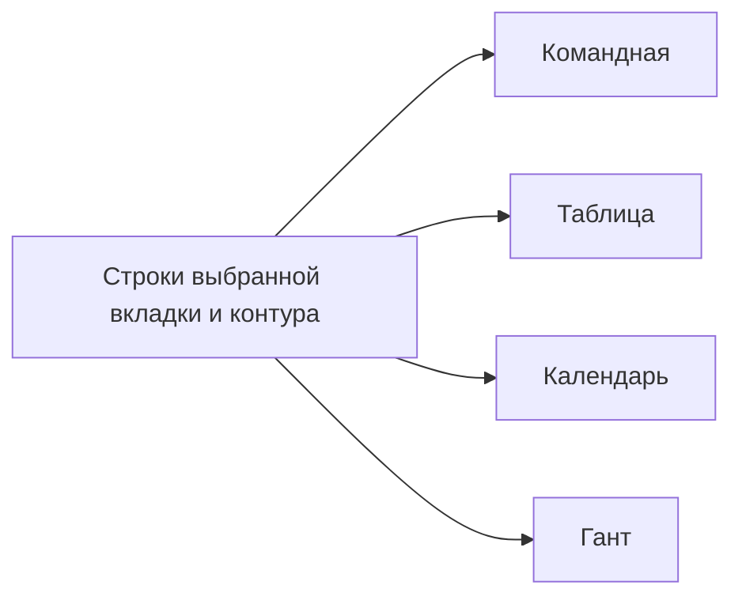

# 38. Очередь задач роли

Документ для разработчиков. Кода нет. Дата: 2026-10-30. Основание: слово пользователя в этот день. У каждой роли проектной команды есть своя очередь задач. В этом разделе задана очередь менеджера проекта. Категории остальных ролей пользователь назовёт отдельно, до этого их вкладок нет.

Требование A104, таск 172, инварианты И-175 и И-176.

Сокращения как в `37`: МП менеджер проекта. Task Tracker: доска «Задачи» проекта и, если подключение есть, внешний трекер по правилу «наружу только принятое» (И-04, таск 42).

Имена в `interfaces.md` внесены дополнением этого дня. При расхождении с `05` §3, §6-§9, `27`, `29`, `32`, `35`, `37` верны они.

## 0. Решения раздела

| № | Решение | Почему |
|---|---|---|
| Р38-01 | Очередь есть у роли на проекте, не у человека отдельно. Все МП проекта видят одни и те же открытые строки. Закрывает один из них, в аудите видно кто | Иначе одно поручение разъедется по личным спискам |
| Р38-02 | Форма называется «Очередь задач». Одна вкладка равна одной категории. Пустая вкладка остаётся на экране | Слово пользователя: категории видны вкладками |
| Р38-03 | «От заказчика» это одна вкладка. Поручение, открытый вопрос, просьба исправить баг и следующие входящие того же источника показываются меткой строки, не новой вкладкой | Пользователь перечислил их через двоеточие и «и так далее» |
| Р38-04 | Строка очереди хранит ссылку на предмет, не копию текста. Предмет остаётся у своего модуля. Закрытие строки предмет не удаляет | Второй экземпляр решения или задачи разойдётся с журналом |
| Р38-05 | Агент и код ставят строку. Закрыть, проверить и экспортировать может только человек с клеткой `queue/act`. Агент эти операции не получает | Проверка человеком и есть смысл очереди |
| Р38-06 | «Принятое решение» на вкладке: агент записал решение по созвону, демо или переписке. В журнале оно `proposed`. После проверки МП оно становится `accepted` или `rejected` | Слово «принятое» здесь про факт разговора, не про статус журнала |
| Р38-07 | Задачи созвона и демо лежат на своей вкладке, пока МП их не проверил и не экспортировал. На доске команды и во внешнем трекере их до экспорта нет | Пользователь разделил проверку и экспорт |
| Р38-08 | Экспорт не обходит согласия аналитика, если его часть в задаче есть и роль назначена (история 7). Кнопка ждёт эти согласия | Очередь МП не забирает чужой шаг |
| Р38-09 | Очередь ручного ревью артефактов (`25`) в эту форму не копируется. План дня (`15`) остаётся расписанием, не входящими | Три списка одного предмета прячут, что уже сделано |
| Р38-10 | У роли без названных категорий форма открывается и пишет «Категории этой роли ещё не заданы». Чужие строки не показываются | Очередь обещана каждой роли, состав задан только у МП |
| Р38-11 | Четыре представления одной очереди: «Командная», «Таблица», «Календарь», «Гант». Меняется раскладка, не набор строк | Слово пользователя 2026-10-30, второе |
| Р38-12 | На всех представлениях два контура: «Проектные» и «С заказчиком». Второй это личные задачи МП и каждого участника по работе с заказчиком | Тот же запрос. Общий список роли и личная работа с заказчиком не смешиваются |
| Р38-13 | Правка ячейки идёт операцией предмета. Своих статусов у представления нет. Панель ячейки показывает только поля, которые актор и так может прочитать | Иначе таблица обойдёт проверку и экспорт |
| Р38-14 | Календарь и Гант очереди не являются календарём платформы (`11`) и Гантом плана (`09`). Часов, денег и базы плана на них нет | Иначе очередь станет вторым графиком проекта |

## 1. Что меняется

| Прежнее | Теперь |
|---|---|
| Входящие МП разложены по виджетам главной, экрану разрывов, журналу решений и черновикам задач | Одна форма «Очередь задач» с шестью вкладками |
| Черновики тикетов после созвона ждут на экране созвона | Пакет созвона и демо лежит на вкладке, пока МП не проверит и не экспортирует |
| Разрыв трассировки виден на «Разрывах» | Тот же разрыв, если он ждёт утверждения МП, стоит строкой на вкладке. Чинят его по-прежнему на экране разрыва |
| Очередь была одним списком | Четыре представления и переключатель «Проектные» / «С заказчиком» (§2.1) |

## 2. Форма

Маршрут `/office/queue`. Фильтр проекта необязателен. Из проекта тот же экран с уже выбранным проектом: `/office/:id/queue`.

Шапка: роль, чья очередь открыта, проект или «все мои проекты», представление (§2.1) и контур. Вкладки слева направо, на вкладке число открытых строк выбранного контура. Карточка и строка таблицы несут одно и то же: проект, название предмета, метка вида, источник (заказчик, агент, коллега), возраст, статус. Клик по названию открывает предмет. Действия категории остаются на карточке и в строке.

Пустая вкладка: «Пока пусто». Телефон: вкладки списком, строка на всю ширину, действия под названием.

Заказчик этот маршрут не открывает: 404. Наблюдатель тоже, если он не МП проекта.

Виджет главной МП «Ждёт моего решения» открывает эту форму. Второй список тех же строк виджет не ведёт.

Колокольчик: вид `queue.opened`. Текст по правилам `25`: код проекта и ключ предмета, без содержания. Права проверяются при отправке.

**Диаграмма:** Mermaid · `flowchart`: проверка задачи созвона и экспорт в Task Tracker.

### 2.1. Представления и контур

Переключатель представления стоит в шапке и не сбрасывает вкладку. Запрос один: `view`, `scope`, `owner_id`, `category`, `project_id`. Четыре ответа рисуют один список.

**Диаграмма:** Mermaid · `flowchart`: четыре представления читают один список очереди.

| Представление | Ключ | Что на экране |
|---|---|---|
| Командная | `team` | Доска. Колонки группируют статус предмета, своих статусов нет. Карточка переносится только если операция предмета принимает этот переход. Отказ пишется на карточке. В контуре «С заказчиком» при выборе «все» дорожки это люди |
| Таблица | `table` | Сетка с правкой на месте. Статус в ячейке. Клик по ячейке открывает боковую панель измерений этой ячейки |
| Календарь | `calendar` | День, неделя, месяц. Строка с датой предмета встаёт на эту дату. Без даты лежит в лотке «Без даты» |
| Гант | `gantt` | Полоса от начала до срока. Одна дата рисуется вехой. Связь рисуется, только если она уже есть у предмета |

**Таблица.** Правка сохраняется сразу, отдельной формы нет. Белый список ячеек задаёт категория: статус и те поля, у которых у предмета уже есть операция правки. Чужое поле отвечает 422 `field_not_editable`. Смена статуса вызывает то же действие, что кнопка вкладки (§4): проверить, закрыть, экспортировать. Экспорт до проверки отвечает 409, как в §5.

**Панель ячейки.** Выезжает справа, не закрывая таблицу. В ней измерения одной ячейки: значение, источник, кто поставил, когда, какие значения можно поставить следующим, ссылка на предмет. Соседние колонки и скрытые поля предмета в панель не копируются. Класс `budget`, часы и причина отсутствия в панель не входят.

**Календарь и Гант.** Перенос по дате пишет срок только через операцию предмета. Если срока у предмета нет, полоса и день только для чтения. Это не календарь встреч `11` и не Гант ИСР `09`: база плана, критический путь, часы и деньги здесь не читаются и не пишутся.

**Контур** на всех четырёх представлениях:

| Контур | Ключ | Чей список |
|---|---|---|
| Проектные | `project` | Очередь роли на проекте. Общая для всех МП проекта (Р38-01). Человек не выбирается |
| С заказчиком | `customer_personal` | Личные задачи по работе с заказчиком. Владелец: МП или участник команды этого проекта |

В контуре «С заказчиком» рядом стоит список людей: менеджер проекта и участники проекта. «Все» показывает тех, кого актор вправе видеть. МП видит себя и каждого участника своих проектов. Участник видит только свои строки. Чужой `owner_id` ему отвечает 404. Заказчик оба контура не открывает.

Личная задача здесь это работа с заказчиком: ответ, поручение, вопрос, созвон или демо, назначенные человеку. Весь личный день и задачи без заказчика в этот контур не входят. Вкладки §3 те же. Строка без категории МП встаёт на вкладку «Прочие».

## 3. Вкладки менеджера проекта

Порядок фиксирован.

| Вкладка | Ключ | Кто приносит | Что лежит |
|---|---|---|---|
| От заказчика | `customer` | Заказчик. Строку ставит код или агент по входящему | Поручения, открытые вопросы, просьбы исправить баг и другие входящие заказчика. Вид строки: `assignment`, `question`, `bug`, `other` |
| Решения | `decision` | Агент | Решение, записанное агентом и ещё не проверенное МП (`office_decisions` в `proposed`) |
| Несоответствия трассировки | `trace_gap` | Агент, страж цепочки | Разрыв `office_chain_gaps`, который ждёт утверждения МП |
| Задачи созвона и демо | `call_task` | Агент | Черновики задач пакета `office_task_batches.origin = call` у созвона или демонстрации |
| Вопросы коллег | `colleague` | Коллега. Строку ставит код или агент | Нерешённый вопрос команды к МП: запрос `ASK-N` внутренней стороны или комментарий |
| Прочие | `other` | Агент | Всё, что ждёт МП и не попало в пять вкладок выше. Агент не угадывает чужую вкладку |

Новый вид входящих заказчика остаётся на вкладке «От заказчика» новой меткой. Новая вкладка появляется только когда пользователь назовёт категорию.

## 4. Действия по вкладкам

Общее. «Открыть» ведёт на предмет. «Закрыть» ставит строке `dismissed` и требует причину. Предмет при этом не стирается. Перенос строки с «Прочих» на названную вкладку доступен МП, если предмет этой вкладке подходит. Обратный перенос, в «Прочие», тоже доступен МП. Агент категорию после постановки не меняет.

**От заказчика.**

| Вид | Предмет | Действие МП |
|---|---|---|
| Поручение | `office_promises` от заказчика в `proposed` | Принять или отклонить существующей операцией обещания |
| Открытый вопрос | Запрос `ASK-N` стороны заказчика или вопрос в комментарии | Ответить на предмете. Строка закрывается, когда запрос закрыт |
| Баг | Сообщение, письмо или комментарий заказчика с просьбой исправить | Открыть источник. Задачу из него создают уже существующим путём. Новой баг-системы нет |
| Другое | Любой иной входящий заказчика | Открыть и закрыть с причиной либо оставить открытым |

**Решения.** «Проверить» вызывает уже существующий переход журнала: `accepted` или `rejected` с причиной. Пока статус `proposed`, решение в документах проекта не действует. Отклонение закрывает строку. Принятие тоже закрывает строку. Текст решения правят на карточке решения, не в очереди.

**Несоответствия трассировки.** В очередь попадает разрыв, у которого ответственный за утверждение это МП (виды, где МП подтверждает или снимает разрыв, `14` §6). «Утвердить» оставляет разрыв в работе стража: цепочку чинят на экране разрыва, не на этой форме. «Отклонить» это `dismissed` с причиной, как снятие разрыва у МП. Разрыв чужой роли в очередь МП не ставится.

**Задачи созвона и демо.** Пакет с `origin = call` и созвон вида обычный созвон или `demo`. Отдельное значение origin для демо не заводится. Задачи пакета в `draft` видны только здесь, на доске «Ждёт согласия» их нет до экспорта.

1. «Проверить»: МП подтверждает черновик (название, связь с требованием, ссылка на созвон или демо) и ставит своё согласие.
2. Если назначен аналитик, чья часть в задаче есть, кнопка «Экспортировать» ждёт его согласие (Р38-08).
3. «Экспортировать» переносит задачу в Task Tracker и закрывает строку. Отказ МП закрывает строку и оставляет задачу `rejected`, в трекер она не идёт.

Дальше, уже в Task Tracker, задачу анализируют, привязывают макеты и передают в разработку. На форме очереди этих шагов нет. Привязка макета остаётся связью задачи и кадра (`14`, вид разрыва `no_mockup`).

**Вопросы коллег.** Открытый `ASK-N` стороны команды, адресованный МП, или комментарий коллеги, который агент положил в эту вкладку. «Ответить» ведёт на предмет. Строка закрывается, когда вопрос закрыт ответом или возвратом с причиной. Вопрос заказчика сюда не попадает: он на вкладке «От заказчика».

**Прочие.** «Открыть» и «Закрыть» с причиной. Если предмет узнаваем, МП переносит строку на вкладку §3.

## 5. Экспорт в Task Tracker

Одно действие `cycle.export_queue_task`.

- Задача появляется на доске «Задачи» в колонке, которую её статус уже занимает после согласий (`09` §2).
- Если у проекта есть активное подключение внешнего трекера, та же операция ставит отправку в `office_bridge_outbox`. Наружу уходит только принятое (И-04). Комментарии трекера по-прежнему не принимаются.
- Если подключения нет, экспорт кладёт задачу только на доску и строка очереди пишет «внешний трекер не подключён». Это не ошибка.
- Повторный экспорт той же задачи не создаёт вторую (ключ идемпотентности: задача и проект).
- До проверки МП и до недостающих согласий операция отвечает 409 `export_before_validation`.

## 6. Чего форма не заменяет

| Уже есть | Остаётся |
|---|---|
| Очередь ручного ревью артефактов, `25` | Рецензия пунктов документа. Строка ревью в `office_queue_items` не создаётся |
| План дня, `15` | Встречи и фокус на дату |
| Доска «Задачи» | Работа после экспорта. Командное представление очереди её колонки не меняет |
| Экран «Разрывы», `/office/:id/gaps` | Разбор и правка цепочки. Вкладка только напоминает, что надо утвердить |
| Календарь платформы, `11` | Встречи и занятость. Календарь очереди показывает только строки очереди |
| Гант плана, `09` | ИСР, база, критический путь. Гант очереди показывает только сроки строк очереди |
| Колокольчик | Сигнал. Работа со строкой идёт на форме очереди |

## 7. Данные

Писатель `cycle`. Чтение чужих таблиц только через операции владельцев.

`office_queue_items`:

| Поле | Смысл |
|---|---|
| `id`, `company_id`, `project_id` | Строка одного проекта |
| `role` | Роль очереди. Сейчас в работе значение `project_manager` |
| `category` | `customer`, `decision`, `trace_gap`, `call_task`, `colleague`, `other` |
| `customer_kind` | Только у `customer`: `assignment`, `question`, `bug`, `other`. Иначе пусто |
| `subject_type`, `subject_id` | Предмет. Текст предмета в строку не копируется |
| `source` | `customer`, `agent`, `colleague` |
| `scope` | `project` или `customer_personal` |
| `owner_user_id` | Пусто у `project`. У `customer_personal` это МП или участник, чья работа с заказчиком |
| `owner_only` | Дополнение 2026-10-30 (`40` §13.4). Строку из личного чата МП с заказчиком читает только `owner_user_id`. Исключение из Р38-01 |
| `status` | `open`, `done`, `dismissed` |
| `opened_by` | Пользователь или запуск агента |
| `closed_by`, `closed_at`, `close_reason` | Кто закрыл. Причина обязательна при `dismissed` |

Один открытый предмет один раз: уникальность `(project_id, role, scope, owner_user_id, subject_type, subject_id)` при `status = open`. У `project` владелец в этом ключе пустой.

Строка рождается в той же транзакции, что перевод предмета в состояние «ждёт МП». Когда предмет вышел из этого состояния другим путём (решение уже `accepted` на карточке, разрыв закрыт на экране разрыва, запрос закрыт ответом), код закрывает строку `done` сам. Ручное закрытие и закрытие кодом пишут аудит без текста предмета.

События, только ключи: `queue.opened`, `queue.closed`, `queue.exported`.

Операции `cycle`: `enqueue_queue_item`, `list_queue`, `validate_queue_item`, `export_queue_task`, `dismiss_queue_item`, `move_queue_item`, `edit_queue_cell`, `queue_cell`.

`edit_queue_cell` принимает поле из белого списка категории и зовёт операцию предмета. `queue_cell` отдаёт измерения одной ячейки в правах актора.

API, актор с клеткой:

| Метод | Путь | Кто |
|---|---|---|
| GET | `/api/office/queue?view=&scope=&owner_id=&category=&project_id=` | `queue/view` своей роли. `view` не меняет состав. Роль без категорий: 200 и пустой список без клетки. Чужой `owner_id` в контуре «С заказчиком»: 404, если актор не МП этого проекта |
| GET | `/api/office/queue/{id}/cells/{field}` | `queue/view`. Поля вне прав предмета нет в ответе |
| POST | `/api/office/queue/{id}/validate` | `queue/act` |
| POST | `/api/office/queue/{id}/export` | `queue/act`, только `call_task` |
| POST | `/api/office/queue/{id}/dismiss` | `queue/act`, тело `{reason}` |
| POST | `/api/office/queue/{id}/category` | `queue/act`, перенос вкладки |
| PATCH | `/api/office/queue/{id}/cells/{field}` | `queue/act`. Тело `{value}`. Вне белого списка 422 `field_not_editable` |

Ошибки: 403 агенту на validate, export, dismiss, category и правку ячейки. 404 чужой проект, роль без участия, заказчик, снятый доступ, чужой владелец личного контура. 409 `export_before_validation`, `invalid_transition`. 422 `category_unknown`, `reason_required`, `field_not_editable`, `scope_unknown`.

Клетки матрицы (`13` §4.7): `queue/view`, `queue/act`. По умолчанию обе у МП своих проектов. Остальным ролям клетки не выдаются, пока для роли не названы категории.

## 8. Права и пути утечки

| Путь | Чем закрыт |
|---|---|
| Заказчик открывает очередь и видит внутренние решения или вопросы коллег | Маршрут заказчику 404 (И-175) |
| Разработчик видит очередь МП | Форма показывает очередь роли актора. Чужие строки не отдаются |
| Агент закрывает строку или экспортирует задачу | Клетки `queue/act` у агента нет (Р38-05) |
| В трекер уходит непроверенный черновик | 409 до проверки и согласий (Р38-07, Р38-08, И-04) |
| В колокольчик попадает текст заказчика или решение | Вид `queue.opened` несёт код проекта и ключ (правила `25`) |
| Строка хранит копию бюджета или переписки | В строке только ссылки (Р38-04) |
| Рецензия документа приходит и в ревью, и в «Прочие» | Предмет ревью `25` строку очереди не получает (Р38-09) |
| МП исключён из проекта, строки остались | Список считается участием на каждый запрос. Нет участия: 404 |
| Участник открывает личные задачи коллеги по заказчику | Контур «С заказчиком» отдаёт чужому владельцу 404. МП видит участников своих проектов (И-176) |
| Панель ячейки или Гант показывают бюджет, часы или базу плана | Этих полей в представлениях очереди нет (Р38-14, И-176) |
| Правка ячейки экспортирует черновик мимо проверки | Та же 409, что у кнопки «Экспортировать» (Р38-13) |

## 9. Инвариант

**И-175.** Строка `office_queue_items` это ссылка. Закрытие строки не удаляет предмет. Агент не переводит строку в `done` или `dismissed` и не экспортирует задачу. Экспорт задачи созвона или демо возможен после проверки МП и после согласий, которые задача уже требует. Заказчик очередь не читает. Открытый предмет одной роли встречается один раз в своём контуре. Роль, для которой категории не названы, строк не получает.

**И-176.** Четыре представления читают один список и не хранят вторую копию строки. Участник читает в контуре «С заказчиком» только свои строки. МП читает такие строки себя и участников своих проектов, кроме строк `owner_only`. Календарь и Гант очереди не показывают часы, деньги и базу плана. Панель ячейки не добавляет поле, которого актор не видит у предмета. Правка ячейки не экспортирует задачу до проверки.

## 10. Таск

G2 после этого раздела: 8 (было 7). Предел яруса 16, запас есть. Новых T3 нет.

| Таск | Сложность | Срез | Blocked by | Требования |
|---|---|---|---|---|
| 172 Очередь задач менеджера проекта | T2 | G2 | 28, 29, 42, 68, 107 | A104 |

172 ждёт разбор созвона (28), пакет созвона с заказчиком (29), внешний трекер (42), страж цепочки (68) и запросы чатов (107). Все они раньше G2. Порядок срезов не менялся.

Критерий приёмки на шве `cycle`: агент ставит по строке в каждую из шести вкладок, закрыть их вызовом агента нельзя, экспорт черновика до проверки отвечает 409, после проверки задача одна на доске и одна в исходящей очереди при активном подключении, заказчик на маршрут получает 404, роль без категорий получает пустую форму без чужих строк. Четыре значения `view` отдают один и тот же набор. Участник на чужой `owner_id` контура «С заказчиком» получает 404. Правка ячейки вне белого списка отвечает 422. В ответе календаря и Ганта нет часов, денег и базы плана.
