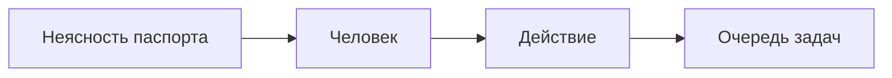

# 39. Реестр интерактивных артефактов

Документ для разработчиков. Кода нет. Дата: 2026-10-30. Основание: слово пользователя в этот день. Отдельный реестр. Первым в очереди реестра стоит паспорт функции. Предложения IA-02..IA-07 в сборку не входят, пока пользователь не назовёт номер.

Требование A105, таски 173-176, инварианты И-177 и И-178.

Сокращения как в `38`. МП: менеджер проекта. СА: системный аналитик. Граф: проекция `insight` поверх рёбер Doublefy и ссылок следа (`14`, G80). MCP: внешний источник по протоколу инструментов, библиотека `19`.

Имена в `interfaces.md` внесены дополнением этого дня. При расхождении с `05` §3, §6-§9, `27`, `29`, `32`, `35`, `37` верны они. О том, какой экран открывается у функции, верен этот раздел: паспорт. Вкладка «Граф» проекта остаётся.

Сверка предложений с матрицей `brainstorm/01-konkurenty.md` (12 продуктов, источники от 2026-10-22). Сайты в этот день заново не открывались. Идеи K01-K18 и N01-N33 здесь не повторяются: они уже разобраны или уже в плане.

## 0. Решения раздела

| № | Решение | Почему |
|---|---|---|
| Р39-01 | Реестр это очередь видов. Номер строки не переставляется. В продукт попадает вид со статусом «принят». Сегодня принят один: IA-01 | Пользователь поставил паспорт первым и попросил реестр отдельно от общего графа |
| Р39-02 | Главный экран функции это паспорт. Граф работает внутри: ищет ответ и собирает список последствий. Холст со всеми связями паспортом не открывается | Сотни связей на одном холсте не отвечают на вопрос о функции |
| Р39-03 | Паспорт хранит ссылки и свидетельства. Текст требования, решения, задачи и проверки читается у владельца на выбранный день | Вторая копия разойдётся со следом |
| Р39-04 | Ползунок даты ничего не пишет. День берётся в поясе пользователя. В сравнение идёт конец этого дня в UTC | Состояние знаний на день это чтение, не снимок |
| Р39-05 | Неясность становится действием только по кнопке человека и строкой очереди задач (`38`). Агент кнопку не нажимает | Пробел без действия остаётся лозунгом, действие без человека обходит очередь |
| Р39-06 | Подтверждение выкладки в первом выпуске это зелёная проверка со стендом или запись человека. Модуль эксплуатации (`17`, срез H) паспорт не ждёт | Иначе паспорт молча потребует выкладку, которой в первом выпуске нет |
| Р39-07 | На паспорте нет часов, денег, адресов стенда и оценок людей. Стенд показывается названием из `office_assigned_resources` | И-170 и запрет персональных оценок |
| Р39-08 | Предложения IA-02..IA-07 записаны в этот реестр и не имеют строк манифеста, тасков и таблиц | Решение от 2026-10-21: идея входит в план по номеру пользователя |

## 1. Чем паспорт отличается от соседних экранов

| Экран | Что на нём |
|---|---|
| Паспорт функции | Одно поведение продукта целиком: ожидание, стенд, история, основания, неясности, ответственные, день |
| Карточка требования | Одно `REQ` и колонки его следа (01 §6) |
| Граф | Карта связей проекта. Остаётся вкладкой. Из паспорта открывается окрестность одной связи, глубина 1 |
| Хронология | Лента изменений проекта (`14` §5), не состояние знаний функции на выбранный день |
| Очередь задач | Входящие роли (`38`). Сюда попадает действие из неясности, не сам паспорт |

**Диаграмма:** Mermaid · `flowchart`: паспорт читает граф и отдаёт ответ списком.

```mermaid
flowchart LR
  passport[Паспорт функции]
  graph[Граф внутри]
  list[Список связей]
  passport --> graph
  graph --> list
```

## 2. Реестр

Маршрут принятых видов: `/office/:id/ia`. Заказчик получает 404. Пока принят один вид, на экране одна строка.

| № | Код | Вид | Статус | Что делает | Чего нет у 12 продуктов матрицы |
|---|---|---|---|---|---|
| 1 | IA-01 | Паспорт функции | принят | Состояние знаний о поведении на выбранный день и стенд | Teamwork Graph и Work Graph рисуют связи. Паспорта функции с днём, стендом и режимом незнания в матрице нет |
| 2 | IA-02 | Доска незнания | предложен | Все неясности паспортов проекта одним списком | Реестры рисков есть у всех. Доски, где строка это отсутствующий факт, а не оценка риска, в матрице нет |
| 3 | IA-03 | Паспорт термина | предложен | Несколько определений одного слова по датам и какая функция каким жила в этот день | Rovo показывает карточку термина. Истории определений, которые спорят, в матрице нет |
| 4 | IA-04 | Свидетельство обещания | предложен | Обещание с дословной цитатой закрывается только свидетельством на стенде | Loom и Rovo делают из встречи задачи. Doczilla сторожит обязательства договора. Обещание с созвона без свидетеля в матрице не закрывается отказом |
| 5 | IA-05 | Комната двух цитат | предложен | Две дословные цитаты. Человек выбирает, какая в силе с какой даты. Обе остаются на ползунке | Матрица трассировки Asana это шаблон таблицы. Комнаты двух цитат в матрице нет |
| 6 | IA-06 | Зеркало роли | предложен | Что роль может по ролевой модели и что уже подтверждено проверкой экрана | RACI это таблица. Сверки «право роли против прошедшей проверки» без оценки человека в матрице нет |
| 7 | IA-07 | Репетиция приёмки | предложен | На выбранный день: какие строки приёмки подтверждены стендом и что ещё нельзя говорить заказчику | Портал JSM показывает заявки. Репетиции приёмки по стенду в матрице нет |

Предложение опирается на уже существующие записи и не заводит второе хранилище того же предмета.

| Код | Читает | Не дублирует |
|---|---|---|
| IA-02 | Неясности IA-01 по всем функциям проекта | Реестр рисков, страж цепочки |
| IA-03 | Абзацы, где термин определён, и слоты функций | Глоссарий страницей Confluence |
| IA-04 | `office_promises` | Журнал решений и задачи созвона |
| IA-05 | `office_conflicts` | Карточка требования |
| IA-06 | `office_role_model_items` и проверки | Оценку человека и загрузку |
| IA-07 | Видимые заказчику критерии и свидетельства стенда | Статусный отчёт |

Как мерить предложение, если пользователь назовёт номер: IA-02 и IA-05 считают закрытые пробелы. IA-03 считает термины, у которых в один день два действующих определения. IA-04 считает обещания без свидетеля. IA-06 считает права роли без проверки. IA-07 считает строки приёмки, которые МП смог показать заказчику без внутренней пометки.

## 3. Порядок пользы для принятого вида

Четыре этапа относятся к IA-01 и к поиску, которым паспорт кормится. Это порядок сборки, не четыре отдельных продукта.

| Этап | Что сделать | Как оценить пользу | Таск |
|---|---|---|---|
| 1 | Ответы по данным MCP со ссылками и датами | Время поиска ответа и доля ответов, у которых у каждого утверждения есть ссылка и дата | 173 |
| 2 | Паспорт связывает требования, задачи и проверки | На пилоте сравнивают, сколько занимает статус по функции с паспортом и без него. Таймер на человека продукт не ставит | 174 |
| 3 | Видны противоречия и отсутствующие подтверждения | Число обнаруженных пробелов и число тех, что погасли свидетельством или решением. Скрытие кнопкой «это не пробел» в погашенные не входит | 175 |
| 4 | Зависимости видны до согласования изменения | Связь, которая появилась после решения и которой не было в последнем ответе кнопки последствий | 176 |

Счётчики этапов 1, 3 и 4 пишет `insight` числами, без текста экрана. Этап 2 на пилоте меряет человек.

## 4. IA-01. Паспорт функции

Пример пользователя: функция «Рейтинг авторов».

Маршрут: `/office/:id/functions/:key`. Ключ `FN-N`. Создаёт человек с клеткой `ia/act`. Агент функцию не создаёт.

Шапка: название, стенд, ползунок даты, режим «Что мы пока не знаем», кнопка «Что затронет изменение?».

Стенд не выбран: блок «Текущее состояние» пишет «Стенд не выбран». Пробел выкладки в этом состоянии не ставится.

### 4.1. Шесть блоков

| Блок | Откуда берётся | Пусто |
|---|---|---|
| Ожидаемое поведение | Слоты `categories`, `periods`, `rules`, `display`. Текст слота читается из связанного требования или абзаца на выбранный день | «Не указано ожидаемое поведение: периоды» и так по имени пустого слота |
| Текущее состояние | Свидетельства выбранного стенда на этот день | «На этот день подтверждений на стенде нет» |
| История | Смены связанных требований, решений, слотов и свидетельств, по дням | «На этот день изменений нет» |
| Основания | Требования, решения и задачи, до которых от слотов один шаг следа | «Оснований на этот день нет» |
| Неясности | Закрытый список пробелов §4.3 | «На этот день неясностей нет» |
| Ответственные | Кто принимает решение и кто подтверждает результат: роль и участник, если он назначен | «Не назван тот, кто принимает решение» или «Не назван тот, кто подтверждает результат» |

Режим «Что мы пока не знаем» оставляет на экране только блок неясностей. Остальные блоки скрыты, данные их не удаляются.

Факт позже выбранного дня в паспорт не входит. Пустой блок из-за дня пишет «На эту дату этого ещё не было», если предмет появился позже. Это другая фраза, чем «не указано».

### 4.2. Слоты и свидетельства

Слот указывает на требование или абзац. Статус слота: `proposed` или `confirmed`. Агент ставит только `proposed`. В ожидаемое поведение входят подтверждённые слоты. Неподтверждённый слот виден в неясностях фразой «Слот ждёт подтверждения».

Свидетельство выкладки:

| Поле | Смысл |
|---|---|
| `stand_title` | Название стенда, без адреса |
| `source_type` | `check` или `human` |
| `source_id` | Проверка или пусто у записи человека |
| `witnessed_on` | Дата выкладки. Может быть пустой |
| `witnessed_by` | Человек. У проверки это тот, кто её принял |

Запись `human` ставит человек с клеткой `ia/act`. Агент её не ставит. Проверка становится свидетельством сама, когда она зелёная и несёт то же название стенда.

### 4.3. Неясности

Фразы фиксированы. Модель их не переписывает.

| Код | Когда | Фраза |
|---|---|---|
| `slot_empty` | Подтверждённого слота этого имени нет | Не указано ожидаемое поведение: {имя слота} |
| `slot_proposed` | Есть только `proposed` | Слот ждёт подтверждения: {имя слота} |
| `deploy_unconfirmed` | Связанные задачи закрыты, свидетельства выбранного стенда нет | Есть закрытые задачи, но не хватает подтверждений выкладки |
| `deploy_date_unknown` | Свидетельство есть, даты нет | Подтверждение выкладки есть, дата не указана |
| `contradiction_open` | У связанных требований открыто противоречие | Есть противоречие двух принятых формулировок |
| `check_missing` | У связанного требования нет проверки | Нет проверки по связанным требованиям |
| `owner_missing` | Пуста роль решающего или подтверждающего | Не назван тот, кто принимает решение. Либо не назван тот, кто подтверждает результат |
| `source_without_link` | Утверждение поиска без ссылки | Ответ без ссылки на источник |
| `source_without_date` | Утверждение поиска без даты | Ответ без даты источника |

Кнопка «Сделать действием» у строки неясности создаёт `office_function_actions` и строку очереди МП в одной транзакции. Предмет очереди это действие, не копия фразы. Повтор той же открытой пары «функция + код пробела + стенд» отвечает 409 `action_exists`.

«Это не пробел» пишет отказ с причиной. Отказ действует, пока набор задач и свидетельств тот же (`inputs_sha`). Состав изменился: отказ не скрывает новую неясность. Отказ не считается устранённым пробелом в счётчике этапа 3.

**Диаграмма:** Mermaid · `flowchart`: человек превращает неясность в строку очереди.



### 4.4. Кнопка «Что затронет изменение?»

Чтение `insight.function_impact`. Ничего не пишет. Ответ это четыре списка: требования, экраны, задачи, проверки. Экраны это макеты и пункты ролевой модели, до которых от функции один шаг. Холст графа не рисуется.

Предмет вне прав актора в списки не входит и числом не называется. Последний ответ кнопки запоминается ключами, без текстов, чтобы этап 4 мог сравнить его с позже появившейся связью.

Вторичная ссылка «Показать связь» открывает окрестность одного ребра на вкладке «Граф», глубина 1.

### 4.5. Проверяемый поиск

Этап 1 дополняет `knowledge.ask` и живое чтение MCP (`19`). Проверка цитаты `01` §7 остаётся.

Утверждение в ответе несёт ссылку и дату. Ссылка на фрагмент ядра или на внешний предмет: подключение, внешний ключ, момент чтения. Нет ссылки или нет даты: этого утверждения в ответе нет. Если вопрос задан с паспорта функции, на этом паспорте появляется `source_without_link` или `source_without_date`. Вопрос не с паспорта такую неясность на функциях не развешивает.

`office_search_log` получает `sourced` и `duration_ms`. Пишет по-прежнему `knowledge`.

## 5. Данные

Писатель всех таблиц ниже: `cycle`. `insight` только читает. Имена проверены по `03` §2: совпадений нет.

| Таблица | Ключевое |
|---|---|
| `office_functions` | `(project_id, key)` ключ `FN-N`. `title`, `status enum(draft, active, retired)`, `decider_role?`, `confirmer_role?`, `decider_membership_id?`, `confirmer_membership_id?` |
| `office_function_slots` | `function_id`, `slot enum(categories, periods, rules, display)`, `target_type`, `target_id`, `status enum(proposed, confirmed)`. Один и тот же предмет в одном слоте один раз |
| `office_function_witnesses` | `function_id`, `stand_title`, `source_type enum(check, human)`, `source_id?`, `witnessed_on?`, `witnessed_by` |
| `office_function_gap_dismissals` | `function_id`, `gap_kind`, `stand_title`, `inputs_sha`, `reason`, `dismissed_by` |
| `office_function_actions` | `function_id`, `gap_kind`, `stand_title`, `status enum(open, done)`, `opened_by`, `queue_item_id` |
| `office_function_impacts` | Только добавление. `function_id`, `actor_id`, `as_of`, `target_keys json`. Без текстов предметов |

Операции `cycle`: `create_function`, `set_function_owners`, `propose_function_slot`, `confirm_function_slot`, `record_function_witness`, `dismiss_function_gap`, `open_function_action`.

Операции чтения: `cycle.function_passport`, `insight.function_impact`.

События, только ключи: `function.created`, `function.witnessed`, `function.action_opened`. Уведомлений этот раздел не добавляет.

API, актор с клеткой:

| Метод | Путь | Кто |
|---|---|---|
| GET | `/api/office/projects/{pid}/ia` | `ia/view`. Только принятые виды |
| POST | `/api/office/projects/{pid}/functions` | `ia/act` |
| GET | `/api/office/projects/{pid}/functions/{key}?as_of=&stand=&mode=` | `ia/view`. `mode=unknowns` оставляет неясности |
| PUT | `/api/office/projects/{pid}/functions/{key}/owners` | `ia/act` |
| POST | `/api/office/projects/{pid}/functions/{key}/slots` | `ia/act`. Агенту только `proposed` |
| POST | `/api/office/projects/{pid}/functions/{key}/slots/{id}/confirm` | `ia/act`, человеку |
| POST | `/api/office/projects/{pid}/functions/{key}/witnesses` | `ia/act`, человеку, `source_type=human` |
| POST | `/api/office/projects/{pid}/functions/{key}/gaps/{kind}/dismiss` | `ia/act`, тело `{reason, stand}` |
| POST | `/api/office/projects/{pid}/functions/{key}/gaps/{kind}/action` | `ia/act` и `queue/act` |
| GET | `/api/office/projects/{pid}/functions/{key}/impact?as_of=` | `ia/view` |

Ошибки: 403 агенту на создание функции, подтверждение слота, свидетельство, отказ и действие. 404 заказчику, чужому проекту, снятому доступу. 409 `action_exists`. 422 `slot_unknown`, `reason_required`, `stand_required`, `secret_like_value`.

Клетки матрицы (`13` §4.7): `ia/view`, `ia/act`. По умолчанию обе у МП и СА своих проектов. Остальным ролям клетки не выдаются, пока пользователь не скажет иначе.

## 6. Права и пути утечки

| Путь | Чем закрыт |
|---|---|
| Заказчик открывает реестр или паспорт | 404 (И-178) |
| В паспорт копируется текст требования | Слот хранит ссылку. Текст читается у владельца (И-177) |
| Ползунок записывает снимок | Ползунок только в запросе (Р39-04) |
| Агент закрывает неясность или ставит свидетельство | 403 (Р39-05, Р39-06) |
| Кнопка последствий показывает чужой предмет | Предмета нет в списке и нет в счётчике (И-178) |
| На паспорте адрес стенда, секрет, часы или деньги | Этих полей нет (Р39-07, И-170) |
| Отказ от пробела навсегда прячет новый пробел | Отказ привязан к `inputs_sha` |
| Ответ MCP без даты звучит как факт | Утверждения в ответе нет (И-177) |
| Предложенный вид IA-02..IA-07 получает маршрут | В `GET /ia` только принятые виды (Р39-01) |

## 7. Инварианты

**И-177.** Интерактивный артефакт не хранит вторую копию предмета. Ползунок даты ничего не пишет. Утверждение поиска без ссылки и без даты не входит в ответ. Агент не создаёт функцию, не подтверждает слот, не ставит свидетельство человека, не скрывает неясность и не открывает действие.

**И-178.** Заказчик реестр и паспорт не читает. Кнопка последствий не показывает названия предметов вне прав актора и не сообщает, сколько таких предметов скрыто. На паспорте нет адресов стенда, секретов, часов, денег и оценок людей. Общий граф не заменяет паспорт. Вкладка «Граф» при этом остаётся.

## 8. Таски

G2 после этого раздела: 12 (было 8). Предел яруса 16, запас 4. Новых T3 нет. Предложения IA-02..IA-07 тасков не получают.

Порядок внутри G2: 173, затем 174, затем 175 и 176. Таск 172 с ними не связан по данным и может идти параллельно 173.

| Таск | Сложность | Срез | Blocked by | Требования |
|---|---|---|---|---|
| 173 Проверяемый поиск: ссылка и дата у каждого утверждения | T2 | G2 | 19, 54, 84 | A105 |
| 174 Паспорт функции | T2 | G2 | 20, 24, 67, 171, 173 | A105 |
| 175 Неясности паспорта и действие в очереди | T2 | G2 | 34, 68, 172, 174 | A105 |
| 176 Последствия изменения | T2 | G2 | 67, 174 | A105 |

173 ждёт ответ с цитатами (19), снимки метрик (54) и библиотеку MCP (84). 174 ждёт требования (20), задачи (24), граф артефактов (67), названия стендов (171) и правило поиска (173). 175 ждёт проверки (34), стража (68), очередь (172) и паспорт (174). 176 ждёт граф (67) и паспорт (174).

Критерий приёмки на шве `cycle` и `knowledge`:

- Ответ с утверждением без ссылки или без даты не отдаёт это утверждение.
- Паспорт «Рейтинг авторов» на выбранный день показывает шесть блоков из ссылок, без копии текста требования в своих таблицах.
- Закрытые задачи и пустое свидетельство выбранного стенда дают фразу «Есть закрытые задачи, но не хватает подтверждений выкладки».
- Кнопка действия агентом отвечает 403, человеком создаёт одну строку очереди, повтор отвечает 409.
- Кнопка последствий возвращает четыре списка и не возвращает холст графа.
- Заказчик на маршруты реестра и паспорта получает 404.
