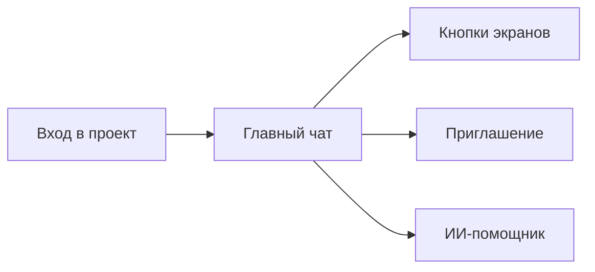
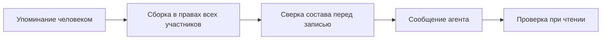

# 40. Главный чат проекта

Документ для разработчиков. Кода нет. Дата: 2026-10-30. Основание: пользователь утвердил пять пунктов и шесть уточнений к ним в этот день. Карточку протокола пользователь отправил в главный чат: чата у встречи нет.

Требования A106-A110, таски 177-181, инварианты И-179..И-182. Сверено суперархитектором в этот же день: `41`, правки внесены.

Сокращения как в `38` и `39`. МП: менеджер проекта. РПО: руководитель проектного офиса. Пр и Подп: представитель и подписант заказчика. Наб п: наблюдатель проекта. Наб о/к: наблюдатель подразделения и компании. АдмК и АдмП: админ компании и админ платформы.

Имена в `interfaces.md` внесены дополнением этого дня. При расхождении с `05` §3, §6-§9, `27`, `29`, `32`, `35`, `37` верны они, кроме Р40-20: это слово пользователя. Новых модулей нет. Новых агентов нет: отвечает профиль `assistant`.

## 0. Решения раздела

| № | Решение | Почему |
|---|---|---|
| Р40-01 | Главный чат это чат площадки `office` вида `main` в `office_project_chats`. Один на проект. Сообщения живут в `office_chat_messages` | Вторая таблица сообщений разойдётся с поиском и сводками (Р18-03) |
| Р40-02 | Участники чата это участники проекта с клеткой `chats/view_main`. Второго списка нет. Выйти из чата значит выйти из проекта | Два списка разойдутся, и бывший участник сохранит доступ |
| Р40-03 | Заказчика в главном чате нет. Учётка стороны заказчика не получает роль команды ни в одном проекте: ни из чата, ни с экрана участников | A21, `18` §2.5, слово пользователя 2026-10-30. Запрет стоит на стороне учётки, а не на роли |
| Р40-04 | Приглашение это `POST /projects/{pid}/members`, поле `via = main_chat`. Только человек на экране. Только существующая учётка стороны исполнителя этой компании. Ссылок-приглашений нет | Участники это уровень C (`13` §1.5). Ссылка уходит наружу и живёт дольше проверки |
| Р40-05 | Вход в проект открывает главный чат у тех, у кого есть `chats/view_main`. У остальных вход как был | Слово пользователя. Наблюдатель и заказчик чат не читают |
| Р40-06 | Telegram и Макс остаются привязанными чатами `18`. Сообщения и карточки главного чата туда не копируются. Обратно тоже | Слово пользователя, Р25-06 |
| Р40-07 | Агент пишет в главный чат только ответом на упоминание человека. Права ответа считает `tenancy.audience_scope` с аудиторией `main_chat` | Запрет Р13-04 и Р18-08 относится к внешним чатам, а И-87 требует считать аудиторию вывода |
| Р40-08 | Подпись про личный диалог стоит под каждым ответом агента, всегда одна и та же | Фраза только при скрытой части выдаёт, что скрытое есть (принцип 5 `00`, И-156, И-178) |
| Р40-09 | Ответ агента проверяется три раза: при сборке, перед записью и при чтении | Состав чата меняется. Новый участник не должен прочитать старый ответ выше своих прав |
| Р40-10 | Ответы агента и карточки не идут в поиск, сводки, кандидаты и граф | Иначе модель цитирует сама себя, а закрытое расходится через поиск |
| Р40-11 | Карточка хранит только ключи. Числа и тексты считаются при чтении в правах читателя | Так уже работает сводка (`18` §3.4). Скрытое не входит в счётчик |
| Р40-12 | Карточка сводки собирается кодом, без модели. Предел 31 день и отсрочка недельной сводки (`18` §3.2) относятся к сводке с моделью и остаются | Иначе полугодовая карточка упрётся в предел входа модели |
| Р40-13 | Карточка сводки выходит на каждый период, даже пустая | Если пустых карточек нет, нули у читателя выдают, что другие видят больше |
| Р40-14 | «Задача без движения» это новое правило кода: метрика `task_stalled`. Остальные четыре сигнала уже есть | Пункт говорит «уже посчитанные», но этого сигнала в архитектуре не было |
| Р40-15 | «Принять протокол» это новая кнопка МП, поля и событие `call.protocol_accepted`. Новых состояний созвона нет. Публикация заказчику остаётся отдельным шагом | Сейчас у протокола есть разбор и публикация, принятия нет. Созвон `standup` в `published` не переходит |
| Р40-16 | Карточка протокола идёт в главный чат проекта | Выбор пользователя. Протоколы и так читает вся команда (`04`, вкладка «Созвоны») |
| Р40-17 | Кнопка «Сделать задачей» на карточке не создаёт вторую задачу, если черновик из пакета созвона уже есть | Иначе одно поручение даст две задачи (Р38-07) |
| Р40-18 | «ИИ-помощник» это новое имя панели «Спросить по проекту». Кнопка открывает последний открытый диалог человека в этом проекте. Если его нет, создаёт новый | Панель и `page_context` уже описаны (`13` §1.7, §1.8). Новый агент не нужен |
| Р40-19 | `page_context` это подсказка. Права на предмет экрана сервер проверяет заново | Данные присылает браузер, им нельзя верить |
| Р40-20 | РПО читает главный чат любого проекта своей области без участия. Пишет и упоминает агента только участником. В пересечение прав ответа РПО вне участия не входит | Слово пользователя 2026-10-30: у этой роли есть доступ к любому проектному чату. Содержимое проекта вне участия ему закрыто (`25` П-2), поэтому в пересечении он обнулил бы ответ |

## 1. Пять пунктов дословно

1. Главный чат проекта внутри офиса. Вход в проект открывает его. Рядом кнопки: задачи, Гант, календарь, файлы, риски. Приглашение в этот чат добавляет человека в проект с ролью, которую выбрал менеджер. Telegram и Макс остаются привязанными чатами, как в разделе 18.
2. Ответ по упоминанию в этом чате. Агент отвечает так, чтобы текст был допустим для самого ограниченного участника чата. Если часть ответа закрыта, он пишет «откройте личный диалог» и не называет скрытый объект. Каждое утверждение со ссылкой на сообщение, задачу или протокол. В чаты заказчика, подрядчика, Telegram и Макс агент по-прежнему сам не пишет.
3. Карточка сводки в главный чат. Дневная сводка остаётся. Дополнительно менеджер задаёт период: неделя, месяц или полгода для длинного проекта. В чат падает карточка со ссылкой, не свободный текст модели. Риски в карточке только уже посчитанные: просрочка, задача без движения, сдвиг прогноза срока, открытый запрос, сработавший риск.
4. Карточка протокола в чат встречи. После того как менеджер принял протокол, в чат этой встречи уходит карточка: договорённости и предложенные поручения. Создание задачи остаётся нажатием человека.
5. Кнопка «ИИ-помощник» на каждом экране проекта. Открывает уже существующий личный диалог этого человека в этом проекте и передаёт, на каком экране он стоит. Новый агент не нужен.

| Пункт | Что уточнено при утверждении | Решение |
|---|---|---|
| 1 | Заказчика в чате нет. Список ролей только команды. Учётка заказчика роль команды не получает | Р40-03, Р40-04 |
| 1 | РПО читает любой проектный чат без участия | Р40-20 |
| 2 | Подпись стоит всегда, не только при скрытой части | Р40-08 |
| 2 | Ответ проверяется три раза и не идёт в поиск | Р40-09, Р40-10 |
| 3 | Числа в правах читателя. Карточка выходит и пустая. «Без движения» считается новым правилом | Р40-11, Р40-13, Р40-14 |
| 4 | Карточка в главном чате. Принятие протокола это новый шаг | Р40-15, Р40-16 |
| 5 | Панель уже есть. Меняются имя и правило открытия | Р40-18, Р40-19 |

## 2. Что меняется

| Прежнее | Теперь |
|---|---|
| Вход в проект открывал вкладку | Вход открывает главный чат (§3.1) |
| Чаты проекта только внешние и привязываются ботом | Есть внутренний чат без бота и без привязки (§3) |
| Агент в чатах молчит | В главном чате отвечает на упоминание. Во внешних чатах молчит как раньше (§4) |
| Сводка только дневная и по запросу | Рядом карточка за неделю, месяц или полгода (§5) |
| Протокол без шага принятия | Кнопка «Принять протокол» и карточка в чат (§6) |
| Панель «Спросить по проекту» | То же, имя «ИИ-помощник», правило открытия диалога (§7) |

## 3. Главный чат

### 3.1. Вход и кнопки

Маршрут `/office/:id/chat`. Адрес `/office/:id` ведёт на него, если у актора есть `chats/view_main`. Иначе `/office/:id` открывает то, что открывал раньше. У АдмП без `admin_as_role` адрес `/office/:id` открывает прежний экран. Заказчик свой кабинет не меняет.

Шапка чата: название проекта, кнопки «Задачи», «Гант», «Календарь», «Файлы», «Риски», «Пригласить», «ИИ-помощник». Лента на всю ширину центра. Поле ввода внизу. Над полем постоянная строка: «Этот чат читают команда проекта и руководитель проектного офиса».

Кнопка ведёт на уже существующий экран. Своих данных у кнопок нет. Кнопка не рисуется, если экрана нет у типа проекта или у роли нет права. «Гант» читает `09`, «Календарь» читает `11` §2.7, «Файлы» открывают дерево `15` §2.6, «Риски» открывают вкладку `09` §5. Меню роли (`04` §6.2) остаётся.

Телефон: кнопки свёрнуты в строку с прокруткой. Лента и поле на весь экран.

**Диаграмма:** Mermaid · `flowchart`: вход в проект и то, что рядом с чатом.

### 3.2. Участники, читатели и приглашение

Участники чата считаются на каждый запрос функцией `tenancy.main_chat_readers(project)`: участники проекта, которые сейчас проходят клетку `chats/view_main`. Строки `office_chat_participants` здесь дают только авторство, доступа они не дают. `member.removed` закрывает чат сразу, `member.role_changed` пересчитывает права.

РПО читает ленту любого проекта своей области (`portfolio_scope`) без участия (Р40-20). Открытие ленты без участия пишется в `office_audit` (`18` §2.5). Писать и упоминать агента РПО может только участником. Вне участия он в `main_chat_readers` не входит, ответы агента читает по §4.5, карточки по §5.4. Виртуальный чат `forwards` это личные пересылки, он к проектным чатам не относится и остаётся закрытым.

Шаг 1 `tenancy.can` участника не создаёт: АдмП в `main_chat_readers` не входит. Чат он открывает только явным `admin_as_role` (`03` §4.3), лента идёт по §4.5 в маске выбранной роли.

Кнопка «Пригласить» видна МП. Форма: сотрудник и роль. Сервер принимает роли МП, БА, СА, Арх, Раз, Тест, Тим, ТЛ. Остальные значения:

| Случай | Ответ |
|---|---|
| Роли Пр или Подп | 422 `role_not_allowed_in_main_chat` |
| Роль наблюдателя проекта: он чат не читает | 422 `role_not_allowed_in_main_chat` |
| РПО, Наб о/к: их назначает АдмК (УИБ29-04) | 422 `role_not_allowed_in_main_chat` |
| Роль МП при директивном типе офиса (`31` §3.3): МП там назначает РПО | 422 `role_not_allowed_in_main_chat` |
| Адрес почты вместо учётки | 422 `user_required` |
| Учётка `side = customer` или учётка вне этой компании | 422 `user_required` |
| Вызов от агента | 403 |

**Ограничение.** Учётка стороны заказчика не получает роль команды ни в одном проекте. `add_member` принимает роли стороны исполнителя только у учётки `side = executor` этой компании, с `via` и без него. Иначе 422 `user_required`. Запрет стоит на стороне учётки, а не на роли (слово пользователя 2026-10-30, И-179).

Заказчика и наблюдателя проекта МП добавляет прежним экраном участников. Там `via` не передаётся, остальные правила `03` §5.2 не меняются.

Новый участник читает историю сообщений людей целиком. Это обычный чат команды, класс `internal_text`. Ответы агента он читает по §4.5, карточки по §5.4.

### 3.3. Сообщения

`POST /api/office/projects/{pid}/main-chat/messages` пишет строку `office_chat_messages`: `direction = in`, `side = executor`, `external_message_id` равен идентификатору сообщения, без префикса. Текст проходит детектор `28` §5.1 до записи. Дальше тот же поток, что у внешнего чата (`18` §2.1): событие `channel_message.received` с `kind = group` и `chat_kind = main`, источник `chat`, абзац равен сообщению, пачка извлечения.

Сообщения людей поэтому попадают в поиск, в дневную сводку, в кандидаты решений и поручений и в план дня без новой логики. Чат считается внутренним: класс `internal_text`, решение из него несёт пометку «внутреннее обсуждение» (`18` §4.2 п. 5), срок запроса как у `internal` (`18` §4.4). Извлечение главного чата идёт с `on_behalf_of` текущего МП проекта.

Метку `chat:<id>` главного чата `tenancy.scope` и `channels.may_deliver` отдают только по клетке `chats/view_main`. Клетки `view_internal`, `view_customer`, `view_contractor` к ней не относятся. То же правило у разделов сводки (`18` §3.4), `chat.digest_ready`, набора `chats`, графа и чужого плана дня: пункт из главного чата показывается только зрителю с этой клеткой, как пункт чата руководства (`25` §5.2).

Не применяется из `18`: привязка и код (§1.3), проверка бота (§1.4), уведомление бота (§1.5), отказ `/office_optout` (команды бота нет), черновики ответов (§5). Строку чата создаёт `channels` при первом открытии или при первой карточке. `external_chat_id` равен `project_id`.

Для строки `kind = main` пути `18` §6.2 `/project-chats/{id}/*`, `GET /chat-messages/{id}`, `/chat-participants/{id}`, `POST /chat-messages/{id}/items`, `POST /chat-messages/{id}/drafts` отвечают 404. Строка не выходит в `GET /projects/{pid}/chats` и на экран `/office/:id/chats`. Рабочие пути: §8 и `POST /chat-messages/{id}/hide`. Р18-11 и `18` §2.5 п. 2 к виду `main` не применяются. Цитата `reply_to_message_id` проходит ту же проверку §4.5.

Вложений в сообщении нет. Файл кладут кнопкой «Файлы», в сообщении ключ. Правка своего сообщения пишет `edits`. Удаления нет (A20). Скрытие по 152-ФЗ идёт прежним `POST /chat-messages/{id}/hide`.

Уведомление человеку об упоминании это существующий вид `chat.mention` (`25` §3.3, К1). Подсказка `@` строится областью вводящего (`03` §4.3). Кадр WS несёт только `message_id`, текст приходит запросом с проверкой прав.

## 4. Ответ агента по упоминанию

### 4.1. Запуск

Человек с `chats/post_main` и `assistant/use` упоминает агента в сообщении. Код находит упоминание в теле и ставит задание `main_chat_reply:<message_id>`. Повтор доставки второго ответа не даёт. Сообщение агента или карточка запуск не вызывают.

Запуск: `agent = assistant`, `trigger = mention`, `on_behalf_of` спросивший, класс `assistant`, расход в `share_assistant`. Предел чата 30 ответов в час (доп.). Сверх предела, без слота или без модели в чат ничего не пишется, спросивший видит причину у поля ввода.

### 4.2. Права при сборке

`tenancy.audience_scope(asker, project, main_chat, chat_reply)` отдаёт пересечение: спросивший, профиль `assistant`, каждый участник чата, белый список классов.

| Класс | В ответе |
|---|---|
| `team`, `customer`, `code`, `internal_text` | Да, если класс и метки проходят у всех участников чата |
| `budget`, `management_chat`, `personal`, `usage`, `showcase` | Никогда, при любом составе, даже если в чате только МП и РПО |

Метка `chat:<id>` проходит, только если этот чат читают все участники главного чата. Пока в проекте есть разработчик вне чата заказчика, переписка заказчика в ответ не входит.

Запуск запоминает `audience_sha`: отпечаток списка участников, их ролей, профилей видимости и ревизии матрицы. Персональные данные идут метками `⟦…-N⟧`. Раскрывает их показ в правах зрителя (`28` Р28-14, карта `pii_render`), не агент.

### 4.3. Контекст и инструменты

Запуск холодный: вне пула тёплых сессий `13` §1.2 п. 3, `session_key = main-chat:<message_id>`, без сводки диалога и без быстрого пути `knowledge.ask`.

В контекст входят вопрос и до 20 предыдущих сообщений людей блоком «материал источника» (`02` §10). Не входят: личный диалог спросившего (`office_assistant_messages`), его план дня, прошлые ответы агента, карточки и сообщения в `hidden_by_request`.

Инструменты только чтения из `13` §1.4 в маске §4.2. Убраны `propose_action`, `draft_chat_reply`, `report_draft` и всё, что пишет. Карточек действий в чате нет: у групповой карточки нет одного владельца.

Прочитанный внешний материал даёт пометку под ответом, как в `13` §1.5. Ссылки ведут только внутрь платформы. Показ через санитайзер И-129.

### 4.4. Проверка и запись

1. Проверка `01` §7.4 без модели. Кавычки сверяет `verify_quote`.
2. Утверждение без ссылки на сообщение, задачу или протокол и без даты убирается целиком (И-177). Пометка «вывод модели» здесь не ставится.
3. Ссылка на предмет вне маски убирается вместе с утверждением.
4. Перед записью код считает `audience_sha` заново. Отличается: запуск идёт ещё раз, с тем же заданием и `request_key` с номером попытки. Отличается снова: ответа в чате нет, спросивший видит «Состав чата изменился, спросите ещё раз».
5. Запись: `direction = out`, `side = bot`, `participant_id` служебного участника, `run_id`, `audience_sha`, `cited_refs`, `data_classes`, `scope_tags`. `data_classes` и `scope_tags` это объединение классов и меток всех результатов инструментов и контекста запуска (провенанс `28` §4.3), а не только процитированного. `sent_mode`, `keys`, `source_id` и `paragraph_id` пусты, `extract_state = skipped`. Журнал `18` §5.5 такие строки не показывает.

Потока токенов нет. Ответ появляется целиком после проверки. Если ничего не осталось, текст один: «В этом чате ответа нет». Он не различает «нет данных» и «данные закрыты».

Под каждым ответом одна и та же подпись: «Ответ собран для всех участников чата. Откройте личный диалог, чтобы спросить подробнее». Ссылка в подписи открывает личный диалог (§7) и передаёт ключ вопроса. Текст ответа туда не передаётся.

**Диаграмма:** Mermaid · `flowchart`: три проверки ответа агента.

### 4.5. Проверка при чтении

Лента отдаёт сообщение агента, только если маска читателя покрывает `data_classes` и `scope_tags`, а каждая ссылка из `cited_refs` читаема ему у владельца. Иначе сообщения в ответе нет. Заглушки нет (И-156), в счётчике нет. Читатель видит вопрос без ответа.

Сообщение в `hidden_by_request` нечитаемо для всех: ответ со ссылкой на него из ленты уходит.

### 4.6. Границы

Во внешних чатах ничего не меняется. Агент не пишет в чаты заказчика, подрядчика, Telegram и Макс. И-56 и Р13-04 действуют. Упоминание бота в привязанной группе ответа не даёт.

Операции записи ответа нет в MCP и в инструментах. Запуск проверяет `agents.reply_in_main_chat`, единственный вызывающий. `channels.post_agent_reply(message_id, run_id, ...)` проверяет своё: сообщение человека есть, упоминание в нём есть, ответа на него ещё нет.

## 5. Карточка сводки за период

### 5.1. Настройка

`office_projects.settings.summary_card`: `period enum(off, week, month, half_year)`, умолчание `off`; `stalled_days`, умолчание 5 рабочих дней (доп.). Меняет МП, клетка `chats/manage`. Дневная сводка `18` §3.2 не меняется и настройку не читает.

| Период | Когда выходит (доп.) |
|---|---|
| `week` | Последний рабочий день недели в `digest_at` |
| `month` | Последний рабочий день месяца в `digest_at` |
| `half_year` | Последний рабочий день июня и декабря в `digest_at` |

Рабочие дни берутся из производственного календаря (таск 93). Карточка выходит только у проекта в `active`.

### 5.2. Сбор

Задание `summary_card:<project>:<конец периода>` у `agents`, без модели. Оно читает ключи у `insight.summary_card_refs(project, from, to)` и зовёт `channels.post_card`. `insight` сам в чат не пишет: запись вниз у него только `trigger_risk` и `observe_risk` (`00` §3.3). Расписаний агентов P19 задание не использует, поэтому срез H ему не нужен.

| Сигнал | Ключ | Откуда | Предмет карточки |
|---|---|---|---|
| Просрочка | `overdue` | `cycle`: срок `due_on` прошёл, статус `handed`, `in_progress`, `code_review` или `check` | Ключ задачи |
| Задача без движения | `stalled` | `insight`, метрика `task_stalled` (§5.3) | Ключ задачи |
| Сдвиг прогноза срока | `forecast_shift` | `plan`: вехи `method = network` из последнего `as_of` периода в `office_gantt_forecasts`, `shift_days` не меньше `office_gantt_settings.shift_threshold_days` (умолчание 10 рабочих дней) | Ключ вехи |
| Открытый запрос | `open_request` | `channels`: `office_chat_requests` в `open` и `overdue`, кроме чатов видов `management` и `forwards` | `ASK-N` |
| Сработавший риск | `risk_triggered` | `cycle`: `office_risks` в `triggered` | Ключ риска |

У проекта без прогноза строка пишет «Не считается». Это не ноль. Состояние «Не считается» пишется в `card_period` при сборке.

### 5.3. Задача без движения

`task_stalled` в каталоге `03` §2.11. Задача в рабочем статусе, и за `stalled_days` рабочих дней нет ни строки `office_task_history`, ни комментария, ни коммита с её ключом. Рабочий статус это те же четыре значения, что у просрочки. Измерений `person` и `assignee` нет (И-181). Кандидата риска метрика не ставит.

### 5.4. Показ

Строка чата хранит `card_kind = summary`, период и `card_refs`: пары «сигнал и ключ». Чисел и текста в строке нет.

При чтении `channels.read_card(actor, message_id)` проверяет ключи у владельцев в области `tenancy.scope(actor)`: задачи, риски, решения и обещания операцией `cycle`, `ASK-N` своей таблицей с меткой `chat:<id>`. Ключ вехи проверяется по `visibility_ref` класса `team` (`25` П-3, `33` §5.3), он лежит в `card_refs` рядом с ключом. Число это количество прошедших ключей. Два читателя могут видеть разные числа. Скрытый ключ не входит ни в число, ни в ответ.

Текст карточки собирает код: «Итоги за неделю 24-30 октября. Просрочка 3. Без движения 2. Сдвиг прогноза 1. Открытые запросы 4. Сработавшие риски 0. Открыть». Имён людей нет.

«Открыть» ведёт на `/office/:id/summary/:message_id`: пять списков, ключ, название и статус в правах читателя. Название вехи на этом экране читает `insight.summary_card_view(actor, message_id)` сверху: `insight` зовёт `channels` и `plan`, `ui` читает `insight`, как в `00` §3.3, дополнение 32. Экран ничего не пишет.

Карточка это сообщение чата, не уведомление. Колокольчик не срабатывает, `chat.new_messages` не идёт, в Telegram и Макс она не уходит (Р25-06, И-78).

## 6. Протокол и его карточка

### 6.1. Принятие

На экране созвона рядом с черновиком протокола кнопка «Принять протокол». Операция `channels.accept_protocol(call_id, version_n)`. Только МП, только человек на экране, правило 409 `not_viewed` (`13` §1.5 п. 3). Просмотр версии хранит `office_calls.protocol_viewed`. Агент получает 403. Кнопка доступна в `analyzed` и `published`.

| Условие | Ответ |
|---|---|
| Протокола нет | 409 `protocol_missing` |
| Эта версия уже принята | 409 `protocol_already_accepted` |
| Новая версия после принятой | Принимается, выходит новая карточка |

Операция пишет `office_calls.protocol_accepted_version_n`, `protocol_accepted_by`, `protocol_accepted_at` и событие `call.protocol_accepted`. Автомат созвона `03` §3.8 не меняется. Заказчику ничего не открывается: публикация остаётся кнопкой `POST /calls/{id}/publish`.

### 6.2. Карточка

В той же транзакции `channels` пишет строку чата `card_kind = protocol`. `card_refs` это ключи кандидатов `office_candidates` видов `decision`, `promise` этого созвона и уже принятых из них строк `office_decisions`, `office_promises`. `card_refs` несёт ещё `call_id` и `version_n`. Текст читается у владельца в правах читателя (§5.4). Название и дата читаются у `channels` в правах читателя. Чего читатель не видит, того в карточке нет.

Вид: название встречи, дата, «Договорённости», «Предложенные поручения», ссылка на протокол. У решения статус журнала: `proposed` или `accepted`. Карточка статус не меняет.

### 6.3. Задача только нажатием

Кнопка «Сделать задачей» видна адресату, МП, БА и СА (`18` §4.3 п. 4). Агент её не нажимает, в MCP её нет.

| Состояние поручения | Что делает кнопка |
|---|---|
| `office_promises.task_id` пуст | Черновик `origin = request` со ссылкой на созвон. Код ставит строку очереди `call_task` (`enqueue_queue_item`). Дальше как задача пакета: `38` §4, экспорт только после проверки МП |
| Черновик из пакета созвона уже есть | Задачу не создаёт. МП ведёт на строку очереди. Остальным пишет «Черновик задачи уже есть, ждёт проверки менеджера» |

Привязку пишет `cycle.link_promise_task(promise_id, task_id)`, `channels.finalize_call` зовёт её вниз. Черновик пакета привязывается к поручению с тем же `evidence_id` в `origin_evidence_id`. Поручение с заполненным `task_id` черновика в пакете не получает. Проверка `task_id` стоит в `cycle`, поэтому держит все три пути: карточку, `/to-task` и карточку B ассистента. Экспорт в Task Tracker идёт по `38` §5.

## 7. Кнопка «ИИ-помощник»

Кнопка стоит в шапке каждого экрана проекта. У заказчика тоже, в его правах (A25). Панель и `/office/assistant` остаются. Имя в интерфейсе меняется, код профиля `assistant` нет.

Нажатие открывает последний диалог `office_assistant_threads` со `state = open` этого человека в этом проекте. Если его нет, создаёт диалог существующим `POST /assistant/threads`. На каждое нажатие новый диалог не создаётся.

`member.role_changed` и новая ревизия матрицы, снявшие у человека клетку или класс, закрывают его открытые диалоги проекта с `closed_reason = rights_changed`, как `member.removed`. Кнопка тогда создаёт новый диалог.

Следующее сообщение несёт `page_context`: адрес, заголовок, выделение, отпечаток (`13` §1.8). Без клетки `assistant/page_context` контекст отбрасывается. Заголовок и выделение проходят детектор `28` §5.1 до модели и до записи, для провенанса считаются классом `internal_text` (И-131). Сервер разбирает адрес по списку маршрутов и получает ключ предмета. Предмет читается инструментом в правах человека. Нет прав: контекст отброшен, ответ не отличается от ответа без контекста. Заголовок и выделение идут блоком «материал источника».

Диалог по-прежнему видит только владелец (`13` §1.3). Переход из подписи §4.4 передаёт ключ вопроса, текст человек отправляет сам.

## 8. Данные

Новых таблиц нет.

| Таблица или поле | Писатель | Ключевое |
|---|---|---|
| `office_project_chats.platform` плюс `office`; `kind` плюс `main` | `channels` | Одна строка `main` на проект |
| `office_chat_messages.run_id?`, `audience_sha?`, `cited_refs json?`, `data_classes json?`, `scope_tags json?` | `channels` | Только у `side = bot` |
| `office_chat_messages.card_kind? enum(summary, protocol)`, `card_period json?`, `card_refs json?` | `channels` | Ключи, без текста и чисел |
| `office_projects.settings.summary_card` | `project` | `period`, `stalled_days` |
| `office_calls.protocol_accepted_version_n?`, `protocol_accepted_by?`, `protocol_accepted_at?`, `protocol_viewed json?` | `channels` | Новых состояний нет |
| `office_gantt_settings.shift_threshold_days` | `plan` | Умолчание 10 рабочих дней |
| Метрика `task_stalled` | `insight` | Без `person`, `assignee` |
| Аудитория `main_chat` в `tenancy.audience_scope` | `tenancy` | Белый список классов §4.2 |

Значение `trigger = mention` у `office_agent_runs` уже есть (`03` §2.12).

Операции: `tenancy.main_chat_readers`; `channels.post_main_message`, `post_agent_reply`, `post_card`, `read_main_chat`, `read_card`, `accept_protocol`; `cycle.link_promise_task`; `insight.summary_card_refs`, `summary_card_view`; `agents.reply_in_main_chat`, `build_summary_card`.

События, только ключи: `summary_card.posted (project_id, message_id)`, `main_chat.reply_posted (project_id, message_id)`, `call.protocol_accepted (call_id, version_n, message_id)`. Все три с пометкой WS и `audience = team`. Сообщения людей идут прежним `channel_message.received`. С `chat_kind = main` нагрузка только ключи: `message_id`, `chat_id`, `chat_kind`, `project_id`.

Лента и карточки отдаются с картой `pii_render` читателя.

API, актор с клеткой:

| Метод | Путь | Кто |
|---|---|---|
| GET, POST | `/api/office/projects/{pid}/main-chat/messages` | `chats/view_main`; `chats/post_main`. Лента по §4.5 |
| PATCH | `/api/office/main-chat/messages/{id}` | Автор, `chats/post_main`. Только сообщение человека |
| POST | `/api/office/projects/{pid}/members`, тело плюс `via = main_chat` | МП. Список ролей §3.2 |
| GET, PUT | `/api/office/projects/{pid}/summary-card` | `chats/view_main`; `chats/manage` |
| GET | `/api/office/projects/{pid}/summary/{message_id}` | `chats/view_main`. Списки в правах читателя |
| POST | `/api/office/calls/{id}/protocol/accept` | МП. Тело `{version_n}` |
| POST | `/api/office/chat-items/{candidate_id}/to-task` | Адресат, МП, БА, СА, путь `18` §6.2 |

Ошибки: 403 агенту на всё, что пишет. 404 заказчику, наблюдателю, чужому проекту, снятому доступу. 409 `protocol_missing`, `protocol_already_accepted`, `not_viewed`. 422 `role_not_allowed_in_main_chat`, `user_required`, `period_unknown`. Предел чата не отклоняет сообщение: `POST` отвечает 201 с полем `reply_skipped`.

Клетки матрицы (`13` §4.7):

| Клетка | МП | РПО | БА | СА | Арх | Раз | Тест | Тим | ТЛ | Наб п | Наб о/к | Пр | Подп | АдмК | ОПД | Аг |
|---|---|---|---|---|---|---|---|---|---|---|---|---|---|---|---|---|
| `chats/view_main` | да | да | да | да | да | да | да | да | да | - | - | з | з | - | - | з |
| `chats/post_main` | да | о | да | да | да | да | да | да | да | - | - | з | з | - | - | з |

«з» значит закреплено: выдать нельзя. «о» у РПО: только при строке участия в `office_memberships`. Чтение у РПО участия не требует (Р40-20).

Ревизия матрицы, открывающая `chats/view_main` или `chats/post_main` ролям наблюдателя, `company_admin`, `privacy_officer`, отвечает 422 `role_not_permitted` (Р40-05, `03` §4.3). Участник с ролью команды проходит клетку этой ролью.

«з» у агента закрывает ему API ленты и запись. Сообщения людей запуск читает двумя путями: контекст §4.3 собирает код; `knowledge.search` отдаёт фрагменты метки `chat:<id>`, если её проходят назначивший и аудитория вывода (И-87). Запись ответа идёт только операцией §4.6.

## 9. Права и пути утечки

| Путь | Чем закрыт |
|---|---|
| МП приглашает заказчика из чата, тот читает внутреннее | 422, Р40-03. Клетка закреплена (И-179) |
| Учётке заказчика дают роль команды, чтобы попасть в чат | Запрет на стороне учётки, с `via` и без него (Р40-03, И-179) |
| Приглашение по ссылке уходит наружу | Ссылок нет, только учётка сотрудника (Р40-04) |
| Агент приглашает человека | Участники это уровень C, 403 |
| МП выдаёт роль МП при директивном типе офиса | 422, роль назначает РПО (§3.2) |
| Исключённый остаётся читателем | Списка чата нет, участники считаются на запрос (Р40-02) |
| Исключённый или новый участник читает чат старыми путями `18` §6.2 | Для `main` они отвечают 404 (§3.3) |
| Наблюдатель или АдмК получают чат ревизией матрицы | 422 `role_not_permitted` (§8) |
| АдмП попадает в чат без уведомления | Только явный `admin_as_role`, шаг 1 участника не создаёт (§3.2) |
| РПО вне участия читает содержимое проекта шире ленты | Исключение только для ленты. Ответы и карточки по правам читателя (§3.2, §4.5, §5.4) |
| РПО вне участия пишет в чат или зовёт агента | `chats/post_main` только участником (Р40-20) |
| Ответ агента раскрывает закрытое всем читателям | Пересечение прав всех участников, проверка при чтении (Р40-07, И-180) |
| В чате только МП и РПО, агент пишет бюджет, потом приходит разработчик | `budget` не входит при любом составе (§4.2) |
| Человек вошёл во время сборки | `audience_sha` сверяется перед записью (§4.4) |
| Новый участник читает старый ответ выше своих прав | Проверка при чтении, сообщения в ответе нет (§4.5) |
| Модель пересказала закрытое и сослалась на другой предмет | `data_classes` и `scope_tags` считаются по всему запуску (§4.4) |
| Ответ пересказал сообщение, скрытое по 152-ФЗ | Ответ уходит из ленты (§4.5) |
| Подпись выдаёт, что скрытое есть | Подпись стоит всегда (Р40-08) |
| Текст «ответа нет» выдаёт закрытое | Текст один на оба случая (§4.4) |
| Ответ агента расходится через поиск | Ответ не индексируется (Р40-10) |
| Сообщения находятся поиском у того, кто не читает ленту | Метка `chat:<id>` только по `chats/view_main` (§3.3) |
| Пункт из чата виден в чужом плане дня | Только зрителю с клеткой (§3.3) |
| Модель цитирует свой прошлый ответ как факт | Прошлые ответы не входят в контекст (§4.3) |
| Закрытое из личного диалога попадает в группу | Запуск холодный, диалог и тёплую сессию не читает (§4.3, И-180) |
| Письмо заказчика с вредной командой меняет ответ | Инструменты только чтения, действий нет, ссылки внутрь платформы, пометка под ответом (§4.3) |
| Поток токенов показывает непроверенный текст | Потока нет (§4.4) |
| WS отдаёт текст участнику с меньшими правами | Кадр несёт только ключ (§3.3) |
| Текст сообщения оседает в событии | Нагрузка только ключи (§8) |
| Счётчик карточки показывает скрытое | Число считается при чтении (Р40-11) |
| Пустая карточка выдаёт скрытое | Карточка выходит всегда (Р40-13) |
| Запрос из чата руководства входит в карточку | Чаты `management` и `forwards` не берутся (§5.2) |
| Черновик созвона попадает в «Просрочку» | Только четыре рабочих статуса (§5.2) |
| Карточка становится оценкой людей | Имён и измерений по людям нет (И-181) |
| Карточка уходит в Telegram или Макс | Это не уведомление, отправки наружу нет (Р40-06) |
| В карточке протокола закрытое решение | Текст читается у владельца в правах читателя (§6.2) |
| Принятие протокола открывает его заказчику | Публикация отдельна (Р40-15) |
| Кнопка карточки создаёт вторую задачу | `task_id` проверяет `cycle` на всех путях (§6.3) |
| Черновик с карточки обходит проверку МП | Код ставит строку очереди `call_task` (§6.3) |
| Подделанный `page_context` читает чужой предмет | Сервер читает предмет в правах человека (Р40-19, И-182) |
| Выделение с настоящим именем уходит модели | Детектор до модели и до записи, клетка `assistant/page_context` (§7) |
| Кнопка открывает диалог, собранный в более широких правах | Смена прав закрывает диалог (§7, И-182) |

## 10. Инварианты

**И-179.** У проекта один главный чат. Его читают только те, кто сейчас проходит `chats/view_main`. Второго списка участников нет. Заказчик и агент клетку получить не могут. Учётка стороны заказчика не получает роль команды ни в одном проекте. Приглашение из чата принимает только роли команды и только учётку стороны исполнителя этой компании. РПО читает чат без участия, пишет только участником. Сообщения главного чата не копируются в привязанные чаты и обратно.

**И-180.** Агент пишет в главный чат только ответом на упоминание человека. Ответ строится в области `main_chat`: пересечение спросившего, профиля и всех участников чата. `budget`, `management_chat`, `personal`, `usage`, `showcase` в него не входят при любом составе. Запуск не читает личный диалог, тёплую сессию, план дня и прошлые ответы агента и не предлагает действий. Отпечаток состава сверяется перед записью. Лента не отдаёт ответ читателю без прав на его классы, метки и ссылки. Подпись под ответом одна и не зависит от того, закрыто ли что-то. Утверждение без ссылки и даты в ответ не входит. Ответы агента не индексируются и не дают кандидатов.

**И-181.** Карточка хранит ключи, не текст и не числа. Модель карточку не пишет. Число и текст считаются при чтении в правах читателя, скрытое в них не входит. Карточка сводки выходит на каждый период, даже пустая, и не называет людей. Метрика `task_stalled` не принимает измерений `person` и `assignee`. Карточка не уведомление и наружу не уходит. Карточка протокола выходит только после принятия МП. Принятие не открывает протокол заказчику. Задачу с карточки создаёт только нажатие человека, вторая задача на поручение не создаётся.

**И-182.** Кнопка «ИИ-помощник» открывает существующий личный диалог и новых прав не даёт. `page_context` не расширяет права: предмет экрана читается в правах человека, заголовок и выделение это материал источника. Диалог видит только владелец. Диалог, собранный в более широких правах, кнопкой не открывается.

## 11. Открытые вопросы

| № | Кому | Вопрос | До ответа |
|---|---|---|---|
| В40-1 | Юрист | Хранение переписки сотрудников без срока и обработка её моделью, отказа в главном чате нет | Отказа нет, уведомление строкой над полем. Запуск и извлечение главного чата только локальным маршрутом |
| В40-2 | Пилот P20 | Порог `stalled_days`, предел 30 ответов в час, 20 сообщений контекста | Умолчания раздела |
| В41-1 | Пользователь | Может ли МП при директивном типе офиса приглашением назначить ещё одного МП (`41` §5) | Нет, 422 |
| В41-2 | Пользователь | Оставлять ли «Задачу без движения» ключом в общей карточке: в маленькой команде ключ ведёт к исполнителю (`41` §5) | Ключ без имени |

## 12. Таски

G2 после этого раздела: 16 (было 12), предел яруса 16, запаса нет. E2: 11 (было 10). Таск 178 новый T3: в нём расчёт прав по всем участникам. Таск 181 идёт в E2, потому что G2 заполнен, а зависит он только от каркаса и ассистента. Правки сверки `41` новых тасков не добавили.

Порядок внутри G2: 177, затем 178, 179 и 180.

| Таск | Сложность | Срез | Blocked by | Требования |
|---|---|---|---|---|
| 177 Главный чат: вход, кнопки, приглашение | T2 | G2 | 64, 65, 107 | A106 |
| 178 Ответ агента по упоминанию | T3 | G2 | 70, 173, 177 | A107 |
| 179 Карточка сводки за период | T2 | G2 | 25, 54, 107, 155, 177 | A108 |
| 180 Принятие протокола и его карточка | T2 | G2 | 28, 172, 177 | A109 |
| 181 Кнопка «ИИ-помощник» | T1 | E2 | 65, 70 | A110 |

177 ждёт матрицу (64), каркас (65) и таблицы чатов (107). 178 ждёт ассистента (70) и правило поиска (173). 179 ждёт риски (25), метрики (54), запросы (107) и прогнозы (155). 180 ждёт разбор созвона (28) и очередь (172).

Критерий приёмки на шве `tenancy` и `channels`:

- Вход в проект у разработчика открывает чат, у наблюдателя и заказчика прежний экран.
- Приглашение с ролью Пр отвечает 422, с ролью Раз добавляет участника и даёт чтение чата. Исключение закрывает чат сразу.
- Приглашение учётки заказчика с ролью Раз отвечает 422, с экрана участников тоже.
- `GET /chat-messages/{id}` и `GET /project-chats/{id}/messages` по главному чату отвечают 404, исключённый автор чат не читает.
- РПО вне участия читает ленту, запись в аудите есть, отправка отвечает 403, в пересечение прав ответа он не входит.
- Ответ в проекте с разработчиком не содержит бюджет, переписку заказчика и текст личного диалога спросившего.
- Ответ в проекте только с МП и РПО не содержит бюджет.
- Добавление участника во время сборки даёт повторную сборку.
- Новый участник с меньшими правами не получает старый ответ в ленте.
- Подпись одинакова у ответа с закрытой частью и без неё.
- Ответ агента не находится поиском и не даёт кандидата.
- Утверждение без ссылки и даты в ответ не попадает.
- Агент в Telegram и Макс ответа не даёт, тест `13` §1.7 зелёный.
- Два читателя с разными правами получают разные числа одной карточки. Скрытый ключ не приходит ни в каком поле.
- Пустой период даёт карточку с нулями. Полугодовая карточка не обращается к модели.
- Карточка не создаёт уведомления и исходящего сообщения.
- Принятие протокола без просмотра отвечает 409, агентом 403. Принятая версия не видна заказчику.
- Кнопка на поручении с черновиком из пакета созвона не создаёт вторую задачу.
- Два нажатия «ИИ-помощник» открывают один диалог. `page_context` с чужим адресом не меняет ответ. После снятия клетки кнопка открывает новый диалог.
