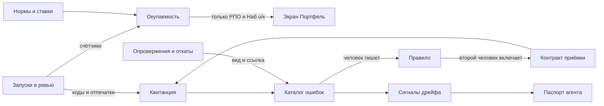
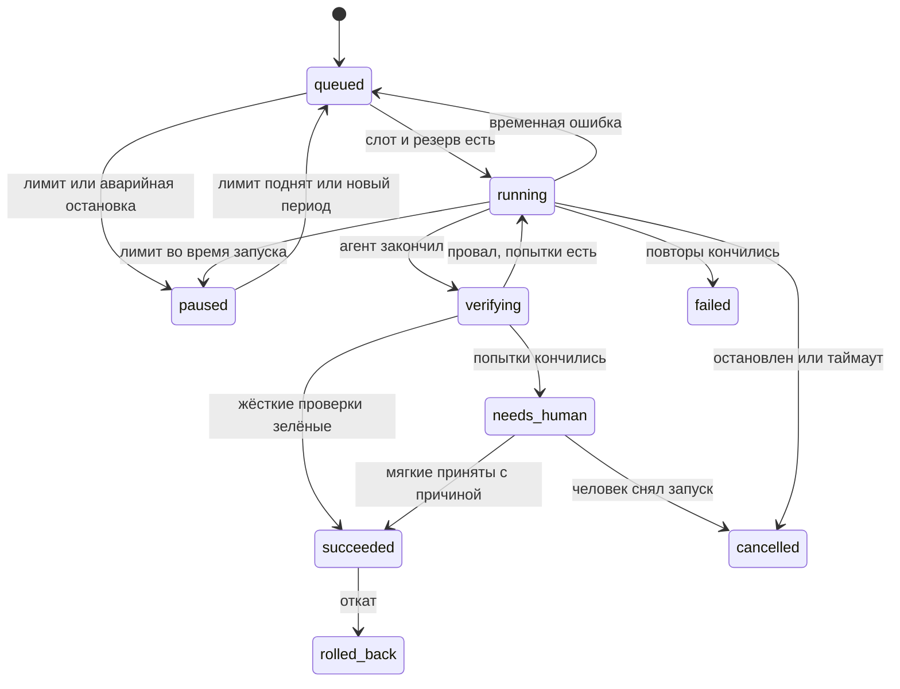

# 45. Обвязка агентов: окупаемость, приёмка, реестр, цикл ошибок

Документ для разработчиков. Кода нет. Дата: 2026-10-31. Основание: слово пользователя в этот день, номера PU-01, PU-02, PU-03, PU-04, PU-06, PU-09, PU-10, PU-11, PU-12 из `44`. Детали взяты с `productuniversity.ru` и у его преподавателя на `aicoding.space` (§14). PU-05, PU-07, PU-08 не приняты и остаются предложениями в `44`.

Требования A112-A120, таски 188-197, инварианты И-185..И-200. Цель раздела: руководство видит окупаемость ИИ, человек видит, что проверено, агентами управляют как штатом, ошибка второй раз не проходит.

Сокращения как в `31`: МП менеджер проекта, РПО руководитель проектного офиса, АдмК администратор компании, ОПД ответственный за персональные данные, Наб п наблюдатель проекта, Наб о/к наблюдатель области или компании. Собственник и топ-менеджмент работают ролью Наб о/к.

Термины: **обвязка** (harness) это всё вокруг модели, что держит агента в рамках: проверки, права, память, приёмка. **Квитанция** это запись, что требовалось, какие проверки прошли и что не проверено. **Контракт приёмки** это список проверок вида результата. **Жёсткая проверка** нельзя обойти, **мягкая** человек может принять с причиной. **Паспорт агента** (Agent Card) это карточка: владелец, назначение, обещанный уровень, расход. **SLA** это обещанный уровень качества и скорости. **Дрейф** это тихое падение качества со временем. **CI** это автоматическая проверка правки на сервере сборки. **Норма** это время операции без ИИ по замеру. **Ёмкость** это освобождённые часы, ещё не ставшие деньгами. Числа без источника это калибровка, не цель.

Имена для `interfaces.md` и строки `manifest.md`, `spec.md` лежат в §13: другая сессия держит там незакоммиченные правки. При расхождении с `05` §3, §6-§9, `27`, `29`, `32`, `35`, `37`, `41`, `43` верны они.

## 0. Решения раздела

| № | Решение | Почему |
|---|---|---|
| Р45-01 | Окупаемость считается нормами на вид операции, а не табелем. Время людей платформа не собирает | Учёт времени отложен решением 2026-10-28. Норма снимается один раз и не следит за человеком |
| Р45-02 | Эффект считается по нижней границе нормы. Отрицательный эффект показывается, не обнуляется | Приём AI-P&L курса `claude-code`: «эффект по нижней границе против стоимости внедрения». Завышенная цифра убьёт доверие собственника |
| Р45-03 | Без снятой нормы показатель не считается. Поставщик норм по умолчанию не даёт | Чужая норма превращает экран в рекламу |
| Р45-04 | Часы и рубли показываются раздельно. Часы это ёмкость. Рубли это условная оценка, пока РПО не подтвердил экономию вручную | Освобождённый час не равен сэкономленному рублю |
| Р45-05 | Разрезов окупаемости два: подразделение и вид операции или агент. Разреза по проекту и человеку нет | Проект с одним МП превращает разрез в оценку сотрудника, И-147 |
| Р45-06 | Запуск получает шаг `verifying`. `succeeded` ставит только код после прохождения жёстких проверок | Модель не решает, что работа сделана |
| Р45-07 | Жёсткой бывает только проверка кодом. Проверка моделью всегда мягкая или справочная | Вердикт агента не одобрение и не условие слияния, `05` №9, К26 |
| Р45-08 | Контракт приёмки живёт в профиле агента и закреплён версией на старте запуска. Агент и ввезённый скил его не меняют | Иначе агент подгонит проверку под результат |
| Р45-09 | Строка «не проверено» в квитанции обязательна. Пропуск проверки без записи запрещён | Молчаливый пропуск хуже провала |
| Р45-10 | Квитанция привязана к отпечатку результата. Результат изменился, значит квитанция устарела | Правило `skills-qe`: нужно свежее свидетельство |
| Р45-11 | Паспорт агента это документ компании с маршрутом `company_doc` плюс машинная часть. Цифры считает код | Тот же приём, что у политики ИИ, `31` §7.1 |
| Р45-12 | Запуск агента вне статуса `active` отклоняется. Исключение `testing` на проекте с флагом пилота | Жизненный цикл MAA-3: идея, сборка, тест, работа, мониторинг, вывод |
| Р45-13 | Владелец агента это человек. Без владельца агент работает, РПО получает сигнал | ИИ не член RACI, `31` §7.1. Принцип «деградация, не отказ» |
| Р45-14 | Пойманная ошибка рождает одно правило и одну проверку. Проверка важнее текста подсказки | Вебинар Harness. Подсказка не растёт, конституция держится в 800 токенах |
| Р45-15 | Правило только сужает: добавляет проверку или заметку. Инструменты, права и аудиторию оно не трогает | Каталог ошибок питается текстом заказчика, это канал инъекции |
| Р45-16 | Правило включает человек, после прогона на примерах ошибки и на золотом наборе. Автовключения нет | Принцип П6 |
| Р45-17 | Каталог ошибок хранит вид, код причины и ссылку. Текста в нём нет | Текст заказчика и ПД не копируются, `28` |
| Р45-18 | Дрейф ловят два сигнала: живые показатели и периодический прогон. Выборка людям только по сигналу | Часы людей дороже прогона |
| Р45-19 | Мало данных это отдельный вердикт, не зелёный и не красный | Курс `skills-bto`: честный вердикт «недостаточно данных» |
| Р45-20 | Стартовые скилы переписаны под артефакты платформы и лежат как `bundled`. Пакет не ставится, код не запускается | P12. Лицензия MIT требует сохранить уведомление |
| Р45-21 | Красная команда это режим `red_team` коллегиального ресёрча `25` §8, новый агент не нужен | Механизм разных моделей, цитат и бюджета уже есть |
| Р45-22 | Красная команда не держит ворота. Её вывод это кандидаты рисков и допущений | Решает человек. Прогон может требовать только профиль ПМО |
| Р45-23 | Инцидент агента закрывается правилом или записанной причиной отказа от него | Иначе разбор не меняет систему |
| Р45-24 | CI проверяет наш код. Защита ветки `main` обязательна, `develop` остаётся без защиты до слова пользователя | Правило словами это просьба. Гарантию даёт проверка вне агента |

## 1. Что меняется и что осталось

| Прежнее | Теперь |
|---|---|
| `running → succeeded` (`02` §3.2) | `running → verifying → succeeded`, при провале возврат агенту, затем `needs_human` (§5) |
| Проверки без модели лежат таблицей для разработчика (`02` §2.2) | Те же проверки это контракт. Человек видит результат квитанцией |
| Каталог агентов это глава документа (`02` §2) | Плюс реестр компании с владельцем, статусом и обещанным уровнем (§6) |
| Регресс только при смене модели, скила, инструкции (`02` §11) | Плюс периодический контроль дрейфа (§8) |
| «Экран N28 не принят» (`02` §11) | Слово пользователя принимает показатели качества для РПО и АдмК. Заказчику отчёт по-прежнему не показывается |
| Отзывы, опровержения, уроки лежат отдельно | Сходятся в каталог ошибок и дают правила (§7) |
| Два стартовых скила (`02` §5.4) | Плюс шесть скилов РП (§9) и режим красной команды (§10) |
| В клоне нет CI и рабочих хуков | CI на `push` и защита `main` (§12) |

Без изменений: П1-П12 `02`, цитаты `verify_quote`, откат, ревью по пунктам `25` §6, перепроверка `25` §7, ответ агента в чате `40` §4.4, запрет раскрывать вклад И-147, раздел `31` §14 про раскрытие ИИ заказчику.

**Сверка с прежними решениями.** Учёт времени отложен (2026-10-28): конфликт снят Р45-01. Команда не видит часов (И-165): часы окупаемости видят только РПО и Наб о/к. N28 не был принят: пользователь принял номера PU-03 и PU-09, заказчику экран закрыт. Противоречий, требующих решения, не найдено.

## 2. Права и утечки (первыми, A71, A72)

### 2.1. Новые сущности

Столбец «Команда» это БА, СА, Арх, Раз, Тест, Тим, ТЛ, при внесении в матрицу таска 64 он раскрывается. «з» закреплено нет, «о» связь с объектом, «сч» счётчики, «-» нет.

| Сущность | Класс | МП | РПО | Команда | Наб п | Наб о/к | Заказчик | АдмК | ОПД | Агент |
|---|---|---|---|---|---|---|---|---|---|---|
| Нормы операций | `usage` | - | да | - | - | сч | з | - | - | з |
| Ставки групп | `budget` | - | да | - | - | - | з | - | - | з |
| Затраты на ИИ | `budget` | - | да | - | - | сч | з | о (модели, железо) | - | з |
| Окупаемость, срезы | `budget` | - | да | - | - | о (своя область) | з | - | - | з |
| Квитанция | как у результата | о | о | о | о | - | з | через `admin_as_role` | - | своя, коды |
| Паспорт агента | `team` | сч | да | сч | - | да | з | да | - | з |
| Показатели агента | `usage` агрегатом | - | да | - | - | сч | з | да | - | з |
| Каталог ошибок | `team` агрегатом, без текста | сч | да | - | - | сч | з | да | - | з |
| Правила агента | `team` | - | да | - | - | - | з | да | - | как проверка, заметка в профиле |
| Сигналы дрейфа | `team` агрегатом | - | да | - | - | сч | з | да | - | з |
| Инцидент агента | `team`, ссылки через `tenancy.scope` | о | да | - | - | сч | з | да | да, если задеты ПД | з |

### 2.2. Клетки ролевой матрицы (к таску 64)

| Клетка | МП | РПО | Команда | Наб о/к | АдмК | ОПД | Пр, Подп | Аг |
|---|---|---|---|---|---|---|---|---|
| `ai_pnl/view` | - | да | - | о | - | - | з | з |
| `ai_pnl/manage` (нормы, ставки, затраты) | - | да | - | - | о (железо, модели) | - | з | з |
| `agents/receipt_view` | о | о | о | - | - | - | з | - |
| `agents/receipt_override` | о (назначивший или МП) | - | - | - | - | - | з | з |
| `agents/registry_view` | сч | да | сч | да | да | - | з | з |
| `agents/registry_manage` | - | да | - | - | да | - | з | з |
| `agents/errors_view` | сч | да | - | сч | да | - | з | з |
| `agents/rules_propose` | - | да | - | - | да | - | з | з |
| `agents/rules_approve` | - | да | - | - | - | - | з | з |
| `agents/incident_view` | о | да | - | сч | да | о | з | з |
| `agents/incident_manage` | - | да | - | - | да | - | з | з |

Правило двух ключей: правило предлагает один человек, включает другой (И-193).

### 2.3. Переходы данных (продолжение карты `27` §3 и `31` §2.2)

Номера присвоит таск 64, здесь буквы.

| Переход | Как | Проверка |
|---|---|---|
| а. Решения ревью и запуски → окупаемость | Только счётчики по виду операции, без имён и текста | Порог k и порог `n` (И-186) |
| б. Проверки → квитанция | Коды, статусы, отпечатки, ссылки на предмет | Показ текста только через `tenancy.scope` зрителя |
| в. Провал проверки → агент | Код проверки и место в его результате | Только то, что агент сам написал (И-190) |
| г. Отзыв, опровержение, откат → каталог ошибок | Вид, код причины, ссылка, проект | Текст не копируется (И-192) |
| д. Каталог → правило | Человек пишет проверку или заметку | Детектор ПД и n-грамм, два ключа (И-193, И-194) |
| е. Пример ошибки → золотой набор | Только внутри компании, локально | В облако только синтетика (И-196) |
| ж. План → красная команда | Пакет в аудитории результата | `audience_scope`, бюджет только у видов с `data_class = budget` (И-198) |
| з. Инцидент → разбор | Ссылки, без цитат | Текст только по ссылке в правах зрителя (И-199) |

### 2.4. Пути утечки и чем закрыты

| № | Путь | Чем закрыт |
|---|---|---|
| У45-01 | Ставка малой группы раскрывает зарплату | Ставка только на группу из k и более людей, иначе ставка компании (И-185) |
| У45-02 | Окупаемость становится оценкой сотрудника | Нет разреза по проекту и человеку, порог `n`, запрет выгрузки строк (И-186) |
| У45-03 | Заказчик видит экономию часов и пересматривает цену | Класс `budget`, клетка `ai_pnl/view`, у заказчика «з», набор `ai_pnl` вне отчётов заказчика (И-187) |
| У45-04 | Данные окупаемости уходят в облако | Классы `budget` и `usage` наружу не уходят, `28` §4.2. Ассистент читать набор не может (И-187) |
| У45-05 | Модель сама пишет «готово» | `succeeded` ставит только код (И-188) |
| У45-06 | Агент подгоняет контракт или скил его ослабляет | Контракт вне каталога запуска, версия закреплена, `office`-блок скила при ввозе отбрасывается (И-189, УИБ29-45) |
| У45-07 | Вывод проверки выносит текст закрытого источника агенту или команде | Агенту только код и место в его результате. Квитанция хранит идентификаторы (И-190) |
| У45-08 | «Принять с причиной» обходит ворота | Только мягкие проверки. Жёсткие не обходятся. Каждое принятие в `office_audit`, счётчик в паспорте (И-191) |
| У45-09 | Каталог ошибок копит ПД и текст заказчика | Текста нет, только код причины. Свободный ввод причины не копируется (И-192) |
| У45-10 | Заказчик или вложение подбрасывает правило через причину отклонения | Модель только предлагает вид ошибки. Правило пишет человек, правило не расширяет права (И-193) |
| У45-11 | Заметка из проекта А попадает агенту проекта Б | Заметка проходит детектор ПД и сверку n-грамм с фрагментами проектов, П9 (И-194) |
| У45-12 | Правило тихо ослабляет запрет | Типы проверок закрытым перечнем, только добавление (И-195) |
| У45-13 | Золотой набор компании уходит в облако при прогоне дрейфа | Набор компании только локально, облачный прогон только на синтетике (И-196) |
| У45-14 | Чужой скил несёт скрытую инструкцию | Текст вычитан человеком, сканер скрытого текста, без скриптов, файлы заморожены отпечатком (И-197) |
| У45-15 | Красная команда выносит бюджет или чат руководства в протокол, видимый команде | Пакет в аудитории результата, `management_chat` и `usage` не входят (И-198) |
| У45-16 | Разбор инцидента копирует ПД и цитаты | Только ссылки, детектор ПД при сохранении (И-199) |
| У45-17 | Показатели агента, которым пользуется один человек, раскрывают его работу | Порог k на показателях паспорта (И-186) |
| У45-18 | Лог CI выносит секреты или данные | Сборка без секретов прода, без дампов, сканер на диффе, запрет `pull_request_target` (И-200) |
| У45-19 | Чужое действие сборки подменяется | Действия закреплены по SHA, не по метке (И-200) |

Сводка по классам: новых клеток для заказчика и агента нет, все «з». Текст заказчика в новых таблицах не хранится. Часов и денег у команды нет.

**Диаграмма:** Mermaid · `flowchart`: куда идут данные новых контуров и где стоят ограничения.

## 3. Окупаемость ИИ (PU-01)

Что взято с сайта: юнит-экономика процесса в рублях, «как выбрать процесс, который окупится за месяц, а не за год», `cost per task`, запуск агента против зарплаты (MAA-1, недели 1 и 7); AI-P&L по нижней границе и «личный контракт с метрикой окупаемости» (тренажёр `claude-code`, модули 1 и 6); простой и дисконтированный срок, типовые ошибки (`/calculators/payback`); полная стоимость владения и расчёт GPU (MAA-3, недели 1 и 2). Цифры калькулятора курса «Нейросети» (ИИ забирает 70% рутины) не берём: это допущение продавца.

### 3.1. Базовая линия

Снимается на пилоте P20 и у каждой компании при установке. Таск 189 это таблица и замеры, без кода.

| Шаг | Что |
|---|---|
| 1 | РПО выбирает до 10 видов операций: протокол созвона, правка задания, ревью документа, сводка, черновик задачи, план дня, ответ по проекту и другие. Вид связан с агентом и классом |
| 2 | По каждому виду минимум 5 замеров у 2 разных людей без ИИ (калибровка, не цель). Источник `measured` |
| 3 | Если замер невозможен: опрос команды, источник `survey`, на экране это видно |
| 4 | Берём нижний квартиль как `baseline_low_min`, медиану как `baseline_median_min` |
| 5 | Отдельно норма проверки результата человеком `review_min` |
| 6 | РПО утверждает норму. Срок годности 12 месяцев (калибровка), дальше показатель с пометкой «норма устарела» |

Имена в замере не хранятся.

### 3.2. Расчёт

Для вида операции `v` за месяц:

- `A` принято без правки, `E` принято с правкой, `R` опровергнуто или откачено. Источник: `office_review_items`, `office_agent_runs`, для одношаговых операций решения по кандидатам.
- `ёмкость(v) = A × (T0 − Tr) + E × (T0 × c − Tr) − R × Tr`, часы. `T0` это `baseline_low_min`, `Tr` это `review_min`, `c = 0,5` (калибровка, не цель).
- `оценка(v) = ёмкость(v) × ставка группы`.
- `затраты = модели + железо + лицензии + внедрение`. Модели из `office_usage`. Железо: стоимость в месяц, умноженная на долю `gpu_ms` классов ИИ, потому что у локальной модели цена токена ноль (`28` §3.2). Внедрение равномерно на `amort_months = 24`, калибровка.
- `эффект = оценка − затраты`. Минус показывается минусом.
- Простой срок окупаемости: вложения делим на средний месячный эффект за 3 месяца. Дисконтированный: по ставке компании, поле РПО. Первые месяцы запуска входят в расчёт, иначе срок занижен (ошибка из `/calculators/payback`).
- `подтверждённая экономия` вводит РПО вручную с основанием: например, ставка не открылась. Только она показывается как деньги, остальное подпись «условная оценка».

Меньше 20 операций в ячейке: ячейка не показывается, текст «мало данных» (калибровка, порог `n`).

### 3.3. Экран

Виджет W12 «Окупаемость ИИ» в `/office/portfolio` (`31` §5.1), вкладка «ИИ». Первая строка: ёмкость за месяц, условная оценка, затраты, эффект, срок окупаемости. Ниже разрез по видам операций и по агентам, ещё ниже разрез по подразделениям. У каждой цифры источник и дата нормы. Рядом W10 с качеством: дешёвый и плохой результат виден сразу.

Выгрузка только агрегатом, отдельным видом отчёта для руководства с классом `budget`. В отчёты заказчика этот набор не входит. Заказчику, команде и МП экран закрыт.

## 4. Метрики агента

Единый список, из которого берут паспорт (§6), дрейф (§8) и окупаемость. Источник `insight`, набор `agent_metrics`, только агрегаты.

| Метрика | Как считается | Откуда идея |
|---|---|---|
| Доля принятых без правки | `A / (A + E + R)` | MAA-4, неделя 3 |
| Зелёных с первого раза | Запуски `succeeded` без возврата | Вебинар Harness |
| Цена операции | Расход на завершённую операцию | MAA-1 `cost per task` |
| Время до результата | Медиана и 90-й процентиль | Менеджер ИИ-продуктов: точность, задержка, стоимость, доверие |
| Доступность | Доля времени без `paused` по причине `provider_down` | MAA-1 `Uptime` |
| Повтор ошибок | Доля ошибок вида, у которого есть действующее правило | PU-04 |
| Обходы | Число «принято с причиной» | Р45-08, И-191 |

## 5. Квитанция приёмки (PU-02)

Что взято с сайта: «начинают с навыков, а не с приёмщика», приёмщик «заворачивает работу, пока они не выполнены», «кому и в каком виде нужен результат», и аудитория «тем, кому потом отвечать» (вебинар Harness); у кейса есть метрика, артефакт и честный стоп-критерий, например «шаг без проверяемого артефакта» (тренажёр `claude-code`); гейт должен уметь падать и проверяться дымом; блокирующие и справочные проверки; свежее свидетельство (`aicoding.space`, `skills-qe`).

### 5.1. Машина состояний

Заменяет `02` §3.2 и перечень `05` §3.4 в части запуска.

`verifying` исполняет код вне джейла. Возвратов не больше 2 на запуск (калибровка), новый резерв не берётся, таймаут класса общий. `needs_human` видит только назначивший и МП, команда результат не видит (`02` §3.2: объекты видны после `succeeded`). При снятии работает механизм отката.

Вне этого пути: одношаговые вызовы домена без запуска и ответ в чате (`40` §4.4, `13` §1). Там проверки свои и ответ появляется после них, квитанция экрана не имеет. Строка в журнале запуска остаётся.

### 5.2. Контракт приёмки

Поле `acceptance_contract` версии профиля агента. Вид результата определяет набор. Берётся из колонки «Проверка без модели» `02` §2.2 и дополняется по `26`.

| Поле проверки | Значения |
|---|---|
| `check_id` | Имя из реестра проверок кода |
| `severity` | `hard`, `soft`, `info` |
| `runner` | `code` или `model`. `model` не бывает `hard` (Р45-07) |
| `applies_to` | Вид результата |
| `fixture` | Заведомо плохой пример, на котором проверка обязана упасть |

Примеры `hard`: дословность цитат (`verify_quote`), сканер секретов, аудитория источников (`source_outside_audience`), маркеры `req:`, авторство и трейлеры коммитов, заполненные обязательные разделы вида. Примеры `soft`: число пунктов без источника, замечания агента-ревьюера, объём правок. Примеры `info`: расход, число прочитанных фрагментов.

Проверка без `fixture` в контракт не входит. CI (§12) прогоняет каждую `fixture` и краснеет, если проверка не упала (И-189).

### 5.3. Квитанция

`office_agent_receipts`, только добавление, одна действующая строка на запуск.

| Поле | Смысл |
|---|---|
| `run_id`, `seq` | Запуск и номер записи |
| `contract_version` | Версия контракта на старте |
| `result_sha` | Отпечаток результата |
| `checks json` | На каждую: `check_id`, `severity`, `status` (`pass`, `fail`, `skip`, `pending`), `evidence_ref`, `at` |
| `not_checked json` | Что не проверено и почему. Пустой список пишется явно |
| `verdict` | `green`, `yellow`, `red` |
| `attempts` | Сколько возвратов было |
| `override_by`, `override_reason` | Кто принял с причиной |

Зелёный: все `hard` и `soft` прошли. Жёлтый: `hard` прошли, `soft` приняты с причиной или есть `pending`. Красный: упала `hard`.

Результат изменился: квитанция получает пометку `stale`, на экране это видно, слияние по ней не считается проверенным (Р45-10). Новый коммит агента запускает проверки заново.

Внешние проверки: сборка MR кода приходит позже событием `pipeline.finished`. `delivery` дописывает новую строку `seq`, статус `pending` становится `pass` или `fail`.

### 5.4. Экран

Блок в карточке запуска, в MR документа и на экране «На ревью» (`25` §6.3). Вверху вердикт и одна фраза. Дальше три списка: «Проверено», «Не проверено», «Принято с причиной». Клик открывает предмет в правах зрителя. Ревью по пунктам квитанция не заменяет.

## 6. Реестр агентов (PU-03)

Что взято с сайта: Agent Card с SLA, метриками и экономикой, «с ним агента можно передать в команду» (MAA-1, неделя 8); Agent Registry с владельцем, SLA, стоимостью и статусом, жизненный цикл, версионирование, бюджеты и алерты, «кто создаёт, кто одобряет, как деплоим», классификация рисков (MAA-3, неделя 6); разметка границ автономии, «где нужна LLM, где хватит правил, где обязателен человек» (MAA-1, неделя 2); Agent Catalog и Success Criteria (6A).

### 6.1. Паспорт

Документ `pmo:agent_card:<agent>` в пространстве компании, маршрут `company_doc`, плюс машинная часть `office_agent_cards`. Поставщик заполняет текст для всех агентов `02` §2, компания задаёт владельца и пороги.

| Поле | Смысл |
|---|---|
| `agent`, `profile_version` | Агент и версия профиля |
| `status` | `draft`, `testing`, `active`, `suspended`, `retired` |
| `business_owner_id` | Человек, отвечает за результат агента |
| `purpose`, `success_criteria` | Зачем и что считается успехом |
| `autonomy` | `suggests` (кандидаты), `drafts` (черновики и ветки), `acts_on_confirm` (исполняет подтверждённое человеком) |
| `risk_class` | `low`, `medium`, `high`. `high`: результат уходит заказчику или руководству |
| `human_gate` | Кто принимает, из `02` §2.1 |
| `sla json` | Пороги: доля без правки, зелёные с первого раза, 90-й процентиль времени, цена операции, доступность |
| `next_review_at` | Пересмотр, умолчание полгода (калибровка) |

`risk_class = high` не опускает `review_policy` ниже `review_floor` (`31` §7.1) и задаёт ревью по пунктам.

### 6.2. Жизненный цикл

`agents.assign` проверяет статус рядом с классом профиля политики ИИ. `testing`: только проект с флагом `pilot`. `suspended`: идущие запуски уходят в `paused` с причиной `card_suspended`. `retired`: 409 `agent_retired`, журнал и квитанции остаются. Новая версия профиля идёт через регресс `02` §11, старая работает до применения.

Переходы статуса: `draft → testing` РПО; `testing → active` РПО плюс зелёный прогон; `active → suspended` РПО, АдмК, контроль дрейфа; `suspended → active` РПО; `active → retired` РПО.

### 6.3. Обещанный уровень

`insight` считает метрики §4 ночью. Порог нарушен два периода подряд: событие `agent_sla.breached`, строка на вкладке РПО, пометка в паспорте. Автоматической остановки нет, остановка только по твёрдому полу (§8.3).

### 6.4. Экран

`/office/portfolio`, вкладка «Агенты». Таблица: агент, статус, владелец, риск, версия, метрики, бюджет доли, пересмотр. Открытие паспорта показывает текст, метрики за 6 месяцев, правила, инциденты. Наб о/к видит таблицу без правки. МП и команда видят статус и назначение в подсказке у агента.

Расход и бюджеты не дублируются: доли остаются в `02` §6.4, паспорт их показывает.

## 7. Цикл «ошибка, правило, проверка» (PU-04)

Что взято с сайта: «каждая пойманная ошибка становится одним правилом и одной машинной проверкой, второй раз она не проходит» (вебинар Harness); классификация ошибок, ограничители, точки эскалации (MAA-1, неделя 5); `error analysis`, LLM как судья, «поиск мест, где продукт ломается» (Менеджер ИИ-продуктов, неделя 8); уроки с датами и измерениями (`aicoding.space`); передача нестандартных случаев и разбор переписки (`/media/ai/ai-in-beauty`). Выпуск рассылки 308 говорит, что работающие внешние механизмы важнее объёма инструкций. Его пример про сокращение подсказки Claude Code я не проверял и опорой не беру.

### 7.1. Откуда приходит ошибка

| Источник | Событие | Код причины |
|---|---|---|
| Опровержение пункта | `25` §6.4 | Причина ревью |
| Отклонение кандидата | `candidate.decided` | Причина отклонения |
| Откат запуска | `agent_run.rolled_back` | Причина отката |
| Провал жёсткой проверки | `agent_run.needs_human` | `check_id` |
| Принятие с причиной | Квитанция | `check_id` |
| Оценка «не то» | `feedback.recorded` | Код оценки |
| Несогласие старшей модели, подтверждённое человеком | `25` §7 | Причина |
| Инцидент | §11 | Вид инцидента |

Пара «было, стало» остаётся в подсказке извлечения проекта (`01` §9), в каталог не копируется.

### 7.2. Каталог

`office_agent_errors`: `company_id`, `project_id`, `agent`, `task_class`, `profile_version`, `category`, `reason_code`, `source_ref`, `fingerprint`, `status`, `rule_id?`, `at`.

`category`: `missing_source` (нет опоры), `wrong_fact`, `wrong_format`, `scope_creep` (вышел за задачу), `stale_input` (устаревший вход), `false_done` (заявил готово без результата), `tool_misuse`, `rights`, `other`.

Категорию ставит код по `reason_code`. Для `other` локальная модель класса `extract` может предложить категорию, в правах проекта, это подсказка. `fingerprint` это отпечаток вида и места, без текста.

### 7.3. Разбор

Вкладка «Ошибки» в паспорте агента и общий список РПО. Строка: вид, агент, число за 30 дней, число проектов, есть ли правило. Открытие примера идёт через `tenancy.scope`: РПО без доступа к проекту видит счётчик.

Система предлагает разбор, когда вид повторился 3 раза за 30 дней (калибровка). РПО выбирает: правило, отказ с причиной, урок в `office_lessons`.

### 7.4. Правило

`office_agent_rules`: `agent`, `kind`, `spec json`, `status` (`proposed`, `testing`, `active`, `retired`), `origin_error_ids`, `proposed_by`, `approved_by`, `fired_count`, `last_fired_at`.

| `kind` | Что делает | Ограничение |
|---|---|---|
| `check` | Новая проверка контракта из закрытого перечня: обязательное поле, запрет термина, обязательная ссылка, число пунктов, шаблон по схеме | Исполнение кода не допускается. Сначала `soft` |
| `note` | Короткая заметка в профиль | До 200 токенов, входит в потолок 3 000, только если проверкой не выразить |

Порядок: человек пишет правило, код прогоняет `fixture` из примеров ошибки и золотой набор, второй человек включает. Новая версия контракта получает номер, идущие запуски работают по старой. Через 14 дней без ложных срабатываний РПО может поднять проверку кодом до `hard` (калибровка).

Правило без срабатываний 90 дней предлагается к снятию (калибровка). В вебинаре это названо прямо: где сложная схема окупилась, а где её выбросили и стало лучше.

## 8. Контроль дрейфа (PU-09)

Что взято с сайта: «SLA, мониторинг качества, drift detection и непрерывное улучшение» (6A, ADMINISTER); `Eval и мониторинг` (MAA); `LLMOps: от разработки до мониторинга`, цикл «sprint, build, eval, deploy» (MAA-3); «недостаточно данных» как честный вердикт (`skills-bto`). Как именно считают дрейф на курсе, на открытых страницах не сказано, методика ниже наша.

### 8.1. Живые сигналы

Ночью `insight` сравнивает окно 28 дней с предыдущими 84 днями на агента и класс: доля без правки, зелёные с первого раза, доля отброшенных цитат, повтор ошибок. Падение больше 15% при `n ≥ 30`: сигнал `warn` (калибровка). Меньше данных: вердикт `insufficient`.

### 8.2. Периодический прогон

Задание `office_jobs` вида `quality_run`, раз в 30 дней (`quality.cadence_days`, калибровка), ночью, отдельная доля расхода. Зовёт `routing.evaluate_release` на золотых наборах `01` §9, `02` §11, `26`, пишет `office_model_evals`. Тот же механизм, что проверка на предвзятость (И-146). Облачная модель получает только поставляемый синтетический набор, набор компании только локально.

### 8.3. Действия

| Сигнал | Что происходит |
|---|---|
| `insufficient` | Запись, без уведомления |
| `warn` | Событие `quality.drift_detected`, строка РПО и АдмК. Система предлагает выборку: 10 принятых результатов на проверку МП тех же проектов через «На ревью» |
| Ниже абсолютного пола `01` §9 (например, цитаты меньше 100%) | Класс на этой модели приостанавливается, как в И-146. `quality.class_paused`, паспорт `suspended` только по слову РПО |

Смена модели, скила или инструкции, случившаяся в окне, показывается рядом с графиком: первая причина для проверки.

## 9. Стартовая библиотека скилов РП (PU-10)

Источник прочитан: пакет `@dzhechkov/skills-pm`, 18 скилов, только текст, скриптов нет, файл `LICENSE` MIT с правами `dzhechko` и Pawel Huryn. По `sources.json` тексты взяты из `phuryn/pm-skills`. Метка доверия пакета `Advisory`. Пакет писан под продукт, не под проектный офис. Тексты Product University (`/team-templates`, `/agile`, `/project`) закрытой лицензии: читаем для понимания, не копируем.

| Берём | Становится | Результат |
|---|---|---|
| `stakeholder-map` | `pm_stakeholder_map` | Реестр заинтересованных сторон, план вовлечения `31` §6.2 |
| `sprint-plan` | `pm_sprint_plan` | Черновик плана спринта: ёмкость, истории, зависимости, риски |
| `prioritization-frameworks` | `pm_prioritization` | Метод и расчёт приоритета бэклога, значения подставляет код |
| `metrics-dashboard` | `pm_metrics_plan` | Предложение метрик проекта из каталога `insight` |
| `outcome-roadmap` | `pm_outcome_roadmap` | Дорожная карта через результаты |
| `brainstorm-okrs` | `pm_okr` | Цели и ключевые результаты, источник О24 |
| `strategy-red-team` | `pm_plan_red_team` | §10 |

Не берём: `growth-loops`, `gtm-strategy`, `pricing-strategy`, `market-sizing`, `beachhead-segment`, `north-star-metric`, `ab-test-analysis`, `cohort-analysis`, `opportunity-solution-tree`, `product-strategy`, `prioritize-features`: они про продукт и рынок.

Правила адаптации:

1. Текст переводится и переписывается под артефакты платформы. Название Slack, ссылки на чужие инструменты и `$ARGUMENTS` уходят.
2. Вход только через `knowledge.search` в правах запуска. Выход: правка документа веткой или кандидаты, не текст в чат.
3. У каждого скила рубрика качества и контракт приёмки (§5). Приём взят из `CLAUDE.md Starter Kit` тренажёра: ядро, границы, рубрика качества.
4. Каждый скил получает `fixture` и прогон на примере до включения.
5. Файлы лежат как `bundled`, версия закреплена отпечатком, обновление только ручным сравнением.
6. Уведомление MIT обоих авторов лежит в `THIRD_PARTY_NOTICES` поставки.

Скил включает АдмК, назначает МП, как в `02` §5.2.

## 10. Красная команда проектных планов (PU-11)

Источник: `strategy-red-team/SKILL.md`, прочитан целиком. Важная мысль оттуда: это не длинный список рисков, а 3-5 несущих допущений, каждое с дешёвой проверкой. Сначала сильнейшая версия довода, потом атака. Если план крепкий, так и сказать.

Режим `mode = red_team` у `office_research_runs` (`25` §8, §10.1). Участники `council_member` разных моделей, арбитр `council_arbiter`, бюджет `share_council`, подтверждение оценки как в `25` §8.6.

**Запуск.** Кнопка «Проверить план на прочность» у принятой или готовящейся версии плана и перед вехой. Жмёт МП или РПО. Ассистент может предложить карточкой уровня B. РПО может поставить `red_team_required` в профиль ПМО для крупного типа: ворота проверят, что прогон был, а не что он зелёный (В45-3).

**Вход.** Пакет `25` §8.2 в аудитории результата: сводный план, ИСР, Гант, реестры рисков и допущений, задание, `plan:benefits`. Деньги только для вида с `data_class = budget`.

**Выход.** Строгая схема на допущение:

| Поле | Смысл |
|---|---|
| Утверждение | Что план считает верным, с цитатой |
| Провалится, если | Конкретное проверяемое условие |
| Что проверить на этой неделе | Какие данные или разговор |
| Порог остановки | Когда менять план |
| Самая дешёвая проверка | Минимальный опыт |
| Оценка | Вред × вероятность × дешевизна проверки |

Плюс два обязательных блока: «Что выдержало» и «Что не удалось оценить». Цитаты проверяет `verify_quote`, довод без цитаты помечается «без опоры» и в верхнюю тройку не попадает.

**После.** Протокол `research:<id>`. Каждая строка одной кнопкой становится кандидатом в реестр рисков или допущений или черновиком задачи проверки. Решает МП. Отказы с причиной идут в каталог ошибок только если это ошибка модели.

## 11. Разбор инцидентов агента (PU-12)

Что взято с сайта: `Incident management: дежурства, runbooks, эскалация`, `Audit trail` (MAA-3, недели 3 и 7); приостановка бота при подключении человека и передача случая разработчикам (`/media/ai/ai-in-beauty`).

### 11.1. Что считается инцидентом

| Уровень | Примеры | Открывается |
|---|---|---|
| И1 | Утечка за аудиторию, обход прав, вывоз данных, успешная инъекция | Автоматически: `emergency_stop`, провал проверок `rights`, `source_outside_audience`, журнал вывоза `28` §4.5 |
| И2 | Неверный результат дошёл до заказчика или руководства, откат принятого, остановка класса | Автоматически при `quality.class_paused`, вручную МП, РПО |
| И3 | Массовый брак без внешнего вреда, резкий рост расхода | Вручную РПО, АдмК |

### 11.2. Ход

`office_agent_incidents`: ключ `AGI-N`, `level`, `status` (`open`, `contained`, `analysed`, `closed`), `agent`, `run_ids`, `owner_id`, `opened_at`, `contained_at`, `closed_at`, `doc_ref`, `rule_id?`, `no_rule_reason?`.

1. Остановить: `pause_agents` на нужной области или `rollback_run`.
2. Оценить: `run_log` показывает, что прочитано и создано, код считает затронутых.
3. Уведомить: РПО, АдмК. Задеты ПД: ОПД и порядок `28` §4.5. Сообщение заказчику готовит МП, отправляет человек.
4. Исправить: откат, возврат версии.
5. Разобрать: документ `pmo:agent_incident:<ключ>`: что случилось, влияние, почему проверки не поймали, что меняем. Без имён, разбор без обвинений. Только ссылки.
6. Закрыть: правило (§7) или причина отказа от него.

Инструкция по шагам лежит в `guide:admin`, раздел «Инцидент агента», по одному порядку на вид: утечка, инъекция, неверный результат, расход. Дежурств платформа не вводит, это организация компании.

Счётчик инцидентов показывается в паспорте.

## 12. Автопроверка нашей сборки (PU-06)

Что взято с сайта: гейт должен уметь падать; блокирующая проверка отдельно от справочной; «где ставить проверку и как проверять её дымом»; история `skills-qe` «агент сказал все тесты проходят, в CI семь красных» (`aicoding.space`); хуки и запуск линтера (`/media/ai/claude-code`). Это наш процесс разработки, у заказчика своя сборка (`17`).

Сейчас: папки `.github` нет, рабочих `.git/hooks` нет, в Pulse на 2026-10-31 записано 33 падающих теста.

### 12.1. Сборка

Файл `.github/workflows/ci.yml`, запуск на `push` в `develop`, `main` и на запросы слияния.

| Задание | Что |
|---|---|
| `backend` | Python 3.11, зависимости из `requirements.lock`, `pytest tests -q` со списком известных падений, `ruff check src/` |
| `frontend` | `npm ci`, `npx vitest run`, `npm run build` в `web/` |
| `installer` | `bash tests/installer_test.sh` |
| `secrets` | Сканер секретов по диффу, версия закреплена |
| `gates` | Каждая `fixture` контрактов (§5.2): проверка обязана упасть. Заведомо плохой образец для сканера секретов |

Страж `tests/test_subprocess_env_guard.py` идёт в `backend`.

### 12.2. Известные падения

Файл `tests/known_failures.txt`: тест, владелец, причина, срок. Новое падение красное. Тест из списка стал проходить: красное, строку надо снять. Срок истёк: красное. Список только сокращается, добавить строку можно только отдельным коммитом с причиной.

### 12.3. Защита

`main`: слияние только при зелёном CI, настройку делает пользователь (В45-4). `develop` без защиты, красный коммит виден на странице репозитория. `.github/` добавляется в `export-ignore` в `.gitattributes`, чтобы не уехать в архив выпуска.

Безопасность сборки: секретов прода нет, дампы не используются, `pull_request_target` запрещён, действия закреплены по SHA, права токена только чтение.

Не проверено: доступна ли защита веток на текущем тарифе GitHub для этого репозитория, сколько минут сборки это съест.

## 13. Схема, API, события, текст для других файлов

### 13.1. Таблицы

| Таблица | Писатель | Поля |
|---|---|---|
| `office_ai_operations` | `insight` | §3.1 |
| `office_ai_rates` | `insight` | `group_key`, `rate_rub_hour`, `people_count`, `valid_from` |
| `office_ai_costs` | `insight` | `period`, `kind enum(model, hardware, license, rollout, support)`, `amount_rub`, `source enum(auto, manual)`, `basis` |
| `office_ai_pnl_snapshots` | `insight` | `period`, `department_id?`, `op_key?`, `agent?`, `n_accepted`, `n_edited`, `n_rejected`, `hours_low`, `rub_low`, `cost_rub`, `confirmed_rub` |
| `office_agent_receipts` | `agents` | §5.3 |
| `office_agent_cards` | `agents` | §6.1 |
| `office_agent_errors` | `agents` | §7.2 |
| `office_agent_rules` | `agents` | §7.4 |
| `office_quality_signals` | `insight` | `agent`, `task_class`, `window`, `metric`, `value`, `baseline`, `n`, `verdict enum(ok, warn, floor, insufficient)` |
| `office_agent_incidents` | `agents` | §11.2 |

`office_agent_runs.state` получает `verifying`, `needs_human`. `pause_reason` получает `card_suspended`. `office_research_runs.mode` получает `red_team`, запись агентов как у `council`.

### 13.2. Операции и API

Префикс `/api/office`. Ошибки по `05` §3.6.

| Метод | Клетка |
|---|---|
| GET `/agent-runs/{id}/receipt` | `agents/receipt_view` |
| POST `/agent-runs/{id}/receipt/override` (`reason`, 422 `hard_check_failed`) | `agents/receipt_override` |
| GET `/portfolio/ai-pnl?period&department&group_by` | `ai_pnl/view` |
| GET, PUT `/pmo/ai-operations`, `/pmo/ai-rates`, `/pmo/ai-costs` | `ai_pnl/manage` |
| GET `/pmo/agents`, `/pmo/agents/{agent}` | `agents/registry_view` |
| PATCH `/pmo/agents/{agent}`; POST `/pmo/agents/{agent}/status` (409 `eval_required`) | `agents/registry_manage` |
| GET `/pmo/agent-errors` | `agents/errors_view` |
| POST `/pmo/agent-rules`; POST `/pmo/agent-rules/{id}/approve` (409 `same_author`, 409 `fixture_failed`); POST `/.../retire` | `agents/rules_propose`, `agents/rules_approve` |
| GET `/pmo/quality` | `agents/errors_view` |
| POST `/research-runs` с `mode = red_team` (`25` §10.3) | `review/council` |
| GET, POST `/pmo/agent-incidents`; POST `/.../{key}/status` | `agents/incident_view`, `agents/incident_manage` |

Новый запрет `agents.assign`: 409 `agent_not_active`, 409 `agent_retired`.

### 13.3. События

`agent_run.verifying`, `agent_run.returned`, `agent_run.needs_human`, `agent_receipt.updated`, `agent_card.status_changed`, `agent_sla.breached`, `agent_error.recorded`, `agent_rule.proposed`, `agent_rule.approved`, `agent_rule.retired`, `quality.drift_detected`, `quality.class_paused`, `agent_incident.opened`, `agent_incident.closed`, `ai_pnl.snapshot_ready`. Полезная нагрузка без текста. Уведомления по правилам `25` §2: код и ключ, без содержания.

### 13.4. Инварианты

| № | Инвариант | Тест |
|---|---|---|
| И-185 | Ставка хранится на группу из k и более людей | Группа меньше k отклонена |
| И-186 | Окупаемость и показатели агента без разреза по проекту и человеку, ячейки меньше порогов не показываются | API не принимает `group_by=project` и `user` |
| И-187 | Наборы `ai_pnl` и `agent_metrics` закрыты заказчику, агенту, ассистенту, внешним клиентам MCP, облаку | Перебор ролей и клиентов |
| И-188 | `succeeded` ставит только код после зелёных жёстких проверок | Подделка вывода модели не меняет состояние |
| И-189 | Контракт вне каталога запуска, закреплён версией. Проверка без падающей `fixture` не входит | Запуск с враждебной инструкцией, CI `gates` |
| И-190 | Квитанция хранит идентификаторы. Агенту возвращается только код и место в его результате | Закрытый источник не виден агенту и команде |
| И-191 | Принятие с причиной только у мягких проверок, запись в `office_audit` | 422 на жёсткой |
| И-192 | Каталог ошибок без текста источника и причины | Поиск строки-метки в таблице |
| И-193 | Правило пишет человек, включает другой человек, модель только предлагает | 409 `same_author`, текст из причины не включается сам |
| И-194 | Заметка без ПД и без n-грамм фрагментов проектов | Отказ при совпадении |
| И-195 | Правило только добавляет проверку из перечня или заметку | Отказ при правке инструментов, прав, аудитории |
| И-196 | Набор компании не покидает контур, облако получает только синтетику | Перехват вызова |
| И-197 | Стартовый скил это текст с отпечатком, вычитан человеком, с уведомлением MIT | Сверка отпечатка, поиск файлов вне `.md` |
| И-198 | Красная команда работает в аудитории результата, без `management_chat` и `usage` | Пакет без класса |
| И-199 | Разбор инцидента хранит ссылки, детектор ПД при сохранении | Отказ при ПД |
| И-200 | Сборка CI без секретов прода и дампов, действия закреплены по SHA | Проверка файла тестом |

### 13.5. Текст для `manifest.md`

Вносится, когда другая сессия закоммитит файл. Статус `in-spec`, основание: пользователь, 2026-10-31, `44`, `45`.

| ID | Слово пользователя |
|---|---|
| A112 | «Экран окупаемости ИИ: сколько вернул и сколько стоил» (PU-01) |
| A113 | «Квитанция приёмки: что проверено и что нет, у каждого запуска агента» (PU-02) |
| A114 | «Реестр агентов: владелец, паспорт, обещанный уровень качества» (PU-03) |
| A115 | «Цикл: ошибка становится правилом и машинной проверкой» (PU-04) |
| A116 | «Автопроверка каждой правки в нашей сборке» (PU-06) |
| A117 | «Контроль дрейфа (тихого падения качества со временем)» (PU-09) |
| A118 | «Стартовая библиотека инструкций агентам для РП из открытого пакета» (PU-10) |
| A119 | «Красная команда: модели ищут слабые места проектных планов» (PU-11) |
| A120 | «Разбор инцидентов агента» (PU-12) |

### 13.6. Текст для `interfaces.md`

| Модуль | Владеет | Выставляет | Прячет |
|---|---|---|---|
| `agents` | `office_agent_receipts`, `office_agent_cards`, `office_agent_errors`, `office_agent_rules`, `office_agent_incidents` | `verify_run`, `receipt`, `override_receipt`, `card`, `set_card_status`, `record_error`, `propose_rule`, `approve_rule`, `open_incident`, `start_red_team` | Реестр проверок кода |
| `insight` | `office_ai_*`, `office_quality_signals` | `ai_pnl`, `agent_metrics`, `quality_signals` | Формулы и нормы |
| `routing` | Без новых таблиц | `evaluate_release` по расписанию | Как сейчас |

### 13.7. Текст для `spec.md`

Раздел «Дополнения 2026-10-31: обвязка агентов». Истории: руководитель видит окупаемость ИИ; МП видит квитанцию; РПО ведёт реестр агентов; ошибка становится правилом; качество сторожит контроль дрейфа; МП получает скилы; МП проверяет план красной командой; АдмК разбирает инцидент. Приёмка каждой истории: инварианты §13.4.

## 14. Источники

Открыты 2026-10-31. Закрытые уроки и запись вебинара не смотрел. Детали платных программ взяты из публичных описаний.

- PU-01: [MAA-1](https://productuniversity.ru/maa1), [тренажёр Claude Code](https://productuniversity.ru/claude-code), [калькулятор окупаемости](https://productuniversity.ru/calculators/payback), [MAA-3](https://productuniversity.ru/schedule/maa-sentyabr-2026).
- PU-02: [вебинар Harness](https://productuniversity.ru/webinar/harness), [тренажёр Claude Code](https://productuniversity.ru/claude-code), [обвязка](https://aicoding.space/harness-engineering/), [skills-qe](https://aicoding.space/courses/skills-qe/).
- PU-03: [MAA-1](https://productuniversity.ru/maa1), [MAA-3](https://productuniversity.ru/schedule/maa-sentyabr-2026), [6A](https://productuniversity.ru/maa).
- PU-04: [вебинар Harness](https://productuniversity.ru/webinar/harness), [MAA-1](https://productuniversity.ru/maa1), [Менеджер ИИ-продуктов](https://productuniversity.ru/schedule/ai-product-manager-fevral-2027), [кейс Daria AI](https://productuniversity.ru/media/ai/ai-in-beauty), [выпуск 308](https://newsletter.productuniversity.ru/ainews-05082026).
- PU-06: [обвязка](https://aicoding.space/harness-engineering/), [мастерская](https://aicoding.space/workshop/), [skills-qe](https://aicoding.space/courses/skills-qe/), [статья о Claude Code](https://productuniversity.ru/media/ai/claude-code).
- PU-09: [MAA](https://productuniversity.ru/maa), [MAA-3](https://productuniversity.ru/schedule/maa-sentyabr-2026), [каталог курсов](https://aicoding.space/courses/).
- PU-10, PU-11: пакет [@dzhechkov/skills-pm](https://www.npmjs.com/package/@dzhechkov/skills-pm) версии 0.1.6, файлы прочитаны в отдельной папке, ничего не запускалось; [курс](https://aicoding.space/courses/skills-pm/).
- PU-12: [MAA-3](https://productuniversity.ru/schedule/maa-sentyabr-2026), [кейс Daria AI](https://productuniversity.ru/media/ai/ai-in-beauty).

На сайте нет программы именно для проектных офисов. Есть старые курсы РП (`/project`, `/project-i`, `/agile`), актуальность наборов не подтверждена.

## 15. Таски

Нумерация продолжает `plan.md`. Таск 187 занят разделом `46`.

| Таск | Что | Ярус | Срез | Blocked by | Требования |
|---|---|---|---|---|---|
| 188 Автопроверка нашей сборки | §12 | T1 | вне срезов | нет | A116 |
| 189 Базовая линия: нормы операций на пилоте | §3.1, без кода | T1 | до среза B, в P20 | нет | A112 |
| 190 Квитанция и шаг проверки запуска | §5, И-188..И-191 | T2 | E | 32 | A113 |
| 191 Реестр агентов и паспорт | §4, §6 | T2 | G2 | 190, 146, 150 | A114 |
| 192 Экран окупаемости ИИ, W12 | §3.2, §3.3, И-185..И-187 | T2 | G2 | 189, 148, 150, 52 | A112 |
| 193 Каталог ошибок и правила | §7, И-192..И-195 | T2 | G2 | 190, 104, 19 | A115 |
| 194 Контроль дрейфа | §8, И-196 | T1 | G2 | 19, 147, 191 | A117 |
| 195 Стартовые скилы РП | §9, И-197 | T1 | E2 | 32, 91 | A118 |
| 196 Красная команда планов | §10, И-198 | T1 | E2 | 105, 195 | A119 |
| 197 Разбор инцидентов агента | §11, И-199 | T1 | G2 | 193, 191 | A120 |

Порядок первых шагов: 188 и 189 не ждут ничего. 190 стоит внести в таск 32 до его сборки, иначе машину состояний придётся переделывать.

## 16. Вопросы пользователю

| № | Вопрос | Умолчание |
|---|---|---|
| В45-1 | Видит ли собственник условную оценку в рублях или только часы и подтверждённую экономию | Видит с подписью «условная оценка» |
| В45-2 | Кто владелец агента по умолчанию | РПО |
| В45-3 | Обязателен ли прогон красной команды на воротах крупного типа | Выключено, РПО включает в профиле ПМО |
| В45-4 | Защитить ли `develop` так же, как `main` | Только `main` |
| В45-5 (юрист) | Срок и порядок уведомления при инциденте с ПД | По `28` §4.5, до заключения юриста |

## 17. Что изменилось в других файлах

- `02`: дополнения к §2, §3.2, §5.4, §11.
- `03`: состояния `office_agent_runs`.
- `05`: примечание к перечню §3.4.
- `25`: режим `red_team` в §8.
- `31`: виджет W12 в §5.1.
- `44`: статусы номеров.
- `plan.md`: таски 188-197.
- `manifest.md`, `interfaces.md`, `spec.md`: текст в §13, не внесён, файлы заняты другой сессией.

Сверка суперархитектора по разделу не проводилась.
